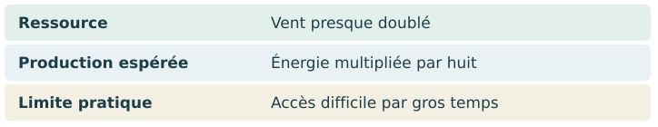

# ENS · MP-PC · Allemand (LV1) 2005 — Corrigé brut

*Corrigé rédigé par IA, non officiel. Signalez toute erreur.*

**Rédaction** · GPT-6.2 Astra Ultra · vitesse non renseignée

**Les promesses de l’éolien en mer du Nord.** La garde ULC 527 annonce deux heures pour les ENS de Paris, de Lyon et de Cachan. Le dictionnaire est interdit. La version compte pour 12 points et les deux réponses pour 8 points. La page 2 ne fixe pas de longueur pour les réponses.

D’après Die Zeit du 6 mai 2004.

## I. Version française

L’avenir appartient à l’énergie éolienne. Sauf en Allemagne ? Les meilleurs sites terrestres y sont déjà pris. Le secteur n’a plus qu’une issue : gagner le large. À quarante kilomètres des côtes, de gigantesques parcs éoliens en mer doivent produire de l’électricité. En mer du Nord, il y a assez de vent pour tout le monde.

Le vent y souffle presque deux fois plus fort qu’à l’intérieur des terres. D’après les lois élémentaires de la physique, voilà qui promet huit fois plus d’énergie, avec des recettes à l’avenant. Mais les dangers sont grands. À l’automne et au printemps, les vagues atteignent jusqu’à vingt mètres de haut. Si une éolienne tombe en panne par mauvais temps, elle risque de rester inaccessible pendant des semaines. Les bénéfices peuvent alors fondre à néant et les exploitants faire faillite.

Les inventeurs allemands ne manquent ni de bonnes intentions ni d’idées. Mais tandis que, chez nous, voilà cinq ans que l’on débat de l’éolien en mer, au Danemark, en Suède, aux Pays-Bas et en Grande-Bretagne, une douzaine de parcs produisent déjà de l’électricité, sans technologie allemande. Dans nos eaux territoriales, des demandes de permis de construire portent certes sur un tiers de la mer du Nord, mais à ce jour il n’y a pas encore la moindre fondation. En cause, une bureaucratie envahissante et des défenseurs zélés de l’environnement qui craignent pour les oiseaux de mer et dénoncent l’« atteinte au paysage ».

Pour les gens de l’éolien, l’ironie est amère. Leur énergie propre se heurte, tout comme le nucléaire, aux obstacles administratifs et à l’opposition de la population et des défenseurs de la nature. À l’étranger, les parcs éoliens pâtissent moins de leur image. Voilà longtemps qu’ils sont devenus une destination appréciée des amateurs de tourisme éolien.

## II.1. L’éolien comme solution de remplacement

Windkraft ist für mich eine glaubwürdige Alternative, wenn man genau sagt, welche bisherige Nutzung sie ersetzen soll. Ein Windpark kann Strom liefern, ohne dass während der Erzeugung Erdöl verbrannt wird. Er kann auch einen Teil der Strommenge übernehmen, für die bisher Kernkraftwerke vorgesehen waren. Daraus folgt allerdings noch nicht, dass eine bestimmte Zahl von Windrädern jederzeit dieselbe Leistung bereitstellt. Bei schwachem Wind braucht man Reserven, Speicher, Verbindungen zu anderen Regionen oder Verbraucher, die ihren Bedarf verschieben können. Auch im Verkehr ersetzt der Wind das Öl erst dann, wenn zum Beispiel ein Zug mit dem erzeugten Strom fährt. Besonders überzeugend finde ich deshalb einen Ausbau, bei dem Netz, Nutzung und Wartung gleich mitgeplant werden. Dann lässt sich an der tatsächlich gelieferten Energie messen, was die Investition gebracht hat.

## II.2. Jusqu’où défendre la nature ?

Die Forderungen von Naturschützern halte ich grundsätzlich für berechtigt. Ein Unternehmen verdient an einem Windpark, während die Folgen für Zugvögel oder für die Küste auch Menschen betreffen, die über den Standort nie entschieden haben. Es ist deshalb sinnvoll, vor der Genehmigung verschiedene Standorte zu vergleichen und den Vogelzug über einen ausreichenden Zeitraum zu beobachten. Manchmal ergibt sich daraus sogar eine einfache Verbesserung: Einige Anlagen können weiter entfernt von einer besonders empfindlichen Zone errichtet werden.

Zu weit ginge für mich die Forderung, jedes sichtbare Zeichen der Energieerzeugung grundsätzlich zu verbieten. Auch der Verzicht auf einen geeigneten Windpark hat Folgen, wenn der Strom dann anderswo unter größerer Umweltbelastung entsteht. Eine gute Entscheidung macht deshalb die Kriterien öffentlich und überprüft nach dem Bau, ob die vereinbarten Maßnahmen tatsächlich wirken.

S. Alloyer et E. Chevrel ont corrigé 64 copies de MP et 47 de PC. Le rapport traite la version et les deux réponses.

[Cahier, allemand p. 2](https://banques-ecoles.fr/cms/wp-content/data/filiere-pc/annales-de-la-banque-pc/session-2005/sujet-2005-ecrit-mp_pc_langue_vivante_1.pdf#page=2) · [Rapport du jury](https://banques-ecoles.fr/cms/wp-content/data/filiere-pc/rapports-des-jurys-de-la-banque-pc/session-2005/rapport-2005-pc_ecrit_langue_vivante_1_allemand.pdf)
