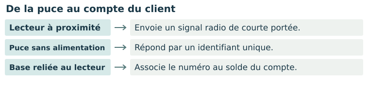
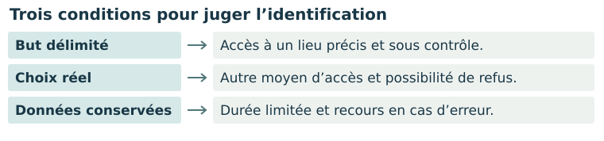

# ENS · MP-PC · Anglais (LE2) 2005 — Corrigé brut

*Corrigé rédigé par IA, non officiel. Signalez toute erreur.*

**Rédaction** · GPT-6.2 Astra Ultra · vitesse non renseignée

Le cahier commun aux ENS de Paris et de Cachan dure deux heures. Dictionnaire et calculatrice interdits pour l’anglais. La version vaut 15 points, la question 5. La réponse doit compter au moins 100 mots.

## V. Version française

**Avec cette puce, impossible de ne pas payer sa tournée**

La vieille excuse « J’ai oublié mon portefeuille à la maison » ne tiendra bientôt plus quand ce sera à vous de payer la tournée. Une discothèque s’apprête à proposer à ses habitués de se faire implanter dans le bras une micropuce qui les dispensera d’emporter des espèces ou une carte bancaire.

Faire la queue à l’entrée ou au bar pour commander un verre appartiendrait également au passé lorsque le Bar Soba, à Glasgow, introduira ce « portefeuille numérique ». La puce a déjà du succès auprès des clients privilégiés de deux discothèques, l’une à Barcelone, l’autre à Rotterdam.

Si ses détracteurs trouvent l’idée digne d’Orwell, d’autres estiment qu’à mesure que nous avançons à grands pas vers une société sans espèces, ce n’est qu’une question de temps avant que la puce ne devienne un moyen de paiement courant à l’épreuve de la fraude. […]

La VeriChip a la taille d’un grain de riz, ne déclenche pas les portiques de détection des aéroports et ne possède aucune alimentation électrique. Enfermée dans un cylindre de verre et de silicone, elle est implantée par un professionnel de santé, sous anesthésie locale, dans le haut du bras, entre la peau et la couche de graisse.

La puce, d’une durée de vie d’environ vingt ans, reste inactive jusqu’à ce qu’on en approche un lecteur qui émet un signal radio de courte portée. Elle répond à ce signal en communiquant au lecteur son numéro d’identification unique. L’usage qui est fait de ce numéro dépend de la base de données à laquelle le lecteur est relié. Au Soba, il donnera accès au solde du compte du client au bar. […]

Mais les détracteurs de cette technologie y voient une menace grandissante, qui confère aux entreprises et aux pouvoirs publics un pouvoir nouveau potentiellement dangereux. Un rapport récent de l’Union américaine pour les libertés civiles indiquait qu’« il ne se passe guère de mois sans que nous apprenions l’existence d’un nouveau moyen de haute technologie de s’immiscer dans la vie privée, de la reconnaissance faciale aux micropuces implantables, aux puces à ADN et même à l’identification par empreinte des ondes cérébrales ».

## 1. Do you consider hi-tech identification devices to be useful security measures or an infringement of people’s privacy?

An identification device can improve security when its use is narrow and people know how their information will be handled. A hospital might reasonably issue a card that gives authorised staff access to a medicine cupboard and records who opened it. The record helps investigate a missing item, and the card can be cancelled if it is lost. I am less convinced by an implant offered simply to shorten a queue. The nightclub may initially store only a customer's balance, yet the same identifier can link visits over many years. A promise made by the present owner is a poor substitute for limits on who can consult the record. I would require a genuine alternative, a short retention period and a way of correcting errors. Convenience alone is a weak reason for giving someone a permanent identifier.

*137 mots.*

L’article de The Observer du 16 janvier 2005 paraît en page 3 du cahier. Les deux coupes sont conservées. Le rapport sur l’anglais LE2 précise les difficultés de lexique et la portée de la question.

[Version et consignes](https://banques-ecoles.fr/cms/wp-content/data/filiere-pc/annales-de-la-banque-pc/session-2005/sujet-2005-ecrit-mp_pc_langue_etrangere_2.pdf#page=3) · [Rapport du jury](https://banques-ecoles.fr/cms/wp-content/data/filiere-pc/rapports-des-jurys-de-la-banque-pc/session-2005/rapport-2005-pc_ecrit_langue_etrangere_2_anglais.pdf)
