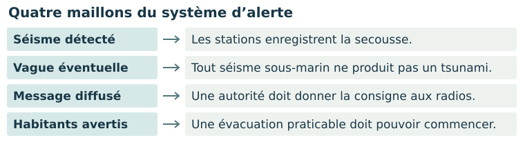

# ENS · MP-PC · Anglais (LV1) 2005 — Corrigé guidé

*Corrigé rédigé par IA, non officiel. Signalez toute erreur.*

**Rédaction** · GPT-6.2 Astra Ultra · vitesse non renseignée

Le cahier commun aux ENS de Paris, de Lyon et de Cachan dure deux heures. Dictionnaire et calculatrice interdits pour l’anglais. La version vaut 12 points, les deux questions 8 points au total. Chaque réponse doit compter au moins 100 mots.

## V. Version française

La première phrase comporte une interrogation indirecte. « De combien de temps dispose-t-on » rend l’idée de délai contenue dans *notice*. Le rapport relève les calques de *routine technology* et *speed is of the essence*. « Une technique éprouvée » et « chaque seconde compte » replacent ces expressions dans la situation d’alerte. À la fin, la répétition de *tell* précise qui donne l’ordre à qui.

Après le séisme survenu près d’Aceh et le tsunami qu’il a provoqué, une question mérite d’être posée. Combien de temps avant l’arrivée d’une vague peut-on prévenir les populations menacées sans risquer de crier trop souvent au loup ? Les séismes eux-mêmes sont imprévisibles et devraient le rester. En revanche, les détecter lorsqu’ils se produisent relève d’une technique éprouvée. La difficulté, en l’occurrence, ne se situait pas là, puisque des stations de surveillance du monde entier ont enregistré la secousse. Malheureusement pour les prévisionnistes, si tout séisme sous-marin de forte magnitude risque de provoquer un tsunami dangereux, tous ne produisent pas effectivement une vague de grande ampleur. Or les fausses alertes coûtent cher et nourrissent la défiance. […]

La plupart des pays touchés par ce tsunami sont pauvres ou disposent, au mieux, de revenus moyens, et la surveillance a un coût. On pourrait en conclure qu’une certaine résignation est raisonnable. L’expérience des États-Unis et du Japon montre pourtant qu’un dispositif de surveillance efficace ne revient pas nécessairement si cher. […]

Même avec un système de détection efficace, cependant, on n’est guère avancé si l’on ne peut évacuer la zone menacée. Ici, chaque seconde compte. La modélisation informatique peut aider à repérer les endroits qui offrent les meilleures chances de sécurité, mais le bon sens est souvent le plus sûr des guides. Il faut courir à toutes jambes pour s’éloigner de la mer. L’ordre d’évacuation devrait lui aussi être facile à diffuser, du moins tant que les gens sont éveillés. Même dans la plupart des régions pauvres, on trouve des postes de radio partout. Il suffit de disposer de procédures permettant de demander aux stations de radio de dire aux habitants de fuir. Le problème, c’est que personne ne l’a fait.

## 1. What makes tsunami prevention difficult?

Préciser le sens contextuel de *prevention*. Anticiper l’heure d’un séisme, interpréter une secousse déjà observée et avertir les habitants forment trois problèmes successifs. Expliquer pourquoi une fausse alerte coûte aussi la confiance nécessaire pour la prochaine fois.

The first difficulty is that an earthquake cannot be forecast with enough precision to evacuate a coast in advance. Once it has occurred, stations can record the shock very quickly, but its strength alone does not establish whether a destructive wave is on its way. Officials must act before all doubt has disappeared. Repeated evacuations are expensive, and residents who have returned home unharmed several times may ignore the next warning. The second difficulty arises after the scientists have made their assessment. A radio station needs to know who can issue an order, and a family needs enough time to reach a safe place. Even the best instruments cannot deliver a message which nobody takes responsibility for sending.

*118 mots.*

## 2. Is such a catastrophe inevitable?

Distinguer le phénomène naturel des pertes humaines. La copie peut illustrer ce que changent des exercices accessibles, puis reconnaître les limites imposées par la proximité de la côte ou la mobilité des habitants.

The movement of the seabed is beyond human control, but the extent of the disaster is partly a matter of public choices. Two towns at the same distance from an earthquake could suffer very different losses. In one, residents may have practised a route inland, local broadcasters may recognise an authorised warning, and neighbours may know who needs help leaving home. In the other, a correct forecast may sit on an official's desk while the water approaches. Preparation does have limits. A community very close to the source may have only minutes, and roads or communications may already be damaged. For that reason a warning system cannot promise universal safety. It can still turn a large loss of life into a much smaller one, which is reason enough to invest in it.

*132 mots.*

Version de l’article de The Economist du 1er janvier 2005, avec ses deux coupes conservées, et réponses aux deux questions de la page 3. Le rapport de Paris, Lyon et Cachan a été consulté.

[Version et consignes](https://banques-ecoles.fr/cms/wp-content/data/filiere-pc/annales-de-la-banque-pc/session-2005/sujet-2005-ecrit-mp_pc_langue_vivante_1.pdf#page=3) · [Rapport du jury](https://banques-ecoles.fr/cms/wp-content/data/filiere-pc/rapports-des-jurys-de-la-banque-pc/session-2005/rapport-2005-pc_ecrit_langue_vivante_1_anglais.pdf)
