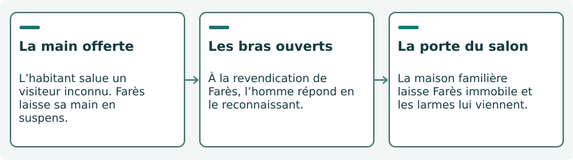

# ENS · MP-PC · Arabe (LE2) 2005 — Corrigé guidé

*Corrigé rédigé par IA, non officiel. Signalez toute erreur.*

**Rédaction** · GPT-6.2 Astra Ultra · vitesse non renseignée

Épreuve d’arabe de LE2, deux heures, page 4 du cahier commun UC 528. Le rapport de H. Ayoub commente en particulier les deux formes d’impuissance que traduit la version.

## I. Version française

Suivre les sujets des verbes. Le visiteur frappe, entend des pas et refuse la poignée de main. L’homme qui habite la maison tend la main, rit, puis ouvre les bras. Le jury signale qu’une copie a ajouté un personnage. Les deux expressions de la première phrase de sentiment décrivent l’impuissance de Farès. Le mot *الكسيح* appliqué au chagrin n’appelle pas un diagnostic physique.

Préserver le décalage entre la colère exprimée avec calme et le rire du propriétaire supposé. En français, l’arrivée dans le salon mérite une dernière phrase brève : le récit ne précise pas quel objet déclenche les larmes.

### Proposition rédigée

C’était l’après-midi. À part le quartier de la Manshiyya, Jaffa était restée telle que Farès al-Libda l’avait connue vingt ans plus tôt. Les quelques instants qui s’écoulèrent entre le coup qu’il frappa à la porte et le bruit des pas d’un homme venant lui ouvrir lui parurent durer des siècles, des siècles de colère impuissante et de chagrin qui le laissait sans force. Enfin la porte s’ouvrit. L’homme, grand, brun de peau, portait une chemise blanche déboutonnée. Il tendit la main à l’inconnu qui venait d’arriver, mais Farès ignora la paume offerte et dit, d’un calme où se concentrait toute sa colère :

— Je suis venu jeter un coup d’œil à ma maison. Cet endroit où tu habites est ma maison à moi. Ta présence ici est une triste farce qui finira bien un jour. Tu peux, si tu veux, me tirer dessus à l’instant même. Mais cette maison est la mienne et j’ai attendu vingt ans pour y revenir…

L’homme qui se tenait sur le seuil et gardait encore la main tendue se mit à rire de bon cœur, s’approchant de Farès al-Libda jusqu’à se trouver juste en face de lui. Alors il s’avança les bras ouverts et le serra contre lui.

— Inutile de passer ta colère sur moi ! Je suis arabe comme toi, de Jaffa, et je te connais. Tu es le fils al-Libda… Entre donc prendre un café !

Farès entra, stupéfait, n’en croyant pas ses yeux. C’était bien la même maison, avec ses meubles, leur disposition, la couleur des murs et tous ces objets dont il se souvenait si bien. L’homme le mena vers le salon sans réussir à cacher son large sourire. Lorsqu’il en ouvrit la porte et l’invita à entrer, Farès s’immobilisa, comme cloué sur place. Puis, tout à coup, les larmes lui jaillirent des yeux.

D’après Ghassan Kanafani.

## II. Question en arabe

La consigne juxtapose la migration contrainte et la migration volontaire. Choisir une difficulté commune, puis distinguer ce que la possibilité de rentrer change dans chaque cas. Relier une seule fois l’argument à Farès suffit. La question porte plus largement sur les relations sociales, la langue, le travail et la transmission familiale.

### Proposition rédigée

قد يغادر الإنسان وطنه هربا من خطر مباشر، وقد يرحل باختياره للدراسة أو للعمل. يتفاوت وقع التجربتين، لكن المغادرين يواجهون سؤالا مشتركا: كيف يبنون حياة في مكان لا يعرف فيه الآخرون تاريخهم؟ فالطبيب الذي لا يعترف البلد الجديد بشهادته يخسر مكانته المهنية ولو كان قد اختار السفر. والطفل الذي يفهم المزاح بلغته الأولى وحدها قد يجلس صامتا في ساحة المدرسة، فيخطئ زملاؤه حين يعدون صمته انطواء.

ويختلف الأمر عند من أجبر على الرحيل. فليس في وسعه دائما أن يزور والديه أو يستعيد وثيقة تركها في بيته. وقد يطول الانتظار حتى يصبح الرجوع نفسه لقاء مع مكان مألوف وغريب معا، كما يحدث لفارس حين يرى الأثاث الذي بقي على حاله بعد عشرين سنة. أما المهاجر طوعا فيستطيع أحيانا أن يختار موعد عودته، لكنه قد يجد أبناءه متعلقين بلغة ومدرسة وأصدقاء في البلد الجديد.

ولا أرى أن حل هذه الصعوبات يقتضي محو الثقافة الأولى أو الانغلاق عليها. فصف لتعلم اللغة يتيح لصاحب الشهادة أن يستعيد صوته المهني، ولقاء يتبادل فيه الأهالي حكاياتهم يجعل لغة البيت موردا للأطفال. وحين تتاح للمرء حقوق مستقرة وعلاقات متبادلة يصير الانتماء إلى المكان الجديد ممكنا من غير أن يطلب منه التنكر للمكان الذي غادره.

[Sujet](https://banques-ecoles.fr/cms/wp-content/data/filiere-pc/annales-de-la-banque-pc/session-2005/sujet-2005-ecrit-mp_pc_langue_etrangere_2.pdf#page=4) · [Rapport](https://banques-ecoles.fr/cms/wp-content/data/filiere-pc/rapports-des-jurys-de-la-banque-pc/session-2005/rapport-2005-pc_ecrit_langue_etrangere_2_arabe.pdf)
