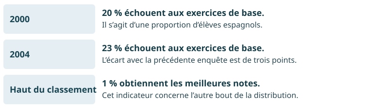

# ENS · MP-PC · Espagnol (LV1) 2005 — corrigé guidé

*Corrigé rédigé par IA, non officiel. Signalez toute erreur.*

**Rédaction** · GPT-6.2 Astra Ultra · vitesse non renseignée · 25 novembre 2026

Épreuve de deux heures, sans dictionnaire, commune aux ENS de Paris, de Lyon et de Cachan. La version vaut 12 points et l’expression 8 points. Longueur indiquée pour l’expression : 100 mots au minimum.

## 1. Version française

**L’Espagne recalée en éducation**

### Avant de traduire

Le titre applique à un pays le verbe scolaire *suspender*. *Catear*, plus familier, reprend cette image dans le premier paragraphe. Retrouver cette variation de ton en français. Dans *no les van*, ce sont les matières qui ne plaisent guère aux jeunes. Le texte distingue aussitôt ce peu de goût de leurs difficultés de compréhension. Les deux comparaisons statistiques du deuxième paragraphe ne prennent pas le même groupe de référence.

### Proposition de traduction

Les jeunes Espagnols de quinze ans ne sont portés ni sur les mathématiques, ni sur les sciences, ni sur la lecture. Plus grave encore, ils n’y comprennent rien et ne savent donc même pas résoudre les exercices les plus élémentaires dans ces matières. Tel est le constat accablant du récent rapport PISA (Programme international pour le suivi des acquis des élèves), établi par l’OCDE auprès de 275 000 collégiens et lycéens des 41 pays les plus riches de la planète. Et l’Espagne se fait recaler. Et pas qu’un peu, puisque nous arrivons péniblement au 26ᵉ rang en mathématiques, en sciences et en lecture, et au 27ᵉ pour la résolution de problèmes concrets. Autrement dit, au-dessous de la moyenne. Pratiquement les derniers de la classe.

Le rapport montre également que les élèves espagnols n’ont fait aucun progrès depuis le bilan précédent, autour de l’an 2000. À l’époque, 20 % des élèves étaient incapables de faire les exercices de mathématiques les plus élémentaires. Aujourd’hui, cette proportion atteint 23 %. Qui plus est, 1 % à peine décrochent les meilleures notes, soit trois points de moins que la moyenne des autres pays. Il en va de même dans les matières scientifiques. En lecture, le nouveau rapport indique que jusqu’à 21 % des élèves ne comprennent pas ce qu’ils lisent. Aucune amélioration par rapport à l’an 2000. Seuls certains domaines autorisent à parler avec optimisme, à savoir la géométrie et l’algèbre. Quant au bel exercice de la lecture, les filles ont manifestement une bonne longueur d’avance sur les garçons, même si ces derniers l’emportent dès qu’il est question de chiffres.

*D’après Cambio 16, 20 décembre 2004.*

## 2. Expression en espagnol

### 1. ¿Qué conclusiones se pueden sacar de la lectura del informe PISA?

Comparer d’abord l’Espagne aux autres pays, puis les deux enquêtes entre elles. Terminer par ce qui empêche d’étendre le constat à toute matière et à tout élève.

Los resultados descritos en el artículo sitúan a España por debajo de la media de los países estudiados. La dificultad no se limita a recordar conocimientos escolares. También afecta a la capacidad de resolver problemas concretos y de entender lo que se lee. La comparación con la encuesta anterior resulta especialmente preocupante. En matemáticas ha aumentado la proporción de jóvenes que no consiguen realizar los ejercicios más sencillos, mientras que muy pocos alcanzan los mejores resultados. Sin embargo, el balance admite matices. Hay motivos de optimismo en geometría y álgebra. Además, las diferencias entre grupos y materias sugieren que conviene estudiar cómo aprenden los alumnos antes de proponer una única solución para todos.

*113 mots.*

### 2. A su parecer, ¿por qué chicos y chicas obtienen sus mejores resultados en campos distintos?

Les écarts mesurés sont des moyennes. Pour formuler une hypothèse personnelle, choisir une pratique concrète qui peut influer sur le résultat et indiquer comment on pourrait la vérifier.

No creo que dos medias distintas permitan deducir que cada sexo tiene una aptitud fija. Antes de llegar a clase, los niños pueden haber recibido invitaciones muy diferentes a leer, a contar o a construir objetos. Incluso una observación bienintencionada, como decirle a una niña que escribe muy bien y no comentar cómo ha resuelto un problema, puede orientar lo que se atreverá a intentar después. También intervienen los recursos familiares, las amistades y la manera de organizar la enseñanza. Para entender los resultados compararía aulas que ofrecen actividades variadas a todos sus alumnos y les preguntaría qué hacen fuera del colegio. Así se podrían contrastar ciertas hipótesis sin convertir una diferencia estadística en un destino individual.

*117 mots.*

## Sources

ENS de Paris, de Lyon et de Cachan. Le rapport écrit de cette option reste à retrouver.

[Sujet, p. 4](https://banques-ecoles.fr/cms/wp-content/data/filiere-pc/annales-de-la-banque-pc/session-2005/sujet-2005-ecrit-mp_pc_langue_vivante_1.pdf#page=4)
