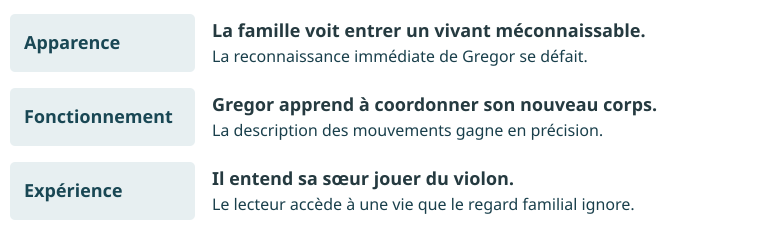

# ENS · MP-PC · Français 2005 — corrigé brut

*Corrigé rédigé par IA, non officiel. Signalez toute erreur.*

**Rédaction** · GPT-6.2 Astra Ultra · vitesse non renseignée · 25 novembre 2026

## Sujet et œuvres

Dans *Tel quel*, Paul Valéry situe l’humanité de l’homme « à sa surface ». Au-dessous de la peau apparaissent les « machines », puis une substance à la fois étrangère et essentielle. Le sujet demande de discuter cette progression à partir des *Fables* de La Fontaine, du *Traité des animaux* de Condillac et de *La Métamorphose* de Kafka.

## Dissertation

Gregor Samsa a toujours ses obligations de commis voyageur et sa première inquiétude va au train qu’il devait prendre. Il suffit pourtant que, dans *La Métamorphose*, la porte de sa chambre s’ouvre pour que les siens cessent de reconnaître en lui le jeune homme qui les faisait vivre. La substitution d’une apparence à une autre a-t-elle suffi pour qu’un homme disparaisse ? Paul Valéry semble nous inviter à en faire l’épreuve inverse. Ôtons ce qui se voit et nous trouverons, sous la peau, des mécanismes, puis une substance dont l’intimité même nous demeure étrangère. La formule initiale paraît déprécier la surface humaine. La dernière proposition réserve pourtant au vivant une profondeur essentielle que la connaissance analytique ne réussit pas à reconquérir. Il faut alors demander ce que nous cherchons lorsque nous voulons connaître un homme. Sa constitution matérielle, le principe de sa sensibilité et la possibilité de le reconnaître comme notre semblable ne se laissent pas nécessairement saisir dans le même geste.

### Ce qui disparaît quand on lève la peau

Pour la famille Samsa, l’homme se présentait dans des gestes et des échanges assez réguliers pour avoir cessé d’attirer l’attention. Gregor se levait pour partir travailler, parlait à travers la porte, procurait un revenu à ses parents et à sa sœur. Au commencement du récit, il comprend encore très bien ce que les autres lui disent. En revanche, sa propre voix change. L’effort même qu’il fait pour expliquer sa situation produit auprès de ses interlocuteurs un bruit dont ils s’effraient. On voit pourquoi Valéry peut réserver à la surface l’humanité de l’homme. Ce qui est en jeu dans une inflexion de voix n’est pas un simple ornement qu’il serait indifférent d’enlever. Cette voix permettait à quelqu’un de répondre publiquement de son retard, de rassurer sa mère, de se faire entendre d’un inconnu. Un monde de rapports humains se défait lorsqu’on ne sait plus à qui attribuer le bruit que l’on entend.

Les bêtes de La Fontaine vérifient cette idée dans l’autre sens. La présence des plumes ou de la fourrure n’empêche nullement le lecteur de saisir la portée très humaine d’une posture ou d’un ton. Dans « Les Animaux malades de la peste », le lion s’accuse devant la cour et les puissants s’appliquent à le disculper. La franchise de l’âne n’obtient pas le même privilège. Le régime de la cour se lit dans la différence entre deux manières de recevoir un aveu. Aucun examen des mâchoires du lion ou des dents de l’âne ne rendrait mieux compte de cette différence. Le secret de la décision est offert à la surface de la scène, dans la succession des paroles, les encouragements et les revirements. Il faut seulement entendre comment une même déclaration change de valeur avec la place de celui qui la prononce.

La surface est donc moins mince que ne le suggère la métaphore anatomique. Elle comprend l’ensemble des signes par lesquels un vivant s’adresse à d’autres vivants. C’est là qu’une humanité peut se constituer ou se défaire. Cependant, fonder sur ce seul constat une définition de l’homme livrerait entièrement Gregor au jugement de sa famille. Que reste-t-il de lui lorsque personne ne se trouve plus disposé à reconnaître ses signes ?

### La découverte des machines ne suffit pas au mécanisme

La deuxième étape proposée par Valéry porte sur ce qu’un changement de méthode donne effectivement à voir. S’intéresser à la manière dont un membre se déplace, dont un mouvement en entraîne un autre, fait paraître une organisation complexe qu’une impression d’ensemble dissimulait. Kafka en donne une version singulière en plaçant le lecteur du côté de celui qui doit apprendre une mécanique nouvelle. Gregor voudrait effectuer un mouvement simple et n’arrive pas à mettre d’accord ses nombreux membres. Puis il acquiert de nouvelles habitudes dans sa chambre. Ce corps impose à ses projets des conditions dont il ne soupçonnait pas l’existence. Or nous comprenons son embarras parce que nous savons quel résultat il cherchait à atteindre. La seule suite des mouvements visibles aurait suffi à décrire ses efforts dans l’espace. Elle aurait omis la distance entre ce qu’il voulait et ce qu’il obtenait.

Cette distance entre un enchaînement physique et un comportement adressé travaille aussi le « Discours à Madame de La Sablière ». La Fontaine y examine la thèse des bêtes machines et donne à observer deux rats qui déplacent un œuf en coordonnant leurs gestes. La scène a toute la netteté d’un petit dispositif mécanique. Mais si l’on veut comprendre pourquoi ces gestes sont ajustés les uns aux autres, il faut considérer le problème que l’œuf pose aux deux animaux. Le fabuliste ne nous a pas introduits miraculeusement dans leur conscience. Il nous oblige en revanche à demander quel gain de connaissance procure le mot « machine » lorsque des mouvements variables et ingénieusement accordés attendent encore leur explication.

Le *Traité des animaux* donne à cette objection une méthode. Condillac part des rapports observables entre les organes des bêtes, leurs besoins et les modifications de leur conduite. Lorsqu’un vivant apprend à rechercher ce qui lui a procuré du plaisir et à éviter ce qui lui a causé de la peine, la sensation et la mémoire permettent de relier ses expériences successives. L’analyse est ici aussi exigeante que celle du mécanicien. Elle distingue des opérations et en cherche les conditions. Mais le fait même d’éprouver du plaisir ou de la peine ne se montre pas au regard comme la disposition d’un organe. L’observateur y accède par analogie avec la manière dont il se sent lui-même affecté. La matière qu’on découvre en analysant le corps peut être essentielle à tout ce qui arrive au vivant sans que son examen nous livre immédiatement ce qu’est, pour lui, une expérience. L’opacité signalée par Valéry arrête une prétention à tout connaître au moyen d’une seule démarche. Elle n’interdit pas d’en changer.

### Revenir à la surface avec un regard transformé

Il existe ainsi deux façons de revenir à ce qui apparaît. L’une consiste à ne tenir pour humain que ce que l’on est déjà habitué à reconnaître. L’autre consiste à se demander de quelle vie l’apparence pourrait être le signe, y compris lorsque son interprétation résiste. La scène du violon chez Kafka fait sentir tout l’écart qui les sépare. En entendant Grete jouer, Gregor s’approche, profondément ému. Ce mouvement correspond pour la maisonnée à la sortie embarrassante d’une créature qu’il aurait fallu tenir cachée. Pour le lecteur qui sait ce que signifiait pour Gregor l’avenir musical de sa sœur, il a une autre profondeur. La narration n’a pas changé de corps. Elle nous a donné accès à une histoire qui rend le même geste autrement lisible. La personne que sa famille cesse d’apercevoir ne s’était pas retirée dans une âme dont la fiction montrerait le siège. Elle se manifeste encore, mais il n’y a plus personne dans la pièce pour recevoir ce signe comme elle le souhaiterait.

Cette expérience éclaire en retour la prudence nécessaire à qui lit les *Fables* ou le *Traité*. La Fontaine peut habiller en courtisan un renard et faire voir la cour avec une merveilleuse acuité. Cela ne prouve pas qu’un renard réel porte sous sa peau une âme de courtisan. Condillac peut former une hypothèse sur la mémoire animale à partir d’une conduite modifiée. Cette analogie ne l’autorise pas à attribuer aux bêtes toutes les opérations de langage et de réflexion dont il fait dépendre la singularité humaine. Le passage de l’apparence à une expérience n’est donc pas une divination. Il demande des comparaisons et demeure exposé à la correction. La fiction ajoute quelque chose à cette discipline des signes. Elle fait éprouver ce qu’il en coûte, pour un vivant, d’être enfermé dans la première interprétation que les autres ont donnée de sa figure.

Si l’on cherche sous la peau la personne comme on chercherait une pièce de plus dans une machine, Valéry a raison de promettre une déception. L’humanité dont il parle se joue dans des relations et ne se découpe pas. Mais la surface à laquelle nous revenons après cette épreuve n’a plus rien d’une évidence. Elle peut manquer son objet lorsque nous tenons l’étrangeté d’un corps pour une preuve d’insensibilité. L’essentiel demeure en partie étranger, et cette part d’inconnu donne précisément une raison de continuer à écouter le vivant qui nous fait face.

## Repère de lecture

## Sources

Le cahier ULC 526, d’une page, porte les ENS de Paris, Lyon et Cachan et les filières MP et PC. Il attribue le texte à *Tel quel* et nomme les trois œuvres. Le registre de cette épreuve comprend le sujet seul.

[Sujet](https://banques-ecoles.fr/cms/wp-content/data/filiere-pc/annales-de-la-banque-pc/session-2005/sujet-2005-ecrit-mp_pc_francais.pdf)
