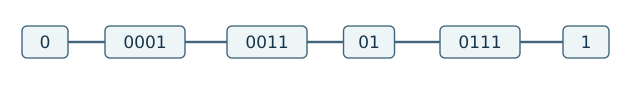

# ENS · MP-PC · Informatique 2005 — corrigé brut

*Corrigé rédigé par IA, non officiel. Signalez toute erreur.*

**Rédaction** · GPT-6.2 Astra Ultra · vitesse non renseignée · 25 novembre 2026

**Révision (tour 1)** · GPT-6.2 Astra Ultra · vitesse non renseignée · 26 novembre 2026

L’alphabet est ordonné, de taille k. Les mots sont indexés à partir de 1 ; la case 0 donne leur longueur. Les facteurs et les fenêtres des cycles peuvent chevaucher la fin et le début.

## Partie 1. Trier les mots

### Question 1.1.1 · Comparaison

```text
i ← 1
tant que i ≤ min(s[0],t[0]) :
    si s[i] < t[i] : renvoyer -1
    si s[i] > t[i] : renvoyer 1
    i ← i+1
renvoyer le signe de s[0]-t[0]
```

Le premier désaccord tranche ; sinon le mot le plus court est préfixe de l’autre ou ils sont égaux. Coût $O(1+\min(|s|,|t|))$.

### Question 1.1.2 · Tri par comparaisons

Trier par fusion le tableau des indices $1,\ldots,n$, en comparant leurs mots. Chaque étage de fusion coûte $O(n\ell_{\max})$ et il y a $O(1+\log n)$ étages. Les mots restent en place. Pour $n\ge2$, le pire coût est $O(n\ell_{\max}\log n)$.

### Question 1.2.1 · Exemple de longueur trois

Pour $j=3$, les paquets non vides sont $0:[1,2,5]$, $2:[3,4]$. Pour $j=2$, $0:[2,4]$, $1:[1,5,3]$. Pour $j=1$, $1:[2,4,5,3]$, $2:[1]$. Donc SIG vaut $[2,4,5,3,1]$.


### Question 1.2.2 · Coût des passes

Chaque passe initialise et concatène $k$ paquets, et distribue $n$ indices. Le modèle attribue un coût constant aux primitives de listes. Avec $\ell$ passes, plus les deux parcours initiaux et finaux de taille $n$, le coût est $O((n+k)\ell)$.

### Question 1.2.3 · Première passe

Après la passe $j=\ell$, les indices sont triés selon la dernière lettre de leur mot. À égalité, ils restent dans leur ordre initial.

### Question 1.2.4 · Invariant

Après la passe de position $j$, la file est triée selon les suffixes $s_i[j..\ell]$. C’est vrai pour $j=\ell$. Lors de la passe de position $j$, on utilise $s_i[j]$ comme clé principale et l’ordre hérité de $s_i[j+1..\ell]$ comme départage stable. À $j=1$ on obtient le tri complet.

### Question 1.2.5 · Sens du parcours

Une redistribution stable rend la clé de la passe la plus récente prioritaire. La première lettre doit donc être traitée la dernière. Sur $01$ et $10$, un parcours des lettres de gauche à droite avec ces mêmes redistributions donnerait à tort $10,01$.

### Question 1.3.1 · Complétion

Ajouter un symbole inférieur à toute vraie lettre et compléter chaque mot à droite jusqu’à $\ell_{\max}$. Les comparaisons par préfixe restent correctes. Le nouveau tri prend $O((k+n)\ell_{\max})$, remplissage compris.

### Question 1.3.2.a · Exemple de longueurs variables

Par positions croissantes, Présent contient $[0,1,2]$, $[0,1]$, $[1,2]$. Longueur contient $[2]$, $[1]$, $[3,4]$. Les files triées, de $j=3$ à 1, sont $[4,3]$, $[4,1,3]$, puis $[2,3,4,1]$.

### Question 1.3.2.b · Préparer Présent

Créer un paquet par lettre. Pour chaque occurrence $s_i[j]=a$, placer $j$ dans le paquet $a$. Balayer les paquets par lettre croissante ; pour chaque $j$ du paquet $a$, ajouter $a$ en queue de Présent$[j]$ seulement si un tableau Dernier$[j]$, initialisé à $-1$, diffère de $a$, puis le mettre à $a$. Chaque occurrence est traitée deux fois, coût $O(k+M)$.

### Question 1.3.2.c · Préparer Longueur

Initialiser $\ell_{\max}$ listes et ajouter l’indice $i$ à celle de numéro tab$[i][0]$. Coût $O(n+\ell_{\max})$.

### Question 1.3.2.d · Correction

À la passe $j$, les nouveaux mots de longueur $j$ ont après $j$ un suffixe vide, antérieur à tout suffixe non vide. Les placer devant les mots déjà triés selon leur suffixe commençant en $j+1$ établit l’ordre secondaire. La distribution stable par lettre $j$ et la réunion des seuls paquets présents dans l’ordre donnent le tri sur les suffixes commençant en $j$. À $j=1$, tout mot a été introduit et son suffixe est le mot entier.

### Question 1.3.2.e · Coût total

Le mot $i$ est distribué exactement $|s_i|$ fois, soit $M$ distributions. Le nombre de couples distincts (position, lettre) est au plus $M$ ; ils bornent le total des concaténations et réinitialisations. Ajouter la préparation $O(k+M)$, l’initialisation, le parcours des positions et la restitution donne $O(k+M)$.

## Partie 2. Cycles de De Bruijn

### Question 2.1.1 · Fréquences

Il y a $k^n$ fenêtres circulaires et $k^n$ mots possibles : chacun apparaît exactement une fois. Une lettre $a$ commence précisément $k^{n-1}$ fenêtres, donc apparaît $k^{n-1}$ fois.

### Question 2.1.2 · Vérification

Vérifier longueur $N=k^n$ et alphabet. Sans tableau auxiliaire, comparer deux à deux les $N$ fenêtres circulaires en $O(nN^2)$. Avec un trie d’adressage ou une table de $N$ booléens, marquer chaque fenêtre et rejeter toute répétition. En codant en base $k$, le code suivant est $(c\bmod k^{n-1})k+a$, où $a$ est la nouvelle lettre. Sous coût constant pour les indices de tableau, temps $O(n+N)$ et espace $O(N)$. Un simple calcul intégral de chaque code donne déjà $O(nN)$.

### Question 2.1.3 · Le mot infini

Pour tout $k\ge1$, le préfixe de longueur $k^2$, lu circulairement, est un cycle d’ordre 2 sur $0,\ldots,k-1$. Pour passer de $k$ à $k+1$, ajouter $(0k)(1k)\cdots((k-1)k)k$ (la notation désigne des lettres). L’ancien raccord final $(k-1)0$ se retrouve au début de la jonction ; les nouvelles paires sont $ik$ et $ki$ pour $i<k$, plus $kk$, en comptant le nouveau raccord circulaire $k0$. Le cas initial est le mot $0$.

### Question 2.2.1 · Préférer la grande lettre

```text
suivant(s,i) :
    pour a de k-1 à 0 :
        u ← les n-1 dernières lettres de s[1..i], suivies de a
        si aucune fenêtre de s[1..i] n’est égale à u : renvoyer a
    renvoyer FIN
```

Après les $n$ zéros initiaux, appeler suivant jusque FIN. Par balayage direct, coût $O(kn|s|^2)$ pour toute la construction. Une table des fenêtres vues et le codage roulant de 2.1.2 ramènent le coût à $O(k^n+n+k|s|)$, initialisation comprise, sous le modèle des indices.

### Question 2.2.2.a · Sommet d’arrêt

Voir chaque fenêtre comme un arc d’un préfixe de $n-1$ lettres vers son suffixe de même longueur. Le chemin part de $0^{n-1}$, avec la boucle $0^n$ déjà utilisée. En son sommet final $z$, tous les $k$ arcs sortants sont pris. Si $z$ différait du départ, il aurait reçu $k+1$ arrivées distinctes, impossible. Le chemin est donc fermé, $z=0^{n-1}$, et ses $k$ arcs entrants, les mots $az$, sont tous utilisés.

### Question 2.2.2.b · Toutes les fenêtres

Par 2.2.2.a, toutes les fenêtres terminées par $n-1$ zéros sont présentes. Supposons présentes toutes celles terminées par $h\ge1$ zéros. Pour chaque contexte $v$ de longueur $n-1$ terminé par $h-1$ zéros, l’arc $v0$ est donc utilisé. Comme 0 est choisi en dernier, tous les arcs sortants de $v$ ont servi (pour $v=0^{n-1}$, c’est établi malgré la boucle initiale). Le chemin étant fermé, tous ses arcs entrants ont aussi servi : chaque fenêtre terminée par $v$ est présente. Descendre à $h=0$. Pour $n=1$, le contexte vide a déjà tous ses arcs. Les $k^n$ fenêtres sont distinctes, donc $|s|=k^n+n-1$. Le suffixe final reproduit le contexte de départ : les $k^n$ premières lettres forment un cycle.


## Partie 3. Colliers et mots primaires

### Question 3.1.1 · Rotation d’une puissance

La rotation de $p^r$, $r\ge2$, d’une lettre est $(\rho(p))^r$, où $\rho$ est la même rotation sur $p$. Itérer donne une puissance de même exposant pour tout conjugué.

### Question 3.1.2 · Petits primaires

Pour $k=2$, par longueurs 1 à 4 : $0,1$ ; $01$ ; $001,011$ ; $0001,0011,0111$. Pour $k=3$, par longueurs 1 à 3 : $0,1,2$ ; $01,02,12$ ; $001,002,011,012,021,022,112,122$. On conserve exactement les mots strictement inférieurs à chaque rotation non triviale.

### Question 3.1.3 · Deux concaténations

En binaire la suite de blocs est $0,0001,0011,01,0111,1$, d’où $0000100110101111$. En ternaire la suite est $0,001,002,011,012,021,022,1,112,122,2$, d’où $000100201101202102211121222$. Leurs fenêtres circulaires sont respectivement les 16 quadruplets et les 27 triplets, chacun une fois. Ce sont les plus petits cycles pour ces paramètres, par 3.6.4.



### Question 3.2.1 · Décalage invariant

Si $s=xy=yx$ avec $|x|=m$, déplacer ses $m$ premières lettres à la fin donne le même mot. Ainsi $s[i]=s[i+m]$ pour $i\le n-m$ et $s[i]=s[i+m-n]$ sinon.

### Question 3.2.2 · PGCD

Les multiples de $m$ modulo $n$ forment le sous-groupe des multiples de $d=\gcd(m,n)$ (Bézout). La lettre est donc constante sur chaque classe modulo $d$. En posant $z=s[1..d]$, on a $s=z^{n/d}$ et $d<n$.

### Question 3.3.1 · Racine primitive

Les décalages stabilisant $s$ forment un sous-groupe de $\mathbb Z/n\mathbb Z$. Soit $d$ son plus petit représentant strictement positif en autorisant $n$ pour l’identité. La division euclidienne montre que $d\mid n$ et que les autres décalages stabilisants sont ses multiples. Le préfixe de longueur $d$ répété donne $s$ et il est apériodique. Toute décomposition en blocs répétés de longueur $e$ a $d\mid e$ : un bloc apériodique impose alors $e=d$.

### Question 3.3.2 · Calcul de la racine

```text
pi[1] ← 0
pour i de 2 à n :
    j ← pi[i-1]
    tant que j > 0 et s[j+1] ≠ s[i] : j ← pi[j]
    si s[j+1] = s[i] : j ← j+1
    pi[i] ← j
d ← n-pi[n]
si n mod d = 0 : renvoyer s[1..d]
sinon : renvoyer s
```

$\pi[i]$ est la longueur du plus long bord propre du préfixe de taille $i$. Les replis parcourent les bords successifs ; le coût amorti est $O(n)$ puisque les hausses du curseur sont d’au plus un par lettre. Le plus petit pas linéaire de $s$ est $d$. Si $s$ est une puissance de racine de taille $e\le n/2$, ce pas vaut $e$ : un pas plus petit donnerait, sur la première période complète et grâce à la deuxième copie, un décalage circulaire plus petit de la racine. Donc le test de divisibilité est exact.

### Question 3.3.3 · Compter les colliers

Écrire le collier $s=t^r$ par 3.3.1. Toute rotation de $t$ strictement plus petite donnerait une rotation de $s$ strictement plus petite. La racine est donc primaire. Réciproquement, la puissance d’un primaire est minimale parmi ses rotations. La bijection avec les primaires de longueurs divisant $n$ donne $C_n=\sum_{d\mid n}L_d$.

### Question 3.3.4 · Compter les mots

Le collier de longueur $n$ issu d’un primaire de longueur $d$ possède exactement $d$ rotations distinctes. Toutes les classes partitionnent les $k^n$ mots, donc $\sum_{d\mid n}dL_d=k^n$.

### Question 3.4.1 · Critère des suffixes

(i) équivaut à (ii) : les égalités avec une rotation non triviale traduisent une périodicité par 3.2. Un mot vérifiant (ii) n’a pas de bord propre. En effet, si $s=va=bv$ avec $v$ bord et $|a|=|b|$, la rotation $vb$ donne $a<b$ après suppression de $v$ commun, tandis que la rotation $av$ donne $b\le a$ en comparant les $|b|$ premières lettres à celles de $bv$. Contradiction. Soit maintenant $s=uv$. La comparaison stricte $s<vu$ se décide avant la fin de $v$, faute de bord, d’où $s<v$. Inversement $s<v$ implique $s<vu$ car $v$ est plus court et une vraie différence décide. Ainsi (ii) et (iii) équivalent.

### Question 3.4.2.a · Concaténer deux primaires croissants

On a $uv<v$. Si $u$ n’est pas préfixe de $v$, cela suit de $u<v$. Sinon $v=ut$ et $v<t$ par primarité de $v$, donc $uv<ut=v$. Tout suffixe inclus dans $v$ est au moins $v$. Un autre suffixe propre est $rv$ avec $r$ suffixe propre de $u$ ; comme $u<r$ par différence avant la fin de $r$, on a $uv<rv$. Le critère 3.4.1 conclut.

### Question 3.4.2.b · Existence de la factorisation

Partir de la liste des lettres, toutes primaires. Tant qu’une paire adjacente est strictement croissante, la remplacer par sa concaténation, primaire par 3.4.2.a. Chaque fusion réduit le nombre de facteurs, sans changer leur produit. À l’arrêt $p_1\ge\cdots\ge p_m$.

### Question 3.4.2.c · Unicité

Inclure le mot entier parmi les terminaisons considérées. Toute terminaison commence par une fin non vide $r$ d’un facteur $p_i$. On a $r\ge p_i\ge p_m$, avec stricte inégalité si $r$ est propre. Prolonger $r$ à droite ne l’abaisse pas sous $p_m$. Ainsi $p_m$ est la plus petite terminaison (l’égalité vaut pour $p_m$ lui-même). Le dernier facteur est déterminé ; l’enlever et réitérer prouve l’unicité.

### Question 3.4.2.d · Plus long préfixe primaire

Pour un préfixe plus long que $p_1$, prendre la portion non vide $r$ du dernier facteur rencontré, éventuellement ce facteur entier. Ce préfixe a $r$ pour suffixe propre ; or $r\le p_j\le p_1$ et $p_1$ en est un préfixe propre. Il est strictement supérieur à $r$, donc non primaire. Si $s$ n’est pas primaire, $p_1$ est donc bien son plus long préfixe primaire.

### Question 3.5.1 · Puissances préprimaires

Noter $b=k-1$. Si $p=b$, la clause spéciale s’applique. Sinon la lettre $b$ est un primaire strictement plus grand que $p$ : un primaire commençant par $b$ ne peut être que $b$. En appliquant 3.4.2.a de droite à gauche, $p^m b$ est primaire (on a $p<p^j b$ pour $j\ge1$). Donc $p^m$ en est un préfixe propre.

### Question 3.5.2 · Augmenter le dernier caractère

Écrire $|t|=h$. L’hypothèse impose $a>s[h+1]$. Pour un suffixe de $u=ta$ débutant en position $i>1$, comparer le début de $s$ à son suffixe débutant en $i$ : $s$ est strictement inférieur et la comparaison se décide avant la fin de ce suffixe. Si une différence survient avant la fin de $t[i..h]$, elle donne $u<u[i..h+1]$. Sinon la lettre suivante du début de $s$ est au plus $s[h+1]$, strictement inférieure à $a$. Ainsi chaque suffixe propre de $u$ est plus grand, donc $u$ est primaire.

### Question 3.5.3 · Période du préprimaire

Soit $p=p_1$, le plus long début primaire (en autorisant le mot entier). Si $s=b^h$ le résultat est direct. Sinon $s$ est préfixe propre d’un primaire $L$. Comparer $s$ à $p^\infty$. Si la première différence est en $j>|p|$ et la lettre de $s$ est plus petite, le suffixe de $L$ démarrant en $|p|+1$ est plus petit que $L$ au rang $j-|p|$, impossible. Si elle est plus grande, prendre une puissance de $p$ assez longue pour couvrir $j$, puis la prolonger en un primaire comme en 3.5.1. Jusqu’au rang $j-1$ ce primaire reproduit $s$, et au rang $j$ il a une lettre plus petite. Par 3.5.2, $s[1..j]$ est primaire, contradiction. Ainsi $s$ est l’extension de $p$.

### Question 3.5.4 · Caractérisation et unicité

Le sens direct est 3.5.3. Réciproquement toute extension de $p$ de longueur $N\ge|p|$ est préfixe d’une puissance assez longue, donc préprimaire par 3.5.1 (y compris le cas spécial). Un préfixe de $p^\infty$ de longueur $h>|p|$ possède un bord non vide de longueur $h-|p|$, donc n’est pas primaire. Le mot $p$ est ainsi le plus long préfixe primaire, ce qui fixe son identité.

### Question 3.5.5 · Reconnaître les colliers

Le préprimaire est primaire exactement lorsqu’il égale son plus long préfixe primaire $p$. Si $|p|\mid |s|$, l’extension est une puissance entière de $p$, donc un collier. Réciproquement un collier est une puissance entière d’un primaire par 3.3.3 et ce primaire est $p$ par unicité.

### Question 3.6.1 · Formule du successeur

Soit $j$ la dernière position de $s$ qui n’est pas $b=k-1$. Poser $q=s[1..j-1](s[j]+1)$. C’est un primaire par 3.5.2, en prenant un primaire commençant par $s$ (si $j=1$, c’est une lettre). Le candidat $t$ est la $n$-extension de $q$. Un mot plus grand que $s$ doit d’abord changer en $i\le j$. Si $i<j$, ou si au rang $j$ il choisit davantage que $s[j]+1$, il dépasse $t$. S’il partage $q$, aucun préprimaire ne peut descendre sous $q^\infty$ : à la première baisse le suffixe décalé de $j$ du primaire prolongeant ce préprimaire serait plus petit que son début. La clause spéciale $b^n$ vérifie aussi l’inégalité. Donc $t$ est le successeur.

### Question 3.6.2 · Pseudo-programme

```text
j ← n
tant que s[j] = k-1 : j ← j-1
copier s[1..j] dans t[1..j] ; t[j] ← t[j]+1
pour i de j+1 à n : t[i] ← t[i-j]
t[0] ← n
renvoyer t
```

La précondition assure $j\ge1$. Coût $O(n)$ en produisant le tableau.

### Question 3.6.3 · Énumération

Émettre $0^n$, de période primaire 1, puis itérer 3.6.2 jusqu’à $b^n$ inclus. Pour les primaires dont la longueur divise $n$, conserver uniquement les états de période $d\mid n$ et émettre leur préfixe de taille $d$. Chaque collier est vu une seule fois. L’ordre des puissances de longueur $n$ est celui de leurs racines primaires : hors cas préfixe, première différence identique ; si $u$ est préfixe propre de $v$, $v$ doit, à sa première différence avec $u^\infty$, être plus grand (3.4.1 appliquée au décalage de $|u|$) et une différence existe puisque $v$ est primaire. Le cas $k=1$ donne le seul primaire 0.

### Question 3.6.4 · Concaténation minimale

Poser $b=k-1$. Pour $n=1$ ou $k=1$, le résultat est immédiat. Sinon, numéroter les colliers de longueur $n$ dans l’ordre croissant et écrire seulement leurs racines $p$ comme en 3.6.3. **Préfixe à chaque frontière.** À partir du début du bloc $p$ on lit les $n$ lettres de $w=p^{n/|p|}$. Pour le voir, raisonner à rebours sur les blocs. Si $|p|=n$, c’est immédiat. Pour une racine courte distincte de $b$, soit $j$ le dernier caractère non maximal de $w$. Le collier suivant partage ses $j-1$ premières lettres : en effet le premier successeur préprimaire change en $j$, et le mot obtenu en prenant ce préfixe augmenté puis en complétant par des $b$ est déjà un collier (critère des suffixes de 3.4.1, ou augmentations successives par 3.5.2). Ainsi le collier suivant est entre ces deux mots. Or $j-1\ge n-|p|$ ; la frontière suivante, par induction, fournit la fin nécessaire. Au dernier bloc $b$, le contexte se complète vers la gauche pour former $b^n$ : l’avant-dernier bloc est $(b-1)b^{n-1}$. On ne requiert le préfixe-frontière à droite que pour les colliers distincts de $b^n$ ; au cas où le suivant est $b^n$, le préfixe commun demandé est vide.

**Fenêtres.** Soit $w$ un collier distinct de $b^n$, de racine $p$ de longueur $d$, avec $h$ lettres $b$ terminales. Les rotations décalées de $i=0,\ldots,d-h-1$ se lisent à l’intérieur du bloc $p$ prolongé par le début du collier suivant : il en faut $n-d+i\le j-1$ lettres, et $j=n-h$. Les autres rotations distinctes commencent par $b^r$ transféré de la fin, $1\le r\le h$. Écrire $v=w[1..n-r]$. Prendre le premier collier de longueur $n$ commençant par $v$. Son prédécesseur $a$ a un préfixe de longueur $n-r$ strictement inférieur à $v$ et finit par $b^r$ : sinon remplacer ses $r$ dernières lettres par $b^r$ donnerait un collier supérieur à $a$, toujours inférieur au premier collier commençant par $v$. Le mot ainsi modifié est bien un collier : son préfixe est préprimaire et, si une première augmentation est nécessaire, 3.5.2 donne un primaire, auquel on peut ensuite ajouter des $b$ par 3.4.2.a. La racine de $a$ finit elle aussi par ces $r$ lettres, car elle n’est pas uniquement formée de $b$. La jonction avec le premier collier de préfixe $v$ réalise donc $b^r v$. Si ce premier collier est $0^n$, la jonction circulaire convient : le mot finit par $b^n$ et commence par $0^n$. Nous avons couvert chaque classe ; la longueur totale $k^n$ de 3.3.4 assure l’unicité des fenêtres.

**Minimalité.** On utilise la caractérisation de Fredricksen, Kessler et Maiorana : les lettres des blocs concaténés sont, dans cet ordre, les lettres émises en partant du contexte $b^{n-1}$ et en prenant à chaque pas la plus petite lettre qui crée une fenêtre neuve. Le contexte initial est fictif pour les $n-1$ premières lettres émises. Il faut donc expliquer pourquoi un concurrent doté d’un autre contexte ne peut faire mieux. [Caractérisation gloutonne, §2](https://www.ece.mcmaster.ca/~schwam10/publications/MSjrnl39.pdf)

Notons $v_j=b^j0^{n-1-j}$ pour $0\le j\le n-1$. Pour $1\le j<n$, toutes les fenêtres $v_{j-1}a$, $a>0$, se terminent dans le mot écrit avant chacune des fenêtres $v_jd$, $d>0$. Voici la vérification à partir des frontières déjà décrites. La fenêtre $v_{j-1}a$ se termine en lisant le préfixe $0^{n-j}a$ du premier collier qui le possède. Pour $j=1$, c’est le collier $0^{n-1}a$ lui-même. Pour $j>1$, la jonction précédente fournit les $j-1$ lettres $b$ au départ de la fenêtre. Ce préfixe apparaît au plus tard à la frontière du primaire $L=0^{n-j}ab^{j-1}$ : sa plage initiale de zéros est la seule et sa longueur est $n$. La fenêtre se termine donc au plus tard à la fin du bloc $L$. De même $v_jd$ se termine en lisant le préfixe $0^{n-1-j}d$ de son premier collier. Tous les colliers portant ce préfixe sont strictement supérieurs à $L$, car ils comportent un zéro initial de moins. Cela inclut $j=n-1$, où le préfixe est simplement $d$. Si $d=b$ et $j=n-1$, la fenêtre $b^n$ se termine à la dernière lettre.

Supposons un concurrent plus petit. Il commence nécessairement comme $z$ par $0^n$. Au premier désaccord, il émet une lettre inférieure à celle du glouton. La fenêtre correspondante a donc déjà servi dans le glouton. Si elle est entièrement située dans le préfixe commun, le concurrent la répète. Il reste seulement les fenêtres qui chevauchent le contexte fictif initial, soit $v_j0$ avec $1\le j<n$. Le désaccord a donc lieu après $v_j$, alors que $z$ écrit une lettre positive. Par l’ordre établi ci-dessus, toutes les sorties positives des contextes $v_{j-1},\ldots,v_0$ ont déjà servi dans le préfixe commun. En prenant zéro depuis $v_j$, le concurrent arrive à $v_{j-1}$ et ne peut qu’ajouter des zéros jusqu’à $v_0$. Là, la sortie zéro a elle aussi servi, dans le $0^n$ initial. Le parcours se bloque trop tôt : si la divergence est à la position $i\le k^n$, partir du premier contexte $0^{n-1}$ et rejoindre $v_0$ a pris $i-(n-1)+(j-1)<k^n$ transitions. Un cycle de De Bruijn en exige exactement $k^n$. Cette contradiction donne $z\le z'$ pour tout $z'\in DB(n)$. [Autre preuve par cycles partiels, théorème 2](https://www-igm.univ-mlv.fr/~perrin/Recherche/Publications/Articles/debruijnRevised3.pdf)
