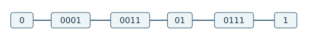

# ENS · MP-PC · Informatique 2005 — corrigé guidé

*Corrigé rédigé par IA, non officiel. Signalez toute erreur.*

**Rédaction** · GPT-6.2 Astra Ultra · vitesse non renseignée · 25 novembre 2026

**Révision (tour 1)** · GPT-6.2 Astra Ultra · vitesse non renseignée · 26 novembre 2026

Le tri par lettres, les chemins dans le graphe des chevauchements et les mots minimaux parmi leurs rotations répondent à une même question : comment énumérer tous les mots sans répétition ? Le dernier résultat relie les trois parties.

## Partie 1. Trier les mots

### Question 1.1.1 · Comparaison

Comparer de gauche à droite jusqu’à la fin du plus court. Au premier désaccord, renvoyer le signe de la différence des lettres ; à défaut, celui de la différence des longueurs. Une lettre commune demande un nombre constant d’opérations. Deux mots égaux imposent une lecture complète.

```text
compare(s,t)
i ← 1
tant que i ≤ min(s[0],t[0]) :
    si s[i] < t[i] : renvoyer -1
    si s[i] > t[i] : renvoyer 1
    i ← i+1
renvoyer le signe de s[0]-t[0]
```

### Question 1.1.2 · Tri par comparaisons

Couper la liste des indices en deux, trier les moitiés, puis les fusionner en choisissant le plus petit des deux mots de tête. Le tableau final est SIG. Un niveau effectue au plus $n$ comparaisons pouvant lire chacune $\ell_{\max}$ lettres.

### Question 1.2.1 · Exemple de longueur trois

Les files successives d’indices sont $[1,2,5,3,4]$, $[2,4,1,5,3]$, puis $[2,4,5,3,1]$. La lecture du résultat donne $100,102,110,112,210$. L’ordre précédent de deux indices est conservé quand leurs lettres de la passe sont égales.


### Question 1.2.2 · Coût des passes

Distinguer le coût du déplacement des indices, proportionnel à $n$, de celui de la visite des paquets, même vides, proportionnel à $k$. On paie les deux à chaque colonne des mots.

### Question 1.2.3 · Première passe

Chaque paquet ne contient qu’une valeur de la dernière lettre. La concaténation parcourt ces valeurs de la plus petite à la plus grande et ne modifie pas l’ordre à l’intérieur d’un paquet.

### Question 1.2.4 · Invariant

À la fin de $r$ passes, lire les $r$ dernières lettres : les indices sont classés selon ces blocs. La lettre traitée au tour suivant devient la première du nouveau bloc. À lettre égale, la réponse du tour précédent ne bouge pas.

### Question 1.2.5 · Sens du parcours

On veut que la première lettre tranche avant toute autre. Si la dernière passe porte sur la dernière lettre, cette dernière emporte la décision dans les paquets globaux. Procéder depuis la droite laisse au contraire aux dernières lettres le seul rôle de départager les préfixes égaux.

### Question 1.3.1 · Complétion

Pour comparer « 0 » et « 00 », l’emplacement manquant doit peser moins qu’un vrai zéro. Réserver un nouveau code et décaler les autres d’une unité. Les mots de longueur commune peuvent alors être soumis à TriPaquets1. On paie pourtant aussi pour toutes les cases ajoutées.

### Question 1.3.2.a · Exemple de longueurs variables

À la position 3, seuls participent $012$ et $101$, dans l’ordre final de colonne $4,3$. À la position 2 vient s’ajouter le mot $21$ d’indice 1 : les indices deviennent $4,1,3$. Enfin on insère le mot $0$ en tête avant de distribuer, ce qui le place devant $012$. On lit $0,012,101,21$.

### Question 1.3.2.b · Préparer Présent

Classer d’abord les couples (lettre, position) d’après leur lettre grâce aux $k$ seaux. Les positions peuvent être répétées dans un seau. Au moment de redistribuer vers les listes de positions, une marque datée par la lettre empêche un deuxième ajout du même couple. L’ordre des lettres est déjà correct et aucune matrice de $k\ell_{\max}$ cases n’est nécessaire.

### Question 1.3.2.c · Préparer Longueur

La longueur est stockée dans la case zéro, donc nul besoin de relire les lettres. La mise en place des listes et un parcours des mots suffisent.

### Question 1.3.2.d · Correction

La règle « un préfixe précède le mot prolongé » se traduit par l’endroit où l’on insère un mot nouveau. Sa queue après la colonne actuelle est vide, elle doit donc passer avant les queues plus longues. À lettre courante égale la stabilité conserve cette priorité.

### Question 1.3.2.e · Coût total

Ne payer un seau que s’il existe réellement à cette position. Chaque seau visité a au moins une occurrence témoin et chaque déplacement d’indice correspond lui aussi à une lettre originale. Les mots étant non vides, $n$ et $\ell_{\max}$ sont tous deux au plus $M$.

## Partie 2. Cycles de De Bruijn

### Question 2.1.1 · Fréquences

Fixer la première lettre d’une fenêtre et choisir librement ses $n-1$ autres lettres. Chaque position du cycle est comptée une fois comme début de fenêtre.

### Question 2.1.2 · Vérification

Il suffit de tester l’absence de doublon parmi les fenêtres, une fois la longueur et les lettres validées. Les indices se lisent modulo $N$. La méthode lente compare chaque position à toutes les précédentes. La méthode rapide achète une case par mot possible : on oublie le premier chiffre du code précédent et on ajoute le prochain en queue. Une case déjà marquée prouve l’échec ; sinon, après $N$ marques, le cycle convient.

### Question 2.1.3 · Le mot infini

Le préfixe $0011$ donne les quatre couples binaires en se refermant. L’étage suivant insère les couples contenant 2, puis celui contenant 3 fait de même. Dans le mot infini chaque couple ordonné d’entiers naturels apparaît exactement une fois : le raccord provisoire de chaque préfixe est réalisé au pas suivant.

### Question 2.2.1 · Préférer la grande lettre

Essayer $k-1$ puis les lettres inférieures en conservant le suffixe courant. Chaque candidat doit former une fenêtre encore absente. On peut balayer toutes les fenêtres ou adresser directement une table de marques.
```text
pour a décroissant :
    c ← code du suffixe courant prolongé de a
    si vu[c] est faux : marquer c ; renvoyer a
renvoyer FIN
```

Marquer d’abord $0^n$. Avec des codes roulants, chaque appel fait au plus $k$ tests, contre $O(kni)$ opérations au préfixe de taille $i$ avec des comparaisons directes.

### Question 2.2.2.a · Sommet d’arrêt

À chaque passage intérieur dans un contexte correspond une arrivée et un départ. Au contexte d’arrêt il ne reste aucun départ possible. Si c’était un sommet différent du premier il y aurait une arrivée de plus que de départs, alors qu’il n’existe que $k$ arrivées distinctes. Il s’agit donc du contexte initial, avec autant d’arrivées que de sorties, soit $k$.

### Question 2.2.2.b · Toutes les fenêtres

Raisonnement à rebours : dès qu’une fenêtre $v0$ a été formée, la règle de préférence avait déjà épuisé les autres prolongements de $v$, hormis le cas initial réglé à la question précédente. Dans le trajet fermé, épuiser les sorties d’un contexte épuise ses entrées. Connaître toutes les fenêtres finissant par $h$ zéros permet ainsi d’enlever un zéro à l’hypothèse. À la fin, aucune restriction ne subsiste sur leur terminaison. Les $n-1$ dernières lettres répètent les premières et servent uniquement à lire les fenêtres qui franchissent le raccord.


## Partie 3. Colliers et mots primaires

### Question 3.1.1 · Rotation d’une puissance

Découper le cycle en blocs identiques. Déplacer le point de lecture de quelques lettres décale tous les blocs de la même façon, sans supprimer leur répétition.

### Question 3.1.2 · Petits primaires

Éliminer d’abord les puissances, puis retenir le plus petit élément de chaque classe circulaire. Sur deux lettres on trouve successivement 2, 1, 2 et 3 mots. Sur trois lettres, les huit triples retenus sont $001,002,011,012,021,022,112,122$ ; les paires sont les trois paires strictement croissantes et chaque lettre est primaire.

### Question 3.1.3 · Deux concaténations

Filtrer les blocs avant de les trier : en binaire les longueurs 1, 2 et 4 conviennent ; en ternaire seules 1 et 3 conviennent. Les chaînes obtenues sont $0000100110101111$ et $000100201101202102211121222$. Vérifier avec les marques de 2.1.2 en rebouclant sur leurs premières lettres. C’est un mode de construction différent de celui qui préfère la grande lettre.



### Question 3.2.1 · Décalage invariant

Numéroter les places sur un cercle. Déplacer l’origine de $m$ cases transforme $xy$ en $yx$. Comme les mots sont égaux, les lettres aux deux positions correspondantes coïncident, avec retour à 1 lorsqu’on dépasse $n$.

### Question 3.2.2 · PGCD

Les pas répétés de taille $m$ reviennent à leur point de départ après $n/d$ tours de pas et visitent exactement les positions de même reste modulo $d$. Les $d$ premières lettres déterminent tout le mot et forment son bloc répété.

### Question 3.3.1 · Racine primitive

Chercher le plus court pas circulaire qui conserve les lettres. Un pas de $n$ fonctionne toujours. La différence de deux bons pas est encore un bon pas ; le plus petit positif divise donc la longueur et tous les autres bons pas. Son préfixe est le seul bloc répété qui ne puisse se raccourcir davantage.

### Question 3.3.2 · Calcul de la racine

Un bord est un préfixe qui est aussi suffixe. Prolonger les bords du préfixe précédent, du plus long au plus court, calcule la table de préfixes en temps linéaire.
```text
b[1] ← 0
pour i de 2 à n :
    h ← b[i-1]
    tant que h > 0 et s[h+1] ≠ s[i] : h ← b[h]
    b[i] ← h + (1 si s[h+1] = s[i], sinon 0)
p ← n-b[n]
renvoyer le préfixe de longueur p si p divise n, sinon le mot entier
```

Un grand bord donne un petit pas. Pour une vraie répétition, sa racine occupe au plus la moitié du mot ; tout pas plus court à travers deux copies rendrait la racine périodique elle-même. Pour un mot sans répétition entière, le test conserve donc le mot original.

### Question 3.3.3 · Compter les colliers

Regarder une puissance sur un cercle revient à regarder sa racine sur un cercle plus court. Le choix de la rotation minimale se transmet dans les deux sens. On obtient exactement un collier de taille $n$ par racine primaire de longueur $d$ divisant $n$.

### Question 3.3.4 · Compter les mots

Pour retrouver des mots quelconques depuis un représentant minimal, choisir une position initiale. Seules les positions des $d$ premières lettres donnent des choix différents, car toute la suite se répète. Le poids de chaque primaire dans le dénombrement est donc sa longueur.

### Question 3.4.1 · Critère des suffixes

Une rotation égale interdit la primitivité, et toute puissance a une rotation égale. Il reste à éliminer le cas où la comparaison avec un suffixe s’arrêterait par préfixe commun. Si un préfixe propre $v$ réapparaissait à la fin, écrire $s=va=bv$. Les deux rotations obtenues aux coupes après $v$ et avant $v$ donnent $s<av$ et $s<vb$. La première impose $b\le a$, la seconde $a<b$. Aucun tel bord n’existe. On peut donc comparer tout suffixe sur une vraie différence avant sa fin ; ajouter le morceau initial derrière lui ne change pas cette comparaison.

### Question 3.4.2.a · Concaténer deux primaires croissants

Séparer les suffixes d’après leur premier caractère dans les deux blocs. Ceux qui commencent dans le second dominent $v$, lui-même supérieur à $uv$ ; pour ce dernier point, si $v$ commence par $u$, comparer $v$ à la fin de $v$ après ce préfixe. Ceux qui commencent à l’intérieur de $u$ sont plus grands dès ce premier bloc. Ainsi $uv$ est plus petit que chacun de ses suffixes propres.

### Question 3.4.2.b · Existence de la factorisation

Un mot est déjà un produit de primaires dès qu’on le découpe lettre par lettre. Corriger une montée locale en fusionnant les deux facteurs qui la forment. Le nombre de barres de séparation baisse, donc on arrive à la forme demandée.

### Question 3.4.2.c · Unicité

Chercher la plus petite fin du mot, le mot entier compris pour le cas d’un seul facteur. Si cette fin débute au milieu d’un facteur, son premier morceau domine ce facteur ; si elle débute à une frontière, elle commence par un facteur au moins égal au dernier. Le plus petit choix est le dernier facteur isolé. Lire les facteurs de droite à gauche devient donc un processus déterministe.

### Question 3.4.2.d · Plus long préfixe primaire

La première frontière est la dernière où puisse s’arrêter un préfixe primaire. En la dépassant, on prend au moins le début d’un second facteur ; le dernier morceau ainsi pris est plus petit que le préfixe complet. Il fournit le suffixe qui viole le critère de 3.4.1.

### Question 3.5.1 · Puissances préprimaires

Le plus grand symbole fournit une terminaison qui rompt la répétition. Partir du primaire $b$, lui ajouter une copie de $p$ à gauche, puis recommencer : après le premier collage, $p$ est toujours strictement plus court que le mot primaire commençant par $p$. Ainsi chaque puissance s’étend à un primaire, sauf les puissances du plus grand symbole déjà admises par définition.

### Question 3.5.2 · Augmenter le dernier caractère

Comparer $ta$ à chacune de ses queues comme on comparerait le primaire initial à la même queue non modifiée. Une différence antérieure à la lettre changée a le bon sens par primarité. Si rien ne s’est encore décidé, le caractère qu’on rencontrait à droite était déjà au moins celui de gauche ; on vient de l’augmenter strictement. Le test des suffixes fonctionne donc à chaque position.

### Question 3.5.3 · Période du préprimaire

La répétition de $p_1$ est le modèle à comparer au mot lu. Un premier écart vers le bas ferait de la queue décalée d’un bloc une queue trop petite du primaire dont $s$ est préfixe. Un premier écart vers le haut, appliqué à un long primaire commençant par des copies de $p_1$, fabriquerait un préfixe primaire plus long que $p_1$. Aucune des deux différences n’est possible. Le cas composé uniquement du plus grand symbole a une période d’une lettre.

### Question 3.5.4 · Caractérisation et unicité

Une répétition coupée peut toujours être prolongée par encore davantage de copies, puis jusqu’à un primaire. Parmi les préfixes de la répétition coupée, le bloc entier est primaire et tout préfixe plus long se recouvre avec lui-même après un décalage d’un bloc. Il ne peut être primaire, car un primaire n’a pas de bord. Cette propriété reconnaît le bloc sans ambiguïté.

### Question 3.5.5 · Reconnaître les colliers

Couper en blocs de longueur $|p|$. Un seul bloc donne un primaire. Plusieurs blocs entiers donnent encore le plus petit représentant de leur classe de rotations. Un dernier bloc tronqué ne peut donner un collier : ce collier posséderait alors une autre description en blocs primaires entiers, incompatible avec l’unicité de 3.5.4.

### Question 3.6.1 · Formule du successeur

C’est une retenue lexicographique. Les plus grands symboles à droite sont déjà saturés ; modifier plus à gauche coûterait trop. Augmenter d’une unité la dernière lettre disponible donne un nouveau préfixe primaire. En reprenant ensuite périodiquement ce préfixe, on fait le choix le plus bas permis : descendre sous une lettre attendue ferait apparaître une queue plus petite que le début et empêcherait tout prolongement primaire.

### Question 3.6.2 · Pseudo-programme

Balayer depuis la droite, incrémenter, puis recopier le bloc modifié autant que nécessaire. La copie peut se faire sur place.
```text
j ← dernier indice non maximal
s[j] ← s[j]+1
pour i = j+1,…,n : s[i] ← s[i-j]
renvoyer s
```

Conserver aussi $j$ si l’on veut connaître la longueur du primaire qui définit le nouveau mot.

### Question 3.6.3 · Énumération

Deux sorties sont possibles à chaque état du même compteur. Pour la première question, écrire l’état complet. Pour la seconde, la retenue précédente fournit la taille du bloc primaire : écrire ce bloc seulement s’il recouvre exactement les $n$ positions. Le premier état utilise le bloc 0 et le dernier le symbole maximal. Un primaire qui prolonge un autre ne peut descendre sous la répétition de celui-ci, sinon il aurait une petite queue ; c’est pourquoi trier les états trie aussi les blocs imprimés.

### Question 3.6.4 · Concaténation minimale

Si $k=1$, seul le mot 0 est possible. Si $n=1$, l’ordre minimal est celui des lettres de l’alphabet. Supposons désormais $k,n\ge2$. Le dénombrement de 3.3.4 fournit la bonne longueur, mais ne prouve pas à lui seul qu’aucune fenêtre ne manque. Voici comment localiser les fenêtres. Noter $b$ la lettre maximale et classer les colliers de longueur $n$ par leurs racines $p$. Si un collier $w$ a $h$ lettres finales maximales et $d=|p|$, son successeur conserve les $n-h-1$ premières lettres : le compteur de 3.6.1 augmente la lettre précédente, et compléter ce préfixe augmenté par des $b$ fournit déjà un collier. Partir de la fin de la liste. Au début d’un bloc de longueur $d<n$, les $n-d$ lettres manquantes du collier se lisent dans ce préfixe conservé du bloc suivant et de son prolongement. Un bloc de longueur $n$ se suffit. Le collier tout maximal se lit à la fin grâce à son prédécesseur $(b-1)b^{n-1}$.

En déplaçant le départ dans le bloc jusqu’à la dernière lettre non maximale, on lit encore toutes les rotations correspondantes : le prolongement demande au plus $n-h-1$ caractères du voisin. Pour une rotation qui prend $r$ lettres finales maximales en tête, repérer la première frontière débutant par le reste $v$ de la rotation. Le bloc précédent finit par au moins $r$ maximales. Sinon le compléter par ces maximales en gardant son début donnerait un collier encore antérieur à la frontière, plus grand que son prédécesseur immédiat. Cette complétion est minimale dans sa classe puisque toute première augmentation d’une lettre du préprimaire donne un primaire, puis une queue faite de maximales en préserve la primarité. Le raccord voulu existe donc. Si $v$ est entièrement nul et la frontière initiale, utiliser le raccord fin-début. Chaque fenêtre de chaque classe apparaît et le compte des places rend ces occurrences uniques.

Pour la minimalité, utilisons la caractérisation gloutonne de la factorisation de Fredricksen, Kessler et Maiorana. Initialiser les $n-1$ dernières lettres à $b$, puis choisir toujours la plus petite lettre créant une fenêtre neuve, produit exactement la concaténation ci-dessus. Les $n-1$ lettres initiales servent de contexte et ne sont pas émises. [Factorisation et caractérisation gloutonne, §2](https://www.ece.mcmaster.ca/~schwam10/publications/MSjrnl39.pdf)

Où un autre cycle pourrait-il gagner une lettre ? Il devrait commencer lui aussi par $0^n$. À sa première divergence, toute lettre plus petite recrée une fenêtre que le glouton a déjà vue. Les fenêtres entièrement contenues dans le préfixe commun sont déjà interdites au concurrent. Les seules exceptions possibles sont celles lues à travers le contexte initial du glouton. Elles s’écrivent $v_j0$, où $v_j=b^j0^{n-1-j}$ et $1\le j<n$. Le concurrent voudrait donc écrire zéro depuis $v_j$ quand la concaténation écrit une lettre positive.

Regardons les sorties positives de $v_{j-1}$. Pour $a>0$, la fenêtre $v_{j-1}a$ se termine lorsqu’on a lu $0^{n-j}a$ à la première frontière portant ce préfixe : les $j-1$ lettres maximales précédentes sont fournies par le raccord démontré plus haut. Pour $j=1$, le mot entier commence à la frontière. On a déjà lu cette fenêtre à la fin du bloc $L=0^{n-j}ab^{j-1}$, qui est primaire puisque sa seule plage de zéros détermine son début. En revanche, pour une sortie positive $d$ de $v_j$, le préfixe à chercher à la frontière est $0^{n-1-j}d$, avec un zéro initial de moins. Sa première frontière vient après le bloc $L$. Cela vaut encore pour $j=n-1$ : la frontière commence alors par $d$, et $b^n$ se termine à la dernière lettre. Ainsi tout départ positif de $v_{j-1}$ précède tout départ positif de $v_j$.

Suivons maintenant le concurrent qui a choisi zéro. Il arrive en $v_{j-1}$. Toutes ses sorties positives sont déjà apparues dans le préfixe commun ; il doit choisir zéro, puis recommencer en $v_{j-2}$. Arrivé en $v_0=0^{n-1}$, il a épuisé aussi la sortie zéro dans son tout premier $0^n$. Or il manque encore des fenêtres. En effet, si la divergence se produit à la lettre $i\le k^n$, le parcours commencé au contexte $0^{n-1}$ a effectué seulement $i-(n-1)+j-1<k^n$ pas lorsqu’il revient en $v_0$. Il ne peut achever le cycle. On obtient la minimalité parmi toutes les origines possibles. [Démonstration publiée par les cycles partiels, théorème 2](https://www-igm.univ-mlv.fr/~perrin/Recherche/Publications/Articles/debruijnRevised3.pdf)
