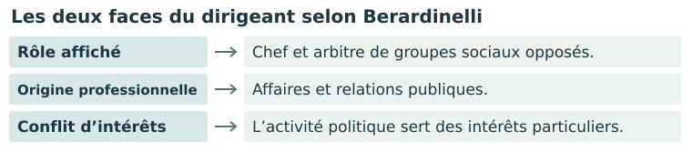

# ENS · MP-PC · Italien (LE2) 2005 — Corrigé brut

*Corrigé rédigé par IA, non officiel. Signalez toute erreur.*

**Rédaction** · GPT-6.2 Astra Ultra · vitesse non renseignée

Le cahier commun aux ENS de Paris et de Cachan dure deux heures. Dictionnaire et calculatrice interdits pour l’italien. La version vaut 15 points, la question en italien 5 points. La réponse doit compter au moins 200 mots.

## V. Version française

Il me semble que la relation entre identité politique et identité personnelle recèle quelque inquiétant mystère. Pourquoi, sans cela, aurait-on tellement peur de constater que les dirigeants et les chefs d’État sont eux aussi des individus ? Voici, je crois, de quoi il s’agit. Au fond, nous n’arrivons pas à croire qu’un individu qui demeure un individu puisse représenter l’intérêt général ou le bien commun en oubliant ses propres intérêts.

L’arrivée de Berlusconi a renversé la situation. Il est vrai que sa manière d’être, si étudiée, si programmée, le fait lui aussi paraître plus qu’humain. Il vient du monde des affaires et des relations publiques plutôt que des écoles de cadres des partis. C’est un patron démiurge. Dans un style entièrement différent, il joue le même rôle, celui du chef et du père du peuple, arbitre pondéré, attentif aux raisons de groupes sociaux opposés, individu idéal et donc dépersonnalisé. Dans son cas, toutefois, le conflit d’intérêts bien connu dont il souffre révèle le problème. C’est bel et bien un individu, avec des intérêts personnels manifestes, qui s’est consacré de toutes ses forces à l’activité politique pour les défendre. […]

Le problème, plus que strictement politique, est culturel et social. Dans les années quatre-vingt-dix, après avoir redécouvert la Justice avec l’opération Mains propres, beaucoup d’Italiens ont commencé à trouver les juges gênants et redoutables. Ainsi, après avoir sanctifié Di Pietro, la majorité a élu Berlusconi. Après avoir rêvé de Justice pendant deux ans, elle a pris peur devant la Légalité.

Il doit y avoir une raison. Les lois et ceux qui les font respecter sont des choses que nous autres Italiens n’aimons pas. Notre pays oscille, comme la plupart des pays du monde, entre la passion de faire justice à tout prix et l’illégalité. Si nous ne parvenons pas à rendre la société tout entière parfaitement juste une fois pour toutes, nous préférons échapper aux lois en vigueur, puisque, d’une manière ou d’une autre, une grande partie de notre vie relève davantage de l’illégalité que de la légalité.

Tant que notre système juridique et judiciaire, tant que les lois et les règlements, les procédures et les procès ne seront pas simples, raisonnables et plus justes, en Italie c’est le parti de l’illégalité qui l’emportera.

## 1. Quali sono i pericoli che derivano dai rapporti tra identità politica e identità personale?

Chi assume una carica pubblica porta con sé una professione, delle amicizie e convinzioni maturate nella propria storia. Pretendere che diventi improvvisamente una persona senza interessi sarebbe ingenuo. Il primo pericolo nasce quando l’immagine del difensore di tutti impedisce di vedere un vantaggio molto preciso. Se un amministratore deve scegliere a chi affidare un servizio e una delle imprese appartiene alla sua famiglia, anche una scelta tecnicamente giustificabile richiede una procedura indipendente. Altrimenti il cittadino non ha modo di distinguere la competenza dal favore personale.

Esiste però anche il rischio inverso. Se ogni giudizio politico si riduce a un giudizio sul carattere del capo, un gesto simpatico può far dimenticare una decisione ingiusta, mentre un particolare della vita privata può screditare una persona che ha agito correttamente. Un dibattito sulle abitudini di un ministro occupa facilmente lo spazio che dovrebbe spettare ai risultati del suo lavoro. Ne risente anche l’opposizione, costretta a scegliere tra la devozione e l’indignazione personale.

Per questo mi sembrano importanti regole comprensibili a tutti. Dichiarare un interesse economico rilevante, astenersi da una decisione e pubblicarne le motivazioni permette di controllare i fatti senza attribuire a un giudice il compito di valutare un’intera personalità. Nello stesso tempo, ciò che non ha alcun rapporto con il mandato deve poter restare privato. La democrazia funziona meglio quando si può chiedere conto di un atto senza dover trasformare chi lo compie in un santo oppure in un nemico.

*238 mots.*

L’extrait est tiré de L’abc del mondo contemporaneo (2004), pages 75–76. La page d’épreuve imprime « Alfonso Beradinelli » pour Alfonso Berardinelli. La coupe après le deuxième paragraphe est conservée. Le rapport spécifique d’italien LE2 n’a pas été retrouvé.

[Version et consignes](https://banques-ecoles.fr/cms/wp-content/data/filiere-pc/annales-de-la-banque-pc/session-2005/sujet-2005-ecrit-mp_pc_langue_etrangere_2.pdf#page=7)
