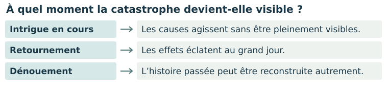
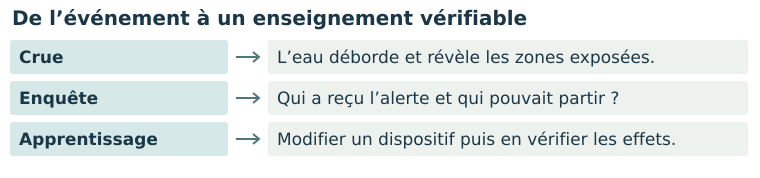

# ENS · MP-PC · Italien (LV1) 2005 — Corrigé brut

*Corrigé rédigé par IA, non officiel. Signalez toute erreur.*

**Rédaction** · GPT-6.2 Astra Ultra · vitesse non renseignée

Le cahier commun aux ENS de Paris, de Lyon et de Cachan dure deux heures. Dictionnaire et calculatrice interdits pour l’italien. La version vaut 12 points, la question en italien 8 points. La réponse doit compter au moins 200 mots.

## V. Version française

**Catastrophe**

Pas de panique. Après tout, une catastrophe, ce n’est pas si exceptionnel. C’est ce dont les journaux parlent le plus. Il s’en produit sans cesse et elle est toujours annoncée. Elle fait partie de notre quotidien. C’est une idée et une nouvelle du jour avec lesquelles nous avons appris à vivre. Scientifiques, sociologues, écologistes, écrivains et autres prophètes de malheur nous disent que la catastrophe, comme dans la tragédie grecque, est la morale de la fable que nous vivons, le dénouement de l’intrigue dont est faite notre histoire. À un certain moment, plus ou moins soudainement, survient le « retournement », sens du mot catastrophe, et l’on en arrive à la résolution de l’intrigue. Les choses et les causes qui existaient et agissaient déjà sous une forme moins manifeste se révèlent ouvertement, leurs effets éclatent au grand jour. Ce qui était caché apparaît à la lumière. Le destin s’accomplit, alors même qu’un instant auparavant on pensait, on espérait que ce n’était pas un destin, que les rapports de cause à effet n’avaient rien de nécessaire ni d’inévitable.

Un tremblement de terre, une inondation, une épidémie, un accident technologique, une guerre, un coup d’État, une révolution, une guerre civile, une crise économique, un massacre. Toutes les catastrophes font la une parce qu’elles bouleversent la prétendue normalité, ouvrant un gouffre qui permet de reconstituer en d’autres termes une histoire déjà en cours. Le sida, la maladie de la « vache folle », les guerres civiles dans l’ex-Yougoslavie, les actions terroristes endémiques de groupes tchétchènes, irlandais, basques ou fondamentalistes islamistes, les luttes contre le terrorisme qui font plus de victimes encore, la catastrophe de Tchernobyl en 1986, les changements climatiques dus à la pollution, les effets périodiques de la dégradation des sols et du régime des eaux, la pénurie d’eau potable et d’air respirable. Qui s’en effraie encore, si tout cela est normal ? La fin du monde, c’est bien connu, n’est jamais qu’un processus en cours.

## 1. Che cosa ci insegnano le catastrofi?

Una catastrofe ci insegna anzitutto a guardare di nuovo ciò che consideravamo normale. Quando un fiume esce dagli argini, le immagini che arrivano in televisione mostrano soprattutto l’acqua nelle strade. Per capire perché alcune famiglie abbiano perduto la casa mentre altre siano riuscite a mettersi in salvo, bisogna però risalire a decisioni anteriori alla piena. Dove si poteva costruire? Chi aveva ricevuto l’avviso? Una persona anziana disponeva di un mezzo per lasciare il quartiere? Il momento del disastro rende visibili rapporti che prima era facile ignorare.

Questa ricostruzione ha anche un limite. Dopo l’evento ogni segnale sembra annunciarlo chiaramente, mentre chi doveva decidere aveva davanti più esiti possibili. Attribuire a un solo errore tutto quello che è accaduto può rassicurare l’opinione pubblica senza migliorare la protezione degli abitanti. Preferirei che un’inchiesta spiegasse quali informazioni erano disponibili in quel preciso momento e quali responsabilità erano state assegnate.

Infine, le catastrofi insegnano qualcosa solo se la memoria si traduce in un cambiamento verificabile. Un comune può correggere una carta del rischio, organizzare un’esercitazione e controllare se anche le persone isolate ricevono il messaggio. Se invece ogni anniversario produce soltanto le stesse immagini, finiamo per abituarci perfino allo scandalo. È proprio questo il pericolo suggerito dall’ironia dell’autore: una società che annuncia continuamente la fine del mondo rischia di smettere di interrogarsi sulle cause di un danno concreto e ancora evitabile.

*227 mots.*

L’extrait est tiré de L’abc del mondo contemporaneo (2004), pages 34–35. Le nom d’Alfonso Berardinelli est imprimé « Beradinelli » sur la page d’épreuve. Le rapport propre à l’option italienne n’a pas été retrouvé.

[Version et consignes](https://banques-ecoles.fr/cms/wp-content/data/filiere-pc/annales-de-la-banque-pc/session-2005/sujet-2005-ecrit-mp_pc_langue_vivante_1.pdf#page=5)
