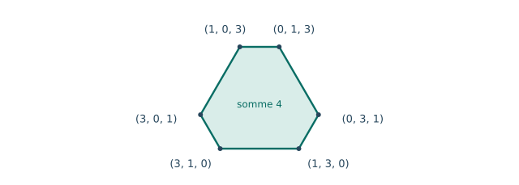
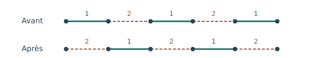
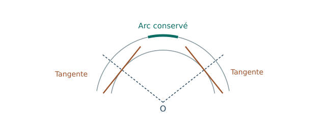

# ENS · MP-PC · Mathématiques-informatique 2005 — corrigé brut

*Corrigé rédigé par IA, non officiel. Signalez toute erreur.*

**Rédaction** · GPT-6.2 Astra Ultra · vitesse non renseignée · 25 novembre 2026

**Révision** · GPT-6.2 Astra Ultra · vitesse non renseignée · 26 novembre 2026

Les vecteurs sont des vecteurs lignes. On note x↓ leur réarrangement décroissant et Sₖ(x) la somme des k plus grandes coordonnées. La majorisation y ≼ x impose Sₖ(y) ≤ Sₖ(x) pour k inférieur à n et l’égalité des totaux.

## Partie 1 · Comparer des vecteurs triés

### Question 1.1 · Ordre sur les vecteurs décroissants

La réflexivité et la transitivité suivent des comparaisons des sommes partielles. Sur $\mathbb R^n$, $e_1$ et $e_2$, distincts pour tout $n\ge2$, se majorisent mutuellement. Sur $D^n$, la double majorisation donne toutes les sommes partielles égales. Leurs différences successives donnent $x_i=y_i$ pour chaque $i$, donc l’antisymétrie.

### Question 1.2 · Sommes des petites coordonnées

Avec le même total $T$, la somme des $r$ plus petites coordonnées de $x$ est $T-S_{n-r}(x)$. Ainsi $S_{n-r}(y)\le S_{n-r}(x)$ équivaut à l’inégalité inverse sur les $r$ plus petites coordonnées, pour $1\le r<n$. À $r=n$, les totaux doivent être égaux.

### Question 1.3 · Vecteur uniforme

Pour $k<n$, la moyenne des $k$ plus grandes valeurs de $x$ est au moins la moyenne globale. En effet, chacune des valeurs restantes est au plus la plus petite des $k$ premières. Si le total est $n$, on a donc $S_k(x)\ge k=S_k(e)$. Les totaux concordent, d’où $e\preceq x$.

## Partie 2 · Matrices doublement stochastiques

### Question 2.1 · Stabilité par produit

Avec $\mathbf1$ colonne de uns, $P\mathbf1=\mathbf1$ et $\mathbf1^TP=\mathbf1^T$. La première égalité donne la valeur propre un. Pour $P_1P_2$ les deux égalités se composent. Chaque coefficient du produit est une somme de produits non négatifs, donc non négatif.

### Question 2.2 · Nécessité de la double stochasticité

La ligne $e_iP$ est majorisée par $e_i$, donc a somme un et minimum au moins zéro par 1.2. Ceci traite toutes les lignes. Puis $eP\preceq e$ impose à toutes ses coordonnées d’être au plus un et à leur somme de valoir $n$. Elles valent toutes un. Ce sont les sommes des colonnes.

### Question 2.3 · Effet sur les sommes partielles

Écrire $x^\downarrow=xU$, $y^\downarrow=yV$. Alors $y^\downarrow=x^\downarrow P'$, $P'=U^{-1}PV$ doublement stochastique. Fixons $k<n$ et posons $t_i=\sum_{j\le k}P'_{ij}$. On a $0\le t_i\le1$ et $\sum_i t_i=k$. Donc
$$
S_k(y)-S_k(x)=\sum_{i>k}x_i^\downarrow t_i-\sum_{i\le k}x_i^\downarrow(1-t_i)\le0,
$$
car les poids des deux sommes sont égaux et $x_k^\downarrow$ sépare leurs valeurs. Pour $k=n$, les sommes des lignes donnent l’égalité des totaux.

### Question 2.4 · Transposition partielle

Pour $Q$ échangeant $j$ et $i$, $T=\lambda I+(1-\lambda)Q$ laisse les autres coordonnées fixes. Il remplace la paire $(x_j,x_i)$ par $(\lambda x_j+(1-\lambda)x_i,(1-\lambda)x_j+\lambda x_i)$. Si $x_j>x_i$, il transfère $(1-\lambda)(x_j-x_i)$ de $j$ vers $i$.

### Question 2.5 · Fixer au moins une coordonnée

Soit $i$ le premier rang où $x_i<y_i$. Il existe, faute de quoi les totaux et $x\ne y$ seraient incompatibles. Par majorisation il existe un rang $j<i$ tel que $x_j>y_j$. Choisir le dernier. Entre $j$ et $i$, toutes les coordonnées concordent. Transférer
$$
\delta=\min(x_j-y_j,y_i-x_i)>0
$$
de $j$ vers $i$, soit $1-\lambda=\delta/(x_j-x_i)$. Le dénominateur est positif puisque $x_j>y_j\ge y_i>x_i$. Les nouvelles valeurs vérifient $x'_j\ge y_j\ge y_i\ge x'_i$. Les valeurs intermédiaires, identiques à celles de $y$, maintiennent l’ordre décroissant, aussi si $i=j+1$. Hors du segment, le tri subsiste. Les seuls préfixes diminués sont ceux de rang $j$ à $i-1$. Leur excédent initial sur $y$ est au moins $x_j-y_j\ge\delta$, puisque tous les rangs avant $i$ étaient en excédent ou à égalité. Ainsi $y\preceq x'$ et une ou deux positions de plus concordent.

### Question 2.6 · Caractérisation par une matrice

Le sens direct de l’implication $y=xP\Rightarrow y\preceq x$ est 2.3. Dans l’autre sens, trier les deux vecteurs. Chaque étape de 2.5 conserve le tri et augmente le nombre de positions exactes, donc on aboutit en au plus $n$ étapes à $y^\downarrow$. Le produit des matrices de transfert est doublement stochastique par 2.1. Le faire précéder et suivre des permutations qui trient $x$ et défont le tri de $y$ donne la matrice voulue.

### Question 2.7 · Programme Transf

Le programme reçoit deux vecteurs décroissants distincts avec $y\preceq x$.
```text
i ← premier indice avec x[i] < y[i]
j ← dernier indice avant i avec x[j] > y[j]
d ← min(x[j]−y[j], y[i]−x[i]) / (x[j]−x[i])
T ← matrice identité
T[i,i] ← 1−d ; T[j,j] ← 1−d
T[i,j] ← d ; T[j,i] ← d
renvoyer T
```
Les recherches prennent $O(n)$ opérations et la matérialisation de la matrice dense $O(n^2)$. La correction découle des bornes et de la conservation du tri en 2.5.

### Question 2.8 · Rectangle de zéros

Former le graphe biparti des coefficients non nuls entre colonnes et lignes. Une permutation de produit non nul est un couplage parfait. Si $t$ colonnes et $s=n+1-t$ lignes définissent un rectangle nul, ces colonnes n’ont que $t-1$ lignes disponibles, d’où impossibilité.

Inversement prendre un couplage maximal en cardinal. S’il n’est pas parfait, partir d’une colonne libre et parcourir alternativement arêtes hors couplage vers les lignes, puis arêtes couplées vers les colonnes. Aucune ligne libre ne peut être atteinte, sinon inverser le chemin augmenterait le couplage. Pour l’ensemble $C$ des colonnes atteintes, toutes les lignes voisines sont atteintes, y compris la ligne partenaire d’une colonne déjà atteinte. Ces lignes sont en bijection par couplage avec $C$ privé de la colonne initiale. Il y a donc $|C|-1$ voisines. Les $n+1-|C|$ autres lignes et les colonnes $C$ forment le rectangle nul demandé.

### Question 2.9 · Extraire une permutation positive

Un rectangle nul avec $s+t=n+1$ forcerait les $t$ colonnes en cause à avoir leur masse totale $t$ sur seulement $n-s=t-1$ lignes, de masse totale $t-1$. C’est impossible par non-négativité. La question 2.8 fournit donc une permutation de produit positif. Si $c$ est le plus petit coefficient choisi, $P-cQ$ est non négative et toutes ses sommes valent $1-c$. Pour $c<1$, $R=(P-cQ)/(1-c)$ est doublement stochastique. Si $c=1$, $P=Q$.

### Question 2.10 · Théorème de Birkhoff

Chaque étape non terminale écrit $P=cQ+(1-c)R$ avec $0<c<1$. Au moins une entrée strictement positive devient nulle et aucune entrée nulle ne redevient positive lors de la normalisation. Toute matrice doublement stochastique possède au moins $n$ entrées positives. Avec exactement $n$, c’est une matrice de permutation. Il y a donc au plus $n^2-n$ étapes non terminales, puis un dernier terme, soit $k\le n^2-n+1$. En développant les combinaisons convexes successives, les coefficients sont positifs et de somme un.

### Question 2.11 · Région majorisée dans le plan

Par 2.6 et 2.10, $\{y:y\preceq x\}$ est l’enveloppe convexe des permutations de $(1,0,3)$. Dans le plan $y_1+y_2+y_3=4$, elle s’écrit $0\le y_i\le3$ pour chaque $i$, car les deux conditions de préfixe sont le maximum $\le3$ et le minimum $\ge0$. Ce plan coupe les faces du cube en six segments. Les six permutations sont leurs sommets, dessinés en projection sur le plan orthogonal à $(1,1,1)$.



## Partie 3 · Colorations et scores

### Question 3.1 · Inverser une chaîne de deux couleurs

Le sous-graphe des deux couleurs a degré au plus deux. Ses composantes non triviales sont des chemins ou des cycles alternés. Un cycle ou un chemin de longueur paire a autant de chaque couleur. Comme $p_1>p_2$, une composante est un chemin impair ayant une arête de plus de couleur 1. Échanger les deux couleurs sur ce chemin maintient la coloration propre et donne les effectifs $(p_1-1,p_2+1)$.



### Question 3.2 · Transférer une unité entière

Soit $D=q_j-q_i\ge1$. Le transfert d’une unité est la transformation de 2.4 avec $1-\lambda=1/D$, valeur admissible même pour $D=1$. La matrice est doublement stochastique, donc le résultat est majorisé par $q$ d’après 2.3. Cela couvre le changement éventuel d’ordre des coordonnées.

### Question 3.3 · Toutes les répartitions plus équilibrées

Trier les effectifs en renommant les couleurs. Pour passer de $p$ à $q\preceq p$, choisir donneur et receveur comme en 2.5. Le transfert entier $\delta=\min(p_j-q_j,q_i-p_i)$ est réalisé par $\delta$ applications de 3.1 aux deux seules couleurs choisies. Pendant ces échanges, avant chaque unité, le donneur dépasse le receveur car il reste au-dessus de sa cible et l’autre en dessous de la sienne, avec $q_j\ge q_i$. Les autres couleurs sont intactes. À la fin du bloc, 2.5 assure tri, majorisation et gain d’une coordonnée correcte. Plus précisément, avant le dernier échange le donneur a encore au moins $q_j+1$ arêtes et le receveur au plus $q_i-1$. Leur différence est donc au moins deux, même lorsque $q_j=q_i$. Itérer puis remettre les noms prescrits.

### Question 3.4 · Tournoi transitif

Orienter l’arête entre $i$ et $j$, $i<j$, de $i$ vers $j$. Le sommet $i$ bat les $n-i$ sommets de rang supérieur et a score $n-i$. Chaque paire reçoit une seule orientation.

### Question 3.5 · Condition sur les scores

Le total des scores est $\binom n2$. Un ensemble de $k$ sommets gagne au moins ses $\binom k2$ rencontres internes. En particulier, la somme des $k$ plus petits scores est au moins $0+1+\cdots+(k-1)$. Avec l’égalité totale, 1.2 donne $s\preceq(n-1,\ldots,0)$.

### Question 3.6 · Correction de Tournoi

Montrons d’abord l’existence d’une réalisation pour toute liste admissible. Entre les matchs et les places de victoire, associer à l’équipe $i$ exactement $s_i$ places. Un match est relié aux places de ses deux équipes. Pour tout ensemble de matchs dont les équipes incidentes forment $U$, le nombre de matchs est au plus $\binom{|U|}2$, tandis que le nombre de places voisines est $\sum_{i\in U}s_i\ge\binom{|U|}2$ par 1.2. Le raisonnement par chemin augmentant de 2.8 fournit une affectation distincte à chaque match. Le nombre total de places est le nombre de matchs, donc le tournoi ainsi orienté réalise les scores.

Dans une telle réalisation, on peut faire battre par l’équipe $n$ les $s_n$ équipes de plus petit indice. S’il lui manque une victoire contre $i$ dans cet ensemble, elle bat un $j$ hors de cet ensemble, avec $s_i\le s_j$. Si $j$ bat $i$, inverser le triangle $i\to n\to j\to i$. Sinon $i$ bat $j$. Il existe alors une équipe $k$ battue par $j$ qui bat $i$, car si $i$ battait aussi tous les adversaires battus par $j$, elle dépasserait son score en le battant lui-même. Ici $k\ne n$ puisque $j$ perd contre $n$. Inverser le cycle $i\to n\to j\to k\to i$. Dans les deux cas, les scores restent fixes et l’équipe $n$ gagne exactement une des victoires prescrites qui lui manquaient. Répéter.

Retirer $n$ laisse donc des scores $s_1,\ldots,s_{s_n},s_{s_n+1}-1,\ldots,s_{n-1}-1$ réalisables. Par 3.5, leur tri est majorisé par $(n-2,\ldots,0)$, comme demandé. Les lignes 2 et 3 du programme font précisément ces orientations et ces soustractions. Le tri suivant renomme simultanément lignes et colonnes, en préservant les matchs déjà fixés. La récurrence descend jusqu’à un seul sommet. Le tournoi produit a les scores attendus à permutation près.

## Partie 4 · Schur-croissance et polygones

### Question 4.1 · Critère à deux coordonnées

Les permutations de $x$ se majorisent mutuellement. Une fonction Schur-croissante est donc symétrique. Si une paire est majorisée dans $\mathbb R^2$, elle s’obtient par une moyenne de la paire et de sa transposée. Étendre cette matrice par l’identité aux autres coordonnées montre la Schur-croissance des sections à deux variables. Réciproquement, la symétrie permet d’amener deux positions quelconques en tête. Un transfert élémentaire les remplace par une paire majorisée et ne peut augmenter la fonction par l’hypothèse sur les sections. Les transferts et permutations de 2.6 produisent tout $y\preceq x$, donc $f(y)\le f(x)$.

### Question 4.2 · Composition avec une fonction convexe

Si $y=xP$, posons $u_j=\sum_i P_{ij}g(x_i)$. Les poids de chaque colonne sont positifs ou nuls, de somme un. Par convexité, $g(y_j)\le u_j$. Par croissance usuelle, $\phi(g(y_1),\ldots,g(y_n))\le\phi(u)$. Puis $u=(g(x_1),\ldots,g(x_n))P$ est majorisé par $(g(x_1),\ldots,g(x_n))$. La Schur-croissance de $\phi$ donne la conclusion.

### Question 4.3 · Aire du polygone inscrit

Prendre les écarts angulaires successifs dans le sens trigonométrique. Quand le centre est intérieur, $0<\theta_i<\pi$ et leur somme vaut $2\pi$. La triangulation depuis le centre donne $A=\tfrac12\sum_i\sin\theta_i$. Le sinus est concave sur cet intervalle. Pour $y=xP$ dont les angles restent dans ce domaine, Jensen sur chaque colonne puis sommation donne $\sum_i\sin y_i\ge\sum_i\sin x_i$. L’aire est donc Schur-décroissante sur les angles admissibles.

### Question 4.4 · Maximum parmi tous les polygones inscrits

Pour des écarts $\theta_i\ge0$ de somme $2\pi$, la formule orientée $A=\tfrac12\sum_i\sin\theta_i$ reste valable même si le centre est extérieur. Il existe un maximum sur ce simplexe compact. Il n’est pas dégénéré car un polygone régulier a une aire positive, et, en cas de sommet répété, insérer à sa place un point sur l’arc libre entre deux sommets voisins distincts agrandit strictement le polygone. Si un écart $t\ge\pi$, le plus petit autre écart $u$ vérifie $0<u<2\pi-t\le\pi$. Transférer un petit angle de $t$ vers $u$ accroît l’aire, puisque sa dérivée vaut $(\cos u-\cos t)/2>0$. Ainsi tout maximum a ses écarts dans $(0,\pi)$. Par stricte concavité, $A\le (n/2)\sin(2\pi/n)$ avec égalité exactement pour les angles égaux, donc pour le polygone régulier.

### Question 4.5 · Longueur intérieure d’un cercle

Pour $r\le1$, $h_r=2\pi r$. Pour $r>1$, posons $\alpha=\arccos(1/r)$. Une tangente au cercle unité exclut du cercle de rayon $r$ les points dont la direction est à distance angulaire $<\alpha$ de sa normale extérieure. Dans l’intervalle entre normales consécutives, la normale la plus proche est l’une des deux extrémités. L’ouverture conservée est donc $(\theta_i-2\alpha)_+$, où $t_+=\max(t,0)$. Ainsi
$$
h_r=r\sum_i (\theta_i-2\alpha)_+ .
$$
Chaque terme est convexe, donc la somme est Schur-croissante par Jensen. La formule prolonge la fonction sur les vecteurs d’angles hors du domaine géométrique si nécessaire.



### Question 4.6 · Moment de rotation et aire minimale

En coordonnées polaires, le moment vaut $\int_0^\infty r^2h_r\,dr$ et l’aire $\int_0^\infty h_r\,dr$. Le vecteur constant d’angle moyen $2\pi/n$ est majorisé par tous les autres. Il minimise donc simultanément les deux intégrales. Si les angles sont inégaux, choisir $2\alpha$ strictement entre leur minimum et leur moyenne. À ce seuil au moins un terme est coupé pour la liste inégale alors qu’aucun ne l’est pour la liste uniforme, car $\sum_i(\theta_i-t)_+=2\pi-nt+\sum_i(t-\theta_i)_+$ pour $t=2\alpha$. Le dernier terme est strictement positif pour la liste inégale et nul pour la liste uniforme. La condition $\min_i\theta_i<t<2\pi/n$ définit un intervalle ouvert non vide de rayons $r=1/\cos(t/2)$. Les minima sont donc atteints seulement par le polygone régulier, aux isométries près. Son aire est $n\tan(\pi/n)$.
