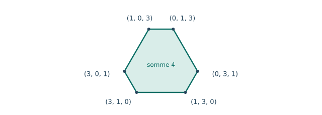
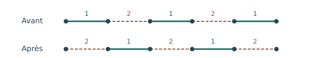
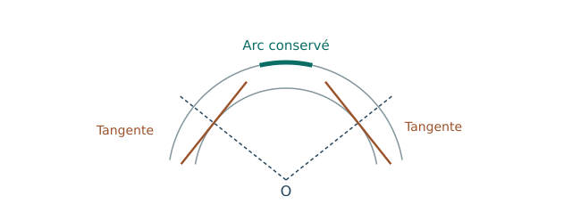

# ENS · MP-PC · Mathématiques-informatique 2005 — corrigé guidé

*Corrigé rédigé par IA, non officiel. Signalez toute erreur.*

**Rédaction** · GPT-6.2 Astra Ultra · vitesse non renseignée · 25 novembre 2026

**Révision** · GPT-6.2 Astra Ultra · vitesse non renseignée · 26 novembre 2026

La majorisation mesure ce que peut produire un transfert entre coordonnées d’un vecteur. On l’utilise pour décomposer une matrice doublement stochastique, réaliser des scores de tournoi et comparer des polygones de même nombre de côtés.

## Partie 1 · Comparer des vecteurs triés

### Question 1.1 · Ordre sur les vecteurs décroissants

Trier efface le nom des coordonnées. Deux vecteurs canoniques distincts montrent donc la perte d’antisymétrie en toute dimension autorisée. Une fois le tri imposé, comparer dans les deux sens fixe chaque préfixe, puis chaque coordonnée par soustraction. La comparaison est déjà réflexive et transitive.

### Question 1.2 · Sommes des petites coordonnées

Couper chaque liste triée au même rang. Une fois le total connu, la somme à droite de la coupure est le complément de celle de gauche. Toutes les inégalités s’inversent en passant d’un côté à l’autre, tandis que l’égalité totale reste nécessaire.

### Question 1.3 · Vecteur uniforme

Si les $k$ premières coordonnées triées avaient une moyenne inférieure à un, toutes les coordonnées restantes seraient aussi inférieures à un. La moyenne globale ne pourrait valoir un. On obtient toutes les bornes des préfixes du vecteur uniforme.

## Partie 2 · Matrices doublement stochastiques

### Question 2.1 · Stabilité par produit

Additionner les coefficients d’une ligne revient à appliquer la matrice au vecteur colonne constant. Les colonnes se traitent par multiplication à gauche. Une composition de deux matrices qui fixent ces vecteurs les fixe encore. Vérifier en plus la positivité terme par terme dans le produit matriciel.

### Question 2.2 · Nécessité de la double stochasticité

Tester d’abord chaque ligne séparément avec le vecteur canonique correspondant. Son total est un et sa plus petite entrée ne peut être inférieure au minimum du vecteur canonique, zéro. Tester ensuite le vecteur de uns. Sa majorisation ne laisse possible que lui-même, ce qui fixe les sommes des colonnes.

### Question 2.3 · Effet sur les sommes partielles

Trier séparément le vecteur entrant et le vecteur sortant ne fait que permuter les lignes et les colonnes de la matrice. Les poids affectés aux $k$ sorties les plus grandes sont compris entre zéro et un par ligne, de somme totale $k$ par les colonnes. Déplacer ces poids vers les plus grandes entrées ne peut diminuer la somme, et leur meilleure répartition est un sur les $k$ premières, zéro ailleurs. Les totaux restent égaux, ce qui donne la majorisation.

### Question 2.4 · Transposition partielle

Calculer le vecteur après l’échange complet puis en prendre la moyenne pondérée avec le vecteur initial. Seules les deux positions choisies reçoivent de nouvelles valeurs. Leur somme est conservée.

### Question 2.5 · Fixer au moins une coordonnée

Trouver la première coordonnée qui manque de masse. La majorisation assure qu’un surplus la précède. Prendre le dernier surplus avant ce manque, ce qui laisse entre eux seulement des valeurs déjà égales aux cibles. Faire circuler le plus petit des deux écarts. Une cible au moins est atteinte, et les deux valeurs modifiées restent encadrées par les cibles intermédiaires. Cela conserve le tri. Les préfixes traversés par le transfert avaient tous au moins le surplus du donneur en réserve, donc ils gardent la majorisation.

### Question 2.6 · Caractérisation par une matrice

Après le tri, traiter l’écart par transferts successifs. La construction précédente garantit que l’entrée du tour suivant est encore triée et domine encore la cible. Le nombre de coordonnées incorrectes décroît strictement. Composer les matrices des tours et les deux changements d’ordre donne $y=xP$. Toute telle matrice satisfait réciproquement les contraintes de majorisation.

### Question 2.7 · Programme Transf

Parcourir les coordonnées en conservant le dernier surplus jusqu’au premier manque. Ces deux indices déterminent le bloc à écrire.
```text
j ← indice non défini
pour i de 1 à n
    si x[i] > y[i] : j ← i
    si x[i] < y[i] :
        t ← min(x[j]−y[j], y[i]−x[i]) / (x[j]−x[i])
        renvoyer l’identité dont le bloc (j,i) vaut ((1−t,t),(t,1−t))
```
L’hypothèse garantit qu’un donneur existe au moment du retour. Les deux écarts sont positifs et le bloc transfère précisément la quantité choisie.

### Question 2.8 · Rectangle de zéros

Le problème consiste à affecter à chaque colonne une ligne distincte où son coefficient ne s’annule pas. Un bloc nul de la taille annoncée laisse une place de moins que nécessaire pour ses colonnes. Pour prouver que tout échec s’explique ainsi, choisir la meilleure affectation partielle possible. Depuis une colonne non affectée, explorer toutes les possibilités de déplacement en délogeant le propriétaire d’une ligne déjà prise. Une ligne libre terminerait une chaîne d’amélioration, ce que l’optimalité exclut. Les lignes accessibles sont donc appariées aux colonnes accessibles sauf celle de départ. Toutes les autres lignes sont nulles sur les colonnes accessibles. Leur nombre est exactement celui exigé.

### Question 2.9 · Extraire une permutation positive

Compter la masse disponible dans le complément d’un éventuel bloc nul. Les colonnes devraient déposer $t$ unités dans des lignes dont la capacité totale n’est que $t-1$. On dispose donc d’une diagonale positive à permutation près. Soustraire le minimum de cette diagonale conserve la positivité et ôte exactement la même masse à chaque ligne et à chaque colonne. Une division par la masse restante normalise le résultat.

### Question 2.10 · Théorème de Birkhoff

Recommencer l’extraction tant qu’une permutation ne suffit pas. Le nombre de cases positives décroît à chaque extraction non terminale, car un minimum est atteint. En partant d’au plus $n^2$ cases et en gardant toujours au moins une case par ligne, on arrive à une permutation après au plus $n^2-n$ retraits. Les coefficients restent ceux d’une moyenne pondérée à chaque étape, donc leur somme finale vaut un.

### Question 2.11 · Région majorisée dans le plan

Placer les six points obtenus en échangeant les coordonnées de $x$. Chacun a la même somme et chaque moyenne de ces points est obtenue par une matrice doublement stochastique. L’ensemble se remplit donc jusqu’aux bords de leur enveloppe convexe. Pour vérifier le tracé, les arêtes ont alternativement une coordonnée constante égale à zéro ou à trois.



## Partie 3 · Colorations et scores

### Question 3.1 · Inverser une chaîne de deux couleurs

Suivre une chaîne tant que l’on rencontre l’autre couleur. Aucun sommet ne permet un branchement et un circuit revient avec autant d’arêtes de chaque sorte. L’excédent global doit donc se voir sur au moins un chemin qui commence et finit avec la première couleur. Inverser toutes ses couleurs conserve l’alternance et déplace exactement une unité vers la deuxième couleur.



### Question 3.2 · Transférer une unité entière

Ne pas comparer les préfixes dans l’ordre d’écriture après le transfert, car ils peuvent ne plus être triés. Écrire le nouveau vecteur comme combinaison du vecteur initial et du vecteur où les positions $i,j$ sont échangées. Le poids de l’échange est l’inverse de l’écart entier positif. Cette moyenne est majorisée par le vecteur initial.

### Question 3.3 · Toutes les répartitions plus équilibrées

Équilibrer seulement les deux couleurs qui présentent le dernier surplus avant le premier manque. Continuer par unités jusqu’à la première cible atteinte. Avant chaque échange, les deux effectifs restent dans le bon ordre pour appliquer le résultat sur les chaînes alternées. La preuve de 2.5 garantit que les nouveaux effectifs triés dominent encore le vecteur demandé. Un nombre fini de blocs suffit, puis on peut renommer les couleurs.

### Question 3.4 · Tournoi transitif

Classer les équipes et faire gagner systématiquement la première du classement de chaque rencontre. Les nombres de victoires descendent alors de $n-1$ à zéro.

### Question 3.5 · Condition sur les scores

Compter les rencontres à l’intérieur d’un groupe d’équipes. Chaque rencontre y crédite exactement une victoire. Les meilleurs résultats contre les équipes extérieures peuvent seulement augmenter la somme de leurs scores. Appliquer ce calcul aux $k$ équipes les moins bien classées et utiliser la formulation de la majorisation par les petites coordonnées.

### Question 3.6 · Correction de Tournoi

Interpréter $s_i$ comme un stock de places pour les victoires de l’équipe $i$. Tout paquet de rencontres entre un ensemble $U$ d’équipes compte au plus $\binom{|U|}2$ matchs. Ces équipes disposent d’au moins autant de places selon les inégalités de la question 3.5 lues sur la liste prescrite. Le critère des mariages démontré en 2.8 permet donc d’attribuer chaque match à une place d’un de ses deux joueurs. Les totaux étant égaux, toutes les places seront occupées et une réalisation existe.

Il reste à garantir les choix particuliers du programme. Dans la réalisation, supposons que l’équipe $n$ perde contre une faible $i$ qu’elle devrait battre et batte une forte $j$ contre laquelle elle devrait perdre. Il y a un chemin de $j$ à $i$ sans passer par $n$, soit directement, soit en deux matchs. En effet, si $i$ bat $j$ et bat aussi toutes les équipes battues par $j$, alors $s_i>s_j$, impossible. Le chemin, prolongé par $i\to n\to j$, forme un circuit. Inverser le circuit donne à chaque participant une victoire en remplacement d’une autre et corrige les deux adversaires de $n$. Répéter jusqu’à ce que $n$ batte exactement les $s_n$ premières équipes.

On peut alors retirer $n$. Les premières équipes gardent leur score résiduel et toutes les autres perdent une victoire. Cette liste étant réalisable, 3.5 donne la majorisation réclamée. Réindexer les équipes restantes par tri laisse correctes les orientations enregistrées, car la matrice est permutée sur ses deux axes. Le même argument s’applique au tour suivant et s’achève au tournoi à un seul sommet.

## Partie 4 · Schur-croissance et polygones

### Question 4.1 · Critère à deux coordonnées

Une permutation ne change aucune somme triée et doit donc laisser la valeur de la fonction intacte. Pour deux coordonnées seules, la majorisation correspond à une moyenne de poids complémentaires entre les deux ordres possibles. Une telle moyenne s’étend à toutes les coordonnées en fixant les autres, ce qui prouve la nécessité du test local. Inversement, remplacer une paire par une paire plus équilibrée ne fait pas croître une fonction qui passe ce test. Elle est symétrique, donc toutes les paires sont permises. La construction par transferts établit alors le résultat global.

### Question 4.2 · Composition avec une fonction convexe

Appliquer Jensen séparément à chacune des sorties de la matrice stochastique. Cette étape fournit une comparaison coordonnée par coordonnée, d’où l’emploi de la croissance usuelle. Les majorants obtenus sont à leur tour les moyennes stochastiques des données transformées par $g$. La deuxième hypothèse, la Schur-croissance, achève la comparaison.

### Question 4.3 · Aire du polygone inscrit

Deux rayons consécutifs et leur corde forment un triangle d’aire égale à la moitié du sinus de l’ouverture. Le centre intérieur autorise la somme des aires de ces triangles avec des ouvertures inférieures à un angle plat. Équilibrer les ouvertures augmente la somme des sinus par concavité, d’où le sens de la majorisation.

### Question 4.4 · Maximum parmi tous les polygones inscrits

Il faut inclure les polygones qui laissent le centre à l’extérieur. Même dans ce cas l’aire est la somme algébrique des aires des triangles issus du centre. Un maximum existe puisque les angles appartiennent à un simplexe compact. Il ne gaspille aucun sommet en le répétant, car un nouveau point sur un arc libre ajoute un triangle d’aire positive. Si un arc couvre au moins un demi-tour, prendre un autre arc aussi petit que possible. Sa longueur est strictement inférieure au complément du grand arc. En prenant un petit angle au grand arc pour l’ajouter à ce petit arc, le gain de sinus dépasse la perte, comme le montre $\cos u>\cos(2\pi-t)$. Au maximum le centre est donc intérieur. Jensen pour le sinus, strictement concave sur les angles restants, impose alors que toutes les ouvertures valent $2\pi/n$.

### Question 4.5 · Longueur intérieure d’un cercle

Sur un rayon formant un angle $t$ avec la normale extérieure d’une tangente, le point à distance $r$ respecte cette contrainte si $r\cos t\le1$. Au-delà du cercle unité, il faut donc s’écarter de chaque normale d’au moins $\alpha=\arccos(1/r)$. Entre deux normales, on retranche cette ouverture à chaque extrémité. Lorsque les zones retranchées se chevauchent, il ne reste rien. Cela donne l’angle $(\theta_i-2\alpha)_+$, à multiplier par $r$ pour une longueur. La partie positive d’une fonction affine étant convexe, une moyenne stochastique des angles ne peut augmenter la somme de ces longueurs. Pour $r\le1$, tout le cercle reste à l’intérieur.



### Question 4.6 · Moment de rotation et aire minimale

Découper en fines couronnes. La quantité d’aire apportée à distance $r$ est $h_r\,dr$. Pour le moment, la même contribution reçoit le poids supplémentaire $r^2$. Le polygone d’angles constants minimise déjà chaque longueur de couronne par la question précédente. Il minimise donc l’aire et le moment. Si certains angles diffèrent, choisir un rayon juste assez grand pour supprimer la contribution d’un petit écart sans encore atteindre l’écart moyen. Le total de tous les écarts diminués du seuil $t=2\arccos(1/r)$ vaut $2\pi-nt$ pour les deux polygones. Pour le polygone irrégulier, la partie positive remplace au moins une valeur négative par zéro et augmente cette somme. Pour le régulier, toutes les valeurs sont encore positives. Cette différence stricte persiste pour tous les seuils compris entre le plus petit écart et la moyenne, donc sur un intervalle de rayons de longueur positive. Les deux intégrales sont alors strictement plus grandes que pour le régulier.
