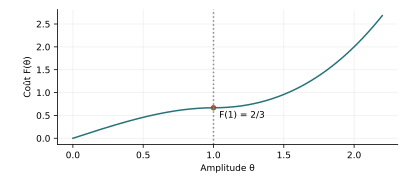
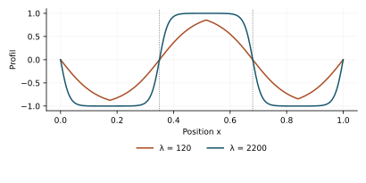

# ENS — Mathématiques MPI 2, session 2005 · Corrigé guidé

*Corrigé rédigé par IA, non officiel. Signalez toute erreur.*

**Rédaction** · GPT-6.2 Astra Ultra · vitesse non renseignée

**Révision** · GPT-6.2 Astra Ultra · vitesse non renseignée

La garde ULC 522 porte une durée de quatre heures. L’épreuve est commune aux ENS de Paris, Lyon et Cachan pour les groupes MP/MPI et I de la filière MP. Pour le groupe I des filières MP et PC, elle est aussi proposée en option commune à Paris et Lyon. Une calculatrice de poche autonome, non imprimante et sans document d’accompagnement est autorisée. [Sujet officiel](https://banques-ecoles.fr/cms/wp-content/data/filiere-mp/annales-de-la-banque-mp/session-2005/sujet-2005-ecrit-mp_mathematiques_2.pdf) · [Rapport du jury](https://banques-ecoles.fr/cms/wp-content/data/filiere-mp/rapports-des-jurys-de-la-banque-mp/rapport-de-jury-session-2005/rapport-2005-mp_ecrit_mathematiques_cachan_lyon_paris.pdf).

Une énergie pénalise la dérivée et l’écart aux deux valeurs +1 et −1. Le problème calcule le coût asymptotique des transitions entre ces deux valeurs et construit des profils qui l’atteignent.

## I. Primitives et fonctions de test

### Question I.1.a

> [!INDICATION]
> Appliquer le théorème fondamental de l’analyse sur chaque morceau, puis sommer.

#### Solution

Sur les intervalles ouverts d’une partition subordonnée à $f$, prenons $g=f'$ au sens classique. Donnons à $g$ une valeur quelconque aux nœuds. Les limites unilatérales existent, donc $g\in\mathcal C$. La formule fondamentale sur chacun des segments, obtenue par passage à la limite aux extrémités, se somme grâce à la continuité de $f$. Elle donne $f(x)=f(0)+\int_0^x g$. Réciproquement, $g$ est bornée, donc sa primitive est lipschitzienne et continue. Sur les intervalles de continuité de $g$, cette primitive est de classe $C^1$ avec dérivée $g$, laquelle possède les limites requises. Elle appartient à $\mathcal D$.

### Question I.1.b

> [!INDICATION]
> Une intégrale ne voit pas les valeurs isolées de son intégrande. Vérifier à quelles fonctions la partition doit être subordonnée.

#### Solution

L’unicité sur tous les intervalles d’une partition de $f$ seule, telle qu’imprimée, est fausse. Prenons $f=0$, sa partition $\{0,1\}$, et les deux intégrandes $g_1=0$ et $g_2=\mathbf1_{\{1/2\}}$. Elles sont continues par morceaux et ont la même primitive.

La propriété utilisée dans la suite est l’unicité à un nombre fini de valeurs près. Pour deux représentantes, prendre une subdivision commune à $f,g_1,g_2$. À l’intérieur de chaque morceau, la dérivée de (1) vaut $g_1(x)=g_2(x)=f'(x)$. Les seules différences possibles sont aux nœuds de cette subdivision.

Le rapport du jury, en première page, reconnaît l’imprécision de cette question. En particulier, l’exemple en un point isolé respecte exactement la définition de continuité par morceaux de la page 2, qui ne fixe pas la valeur au nœud. Le carré d’une représentante et celui d’une autre ont donc la même intégrale, ce qui sera nécessaire pour définir l’énergie.

### Question I.1.c

> [!INDICATION]
> Prendre une subdivision commune et utiliser la règle du produit.

#### Solution

Sur chaque intervalle d’une subdivision commune, le produit est $C^1$ et sa dérivée classique vaut $f_1g_2+f_2g_1$. Les limites unilatérales sont finies et le produit est continu aux nœuds, donc $f_1f_2\in\mathcal D$. Par I.1.a, l’intégrale de cette dérivée redonne les accroissements du produit, quelles que soient les valeurs isolées des représentantes.

### Question I.2

> [!INDICATION]
> Intégrer le carré de la différence entre g et sa moyenne.

#### Solution

Pour $m=\int_0^1g$, on a $\int_0^1(g-m)^2=\int_0^1g^2-m^2\ge0$. En cas d’égalité, la fonction positive $(g-m)^2$ est nulle sur chaque intervalle où elle est continue, car une valeur positive y donnerait une intégrale positive. Ainsi $g=m$ sauf éventuellement aux nœuds. Réciproquement, les valeurs en un nombre fini de points laissent les intégrales inchangées.

### Question I.3

> [!INDICATION]
> Calculer la dérivée par morceaux et les valeurs au bord.

#### Solution

La primitive $G(x)=\int_0^xg$ appartient à $\mathcal D$ par I.1.a. La fonction $f=G-xG(1)$ en fait donc partie, admet $g-G(1)$ pour dérivée et vérifie $f(0)=f(1)=0$. Ainsi $f\in\mathcal D_0$.

### Question I.4

> [!INDICATION]
> Choisir la fonction de test construite en I.3.

#### Solution

Si $g=C$ sauf en un nombre fini de points, $\int_0^1g\theta'=C(\theta(1)-\theta(0))=0$. Inversement, prenons $\theta$ de I.3. L’hypothèse donne $0=\int g(g-m)=\int g^2-m^2$. Le cas d’égalité de I.2 donne la conclusion.

### Question I.5

> [!INDICATION]
> Retrancher une primitive de g pour ramener l’identité à I.4.

#### Solution

Soit $G(x)=\int_0^xg$. La formule du produit intégrée donne $\int G\theta'=-\int g\theta$, puisque $\theta$ s’annule aux deux bords. L’hypothèse équivaut donc à $\int(f-G)\theta'=0$. Par I.4, $f=G+C$ sauf en un nombre fini de points. Posons $\widetilde f=G+C$. Elle appartient à $\mathcal D$, vérifie $\widetilde f(x)=\widetilde f(0)+\int_0^x g$ et est $C^1$ sur $[0,1]$ si $g$ y est continue.

## II. Équation du minimum et amplitude

### Question II.1

> [!INDICATION]
> Vérifier la classe des intégrandes et leur dépendance aux valeurs ponctuelles.

#### Solution

Pour $u\in\mathcal D_0$, la dérivée $u'$ est continue par morceaux et bornée, et $(1-u^2)^2$ est continue. Les deux intégrales sont finies. Deux dérivées au sens de (1) ne diffèrent qu’en un nombre fini de points par I.1.b, donc leurs carrés ont la même intégrale.

### Question II.2.a

> [!INDICATION]
> Calculer le coefficient de degré un en la perturbation.

#### Solution

Notons $u=u_\lambda$. L’énergie de $u+\varepsilon\psi$ est un polynôme en $\varepsilon$ de degré au plus quatre. Dans le premier terme, le coefficient linéaire est $\int u'\psi'$. Dans le second, $1-(u+\varepsilon\psi)^2=1-u^2-2\varepsilon u\psi-\varepsilon^2\psi^2$ donne le coefficient $-\lambda\int(1-u^2)u\psi$. Leur somme est la limite du quotient demandé.

On peut contrôler le reste sans permuter une limite et une intégrale. Pour $|\varepsilon|\le1$, le terme restant après soustraction des termes constants et linéaires vaut exactement
$$
 \varepsilon^2\!\int_0^1\!\left[\frac{\psi'^2}{2}
 +\frac{\lambda}{4}(6u^2-2)\psi^2
 +\lambda\varepsilon u\psi^3+\frac{\lambda}{4}\varepsilon^2\psi^4\right]dx.
$$
Les fonctions dans les crochets sont bornées par morceaux, uniformément pour ces $\varepsilon$. Après division par $\varepsilon$, cette contribution tend donc vers zéro.

### Question II.2.b

> [!INDICATION]
> Utiliser les perturbations réelles de chaque signe.

#### Solution

L’espace $\mathcal D_0$ est vectoriel, donc $u+\varepsilon\psi$ y reste pour tout $\varepsilon\in\mathbb R$. Le polynôme énergie atteint son minimum en zéro. Sa dérivée calculée en II.2.a s’annule et donne, pour toute $\psi$, $\int_0^1 [u'\psi'-\lambda(1-u^2)u\psi]=0$.

### Question II.2.c

> [!INDICATION]
> Appliquer le lemme de I.5 à une représentante de la dérivée faible.

#### Solution

Posons $f=u'$ et $g=-\lambda(1-u^2)u$. Ce dernier est continu, donc I.5 fournit $w\in C^1([0,1])$ égal à $u'$ sauf en un nombre fini de points et vérifiant $w'=g$. On a $u(x)=u(0)+\int_0^xw$, donc $u$ est $C^1$, sa dérivée classique est $w$ et vérifie encore (3). En fait $u\in C^2$ et $-u''=\lambda(1-u^2)u$. Par composition avec le polynôme du membre de droite, la régularité s’améliore de deux ordres à chaque étape, d’où $u\in C^\infty(]0,1[)$.

### Question II.2.d

> [!INDICATION]
> Multiplier l’équation par la dérivée pour reconnaître une dérivée totale.

#### Solution

Comme $u''=\lambda(u^2-1)u$, on a $[(u')^2]'=2u'u''=[(\lambda/2)(u^2-1)^2]'$. La différence est constante sur l’intervalle. Il existe donc $C_\lambda$ tel que $(u')^2=(\lambda/2)((u^2-1)^2-C_\lambda)$. La continuité prolonge cette relation aux bords.

### Question II.2.e

> [!INDICATION]
> Évaluer la première intégrale au bord et en un point critique. Utiliser l’unicité de Cauchy au premier contact avec un puits.

#### Solution

En $x=0$, l’identité impose $C_\lambda\le1$. Par Rolle, il existe $c$ avec $u'(c)=0$, donc $C_\lambda=(u(c)^2-1)^2\ge0$. Si $u(x)=1$ ou $-1$ en un point, l’identité y impose $C_\lambda=0$ et $u'(x)=0$. L’équation autonome a un second membre polynomial, et son problème de Cauchy a une unique solution locale. Avec ces données c’est la solution constante $1$ ou $-1$, laquelle se propage par unicité et contredit $u(0)=0$. La continuité de $u$ donne donc $|u|<1$ partout.

### Question II.3

> [!INDICATION]
> Équilibrer le coût de la dérivée dans les rampes et la pénalisation du potentiel.

#### Solution

Dans les deux rampes linéaires de largeur $\varepsilon$, la moitié de l’intégrale de la dérivée au carré vaut $1/\varepsilon$ au total. La contribution du potentiel est $(\lambda\varepsilon/2)\int_0^1(1-t^2)^2dt=4\lambda\varepsilon/15$. Le plateau n’ajoute rien. Prenons $\varepsilon=1/\sqrt\lambda<1/2$ pour $\lambda>4$. La minimalité donne $E_\lambda(u)\le (19/15)\sqrt\lambda$. Or $E_\lambda(0)=\lambda/4$, strictement supérieur à cette borne pour $\lambda$ assez grand. Ainsi $u\ne0$, et $-u$, de même énergie, est un second minimiseur distinct.

La comparaison qui exclut la solution nulle est explicite : il suffit que $\sqrt\lambda>76/15$, condition qui implique aussi $\varepsilon<1/2$. On utilise ici l’existence du minimiseur admise par l’énoncé.

### Question II.4.a

> [!INDICATION]
> Isoler la contribution du potentiel dans la borne d’énergie.

#### Solution

Avec $\phi_\lambda=u_\lambda^2$, la positivité de l’énergie cinétique donne $0\le\int_0^1(\phi_\lambda-1)^2\le 4E_\lambda(u_\lambda)/\lambda\le4C/\sqrt\lambda$ pour $\lambda$ grand. La limite est nulle.

### Question II.4.b

> [!INDICATION]
> Comparer la valeur maximale à un en utilisant la borne ponctuelle stricte.

#### Solution

La continuité assure l’existence du maximum $\mu_\lambda$. D’après II.2.e, $0\le u_\lambda(x)^2\le\mu_\lambda^2<1$, donc $(1-\mu_\lambda^2)^2\le(1-\phi_\lambda(x))^2$. L’intégrale garde cette borne inférieure car l’intervalle est de longueur unité. II.4.a entraîne $\mu_\lambda^2\to1$, puis $\mu_\lambda\to1$.

## III. Minoration de l’énergie par une variation

### Question III.1

> [!INDICATION]
> Compléter la borne de II.3 sur les petites valeurs du paramètre.

#### Solution

Les minimiseurs conviennent. Pour $\lambda$ grand on dispose de II.3. Pour $0<\lambda\le L$, la minimalité face à $0$ donne $E_\lambda(u_\lambda)\le\lambda/4\le(\sqrt L/4)\sqrt\lambda$. Une constante commune couvre les deux plages.

### Question III.2

> [!INDICATION]
> Compléter un carré puis appliquer l’inégalité à des quantités positives.

#### Solution

Le carré $(\sqrt\varepsilon x-y/\sqrt\varepsilon)^2\ge0$ donne l’inégalité énoncée. En particulier, la somme des carrés $|v'|^2/2$ et $\lambda|1-v^2|^2/4$ est au moins le double du produit de leurs racines carrées. L’intégration donne $E_\lambda(v)\ge\sqrt{\lambda/2}\int_0^1 |v'(1-v^2)|$.

### Question III.3

> [!INDICATION]
> Introduire une primitive signée et couper le trajet à un point où le module est maximal.

#### Solution

La fonction $F$ de l’énoncé vaut $\int_0^\theta|1-t^2|dt$ pour $\theta\ge0$. Cela donne les deux formules et la dérivée continue, en particulier au raccord $1$. Prolongeons-la en une fonction impaire $G(s)=\int_0^s|1-t^2|dt$. Alors $G(v)$ est $C^1$ par morceaux et $|(G(v))'|=|v'(1-v^2)|$. Si $|v(x_*)|=\eta_\lambda$, la variation sur $[0,x_*]$ puis sur $[x_*,1]$ est au moins $F(\eta_\lambda)$ sur chacun des deux intervalles, puisque $v(0)=v(1)=0$. III.2 fournit $E_\lambda(v)\ge\sqrt{2\lambda}F(\eta_\lambda)$.

Sur $[0,1]$ on lit $F(\theta)=\theta-\theta^3/3$. Pour $\theta\ge1$, intégrer à partir de $F(1)=2/3$ donne $F(\theta)=4/3+\theta^3/3-\theta$. Les deux dérivées s’annulent en $1$, d’où le raccord $C^1$. Pour chaque tronçon, l’inégalité utilisée s’écrit $\int_a^b |(G\circ v)'|\ge|G(v(b))-G(v(a))|$ ; elle vaut même si $v$ change plusieurs fois de sens.

### Question III.4

> [!INDICATION]
> Appliquer cette borne au minimum et utiliser la limite de son amplitude.

#### Solution

Pour $v=u_\lambda$, $\eta_\lambda=\mu_\lambda\to1$. Puisque $F$ est continue et $F(1)=2/3$, on obtient $\liminf_{\lambda\to\infty}E_\lambda(u_\lambda)/\sqrt\lambda\ge 2\sqrt2/3$, ce qui est la limite des infimums demandée.

## IV. Profil optimal et interfaces multiples

### Question IV.1

> [!INDICATION]
> Retrouver la première intégrale, puis résoudre l’équation du premier ordre près de zéro.

#### Solution

Les données initiales donnent $(\psi')^2=(1-\psi^2)^2/2$, comme en II.2.d. Près de zéro $\psi'>0$ et $|\psi|<1$, donc $(\operatorname{artanh}\psi)'=1/\sqrt2$. Ainsi $\psi(x)=\tanh(x/\sqrt2)$. Cette expression est définie sur $\mathbb R$, vérifie l’équation et les données par dérivation. L’unicité de Cauchy pour le champ polynomial assure l’unicité globale. Sa limite en $+\infty$ vaut $1$.

### Question IV.2

> [!INDICATION]
> Exploiter la symétrie, changer d’échelle, puis intégrer en prenant le profil pour variable.

#### Solution

Posons $a=1/(2\varepsilon)$ et $q=\psi(a)$. Par réflexion et changement de variable, l’énergie du profil est
$$E_\lambda(\psi_\varepsilon)=(\varepsilon^{-1}+\lambda\varepsilon)\int_0^a\psi'(t)^2dt
=\frac{\varepsilon^{-1}+\lambda\varepsilon}{\sqrt2}\left(q-\frac{q^3}{3}\right).$$
En effet $1-\psi^2=\sqrt2\psi'$ et le changement $s=\psi(t)$ donne la dernière intégrale. Pour $\varepsilon=\lambda^{-1/2}$, admissible dès $\lambda>4$, $q\to1$. La minimalité fournit une limite supérieure de $2\sqrt2/3$ après division par $\sqrt\lambda$. Avec III.4 on obtient la limite annoncée.

Pour vérifier les facteurs, chaque demi-profil donne $\frac1{2\varepsilon}\int_0^a\psi'^2$ pour la dérivée et $\frac{\lambda\varepsilon}{2}\int_0^a\psi'^2$ pour le potentiel. Lorsque $\varepsilon=\lambda^{-1/2}$, les deux coûts sont égaux. Cette égalité explique pourquoi la majoration atteint la constante de III.4.

### Question IV.3.a

> [!INDICATION]
> Construire des plateaux qui raccordent les deux bords de chaque sous-intervalle à zéro.

#### Solution

Soit $\ell_*$ la longueur du plus court intervalle et $d_n(x)=\min(x-x_n,x_{n+1}-x)$. Pour $\lambda$ assez grand, prenons $\varepsilon=\lambda^{-1/2}<\ell_*/2$ et posons $U_\lambda(x)=(-1)^n\min(1,d_n(x)/\varepsilon)$ sur le morceau $n$. Les fonctions se raccordent en zéro, sont linéaires par morceaux et prennent finalement la valeur voulue en tout point intérieur fixé. L’énergie sur chaque morceau vaut $1/\varepsilon+4\lambda\varepsilon/15$ par II.3. Pour les $\lambda$ plus petits, prenons $U_\lambda=0$, dont l’énergie est majorée par une constante fois $\sqrt\lambda$ sur cet intervalle borné.

### Question IV.3.b

> [!INDICATION]
> Mesurer la variation signée aux milieux des intervalles. Deux plateaux consécutifs ont des signes opposés.

#### Solution

Choisissons un point $m_n$ dans chaque intervalle. III.2 minore $E_\lambda(U_\lambda)/\sqrt\lambda$ par $1/\sqrt2$ fois la variation de $G(U_\lambda)$, où $G$ est la primitive impaire de III.3. Celle-ci domine la somme des modules d’accroissements le long de $0,m_1,\ldots,m_{N-1},1$. Aux deux bords la valeur est nulle. Aux points intermédiaires elle tend vers $(-1)^n(2/3)$. Dans la limite, les deux accroissements de bord coûtent $2/3$ chacun et les $N-2$ sauts intérieurs coûtent $4/3$ chacun. Il vient $\liminf E_\lambda(U_\lambda)/\sqrt\lambda\ge2(N-1)\sqrt2/3$.

### Question IV.3.c

> [!INDICATION]
> Recoller des demi-profils exacts sur chaque intervalle de la subdivision.

#### Solution

Sur le morceau $[x_n,x_{n+1}]$ de longueur $\ell_n$, posons $V_\lambda(x)=(-1)^n\psi(\sqrt\lambda\,d_n(x))$. Les deux demi-profils concordent au milieu et les morceaux adjacents se recollent en zéro. Ainsi $V_\lambda\in\mathcal D_0$, et sa limite intérieure vaut $(-1)^n$. Reprenant IV.2 avec $q_n=\tanh(\ell_n\sqrt\lambda/(2\sqrt2))$, l’énergie du morceau divisée par $\sqrt\lambda$ est $\sqrt2(q_n-q_n^3/3)$. Elle est bornée par $2\sqrt2/3$ pour tout $\lambda>0$ et tend vers cette valeur. La somme sur les $N-1$ morceaux donne les hypothèses (4) et la limite exacte $2(N-1)\sqrt2/3$.

