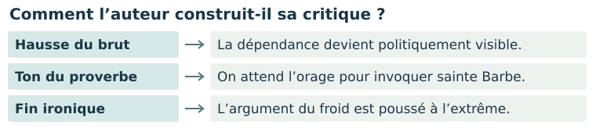
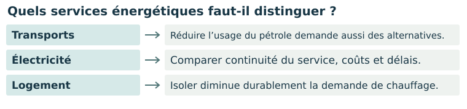

# ENS · MP-PC · Portugais (LE2) 2005 — Corrigé guidé

*Corrigé rédigé par IA, non officiel. Signalez toute erreur.*

**Rédaction** · GPT-6.2 Astra Ultra · vitesse non renseignée

Le cahier commun aux ENS de Paris et de Cachan dure deux heures, sans dictionnaire ni calculatrice pour le portugais. La garde prévoit une version française sur 15 et une question en portugais sur 5. La page de portugais ne fixe pas de longueur chiffrée.

## V. Version française

*Revivalismo* annonce le retour d’une idée ancienne. *Crude* signifie « brut » dans ce contexte pétrolier. Le proverbe sur sainte Barbe associe le tonnerre et l’appel tardif à la protection de la sainte. Conserver l’ironie de l’hiver portugais prétendument implacable. *A medo* décrit un retour d’abord timide dans le débat.

**Le retour en grâce du nucléaire**

Le gouvernement veut réduire notre dépendance à l’égard du pétrole, maintenant que le baril de brut traverse sur les marchés internationaux une période prolongée de cherté, due surtout à l’amateurisme irresponsable de la politique internationale de George W. Bush.

Le gouvernement a raison de songer à d’autres solutions. Dommage seulement qu’il faille attendre le tonnerre pour invoquer sainte Barbe. De fait, nous importons 90 % de notre énergie primaire sous forme de combustibles fossiles, le pétrole représentant une part de 66 %. On a immédiatement profité de l’inquiétude du gouvernement pour ressusciter l’idée dépassée de l’énergie nucléaire. Timidement d’abord, avec un démenti officiel niant que la question ait été discutée en Conseil des ministres. Quelques jours plus tard, pourtant, plusieurs personnalités sont venues donner leur avis sur la nécessité pour notre pays d’embrasser l’atome, de peur que nous ne mourions tous de froid durant nos hivers impitoyables…

## 1. Qual pode ser o papel hoje em dia das energias, nomeadamente das energias nucleares?

*Nomeadamente* invite à accorder une place explicite au nucléaire sans réduire la question à un vote pour ou contre. Le modèle emploie *comboio*, *autocarro* et *rede eléctrica* dans un portugais européen cohérent avec le texte.

Antes de escolher uma fonte de energia, convém perguntar para que serviço a queremos. Uma central pode fornecer electricidade durante muitas horas sem consumir petróleo, mas isso pouco altera a viagem de quem depende diariamente do automóvel e não tem comboio nem autocarro. Nesse caso, melhorar os transportes colectivos ou aproximar serviços e habitação pode reduzir a dependência de forma mais directa. Também uma casa bem isolada precisa de menos aquecimento, seja qual for a origem da energia.

A energia nuclear tem a vantagem de permitir uma produção regular com baixas emissões de carbono durante a exploração. A construção exige, porém, tempo, financiamento e instituições capazes de acompanhar a segurança e os resíduos muito depois de passar o entusiasmo inicial. Compará-la com a energia eólica ou solar obriga igualmente a considerar o funcionamento da rede eléctrica quando varia o tempo. Nenhuma destas contas se resolve invocando apenas o preço do barril desta semana.

Defenderia uma decisão pública que apresentasse prazos, custos e alternativas para cada uso. Um país pode procurar maior autonomia e, ao mesmo tempo, reconhecer que o primeiro combustível a poupar é aquele de que já não precisa para prestar o mesmo serviço.

*195 mots.*

L’article a paru au Portugal dans le Jornal de Letras, du 24 novembre au 7 décembre 2004. Les pourcentages et les positions rapportés se lisent dans ce contexte. Le modèle d’expression suit l’usage du Portugal. Le rapport spécifique de l’épreuve n’a pas été retrouvé.

[Version et consignes](https://banques-ecoles.fr/cms/wp-content/data/filiere-pc/annales-de-la-banque-pc/session-2005/sujet-2005-ecrit-mp_pc_langue_etrangere_2.pdf#page=9)
