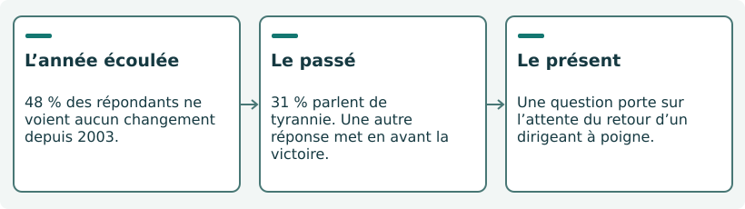

# ENS · MP-PC · Russe (LE2) 2005 — Corrigé brut

*Corrigé rédigé par IA, non officiel. Signalez toute erreur.*

**Rédaction** · GPT-6.2 Astra Ultra · vitesse non renseignée

Le cahier de LE2 rapproche un bilan de l’année 2004 d’un sondage sur Staline. Il demande de commenter les réponses en 100 mots en mobilisant ses connaissances historiques. Le registre fournit le cahier de l’épreuve. La réponse russe compte 100 mots.

## I. Version française

**Événements — 2004, tout est calme en Russie**

Dans l’ensemble, les Russes estiment que l’année écoulée a été plus difficile que 2003. D’après les résultats du traditionnel sondage de fin d’année réalisé par le Centre d’analyse Iouri Levada, 34 % de nos concitoyens partagent cet avis. Pour 18 % d’entre eux, l’année 2004 a été plus facile. Cependant, le groupe le plus nombreux, soit 48 %, n’a ressenti de changement ni dans un sens ni dans l’autre.

Les résultats d’un récent sondage effectué à l’occasion du 125ᵉ anniversaire de la naissance de Staline sont apparus très révélateurs. Il s’est avéré que 31 % seulement des citoyens russes voient en lui un tyran cruel et inhumain, responsable de la mort de millions de personnes. Et presque autant de sondés (29 %) jugent que, quelles que soient les erreurs et les tares qu’on lui attribue, l’essentiel est que le peuple soviétique a remporté sous sa direction la victoire dans la Grande Guerre patriotique. Un cinquième des répondants (21 %) qualifie Staline de « dirigeant sage » qui a conduit l’URSS à la puissance et à la prospérité. Par ailleurs, 16 % des participants au sondage sont convaincus que « seul un dirigeant à poigne pouvait maintenir l’ordre dans le pays, dans les conditions qui y régnaient à l’époque, avec l’âpreté de la lutte des classes, la menace extérieure et le laisser-aller général ». Et 16 % des Russes approuvent l’affirmation selon laquelle « notre peuple ne pourra jamais se passer d’un dirigeant du genre de Staline. Tôt ou tard, il viendra et rétablira l’ordre ».

*Polit.ru*, vendredi 7 janvier 2005.

## II. Question en russe

Ответы показывают, насколько по-разному люди понимают слово «порядок». Для одних оно связано с победой над нацизмом и превращением СССР в великую державу. Для других его цена измеряется судьбами заключённых, депортированных семей и людей, расстрелянных по ложным обвинениям. Победа была достигнута усилиями миллионов, и благодарность фронтовикам сама по себе не оправдывает репрессий. Особенно тревожит готовность некоторых опрошенных видеть в таком руководителе образец для будущего. Но нельзя складывать приведённые проценты: один человек мог соглашаться с несколькими суждениями. Чтобы понять ответы, я спросил бы, какими источниками пользовались участники и обсуждала ли их семья опыт тех лет. Тогда за цифрами стали бы видны люди.

[Sujet](https://banques-ecoles.fr/cms/wp-content/data/filiere-pc/annales-de-la-banque-pc/session-2005/sujet-2005-ecrit-mp_pc_langue_etrangere_2.pdf#page=10)
