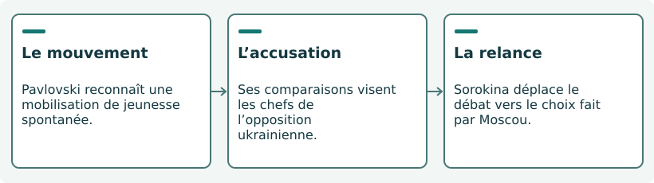

# ENS · MP-PC · Russe (LV1) 2005 — Corrigé brut

*Corrigé rédigé par IA, non officiel. Signalez toute erreur.*

**Rédaction** · GPT-6.2 Astra Ultra · vitesse non renseignée

Le cahier de LV1 demande une version, puis une réponse de 200 mots. L’entretien télévisé est daté du 26 décembre 2004. La copie adopte ce point d’observation pour examiner les conséquences possibles de la vague orange. Le rapport écrit n’est pas identifié dans le registre. La réponse russe compte 200 mots.

## I. Version française

**Que se passe-t-il en Ukraine ?**

Gleb Pavlovski, président de la Fondation pour une politique efficace :

« Il y a bien des raisons à cela. Le pouvoir est arrivé à son terme. N’oubliez pas que Koutchma s’en va. C’est la fin d’une époque, et les gens veulent la fêter. Seulement Koutchma ne leur a pas offert de fête, alors ils se la sont organisée eux-mêmes. Ensuite, on trouve là les traits d’un mouvement d’émancipation, d’un mouvement de jeunesse antiautoritaire tout naturel. Celui-là est parfaitement naturel. Et puis il y a des tentatives tout à fait manifestes de manipuler ce mouvement, de plusieurs côtés, pas d’un seul... pas seulement, ici, pas seulement de l’Ouest... Ici, à mon avis, les dirigeants de l’opposition se fascisent rapidement. Écoutez donc le vocabulaire de M. Iouchtchenko : “Ma nation, Dieu, les bandits en prison”, et ainsi de suite. C’est en somme le vocabulaire d’une sorte de fascisme de gauche à ses débuts, un vocabulaire social-populiste. Il congédie la foule en lui disant : “La paix soit avec vous.” C’est donc qu’il se prend déjà pour Jésus-Christ, et cela n’est pas sans danger. De façon générale, un paranoïaque au pouvoir, ce n’est pas sans danger. Un homme qui croit sincèrement avoir été empoisonné, c’est dangereux. »

S. Sorokina : « Attendez, attendez ! Mais... pourquoi la Russie a-t-elle misé sur Ianoukovitch au lieu d’observer tranquillement qui le peuple allait choisir ? »

Gleb Pavlovski : « Vous savez, premièrement, en Ukraine, plus encore qu’en Russie, ce sont, en règle générale, les élites qui choisissent ceux qui occupent le sommet de la vie politique. On ne s’imagine même pas à quel point. Si nous avons tellement pris l’habitude de qualifier notre pays d’autoritaire, c’est tout simplement que nous n’avions pas vu l’Ukraine. Nous n’avions pas vu la verticale du pouvoir à l’œuvre, dans toute sa splendeur, dans toute la splendeur de sa corruption, dirais-je, à l’apogée, veux-je dire, de cette corruption qui vient de précipiter le pays entier dans une crise très profonde et qui y a malheureusement entraîné toutes les élites politiques ukrainiennes. La Russie n’est pour rien dans le choix des successeurs de Koutchma. Souvenons-nous-en. Nous avons soutenu ce choix. »

*L’Instinct fondamental*, chaîne ORT, 26 décembre 2004.

## II. Question en russe

Если смотреть на события из конца декабря 2004 года, самым важным следствием «оранжевой волны» мне представляется изменение представлений о выборах. Граждане Украины увидели, что за подсчётом голосов можно следить, а объявленный результат можно оспорить в суде. Этот опыт переживёт победу отдельного кандидата, если одинаковые правила будут действовать и тогда, когда проиграют сегодняшние победители. Однако многолюдная площадь ещё не говорит от имени всей страны. Житель восточной области вправе голосовать иначе, не опасаясь, что его сочтут противником независимости. Будущему президенту придётся разговаривать и с такими избирателями.

Для России события ставят вопрос о том, кого именно она считает своим соседом. Поддержать знакомого политика проще, чем выстроить отношения с обществом, способным неожиданно сменить руководство. Если Москва сведёт происходящее к иностранному вмешательству, недоверие может распространиться на торговлю, культурные связи и обычные семейные отношения через границу. Если же она признает право украинцев на собственное решение, у двух государств останется пространство для переговоров даже при несовпадении интересов.

Наконец, российские зрители следят за тем, как спорят украинские политики и как действуют наблюдатели. Одних увиденное вдохновит на участие в общественной жизни, других испугает возможностью беспорядка. Поэтому я не ждал бы механического повторения событий в России. Но вопрос о доверии к выборам теперь труднее объявить исключительно внутренним делом украинской политики.

[Sujet](https://banques-ecoles.fr/cms/wp-content/data/filiere-pc/annales-de-la-banque-pc/session-2005/sujet-2005-ecrit-mp_pc_langue_vivante_1.pdf#page=6)
