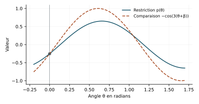

# ENS Paris, Lyon et Cachan — Mathématiques MPI 1, session 2005 · Corrigé guidé

*Corrigé rédigé par IA, non officiel. Signalez toute erreur.*

**Rédaction** · GPT-6.2 Astra Ultra · vitesse non renseignée

**Révision** · GPT-6.2 Astra Ultra · vitesse non renseignée

Les opérateurs de Dunkl associent aux dérivées des différences divisées venant des transpositions. Le sujet démontre leur commutation puis construit des fonctions propres simultanées, en contrôlant les normes des composantes homogènes.

## I. Une dérivation déformée en une variable

### Question I.1.a

> [!INDICATION]
> Écrire la différence symétrique comme deux accroissements depuis zéro.

#### Solution

On a $(f(x)-f(-x))/x=[f(x)-f(0)]/x+[f(-x)-f(0)]/(-x)\to2f'(0)$. Comme $f'$ est continue, le prolongement a pour valeur $T(f)(0)=(1+2k)f'(0)$.

### Question I.1.b

> [!INDICATION]
> Distinguer les monômes pairs et impairs.

#### Solution

On a $T(1)=0$. Pour $d\ge1$, $T(X^d)=a_d X^{d-1}$ avec $a_d=d+k(1-(-1)^d)$, soit $d$ en degré pair et $d+2k$ en degré impair.

### Question I.1.c

> [!INDICATION]
> Décomposer le polynôme dans la base des monômes.

#### Solution

La dérivation et la différence divisée sont linéaires, y compris après prolongement en zéro. La formule précédente abaisse chaque degré d’au moins un, et les constantes sont annulées. Ainsi $\deg T(P)\le\deg P-1$ avec la convention usuelle pour le polynôme nul.

### Question I.1.d

> [!INDICATION]
> Déterminer le coefficient de l’endomorphisme sur chaque droite homogène.

#### Solution

Écrivons $\psi(X^d)=b_dX^d$. On doit avoir $b_0=1$ et $db_d=a_db_{d-1}$ pour tout $d\ge1$. Ces relations imposent $b_d=\prod_{j=1}^d(a_j/j)$ et ne requièrent aucune division par $a_j$. Réciproquement, ces valeurs définissent une application linéaire sur la base des monômes. Elle conserve le degré homogène et satisfait l’entrelacement sur la base, donc sur tous les polynômes.

### Question I.2.a

> [!INDICATION]
> Comparer les conditions de non-annulation des deux familles de coefficients.

#### Solution

Dans $T(\sum p_dX^d)$, les termes d’indices $d\ge1$ ont des degrés distincts. Un polynôme non constant du noyau existe exactement quand un $a_d$ s’annule. La formule de I.1.d montre que $\psi$ est diagonale avec tous les $b_d$ non nuls exactement quand aucun $a_d$ ne s’annule. L’inverse dans ce cas agit coefficient par coefficient sur la même base.

### Question I.2.b

> [!INDICATION]
> Seuls les indices impairs peuvent donner des valeurs singulières.

#### Solution

Pour $d$ pair positif, $a_d=d\ne0$. Pour $d=2m+1$, $a_d=0$ équivaut à $k=-(2m+1)/2$. Ainsi $M_1=\{-(2m+1)/2:m\in\mathbb N\}\subset\mathbb R_-^*$.

## II. Opérateurs de Dunkl et commutateurs

### Question II.1.a

> [!INDICATION]
> Intégrer la différentielle sur le segment joignant un point à son transposé.

#### Solution

Soit $s=(ij)$, $v=e_i-e_j$ et $z=x-sx=(x_i-x_j)v$. Le théorème fondamental sur le segment donne, y compris par prolongement sur la diagonale,
$$\Delta_{ij} f(x)=\int_0^1 D_v f(sx+t z)\,dt.$$
L’intégrande est continu en $(x,t)$ et le segment des paramètres est compact, donc $\Delta_{ij}f$ et $T_uf$ sont continus. Pour $P$ homogène de degré $d\ge1$, $D_vP$ est homogène de degré $d-1$. La substitution linéaire dans l’intégrale conserve ce degré et l’intégration ne porte que sur les coefficients. Il en va de même pour $T_uP$.

### Question II.1.b

> [!INDICATION]
> Suivre l’indice d’une variable, d’une dérivée et d’une paire transposée.

#### Solution

L’action envoie $X_i$ sur $X_{w(i)}$. La composition sur les générateurs donne $\rho_w\rho_{w'}=\rho_{ww'}$. La règle de chaîne donne $\rho_wD_{e_i}=D_{e_{w(i)}}\rho_w$. La conjugaison envoie la transposition $(ij)$ sur $(w(i)w(j))$ et le dénominateur $X_i-X_j$ sur $X_{w(i)}-X_{w(j)}$, donc $\rho_w\Delta_{ij}=\Delta_{w(i),w(j)}\rho_w$. Comme $\Delta_{ji}=-\Delta_{ij}$, écrire $T_{e_i}=D_{e_i}+k\sum_{j\ne i}\Delta_{ij}$ permet de réindexer la somme et donne la dernière égalité.

### Question II.2.a

> [!INDICATION]
> Translater les deux coordonnées de la même quantité.

#### Solution

Le dénominateur $X_1-X_2$ est invariant par translation suivant $e_1+e_2$, et la permutation $(12)$ commute avec cette translation. La dérivation suivant $e_1+e_2$ commute donc avec $\Delta_{12}$ hors de la diagonale, puis partout par continuité des polynômes obtenus.

### Question II.2.b

> [!INDICATION]
> Développer sur les trois coordonnées distinctes dans la base des permutations. Les deux cycles de longueur trois suffisent après annulation des transpositions.

#### Solution

Notons $A=(12), B=(2i), C=(1i)$, $a=1/(X_1-X_2), b=1/(X_2-X_i), c=1/(X_1-X_i)$. On a $ab=c(a+b)$. Écrivons $D_A=a(1-A)$ et de même $D_B,D_C$, les lettres de permutation désignant leurs actions. Le membre à annuler est $[D_C,D_B]-[D_C,D_A]+[D_A,D_B]$.

Pour vérifier tous les coefficients, on utilise $[p(1-S)][q(1-R)]=pq-pqR-pS(q)S+pS(q)SR$. Les coefficients de l’identité se compensent dans tout commutateur. Ceux de $C,A,B$ sont respectivement $c(b+a)-c(a+b)$, $-a(b-c)+a(b-c)$ et $b(a-c)+b(c-a)$, tous nuls. Le coefficient du cycle $CB=AC=BA$ est $-ac+ab-bc$ et celui du cycle inverse est $-ab+bc+ac$. Ils s’annulent par la relation sur $a,b,c$. L’égalité, démontrée sur l’ouvert dense des coordonnées distinctes, vaut partout car les deux membres sont des opérateurs polynomiaux.

### Question II.2.c

> [!INDICATION]
> Identifier les paires d’indices disjointes, les termes mixtes et les termes sur une même triple de coordonnées.

#### Solution

Les dérivées ordinaires commutent sur les polynômes. Par bilinéarité et covariance, il suffit pour les $T$ d’étudier $[T_{e_1},T_{e_2}]$. La partie linéaire en $k$ est $-[D_{e_1}+D_{e_2},\Delta_{12}]$, car les dérivées d’indice extérieur commutent avec la différence divisée. Elle s’annule par II.2.a. Dans le terme en $k^2$, les différences divisées sur paires disjointes commutent (leurs permutations et leurs dénominateurs agissent sur des variables disjointes), et $[\Delta_{12},\Delta_{21}]=0$. Pour chaque $i\ge3$ reste exactement la somme de II.2.b. Ainsi le commutateur est nul pour toutes les directions.

## III. Trois normes sur les polynômes homogènes

### Question III.1.a

> [!INDICATION]
> Écrire les coordonnées du cercle en termes de z et de son inverse.

#### Solution

Pour $z=e^{i\theta}$, on a $\cos\theta=(z+z^{-1})/2$ et $\sin\theta=(z-z^{-1})/(2i)$. Ainsi $z^d\widetilde P(\theta)$ est la valeur en $z$ d’un polynôme de degré au plus $2d$. Il n’est pas nul identiquement, sinon $P$ s’annulerait sur le cercle et, par homogénéité, sur le plan entier. Le paramétrage sur $]-\pi,\pi]$ est injectif, ce qui borne le nombre de zéros distincts par $2d$.

### Question III.1.b

> [!INDICATION]
> Suivre le changement de signe entre deux extrema consécutifs du cosinus. Le rapport du jury corrige le signe dans le choix de l’angle.

#### Solution

Écrivons $p=\widetilde P$ et choisissons $0<\beta<\pi/d$ avec $p(0)=-\cos(d\beta)$, signe indiqué par le jury. Alors $Q(\theta)=\cos(d\theta)+p(\theta-\beta)$ s’annule en $\beta$. C’est la restriction au cercle d’un polynôme homogène de degré $d$ (la partie réelle de $(X+iY)^d$ pour le premier terme, une rotation pour le second). Comme $|p|<1$, $Q(j\pi/d)$ a le signe $(-1)^j$. Chacun des $2d$ intervalles consécutifs d’une période contient donc un zéro, et $Q$ n’est pas identiquement nul. Par III.1.a, l’intervalle $(0,\pi/d)$ ne peut en contenir deux. Si $Q'(\beta)>0$, $Q$ serait négative juste à gauche de $\beta$ et positive juste à droite, imposant d’autres zéros avant et après. Donc $Q'(\beta)\le0$, soit $p'(0)\le d\sin(d\beta)=d\sqrt{1-p(0)^2}$.

### Question III.1.c

> [!INDICATION]
> Translater l’angle, le renverser et normaliser avec une borne strictement supérieure au maximum.

#### Solution

Soit $M=\sup|p|$. Appliquons III.1.b aux deux fonctions $p(\theta\pm t)/(M+\varepsilon)$, qui proviennent de transformations orthogonales et ont un module strictement inférieur à $1$. On obtient $|p'(\theta)|\le d\sqrt{(M+\varepsilon)^2-p(\theta)^2}$. Après passage à la limite et élévation au carré de quantités positives, $p'(\theta)^2+d^2p(\theta)^2\le d^2M^2$.

### Question III.1.d

> [!INDICATION]
> Décomposer le gradient sur les directions radiale et tangentielle.

#### Solution

Au point unitaire $x=(\cos\theta,\sin\theta)$, la dérivée radiale vaut $dp(\theta)$ par homogénéité et la dérivée tangentielle vaut $p'(\theta)$. Ces deux directions sont orthonormées, donc $|D_uP(x)|\le\|\nabla P(x)\|=(d^2p(\theta)^2+p'(\theta)^2)^{1/2}\le d\|P\|$ pour tout $u$ unitaire. D’où $\|P\|_1\le\|P\|$.

### Question III.2.a

> [!INDICATION]
> Dériver la relation d’homogénéité par rapport au facteur d’échelle.

#### Solution

Pour tout $x$, $P(tx)=t^dP(x)$. La dérivée en $t=1$ donne $\sum_i x_iD_{e_i}P(x)=dP(x)$, l’identité d’Euler.

### Question III.2.b

> [!INDICATION]
> Restreindre aux deux directions utiles, puis prendre une dérivée radiale.

#### Solution

Pour $x,u$ unitaires, un plan euclidien contenant $x,u$ existe car $n\ge2$, aussi quand ils sont colinéaires. La restriction de $P$ à ce plan a norme sur son cercle au plus $\|P\|$ et la même dérivée en $x$ suivant $u$. III.1.d donne donc $\|P\|_1\le\|P\|$. Pour $u=x$, III.2.a donne $D_xP(x)=dP(x)$, ce qui impose l’inégalité réciproque.

### Question III.2.c

> [!INDICATION]
> Itérer la formule de III.2.b sur les dérivées de degrés successifs.

#### Solution

Chaque $D_{u_1}P$ est homogène de degré $d-1$. Puisque $\sup_{\|u\|=1}\|D_uQ\|=m\|Q\|$ en degré $m\ge1$, les applications successives de cette formule donnent $\sup_{u_1,\ldots,u_d}\|D_{u_1}\cdots D_{u_d}P\|=d!\|P\|$. La dernière dérivée est constante. Ainsi $\|P\|_D=\|P\|=\|P\|_1$.

## IV. Paramètres singuliers et inverse dans l’algèbre des permutations

### Question IV.1.a

> [!INDICATION]
> Conjuguer la somme entière des transpositions.

#### Solution

La conjugaison par $w$ permute l’ensemble des transpositions. Ainsi $\rho_w\phi\rho_w^{-1}=\sum_{i<j}\rho_{(w(i)w(j))}=\phi$, ce qui donne la commutation.

### Question IV.1.b

> [!INDICATION]
> Restreindre chaque involution au sous-espace propre de la somme.

#### Solution

Dans la base des monômes de degré $d$ déclarée orthonormée, les transpositions sont des matrices de permutation involutives, donc symétriques. Leur somme est symétrique. Pour une valeur propre $\lambda$, l’espace propre $E$ est stable par IV.1.a. Sur $E$ chaque transposition est encore une involution, de trace entière et de valeur absolue au plus $\dim E$. Ainsi $\lambda\dim E=\sum_{i<j}\operatorname{tr}(\rho_{(ij)}|_E)$ est entier et de module au plus $N\dim E$. D’où $\lambda\in\mathbb Q\cap[-N,N]$.

### Question IV.1.c

> [!INDICATION]
> Appliquer une combinaison linéaire à un monôme dont les exposants sont tous distincts.

#### Solution

Pour $m=X_1X_2^2\cdots X_n^n$, les $\rho_wm$ sont $n!$ monômes distincts. Une combinaison nulle des opérateurs donne donc des coefficients tous nuls lorsqu’on l’applique à $m$. L’espace engendré contient l’identité et est stable par composition d’après II.1.b. C’est une algèbre de dimension $n!$.

### Question IV.1.d

> [!INDICATION]
> Trouver une seule relation polynomiale valable simultanément sur tous les degrés.

#### Solution

Les $n!+1$ puissances $1,\phi,\ldots,\phi^{n!}$ appartiennent à l’algèbre précédente. Il existe un polynôme non nul $p$ de degré au plus $n!$ tel que $p(\phi)=0$ sur l’algèbre entière des polynômes. Toute valeur propre dans un degré quelconque est racine de $p$. Ainsi $|L|\le n!$.

### Question IV.2.a

> [!INDICATION]
> Regrouper les termes de chaque paire dans la somme pondérée.

#### Solution

La partie différentielle donne $dP$ par III.2.a. Pour $i<j$ la partie restante vaut $k(X_i-X_j)\Delta_{ij}P=k(P-\rho_{(ij)}P)$. La somme sur les $N$ paires donne $\sum_i X_iT_{e_i}P=(d+kN)P-k\phi P=\gamma_dP$.

### Question IV.2.b

> [!INDICATION]
> Isoler une composante homogène non constante du noyau commun.

#### Solution

Les $T_{e_i}$ abaissent le degré homogène. Si $P$ non constant est annulé par tous, chaque composante homogène l’est séparément. Prenons-en une non nulle $P_d$ de degré $d\ge1$. IV.2.a donne $\gamma_dP_d=0$. Pour $k=0$, cela serait $dP_d=0$, impossible. Donc $P_d$ est propre pour $\phi$ avec $\lambda=N+d/k\ne N$. Nécessairement $k=d/(\lambda-N)$, avec $\lambda\in L$. Ces valeurs sont négatives par IV.1.b.

### Question IV.3.a

> [!INDICATION]
> Factoriser par d+kN et borner la somme des permutations.

#### Solution

Le paramètre $d$ est ici fixé et $\gamma_d$ agit sur tous les degrés. Sur tout espace homogène, les valeurs propres de $\gamma_d$ sont $d+k(N-\lambda)\ge d>0$, puisque $k\ge0$. L’opérateur y est injectif et donc surjectif en dimension finie. Les inverses par degré se réunissent sur la somme directe, puisque chaque polynôme a un nombre fini de composantes.

### Question IV.3.b

> [!INDICATION]
> Construire l’inverse dans l’algèbre de dimension finie engendrée par les permutations.

#### Solution

Dans cette algèbre, notons $r=k/(d+kN)$ et munissons les coefficients dans la base $\rho_w$ de la norme $\ell^1$, sous-multiplicative par la loi de groupe. On a $\|r\phi\|_1=rN<1$. La série géométrique converge donc dans cette algèbre de dimension finie et donne
$$\gamma_d^{-1}=\frac{1}{d+kN}\sum_{m\ge0}r^m\phi^m.$$
Les coefficients $c_d(w)$ existent et sont uniques par IV.1.c.

Le cas de deux variables permet de contrôler l’inverse. Ici $\phi=s$ est l’échange des variables et $s^2=I$. La multiplication des deux facteurs conjugués donne
$$\big((d+k)I-ks\big)\big((d+k)I+ks\big)=d(d+2k)I.$$
Ainsi les coefficients de $I$ et de $s$ sont $(d+k)/(d(d+2k))$ et $k/(d(d+2k))$. Leur somme vaut $1/d$, et le second s’annule pour $k=0$.

### Question IV.3.c

> [!INDICATION]
> Appliquer l’inverse à l’identité d’Euler déformée.

#### Solution

Pour $P$ homogène de degré $d$, appliquer IV.3.b à IV.2.a donne $P=\sum_w c_d(w)\rho_w(\sum_iX_iT_{e_i}P)$. En notant $x^w=(x_{w(1)},\ldots,x_{w(n)})$, cela s’écrit exactement $P(x)=\sum_w c_d(w)\sum_i x_{w(i)}(T_{e_i}P)(x^w)$.

### Question IV.3.d

> [!INDICATION]
> Appliquer la décomposition de l’inverse à la constante unité.

#### Solution

Sur les constantes $\phi$ agit par $N$ et donc $\gamma_d$ par $d$. Comme $\rho_w1=1$, on obtient $\sum_w c_d(w)=1/d$.

### Question IV.3.e

> [!INDICATION]
> Compter les produits de transpositions dans chaque puissance.

#### Solution

Le coefficient de $\rho_w$ dans $\phi^m$ est le nombre de suites de $m$ transpositions ayant pour produit $w$. Il est positif ou nul. La série de IV.3.b pondère ces coefficients par des réels positifs ou nuls. Sa limite $c_d(w)$ est donc positive ou nulle, y compris lorsque $k=0$.

## V. Entrelacement et contraction

### Question V.1.a

> [!INDICATION]
> Construire le candidat en utilisant l’identité d’Euler pour le degré d+1.

#### Solution

Nécessairement $P=(d+1)^{-1}\sum_iX_iP_i$. Ce polynôme est homogène de degré $d+1$, et sa dérivée par rapport à $X_j$ vaut $(d+1)^{-1}(P_j+\sum_iX_iD_{e_j}P_i)$. Par compatibilité et l’identité d’Euler, la somme vaut $\sum_iX_iD_{e_i}P_j=dP_j$. Ainsi cette dérivée est bien $P_j$ et l’unicité suit de la formule.

### Question V.1.b

> [!INDICATION]
> Construire degré par degré le polynôme dont les dérivées sont imposées.

#### Solution

En degré zéro $\psi$ est l’identité. Supposons l’application construite et l’entrelacement vérifié jusqu’au degré $d-1$. Pour $P$ homogène de degré $d\ge1$, posons $P_i=\psi(T_{e_i}P)$. Pour $d\ge2$ les dérivées croisées coïncident puisque $D_jP_i=\psi(T_{e_j}T_{e_i}P)$ et que les $T$ commutent. En degré $1$ les $P_i$ sont constants et la compatibilité est immédiate. V.1.a donne un unique $\psi(P)$ homogène de degré $d$ avec ces dérivées. Sa formule est linéaire en $P$. La somme directe et la linéarité en $u$ donnent l’endomorphisme cherché ainsi que son unicité.

### Question V.1.c

> [!INDICATION]
> Comparer les noyaux en procédant par degré minimal.

#### Solution

Si $k\in M$, choisissons une composante non nulle $P_d$ du noyau commun de degré positif. Toutes les dérivées de $\psi(P_d)$ sont nulles, et ce polynôme homogène de degré $d>0$ est donc nul. L’application n’est pas injective. Réciproquement, si elle a un noyau, prenons $P_d\ne0$ homogène de degré minimal dans ce noyau, nécessairement positif. Les $\psi(T_{e_i}P_d)=0$ impliquent $T_{e_i}P_d=0$ par minimalité. Ainsi $k\in M$. Hors de $M$, l’injection est bijective dans chaque degré fini, puis sur la somme directe.

### Question V.2.a

> [!INDICATION]
> Utiliser les coefficients positifs de IV.3 et recommencer sur un degré de moins.

#### Solution

Pour $x\in S$, le point $z=x^w$ est unitaire et $\sum_i z_i(T_{e_i}P)(z)=(T_zP)(z)$. Par IV.3.c–e, $|P(x)|\le d^{-1}\sup_{u\in S}\|T_uP\|$. Itérons cette inégalité en degrés $d-1,\ldots,1$, les $T$ abaissant chaque fois le degré d’une unité. On obtient $\|P\|\le(d!)^{-1}\sup_{u_1,\ldots,u_d}\|T_{u_1}\cdots T_{u_d}P\|=\|P\|_T$.

### Question V.2.b

> [!INDICATION]
> Échanger une dérivée avec l’inverse de l’entrelacement.

#### Solution

Ici $k\ge0$ est hors de $M$ et $T_u\chi=\chi D_u$, avec $\chi=\psi^{-1}$. Après $d$ applications, $D_{u_1}\cdots D_{u_d}P$ est constant, et $\chi$ le fixe. Les deux expressions sous les suprema coïncident. Par conséquent $\|\chi(P)\|_T=\|P\|_D$.

### Question V.2.c

> [!INDICATION]
> Réunir les estimations sur les trois normes.

#### Solution

Pour $d\ge1$, $\|\chi(P)\|\le\|\chi(P)\|_T=\|P\|_D=\|P\|$ par V.2.a–b et III.2.c. L’égalité vaut en degré zéro puisque $\chi$ fixe les constantes.

## VI. Série de polynômes et fonctions propres

### Question VI.1.a

> [!INDICATION]
> Sur une boule de rayon strictement inférieur à un, la décroissance géométrique domine la croissance des dérivées.

#### Solution

Par homogénéité, le supremum de $|f_d|$ sur la boule fermée vaut $\|f_d\|$. La série converge donc normalement et sa somme est continue sur $B$. Pour $0<r<1$ et des directions unitaires, III.2.b itérée donne une borne $d(d-1)\cdots(d-m+1)r^{d-m}\|f_d\|$ pour toute dérivée d’ordre $m\le d$ sur la boule de rayon $r$ (les termes de degré $d<m$ disparaissent). Le facteur est borné en $d$ pour $m,r$ fixés. Les séries dérivées convergent normalement sur chaque telle boule. La dérivation terme à terme à tout ordre donne $f\in C^\infty(B^\circ)$.

### Question VI.1.b

> [!INDICATION]
> Restreindre la somme à une droite passant par l’origine.

#### Solution

Pour un point unitaire $x$ et $|t|<1$, $0=f(tx)=\sum_{d\ge0}t^df_d(x)$. L’unicité des coefficients de la série entière donne $f_d(x)=0$ pour tout $d$. L’homogénéité propage cette nullité à tous les points.

### Question VI.2.a

> [!INDICATION]
> Interpréter les fonctions comme des suites sommables de composantes homogènes.

#### Solution

VI.1.b garantit l’unicité de la décomposition. Les composantes du produit sont les convolutions $h_d=\sum_{j=0}^df_jg_{d-j}$ et $\sum_d\|h_d\|\le\sum_j\|f_j\|\sum_l\|g_l\|$. La convergence absolue justifie le produit des séries point par point. La constante $1$ est unité de norme un. La norme est la somme des normes des composantes. Pour une suite de Cauchy, celles de chaque degré convergent en dimension finie. Si les distances des termes de rang au moins $m$ sont $\le\varepsilon$, passer à la limite sur les sommes partielles des distances puis faire croître le degré maximal donne la même borne entre un terme de rang au moins $m$ et la suite limite. Cette dernière est donc sommable et la convergence a lieu dans $H$. L’algèbre est complète.

### Question VI.2.b

> [!INDICATION]
> Sommer la contraction de V.2.c sur tous les degrés.

#### Solution

La série $\sum\chi(f_d)$ définit un élément de $H$, car $\sum\|\chi(f_d)\|\le\sum\|f_d\|$. Elle définit un endomorphisme linéaire continu de norme au plus un, unique prolongement par densité des sommes finies. Comme il fixe $1$, sa norme vaut un.

### Question VI.3.a

> [!INDICATION]
> Comparer les composantes homogènes des équations et utiliser le noyau commun trivial aux degrés positifs.

#### Solution

Soit $p_d=(\sum_i y_iX_i)^d/d!$. Alors $\|p_d\|\le\|y\|^d/d!$, donc l’exponentielle appartient à $H$. Pour $e_d=\chi(p_d)$, on a $e_0=1$ et $T_{e_i}e_{d+1}=\chi(D_{e_i}p_{d+1})=y_i e_d$. On peut sommer degré par degré sur toute boule de rayon $r<1$. Les dérivées y convergent normalement par VI.1.a et la formule de segment II.1.a assure le même passage à la limite pour les différences divisées. Ainsi $E_y=\sum e_d$ résout le système.

Pour toute autre solution $f=\sum f_d$, identifier les puissances de $t$ en un point $tx$ avec $x$ unitaire et $0<t<1$ donne $T_{e_i}f_{d+1}=y_if_d$, et $f_0=1$. Si $f_d=e_d$, leur différence au degré suivant appartient au noyau commun des $T_{e_i}$. Ce noyau est nul à tout degré positif pour $k\ge0$ par IV.2.b. La récurrence donne $f=E_y$ sans avoir à supposer l’inverse de $\chi$ continu sur $H$.

### Question VI.3.b

> [!INDICATION]
> Utiliser la borne factorielle sur chaque boule de rayon fini.

#### Solution

Pour tout $R>0$, $\sup_{\|x\|\le R}|e_d(x)|\le R^d\|y\|^d/d!$. Pour les dérivées d’ordre $m\le d$, les bornes de VI.1.a donnent $R^{d-m}\|y\|^d/(d-m)!$, sommables à tout rayon. La même série définit donc une fonction $C^\infty$ sur $\mathbb R^n$, égale à $E_y$ sur la boule initiale. Par la formule du segment on y conserve $T_{e_i}E_y=y_iE_y$.

### Question VI.4

> [!INDICATION]
> Choisir deux coordonnées et passer à leur différence.

#### Solution

Pour $n=2$, posons $z=x_1-x_2$ et $u=(1/2,-1/2)$. La transposition échange $z$ et $-z$. Sur $P(x)=p(z)$, on a $D_uP=p'(z)$ et $T_uP=p'(z)+k(p(z)-p(-z))/z$, exactement l’opérateur de I. La direction $(1,1)$ n’a pas de terme de différence et annule $P$. Réciproquement, un polynôme du noyau commun en deux variables est annulé par $D_{(1,1)}$ et ne dépend donc que de $z$. Ainsi pour $n=2$ les paramètres singuliers sont précisément ceux de I.2.b. L’entrelacement multivarié se restreint à celui de I par unicité, car il conserve le noyau de la dérivée dans la direction $(1,1)$ sur ces polynômes.

Le lien s’étend aux fonctions propres. Posons $t=(x_1+x_2)/2$, $\sigma=y_1+y_2$ et $\lambda=(y_1-y_2)/2$. Dans les coordonnées $(t,z)$ les deux équations selon $(1,1)$ et $(1/2,-1/2)$ deviennent $\partial_t f=\sigma f$ et $T_z f=\lambda f$, où $T_z$ désigne l’opérateur de I dans la variable $z$. Pour $k\ge0$, la solution de valeur $1$ à l’origine est donc
$$f(t,z)=e^{\sigma t}\sum_{d\ge0}\frac{(\lambda z)^d}{a_1\cdots a_d}.$$
En degré zéro le produit vide vaut un. L’identité $T_z(z^d)=a_dz^{d-1}$ vérifie l’équation terme à terme, et $a_d\ge d$ assure la convergence à tout rayon. Pour $k=0$ on retrouve $e^{y_1x_1+y_2x_2}$.
