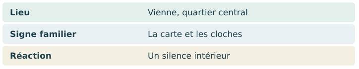

# X · MP-PC · Allemand 2005 — Corrigé guidé

*Corrigé rédigé par IA, non officiel. Signalez toute erreur.*

**Rédaction** · GPT-6.2 Astra Ultra · vitesse non renseignée

**Le retour à Vienne et l’ambivalence du progrès.** La composition de l’École polytechnique et de l’ESPCI comprend une version et une expression écrite, chacune d’une heure et demie, sans dictionnaire. La seconde partie demande deux réponses en allemand.

Ingeborg Bachmann, Das dreißigste Jahr (1961). Étienne Klein, « Science et progrès », La science nous menace-t-elle ? (2003).

## Version · Une patrie devenue étrangère

> [!INDICATION]
> La construction würde suivie d’une série d’infinitifs énumère ce que le voyageur imagine encore à venir. Inneren Stadt désigne le centre de Vienne. Le Graben est une rue centrale, comme le précise la note.

> [!INDICATION]
> Le narrateur passe au présent pour la maxime Es ist niemand erlaubt. Il revient au passé quand il décrit le restaurant. Gardez la cassure entre l’émotion attendue et le silence intérieur, puis le mélange d’excès de zèle et de gêne de la dernière phrase.

Il retournait dans la ville qu’il avait le plus aimée. Il allait à Vienne.

Dans son compartiment, il s’allongea, la tête sur son manteau roulé en boule, et se mit à réfléchir. Sur cette couche, il traverserait l’Europe au roulement du train, se réveillerait en sursaut au milieu de ses rêves, aurait froid à l’approche des montagnes familières, se rappellerait des choses dont le souvenir lui était pénible. Il voulait revenir à son point de départ, car de ce qu’on appelle le monde, il avait assez vu.

Il prit une chambre dans un petit hôtel du centre de Vienne, à proximité de la poste. Jamais encore il n’avait logé à l’hôtel dans cette ville. Il y avait été sous-locataire, avec ou sans accès à la salle de bains, avec ou sans droit de se servir du téléphone. Chez des parents, chez une infirmière qui vivait seule et supportait mal l’odeur de son tabac, chez la veuve d’un général dont il lui avait fallu s’occuper des chats et des cactus quand elle partait en cure.

Pendant deux jours, il fut si indécis qu’il n’osa téléphoner à personne. Personne ne l’attendait. Il avait trop longtemps négligé d’écrire à certains, d’autres n’avaient jamais répondu à ses lettres. Soudain, il sentit que, pour bien des raisons, son retour était impossible. Un mort n’aurait pas davantage eu le droit de revenir. Il n’est permis à personne de reprendre là où l’on s’est arrêté. Il n’y a personne, se dit-il, plus personne qui compte encore sur moi. Il alla manger dans un restaurant où, autrefois, il n’aurait jamais osé mettre les pieds. Il lut la carte avec plus de facilité qu’ailleurs. Il croyait s’émouvoir à chaque appellation singulière dont il avait si longtemps regretté l’absence, mais il n’en était rien. Il reconnut les cloches qui sonnaient midi. Au fond de lui régnait un silence de mort. Sur le Graben, il rencontra des connaissances par hasard, puis d’autres encore. Encouragé par ces coïncidences qui semblaient pleines de sens, il se joignit à tous, avec un empressement excessif, tout embarrassé.

## Première question · Les deux sens du progrès

> [!INDICATION]
> Analysez le déplacement historique. L’espoir des Lumières portait sur une amélioration humaine et politique. Chez Klein, l’efficacité croissante des techniques accroît aussi notre capacité à produire des effets dont la portée nous échappe. La question demande une synthèse en allemand, en environ 120 à 150 mots.

Für Étienne Klein hat das Wort Fortschritt lange zwei Versprechen miteinander verbunden. Wenn Menschen mehr wissen, können sie wirksamer handeln. Daraus schlossen die Denker der Aufklärung, dass eine besser unterrichtete Gesellschaft auch freier und glücklicher werde. Die Hoffnung richtete sich auf eine Zukunft, die Menschen selbst gestalten würden. Heute scheint gerade diese Fähigkeit zur Gestaltung beunruhigend. Die Kernenergie etwa eröffnet eine erhebliche Energiequelle und verbindet sich zugleich mit der Erfahrung einer zerstörerischen Macht. Eine technische Leistung vergrößert also unseren Handlungsspielraum, ohne die Folgen unserer Entscheidungen vollständig vorhersehbar zu machen. Je sicherer unser Alltag geworden ist, desto schwerer fällt es uns zudem, ein verbleibendes Risiko hinzunehmen. Der Fortschritt bezeichnet damit sowohl einen Zuwachs an Können als auch eine Hoffnung auf ein besseres Leben. Ob das eine tatsächlich zum anderen führt, ist für Klein zu einer offenen Frage geworden.

*137 Wörter.*

## Seconde question · Connaître et décider

> [!INDICATION]
> L’avis personnel demandé peut s’appuyer sur une décision concrète. Distinguez ce qu’une comparaison permet de mesurer, la manière de corriger une décision et la question de savoir qui supporte le risque. Le sujet indique environ 180 à 200 mots.

Wissenschaft kann Risiken sichtbar machen, bevor die Schäden so groß werden, dass sie niemand mehr übersehen kann. Wenn eine Stadt zum Beispiel ihre Busse auf einen neuen Antrieb umstellt, lassen sich der Energieverbrauch, die Belastung der Luft und die Folgen für die Beschäftigten untersuchen. Dabei kommt es darauf an, mehrere Möglichkeiten unter vergleichbaren Bedingungen zu prüfen. Einzelne gute Messwerte wären ein schlechter Grund, das gesamte Netz sofort umzustellen.

Wissenschaft hilft außerdem, aus Erfahrungen zu lernen. Eine zunächst kleine Versuchsreihe kann zeigen, ob das Fahrzeug auch im Winter zuverlässig ist. Veröffentlicht die Stadt die Ergebnisse einschließlich der Unsicherheiten, können andere Forscher Fehler entdecken und Fahrgäste nachvollziehen, worauf die Entscheidung beruht. Allerdings lässt sich die Frage, welches Risiko hinnehmbar ist, durch Messungen allein kaum beantworten. Wer neben einem Betriebshof wohnt, trägt womöglich andere Lasten als jemand, der täglich mit einem leiseren Bus fährt.

Deshalb bedeutet Beherrschung für mich, Entscheidungen begründen, überprüfen und nötigenfalls ändern zu können. Dazu gehören Fachwissen, eine öffentliche Diskussion über die Verteilung der Folgen und ein Verfahren, mit dem Betroffene neue Beobachtungen melden können. Das Versprechen völliger Sicherheit wäre dagegen selbst ein Hindernis für einen verantwortlichen Umgang mit technischem Fortschritt.

*191 Wörter.*

L’index historique de l’École polytechnique annonçait deux rapports d’allemand, sur la version et sur l’expression écrite. Aucun des deux PDF n’a été retrouvé.

[Version p. 1](https://web.archive.org/web/20061125010640id_/http://www.imprimerie.polytechnique.fr/EnLignes/Files/05_Version.pdf#page=1) · [Expression écrite p. 1–2](https://web.archive.org/web/20061125010606id_/http://www.imprimerie.polytechnique.fr/EnLignes/Files/05_ExprEcrit.pdf) · [Index historique de la session](https://web.archive.org/web/20090415070752/http://www.polytechnique.fr:80/concours/sujets/sujet05/sujet05.htm) · [Index historique de la session](https://web.archive.org/web/20090415070752/http://www.polytechnique.fr:80/concours/sujets/sujet05/sujet05.htm)
