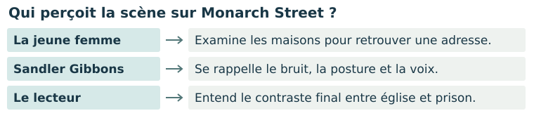
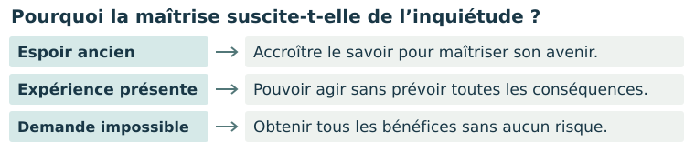
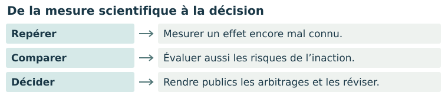

# X · MP-PC · Anglais 2005 — Corrigé brut

*Corrigé rédigé par IA, non officiel. Signalez toute erreur.*

**Rédaction** · GPT-6.2 Astra Ultra · vitesse non renseignée

Les deux cahiers durent chacun une heure trente, sans dictionnaire. La version se rédige en français. Les deux réponses au texte français se rédigent en anglais. Le sujet donne à titre indicatif 120 à 150 mots pour la première et 180 à 200 pour la seconde.

## V. Version française

**Portrait**

Le jour où elle arpenta les rues de Silk, un vent cinglant maintenait la température au plus bas et le soleil avait beau faire, les thermomètres extérieurs ne montaient guère au-dessus de zéro. Des plaques de glace s’étaient formées au bord de l’eau et, plus à l’intérieur des terres, les maisons de bric et de broc de Monarch Street gémissaient comme des chiots. Le verglas miroitait puis s’effaçait dans l’ombre du soir naissant, si bien que les trottoirs sur lesquels elle avançait d’un pas résolu auraient trahi le pied le plus agile, à plus forte raison celui de quelqu’un qui boitait légèrement. Par un temps pareil, elle aurait dû baisser la tête et plisser les yeux, mais, étrangère à la ville, elle examinait chaque maison les yeux écarquillés, à la recherche de l’adresse qui correspondait à celle de l’annonce, le 1, Monarch Street. Elle finit par s’engager dans une allée où Sandler Gibbons, debout sur le seuil de son garage, déchirait la couture d’un sac de produit dégivrant. Il se souvient du claquement de ses talons sur le béton tandis qu’elle s’approchait, de l’inclinaison de sa hanche une fois qu’elle se fut arrêtée, avec, derrière elle, le soleil couleur de melon et, sur son visage, la lumière du garage. Il se souvient du plaisir que lui procura sa voix quand elle lui demanda le chemin de la maison de ces femmes qu’il connaît depuis toujours.

« Vous êtes sûre ? » demanda-t-il quand elle lui eut donné l’adresse.

Elle sortit d’une poche de sa veste un carré de papier qu’elle tint entre ses doigts sans gants le temps de vérifier, puis hocha la tête.

Sandler Gibbons parcourut ses jambes du regard et se dit que ses genoux et ses cuisses devaient la brûler, tant sa minijupe les exposait au froid. Puis il s’émerveilla de la hauteur des talons de ses bottes, de la coupe de sa petite veste en cuir. Au début, il avait cru qu’elle portait un chapeau, quelque chose de volumineux et de duveteux pour lui tenir chaud aux oreilles et au cou. Puis il s’était rendu compte que c’étaient ses cheveux que le vent rabattait vers l’avant, détournant son attention du visage. Il voyait en elle une gentille enfant, à l’ossature délicate, bien élevée mais perdue.

« Les femmes Cosey, dit-il. C’est chez elles que vous voulez aller. Ça fait bien longtemps que c’est plus le numéro un, mais allez donc leur dire. On peut rien leur dire. Le 1410 ou le 1401, sans doute. »

À son tour, elle lui demanda s’il en était sûr.

« Puisque je vous le dis », répondit-il, brusquement irrité. C’était le vent, se dit-il, qui lui faisait pleurer les yeux. « Continuez par là. Vous pouvez pas la rater, à moins de le faire exprès. Grande comme une église. »

Elle le remercia mais ne se retourna pas quand il lui cria dans le dos « Ou comme une prison ! »

## 1. Explain the ambivalence of progress in Étienne Klein’s argument.

Progress once promised a secular form of salvation. Greater knowledge, education and exchange would allow people to control their circumstances, and the future offered hope of a better common life. For Klein, the achievements that sustained this confidence now also undermine it. Nuclear science, for instance, combines intellectual discovery and a major source of energy with an unprecedented capacity for destruction. Modern societies enjoy exceptional security yet demand innovations without any adverse consequences. They fear the future because they can shape it without knowing exactly what shape their actions will give it. Nature itself can consequently appear benevolent beside a technology once expected to deliver humanity from its dangers. The ambiguity lies in the gap between a demonstrable increase in power and an uncertain increase in freedom or happiness.

*129 mots.*

## 2. Can science help control the risks inherent in progress?

Science can help us control risks precisely because a good investigation allows its first conclusions to be challenged. Imagine a city introducing a lighter material for its bridges. Engineers can test how it behaves under repeated loads, compare the results with older materials and inspect the first structures over time. If an unexpected defect appears, a shared record can protect people far beyond the place where it was found. Refusing the innovation would also have consequences if existing bridges were deteriorating.

Yet measurement cannot settle every question the city faces. A small probability of failure may seem acceptable to a contractor and intolerable to residents whose only route to hospital crosses the bridge. People need to know the assumptions behind the estimate, who will pay for inspections and what will happen if early warnings are ignored. Scientists can revise an estimate when evidence changes. They cannot decide on everyone's behalf how benefits and burdens ought to be shared. I would therefore combine independent testing with public decisions that can be reviewed. The goal is to detect and correct mistakes before they become disasters, while acknowledging the uncertainty that remains.

*189 mots.*

La version appartient à Love (2003). Le cahier d’expression reproduit « Science et progrès », extrait de La science nous menace-t-elle ? (2003). Les deux sujets sont conservés par captures d’archives des publications du concours. Les rapports d’anglais 2005 ne figurent pas parmi les pièces retrouvées.

[Cahier de version](https://web.archive.org/web/20061125010640id_/http://www.imprimerie.polytechnique.fr/EnLignes/Files/05_Version.pdf#page=2) · [Cahier d’expression](https://web.archive.org/web/20061125010606id_/http://www.imprimerie.polytechnique.fr/EnLignes/Files/05_ExprEcrit.pdf)
