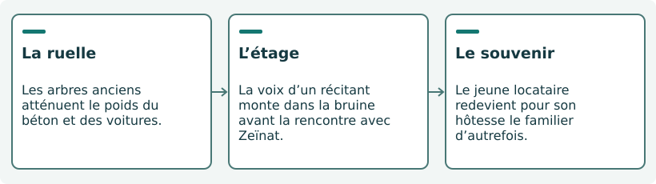

# X · MP-PC · Arabe 2005 — Corrigé guidé

*Corrigé rédigé par IA, non officiel. Signalez toute erreur.*

**Rédaction** · GPT-6.2 Astra Ultra · vitesse non renseignée

La version arabe se trouve page 3 du cahier de versions. Le texte français d’Étienne Klein et les deux questions figurent dans le cahier d’expression écrite commun. Aucun rapport propre à l’écrit arabe de 2005 n’a été retrouvé. Les réponses arabes comptent 128 et 184 mots séparés par des espaces.

## I. Version française

La focalisation est celle du visiteur. Maintenir le présent dans la promenade et l’échange, puis passer à l’imparfait pour les habitudes anciennes. Les arbres et les quatre quartiers situent la promenade parmi les traces de la ville ancienne. Dans la phrase au seuil de la maison, distinguer la bruine continue, la voix du récitant qui arrive de loin, puis le balbutiement du visiteur. Le dialecte égyptien des répliques se rend par un français parlé naturel. Le titre de bey et le ton de la dernière phrase marquent une affection mêlée de fierté.

### Proposition rédigée

**Retour au Caire**

La ruelle s’étire en longueur. Elle a gardé ses vieux arbres malgré les quelques immeubles qui se dressent à la place des anciennes villas. Au cours de mes promenades à pied, j’ai été très heureux de retrouver les arbres dans les quartiers de Dokki, de Mohandessine, de Gizeh et de Zamalek, malgré le béton qui en a envahi les espaces libres. Les immeubles sont neufs. Quelques tilleuls, peupliers et acacias sont encore debout, atténuant un peu l’impression d’entassement que donnent les voitures des deux côtés des rues et des ruelles, le poids des hauts bâtiments serrés les uns contre les autres. La ruelle, pourtant, conserve quelque chose de l’allure campagnarde qui la distinguait dans les années soixante. J’avance à pas lents, accueillant les bruits et le tumulte qui montent de la grande rue. Plus je m’enfonce dans la ruelle, plus je m’approche de cette quiétude devenue impossible dans Le Caire bruyant et tumultueux.

À la lueur d’une veilleuse, j’aperçois l’entrée de la maison à deux étages. Seules les fenêtres du haut sont éclairées. Une pluie fine tombe sans discontinuer ; la voix d’un récitant du Coran me parvient de loin. Une dame qui approche de la soixantaine m’ouvre la porte. Je balbutie :

— S’il vous plaît, je voudrais voir madame Zeïnat.

— Et qui dois-je annoncer, mon garçon ? répond-elle d’une voix tranquille.

— Je suis Mohammed, du Maroc. J’habitais ici il y a vingt ans.

Les traits de madame Zeïnat n’ont guère changé. C’est le même visage rond, les mêmes grands yeux, la silhouette qui a gardé un peu de son embonpoint. Un châle lui enveloppe la tête. Elle porte un pull-over de laine bleu marine et une couverture blanche sur les jambes. Elle est assise sur le canapé, mais la fatigue se lit sur son visage. Après quelques mots échangés, elle se rappelle parfaitement qui j’étais parmi les trois étudiants marocains. C’était moi qui étais chargé de payer le loyer du rez-de-chaussée. Nos conversations étaient mesurées et courtes, parce qu’elle semblait avoir toujours mille choses à faire. Elle donnait ses instructions à la domestique pour le ménage, sortait faire les courses, préparait les repas et recevait les visiteurs. Depuis la disparition de son mari, c’était elle qui dirigeait la maison et veillait sur leur fils. Elle a vite retrouvé avec moi l’attitude que je lui connaissais, avec son accent maternel et sa fierté :

— Tu fais honneur à l’Égypte en venant nous voir ! Ma parole, monsieur Mohammed est devenu un bey et le voilà professeur à l’université ! Quelle belle chose… Et tes camarades, que deviennent-ils ?

Mohammed Berrada, *Comme un été qui ne reviendra pas*, 1999.

## II.1. Analyse du texte commun

Réunir le contraste historique et le paradoxe contemporain. Au XVIIIe siècle, les sciences promettaient une protection contre les catastrophes naturelles. Dans la lecture de Klein, le risque perçu peut désormais naître de nos propres pouvoirs. Le niveau général de sécurité et le sentiment de menace ne varient pas nécessairement ensemble.

### Proposition rédigée

يعرض إتيان كلاين مفارقة تتعلق بالصلة بين اتساع قدرة الإنسان واطمئنانه إلى المستقبل. فبعد زلزال لشبونة علق مفكرو عصر الأنوار أملهم على العلوم لكي يتقوا كوارث الطبيعة. أما اليوم فقد أصبح بعض أسباب الخوف كامنا في الأفعال التي أتاحت لنا المعرفة أن نأتيها. تفتح الطاقة النووية مثلا بابا لإنتاج كميات كبيرة من الكهرباء، فيما تستدعي إمكانات استخدامها المدمر. ولا يرجع التحول في النظرة إلى أن الحاضر أقل أمنا بالضرورة، بل إلى إدراك أن القدرة على تغيير العالم تتقدم أسرع من القدرة على توقع جميع النتائج. لذلك يطالب الناس بابتكار مأمون ونظيف واقتصادي في وقت واحد، مع أن هذه المطالب قد تتعارض. فالتقدم في الوسائل حقيقة قابلة للملاحظة، أما حكمنا بأن هذه الوسائل جعلت الحياة أسعد وأكثر حرية فيظل سؤالا يحتاج إلى معايير لا توفرها زيادة القدرة التقنية وحدها.

## II.2. Réflexion personnelle

Choisir une innovation ordinaire et poser deux questions distinctes. Que peut mesurer un essai ? Qui peut décider que le bénéfice compense les risques pour les personnes concernées ? Cela permet de répondre en son nom avec un exemple précis et une limite argumentée.

### Proposition rédigée

أعتقد أن العلم يستطيع أن يخفض الأخطار التي تولدها بعض الابتكارات، بشرط أن نميز بين اكتشاف الخطر وتحديد ما يقبل به الناس منه. فحين تقرر مدينة استعمال مادة جديدة لعزل المساكن، يستطيع الباحثون قياس استهلاك الطاقة قبل العزل وبعده، ومتابعة جودة الهواء داخل الشقق، وفحص أداء المادة عند انتهاء عمرها. وقد يكشف القياس أن الوفر كبير في نوع من المباني وضئيل في نوع آخر. عندئذ تتغير شروط الاستعمال بناء على دليل، ويصبح من الممكن العدول عن قرار سابق قبل أن تعم آثاره.

لكن القياس لا ينطق باسم جميع السكان. فقد يحصل المالك على معظم الوفر ويتحمل المستأجر كلفة إخلاء البيت، وقد يقع معمل إعادة التدوير قرب حي لا ينتفع أهله من المشروع. من يقرر أن هذه الأعباء موزعة بعدل؟ أرى أن على الخبراء إعلان ما يعرفونه وما بقي غير محسوم، وأن يستمع أصحاب القرار إلى من تقع عليهم التبعات، وأن يتفقوا منذ البداية على موعد لمراجعة النتائج. وهكذا يحمينا العلم من تخمينات يمكن اختبارها، ويساعدنا على تصحيح الطريق إذا أخطأنا. أما وعد الناس بزوال كل احتمال للضرر فيعرض ثقتهم للانهيار عند ظهور أول نتيجة لم تكن متوقعة، ويحول طلب الأمان المعقول إلى مطالبة مستحيلة.

[Sujet](https://web.archive.org/web/20061125010640id_/http://www.imprimerie.polytechnique.fr/EnLignes/Files/05_Version.pdf#page=3) · [Sujet complémentaire](https://web.archive.org/web/20061125010606id_/http://www.imprimerie.polytechnique.fr/EnLignes/Files/05_ExprEcrit.pdf)
