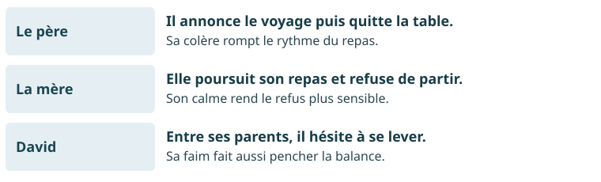

# X–ESPCI · MP-PC · Espagnol 2005 — corrigé brut

*Corrigé rédigé par IA, non officiel. Signalez toute erreur.*

**Rédaction** · GPT-6.2 Astra Ultra · vitesse non renseignée · 25 novembre 2026

Version et expression de 1 h 30 chacune, sans dictionnaire. Réponses en espagnol. Longueurs indicatives : 120 à 150 mots environ, puis 180 à 200 mots environ.

## 1. Version française

**Dispute en famille**

Sans que le moindre signe extérieur permît de conclure à une amélioration de leur situation, le père annonça un jour, à l’improviste :

— Nous allons faire un voyage.

C’était dimanche. Ils étaient à table, il y avait de la soupe de poisson. Il pleuvait. La mère était rentrée de la messe trempée jusqu’aux os. Le père, comme d’habitude, n’était pas allé à l’église. À l’école, David avait communié, joué un match de football dans la cour… Et voilà que son père disait :

— Nous allons faire un voyage.

— Où ça ? demanda la mère sans interrompre son repas.

— Dans le Sud ! s’écria David, en regardant son père de l’autre côté de la table.

Le père s’essuya la bouche avec sa serviette pliée, but un peu de vin et dit :

— Non. Pas dans le Sud. À Madrid.

La mère continua à manger, calme et sérieuse. Sans lever les yeux de son assiette, elle demanda :

— Encore ta sœur ?

— Oui, reconnut le père, avant d’ajouter : c’est, il me semble, une bonne occasion pour David de découvrir Madrid et d’aller voir les seuls cousins qu’il ait.

Sans se départir de son calme, sans hausser le ton, sans s’arrêter de manger, comme si, en s’interrompant, elle risquait de perdre pour de bon la cadence de ses gestes, la mère déclara entre deux bouchées :

— Vous pouvez y aller tous les deux. Moi, je n’irai pas.

Le père se leva et quitta la table. Malgré la crème qu’il y avait pour le dessert. Alors même qu’il avait dit en s’asseyant : « J’ai faim. »

David hésitait. Devait-il le suivre, lui témoigner son soutien dans le dépit que lui causait le rejet que la mère manifestait chaque fois qu’il était question de la sœur de Madrid ? Ou bien rester auprès de la mère, rétablir l’équilibre de la balance que le poids, la force et le prestige du père faisaient pencher tous les jours du même côté ? Et surtout rester pour finir le déjeuner du dimanche, parce que lui, il avait vraiment très faim.

*Josefina R. Aldecoa, Porque éramos jóvenes, Anagrama, 2000.*

## 2. Expression en espagnol

Étienne Klein, *La science nous menace-t-elle ?* (2003), « Science et progrès ». La première question demande de restituer l’argument de l’auteur. La seconde appelle une prise de position.

### 1. ¿Por qué resulta ambivalente la idea de progreso según Étienne Klein?

Para los pensadores que reaccionaron al terremoto de Lisboa, el desarrollo de las ciencias prometía reducir la impotencia humana frente a la naturaleza. Más conocimientos debían permitir nuevas realizaciones técnicas y estas, a su vez, mejorar la vida de todos. La idea de progreso ofrecía así una esperanza colectiva. Hoy sabemos que una misma capacidad puede proporcionar energía o causar daños y que no dominamos todas las consecuencias de nuestros actos. Tememos el futuro precisamente porque tenemos poder para cambiarlo. Además, una sociedad comparativamente segura exige innovaciones sin efectos perjudiciales y tiende a ver en la naturaleza un refugio. Por tanto, avanzar en el conocimiento sigue ampliando nuestras posibilidades, pero no garantiza que el uso de esas posibilidades nos haga más libres ni más felices.

*125 mots.*

### 2. ¿Puede la ciencia contribuir a controlar los riesgos que conlleva el progreso?

La ciencia puede ayudarnos a controlar los riesgos si aceptamos que controlar no significa eliminar toda incertidumbre. Pensemos en una ciudad que decide construir viviendas junto a un río. Los datos sobre lluvias y crecidas permiten estimar qué barrios podrían inundarse. También sirven para comparar varias decisiones, desde conservar una zona sin construir hasta modificar el trazado de una carretera. Una vez terminadas las obras, observar lo que ocurre puede revelar que una protección eficaz en un barrio ha desplazado el riesgo hacia otro. En ese sentido, investigar es tan importante después de innovar como antes.

Sin embargo, los cálculos no deciden por sí solos quién debe pagar la protección o qué hacer con las familias que ya viven allí. Escuchar a los vecinos puede incluso descubrir situaciones que ningún mapa recoge, como la dificultad para salir de casa durante la noche. Me parece más responsable publicar los márgenes de error y explicar cómo se revisará una decisión que prometer una seguridad absoluta. La ciencia contribuye a una acción prudente cuando sus resultados circulan, sus límites se pueden discutir y existe una autoridad dispuesta a corregir el rumbo.

*188 mots.*

## Sources

École polytechnique et École supérieure de physique et de chimie industrielles. Le rapport écrit de cette option reste à retrouver.

[Sujet, p. 4](https://web.archive.org/web/20061125010640id_/http://www.imprimerie.polytechnique.fr/EnLignes/Files/05_Version.pdf#page=4) · [Sujet complémentaire, p. 1–2](https://web.archive.org/web/20061125010606id_/http://www.imprimerie.polytechnique.fr/EnLignes/Files/05_ExprEcrit.pdf)
