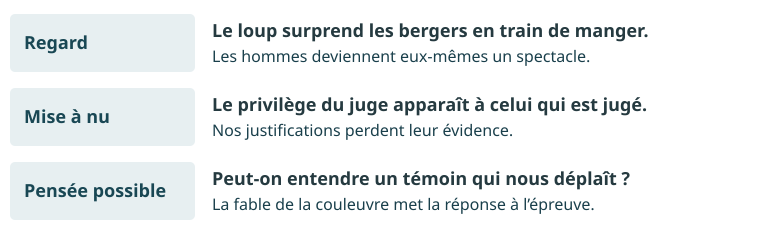

# X · MP-PC · Français 2005 — corrigé guidé

*Corrigé rédigé par IA, non officiel. Signalez toute erreur.*

**Rédaction** · GPT-6.2 Astra Ultra · vitesse non renseignée · 25 novembre 2026

## Sujet et œuvres

Jacques Derrida, dans « L’animal que donc je suis », imagine l’homme nu devant l’animal qui le regarde et suggère que « penser commence peut-être là ». Le sujet invite à apprécier ces propos à partir des livres VII à XI des *Fables*, du *Traité des animaux* et de *La Métamorphose*.

## Suivre le mouvement de la citation

Écrire les sujets des verbes. L’animal regarde. Nous sommes nus. Le verbe « penser » arrive à l’infinitif, accompagné d’un « peut-être ». La question porte sur ce que cette rencontre fait commencer en nous. Une démonstration de l’intelligence des bêtes, même appuyée sur Condillac, laisserait sans réponse le passage décisif par notre propre nudité.

## Distinguer trois niveaux de preuve

Le loup des *Fables* dispose d’une parole que le poète lui a donnée. Son exemple démontre que le déplacement du point de vue rend visible une injustice dans notre manière de juger. Il ne démontre pas à lui seul ce que pense un loup réel. Dans le *Traité des animaux*, une conduite peut recevoir une explication par la sensibilité à partir d’une analogie réglée. La démarche n’a plus le même statut. Chez Kafka enfin, nous suivons les pensées du personnage dont l’entourage ne comprend plus les signes. Le désaccord entre les deux points de vue devient l’objet même du travail demandé au lecteur.

## Préparer une objection qui relance le devoir

Si le regard suffisait à produire la pensée, comment expliquer l’issue de « L’Homme et la Couleuvre » ? L’enquête offre à l’homme des témoignages, mais il dispose aussi du pouvoir de refuser leurs conséquences. Reprendre ensuite le premier adverbe modalisateur de Derrida. « Peut-être » permet de distinguer l’expérience qui ouvre une question de la décision, toujours incertaine, de lui répondre.

Pour contrôler le dernier paragraphe, remplacer « l’homme apprend à connaître l’animal » par une formule dans laquelle l’homme devient aussi l’objet de la connaissance. Ce changement grammatical restitue le mouvement le plus singulier de la citation.

## Dissertation rédigée

Un loup voit des bergers manger un agneau. Dans la situation inverse, il sait quel concert de reproches accompagnerait son repas. Le trait de La Fontaine est plaisant pour le lecteur, beaucoup moins pour les hommes dont il vient de retourner le point de vue. Nous sommes familiers du regard à l’aide duquel nous jugeons les bêtes. Qu’arrive-t-il lorsque l’une d’elles nous aperçoit en train de faire précisément ce que nous condamnons en elle ? Derrida ouvre sa réflexion par ce renversement. L’animal nous regarde, nous nous tenons nus devant lui, et la pensée trouve là un commencement possible. Il ne dit rien de certain sur ce que l’animal voit ou comprend. C’est l’homme, jusqu’alors assuré d’occuper la place de l’observateur, qui perd la protection de cette évidence. Mais suffit-il de s’éprouver exposé pour commencer à penser autrement ? Les fictions de La Fontaine et de Kafka ainsi que le *Traité des animaux* de Condillac permettent de préciser les conditions auxquelles un embarras peut devenir une connaissance.

### Un témoin que nous n’avons pas choisi

Dans « Le Loup et les Bergers », ce que voit le loup a davantage d’importance pour son raisonnement que tout ce que pourraient déclarer les hommes sur leurs intentions. Il lui suffit de les surprendre occupés à manger. Eux qui le désignent comme le prédateur par excellence apparaissent à leur tour sous l’aspect de vivants qui assurent leur subsistance aux dépens d’autres vivants. La nudité qu’évoque Derrida peut s’entendre en ce premier sens. Les bergers n’ont perdu aucun vêtement, aucune capacité de tenir un discours. Ils ont perdu le privilège de choisir eux-mêmes la description sous laquelle leur conduite sera examinée. La fable rend au loup l’occasion d’une comparaison que les catégories employées par les hommes lui refusaient. Ce n’est pas que les deux conduites soient démontrées identiques à tout égard. C’est que la différence de traitement demande désormais des raisons dont on pouvait se passer tant que personne ne retournait la question.

Kafka obtient un déplacement analogue en faisant partager au lecteur la position d’une créature qu’on se cache pour regarder. Gregor, retenu dans sa chambre, écoute les siens et observe leurs gestes. Avant sa métamorphose, il se croyait, en tant que soutien de famille, en mesure de leur éviter une vie de travail. Il découvre les ressources, les inquiétudes et les changements d’attitude que sa présence dans la maison fait apparaître. L’animal ici ne prononce aucune morale. Sa position à l’écart suffit à transformer la maison familiale en scène où les gestes de chacun deviennent observables. Au lecteur d’apercevoir, sous le langage du dévouement ou de la gêne, le rôle tenu par les intérêts et par l’image que l’on veut donner à des étrangers. Une existence que l’on croyait pouvoir tenir hors de la vue publique devient ainsi le poste d’où les convenances domestiques se laissent le mieux examiner.

La portée du regard tient donc à son extériorité. Si le témoin était simplement notre double, il nous fournirait une occasion de nous admirer ou de nous condamner d’avance. Le témoin animal n’a pas souscrit aux raisons avec lesquelles nous réglons nos relations entre humains. À la différence d’un juge en robe, il ne possède même aucun titre qui le rendrait autorisé à nous juger. C’est précisément cela qui fait vaciller notre prétention à juger seuls. Pourquoi penserait-on que la dépendance de la bête ou son incapacité à parler notre langue nous dispense d’expliquer ce que nous lui faisons ?

### Reconnaître l’exposition et résister à la projection

Le danger serait d’échapper à cette question en installant dans le regard animal les pensées qui nous arrangent. Le loup de La Fontaine tire une leçon remarquable de la conduite des bergers. Mais un fabuliste a mis en forme cette leçon pour des lecteurs humains. Nous savons à quoi songe le loup parce que le poème nous le dit, et ce privilège appartient à la fiction. Derrida conserve à l’inverse une grande retenue. Qu’un animal se tourne vers moi et que je me sente soudain démuni ne me révèle pas le contenu exact de sa pensée. Attribuer à tout animal le même regard accusateur ferait aussi peu de place à son existence singulière que lui refuser par principe toute expérience. Le dépouillement exigé de l’observateur concerne aussi l’envie d’interpréter immédiatement ce qui l’a touché.

Condillac fournit ici un moyen de ne pas confondre la prudence avec le silence. L’homme connaît de l’intérieur ce qui se passe pour lui lorsqu’une douleur infléchit une conduite ou qu’un plaisir passé le conduit à chercher de nouveau un objet. Il reconnaît chez des animaux des organes sensibles, des situations et des changements de comportement susceptibles de recevoir une explication analogue. Il devient alors possible de contester la suffisance du modèle mécanique sans prétendre éprouver exactement ce que sent tel animal. L’analogie commence par une expérience que nous possédons effectivement. Elle s’aventure ensuite jusqu’à un autre vivant et doit répondre aux différences qu’il présente. Celui qui pense se découvre ainsi muni d’un corps vulnérable avant de se connaître comme un esprit capable de classer les espèces. Cette mise à nu vaut autant pour ses conditions de connaissance que pour ses habitudes morales.

Elle se heurte cependant à une difficulté mise en scène par *La Métamorphose*. Nous entrons si facilement dans les pensées de Gregor qu’il nous est tentant de résoudre le problème en décidant qu’il est simplement un homme demeuré intact à l’intérieur d’une enveloppe animale. Son goût pour la nourriture a pourtant changé, ses mouvements préférés aussi. Il veut garder les meubles qui portent les souvenirs de son passé et il voudrait pouvoir circuler dans la chambre suivant ses nouveaux besoins. Pour entendre les deux mouvements, il faut veiller à ne pas habiller de nouveau le vivant singulier sitôt qu’on l’a rencontré. Penser à partir de son regard exigera de consentir à ne pas savoir d’avance quelle sorte d’être on va découvrir.

### Quel usage faisons-nous de cette découverte ?

Derrida conserve un « peut-être » que les œuvres permettent enfin de justifier. Dans « L’Homme et la Couleuvre », la bête à laquelle l’homme reproche l’ingratitude retourne contre lui l’accusation. Une enquête s’engage. Les témoignages qui se succèdent pourraient offrir à l’homme une occasion de reconsidérer la façon dont il traite les êtres dont il a reçu les services. Il est donc insuffisant de dire que les animaux ne parlent pas ou que personne n’a réuni les preuves. La fiction a justement levé ces obstacles pour faire paraître une résistance plus profonde. Le puissant peut récuser les témoins à mesure qu’ils lui déplaisent et conserver en pratique le dernier mot. Le regard revenu jusqu’à lui n’aura ouvert aucune pensée si celui qui se sent accusé ne s’intéresse qu’aux moyens de l’écarter.

Chez Kafka, le lecteur a pour sa part reçu plus de chances de comprendre que les personnages. Il sait les efforts de Gregor pour ne pas effrayer sa sœur, sa honte, son intérêt pour la musique. Il voit aussi les fatigues réelles d’une famille que la situation épuise. Être mis ainsi en présence de points de vue incompatibles ne commande pas une absolution générale. Cela oblige à regarder ce qu’on serait tenté de réduire à un trait de caractère, par exemple l’exaspération d’un proche, comme une décision qui engage le sort d’un autre être. La pensée commence à l’endroit très précis où une catégorie qui allait de soi cesse de dispenser de cet examen. Elle laisse une question que l’on peut désormais se poser aussi ailleurs. Qui vit les conséquences de mon jugement sans avoir reçu de moi le pouvoir d’y répondre ?

Ainsi le regard de l’animal peut faire apparaître aux hommes ce qu’ils se cachent sous les vêtements de la supériorité ou de la bonne conscience. Il peut aussi leur faire découvrir la précarité sensible qui les rend eux-mêmes accessibles à d’autres vivants. Il ne fait cependant pas leur travail à leur place. Le commencement probable de la pensée est cet instant où l’observateur démuni de ses premières certitudes accepte encore de rester devant celui qui le regarde.

## Sources

La garde de l’École polytechnique et de l’ESPCI indique MP et PC et quatre heures. L’énoncé d’une page et le rapport de neuf pages sont conservés par des captures de leur publication institutionnelle. Le rapport distingue le regard, la nudité et le commencement possible de la pensée, en mettant en garde contre la réduction au seul problème de l’intelligence animale.

[Sujet](https://web.archive.org/web/20061125011449id_/http://www.imprimerie.polytechnique.fr/EnLignes/Files/05_ComposFranc.pdf) · [Rapport](https://web.archive.org/web/20061125010704id_/http://www.imprimerie.polytechnique.fr/EnLignes/Files/05_ComposFranc_Rap.pdf)
