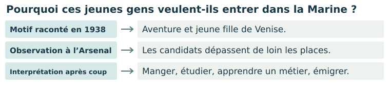
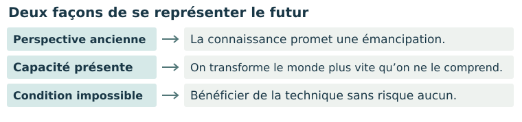
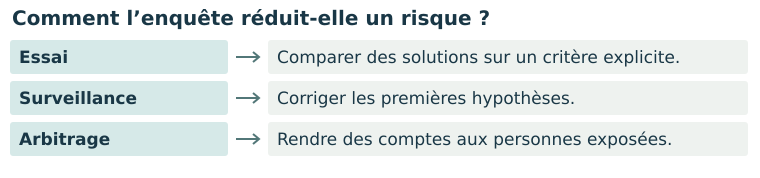

# X · MP-PC · Italien 2005 — Corrigé guidé

*Corrigé rédigé par IA, non officiel. Signalez toute erreur.*

**Rédaction** · GPT-6.2 Astra Ultra · vitesse non renseignée

Les deux cahiers durent chacun une heure trente, sans dictionnaire. La version se rédige en français. Les deux réponses au texte français se rédigent en italien. Le sujet donne à titre indicatif 120 à 150 mots pour la première et 180 à 200 pour la seconde.

## V. Version française

*Quassù* adopte le point de vue du montagnard. *Feci domanda* renvoie à une candidature et *non idonei* aux candidats jugés inaptes. Distinguer le désir d’aventure du jeune homme du savoir social qu’introduit, bien plus tard, *non sapevo pensarlo*.

**Jeunes soldats**

Par goût de l’aventure et parce que j’étais tombé amoureux d’une jeune Vénitienne qui venait passer ses vacances ici, dans la montagne, je demandai, à l’été 1938, à m’engager dans le Corps royal des équipages de la Marine. Je n’avais jamais vu la mer que du haut de mes montagnes, de très loin. La mer que je connaissais était celle des romans de Salgari, de Verne, de Conrad.

À la caserne de l’Arsenal de Venise, après avoir lu d’où je venais et jeté un coup d’œil à mes papiers, on me regarda en retenant un rire. L’un d’eux me demanda « Tu sais nager ? »

J’étais nu devant la commission et mon corps blanc, où le duvet commençait à peine à pousser, leur inspira de la compassion. « Et skier ? me demanda un officier de marine. Allez, rentre chez toi. »

Je restai deux jours à l’Arsenal. Des garçons comme moi, il y en avait beaucoup, beaucoup, beaucoup plus que de places mises au concours par la Marine royale. Nous dormions dans des hamacs, nous mangions à la gamelle et, le soir, empotés et un peu perdus, nous marchions par petits groupes parmi les touristes qui se pressaient sur la Riva degli Schiavoni et la place Saint-Marc.

Le deuxième jour, on fit l’appel des candidats déclarés inaptes et on remit à chacun son billet de train pour rentrer chez lui. On nous paya aussi trois jours de solde.

La commission avait eu l’embarras du choix. Nous étions tous des jeunes de moins de vingt ans, nous venions des provinces de Vénétie et de Lombardie, des montagnes et des lacs, des campagnes et des villes, des villages du bord de mer. Un échantillon de la jeunesse de ce temps-là, des garçons de l’Italie fasciste qui avaient grandi dans les organisations de jeunesse. Je ne savais pas le formuler alors, mais cette affluence au concours était aussi le signe de la misère et de la difficulté à vivre. Entrer dans la Marine, c’était trouver une issue. On réglait la question de la nourriture et des études, on apprenait un métier, on satisfaisait son goût de l’aventure et on faisait le tour du monde. Pour beaucoup, c’était aussi une façon d’émigrer, puisque, par d’autres voies, c’était devenu difficile.

## 1. Spiegare l’ambivalenza del concetto di progresso secondo Étienne Klein.

Poser le couple *potere di agire / capacità di prevedere*. La subordonnée *benché… godano* introduit le paradoxe d’une société à la fois sûre et inquiète. Le résumé doit rester attribuable à Klein.

Per Klein il progresso ha assunto due significati che convivono con difficoltà. Per i pensatori che riponevano le proprie speranze nella scienza, nell’istruzione e negli scambi, il futuro prometteva di liberare l’umanità dai limiti che fino ad allora aveva subito. Oggi la stessa capacità di trasformare il mondo suscita timore, perché gli effetti delle nostre azioni superano la nostra capacità di prevederli. L’energia nucleare riunisce in una sola conquista conoscenze nuove, risorse considerevoli e una potenza distruttiva senza precedenti. Benché godano di una sicurezza storicamente eccezionale, le società moderne esigono tecniche efficaci e prive di conseguenze negative. Perfino la natura può apparire come un bene perduto. In queste condizioni un aumento misurabile delle prestazioni non dimostra da solo che gli uomini siano diventati più liberi o più felici.

*128 mots.*

## 2. La scienza può contribuire a controllare i rischi inerenti al progresso?

Une réponse personnelle peut distinguer les tâches qui relèvent de l’ingénieur et celles qui engagent la collectivité. *Purché* régit le subjonctif. *Un rischio accettabile per chi?* oblige à identifier le groupe exposé.

La scienza può ridurre molti rischi purché si accetti di mettere alla prova le promesse iniziali. Se un comune sceglie un materiale nuovo per un ponte, gli ingegneri possono confrontarlo con quello già in uso, misurarne l’usura e stabilire quali segnali richiedano un’ispezione. I dati raccolti sul primo ponte serviranno anche a chi dovrà progettare il secondo. Un risultato deludente, reso pubblico in tempo, può dunque avere un valore enorme.

Tuttavia la misura di una probabilità non stabilisce automaticamente se il rischio sia accettabile. Per gli abitanti di un quartiere che dipende da quel ponte per raggiungere l’ospedale, una chiusura ha un costo diverso da quello sostenuto da chi può cambiare strada. Occorre anche chiedersi che cosa accadrebbe mantenendo una struttura vecchia: rinunciare a innovare comporta conseguenze che vanno esaminate con la stessa attenzione.

A mio parere la scienza dà il contributo migliore quando confronta alternative reali e rende esplicite le proprie incertezze. Spetta poi alle istituzioni scegliere, ascoltare le persone esposte e prevedere una correzione qualora le osservazioni smentiscano le attese. Una decisione rivedibile è più credibile di una promessa di sicurezza assoluta.

*184 mots.*

La version est extraite de L’ultima partita a carte (2002). Le cahier d’expression reproduit l’extrait d’Étienne Klein et demande deux réponses dans la langue d’inscription. Les deux publications du concours ont été retrouvées dans les archives du Web. Le rapport italien de 2005 reste à retrouver.

[Cahier de version](https://web.archive.org/web/20061125010640id_/http://www.imprimerie.polytechnique.fr/EnLignes/Files/05_Version.pdf#page=5) · [Cahier d’expression](https://web.archive.org/web/20061125010606id_/http://www.imprimerie.polytechnique.fr/EnLignes/Files/05_ExprEcrit.pdf)
