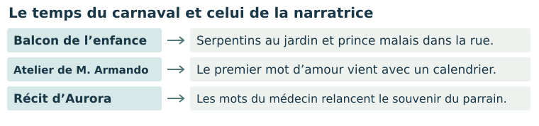
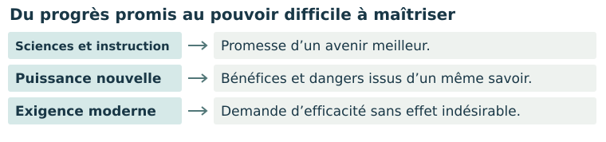
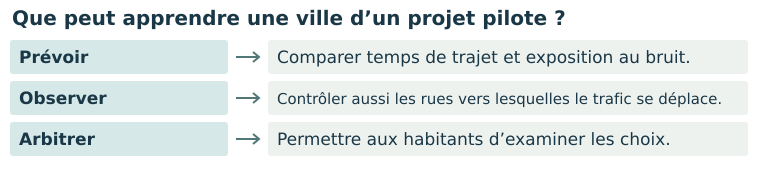

# X · MP-PC · Portugais 2005 — Corrigé brut

*Corrigé rédigé par IA, non officiel. Signalez toute erreur.*

**Rédaction** · GPT-6.2 Astra Ultra · vitesse non renseignée

Les deux cahiers durent chacun une heure trente, sans dictionnaire. La version se rédige en français. Les deux réponses au texte français se rédigent en portugais. Le sujet donne à titre indicatif 120 à 150 mots pour la première et 180 à 200 pour la seconde.

## V. Version française

**La fille du Minho et le Prince**

Au carnaval on me déguisait en fille du Minho et je passais trois jours toute seule au balcon, à lancer vers les arbres du jardin Constantino des serpentins qui se balançaient aux branches jusqu’à ce que la pluie de Pâques les décolore. À l’époque j’étais grosse. Quand, à seize ans, je suis entrée en apprentissage chez monsieur Armando, j’ai cessé d’être grosse et je suis devenue forte. Mon parrain, qui déjeunait avec nous le dimanche pour écouter à la radio la retransmission des matchs de l’Atlético, vu que son poste à lui passait sa vie au clou, et qui aimait se déguiser en femme avec un fichu et du fard à joues, expliquait en montrant le rembourrage de sa poitrine que les dames devaient être spacieuses, bien que le médecin de famille affirme, après m’avoir pesée, que Quatre-vingt-dix kilos, dona Aurora, à cinquante et un ans, je ne voudrais pas vous offenser, mais ça prend peut-être un peu trop de place. Et pourtant, quand j’étais jeune, les hommes préféraient qu’on ne soit pas des espèces de squelettes, et je crois que c’est parce que j’étais forte que Sandokan est tombé amoureux de moi.

Bien sûr il ne s’appelait pas Sandokan, il s’appelait Feliciano, et à l’époque où on me déguisait en fille du Minho on le déguisait, lui, en prince malais, avec un turban à émeraude de verre et des moustaches au bouchon brûlé, et il trottinait sous mon balcon avec ses parents en allant au carnaval de l’Éden. Là, à la fin du numéro des clowns, on lâchait du plafond des dizaines de ballons et des pirates à jambe de bois fourraient sans pitié des confettis dans le cou des fées aux cheveux blonds d’étoupe et à la baguette magique en aggloméré, qui étouffaient à force de pleurer d’humiliation.

À l’époque du costume du Minho il ne m’accordait pas la moindre attention, on n’a jamais vu un Sandokan s’intéresser à des boucles d’oreilles en fer-blanc. Il est tombé amoureux quand je cousais des pantalons chez monsieur Armando, et un après-midi j’ai reçu en cadeau le calendrier du garage Manuel José Palhas Bexiga, carrosserie et peinture, avec la photo d’un petit chien qui ressemblait à celui de ma cousine Alcina, et un billet dans une enveloppe rose qui disait Je vous attends à la mercerie du Marreco. Elle était rue Pascoal de Melo, en face de la brasserie, là où il y a maintenant l’horloger.

*António Lobo Antunes, Livre de chroniques, 1999.*

## 1. Em que consiste a ambivalência da ideia de progresso no texto de Étienne Klein?

Na tradição evocada por Klein, o progresso permitia esperar da ciência e da instrução uma melhoria da condição humana. À esperança de salvação sucedia a confiança num futuro que os próprios homens poderiam construir. O êxito deste projecto, porém, alterou o sentido da promessa. A energia nuclear mostra como o mesmo avanço alarga o conhecimento, cria recursos e multiplica o poder de destruição. Antes receávamos o futuro por termos pouca influência sobre ele; hoje receamo-lo precisamente porque as consequências dos nossos actos escapam em parte à previsão. Embora vivamos em sociedades historicamente protegidas, exigimos técnicas eficazes que nunca produzam efeitos indesejáveis. A ambivalência nasce dessa distância entre o domínio adquirido sobre as coisas e a dificuldade de saber se esse domínio nos tornou mais livres e mais felizes.

*128 mots.*

## 2. Poderá a ciência ajudar a controlar os riscos inerentes ao progresso?

Imagine-se uma cidade que pretende reduzir o ruído e a poluição junto de uma escola. Um novo plano de circulação parece apresentar vantagens evidentes no desenho do engenheiro. Antes de o adoptar definitivamente, seria possível experimentá-lo durante algumas semanas, medir o ar à entrada das aulas e contar os veículos nas ruas vizinhas. O trabalho científico permitiria descobrir se a melhoria junto da escola foi obtida à custa de outra rua onde também vivem crianças. Permitiria ainda comparar o plano com uma alternativa, como aumentar a frequência dos autocarros.

Há, contudo, uma escolha que nenhum aparelho de medição faz. Se os ganhos forem consideráveis para muitos moradores e os encargos pesados para um pequeno bairro, quem decide o que é aceitável? Os habitantes devem conhecer os dados, poder apontar uma falha da experiência e ouvir a justificação de quem assume a decisão.

Por isso considero a ciência indispensável ao controlo dos riscos, desde que os resultados possam contrariar o entusiasmo de quem lançou o projecto. Ela ajuda a distinguir um receio fundado de uma hipótese improvável. Cabe à colectividade decidir que riscos está disposta a correr e garantir que a experiência pode ser corrigida.

*194 mots.*

La version provient du Livro de Crónicas (1999). Les textes d’expression sont écrits en portugais européen, dans la continuité de l’extrait lisboète. Les deux cahiers de l’X et de l’ESPCI ont été retrouvés. Le rapport portugais de 2005 reste à retrouver.

[Cahier de version](https://web.archive.org/web/20061125010640id_/http://www.imprimerie.polytechnique.fr/EnLignes/Files/05_Version.pdf#page=6) · [Cahier d’expression](https://web.archive.org/web/20061125010606id_/http://www.imprimerie.polytechnique.fr/EnLignes/Files/05_ExprEcrit.pdf)
