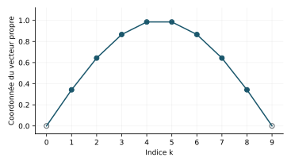

# École polytechnique MP — Deuxième composition de mathématiques 2005 · Corrigé brut

*Corrigé rédigé par IA, non officiel. Signalez toute erreur.*

**Rédaction** · GPT-6.2 Astra Ultra · vitesse non renseignée

**Révision (tour 1)** · GPT-6.2 Astra Ultra · vitesse non renseignée · 26 novembre 2026

Le quotient de Rayleigh permet de lire la valeur propre maximale. Le chemin et le cycle donnent deux modèles explicites ; pour un graphe connexe quelconque, la positivité hors diagonale suffit à caractériser le vecteur propre principal.

## Première partie. Norme et quotient de Rayleigh

### Question 1.a

Par le théorème spectral réel il existe une base orthonormée de vecteurs propres de valeurs $\mu_j$. Pour $x=\sum_j c_j e_j$, $\|Ax\|^2=\sum\mu_j^2 c_j^2\le(\max_j|\mu_j|)^2\|x\|^2$. Un vecteur de base réalisant ce maximum donne l’égalité, donc $\|A\|=\max_j|\mu_j|$.

### Question 1.b

Pour $x\ne0$, $(Ax|x)/\|x\|^2=\sum_j \mu_j c_j^2/\sum_j c_j^2$. Cette moyenne est au plus $\lambda=\max_j\mu_j$ et atteint $\lambda$ sur chaque vecteur propre non nul correspondant.

### Question 1.c

On a $\lambda\|x\|^2-(Ax|x)=\sum_j(\lambda-\mu_j)c_j^2$. L’égalité équivaut à $c_j=0$ pour tout $\mu_j<\lambda$, soit $Ax=\lambda x$. Cela couvre aussi le vecteur nul.

## Deuxième partie. La matrice d’un chemin

### Question 2

Pour une matrice tridiagonale de la classe donnée, $a_{i,i+1}>0$. La première ligne de $Ax=\mu x$ détermine $x_2$ à partir de $x_1$ ; la ligne $i<N$ détermine $x_{i+1}$ à partir de $x_i,x_{i-1}$. L’application $x\mapsto x_1$ est donc injective sur chaque espace propre. Sa dimension est un et la matrice étant symétrique diagonalisable, la multiplicité algébrique est également un.

### Question 3.a

Pour les diagonales $X$ et les doubles sous-diagonales $-1$, on obtient $P_2=X^2-1$ puis $P_3=X(X^2-1)-X=X^3-2X$.

### Question 3.b

Le terme diagonal contribue $XP_{N-1}$. Le seul autre coefficient, situé juste avant la diagonale, laisse un mineur qui se développe avec un unique $-1$, d’où la contribution totale $-P_{N-2}$. Ainsi $P_N=XP_{N-1}-P_{N-2}$ avec $P_0=1,P_1=X$.

### Question 3.c

On a $P_N(0)=-P_{N-2}(0)$, donc zéro pour $N$ impair et $(-1)^{N/2}$ pour $N$ pair. Or $\det A_N=(-1)^NP_N(0)$, soit les mêmes valeurs.

### Question 3.d

À partir de $P_0=1$ et $P_1=X$, on trouve par récurrence $P_N(-X)=(-1)^NP_N(X)$. Le polynôme est donc pair ou impair suivant la parité de $N$.

### Question 4

Avec les conventions $x_0=x_{N+1}=0$, $x_{j+1}=\lambda x_j-x_{j-1}$. Par récurrence, $x_k=P_{k-1}(\lambda)x_1$ pour $1\le k\le N$. En renversant l’ordre des coordonnées on obtient $x_{N-k}=P_k(\lambda)x_N$ pour $0\le k<N$. En particulier les deux coordonnées extrêmes d’un vecteur propre non nul ne s’annulent pas.

### Question 5.a

Pour le vecteur $\mathbf1$, $A_N\mathbf1$ a pour coordonnées extrêmes un et pour les $N-2$ autres deux. On a donc $\|A_N\|^2\ge(2+4(N-2))/N=4-6/N$. D’autre part, pour $1\le j\le N$, $x_k^{(j)}=\sin(jk\pi/(N+1))$ vérifie les deux conditions aux bords et $x_{k-1}^{(j)}+x_{k+1}^{(j)}=2\cos(j\pi/(N+1))x_k^{(j)}$. Ces vecteurs sont non nuls et les $N$ valeurs propres sont distinctes. Elles épuisent le spectre, toutes de module strictement inférieur à deux. La norme carrée est donc strictement inférieure à quatre.

L’indication du sujet donne une autre preuve de la borne stricte. Avec $x_0=x_{N+1}=0$, le développement des carrés fournit
$$4\|x\|^2-\|A_Nx\|^2
=2x_1^2+2x_N^2+\sum_{i=1}^{N}(x_{i-1}-x_{i+1})^2.$$
Si cette somme est nulle, $x_1=0$ et $x_{i+1}=x_{i-1}$ pour tout $i$. Partant de $x_0=x_1=0$, on obtient $x=0$. La différence est donc strictement positive sur la sphère unité compacte et y atteint un minimum positif, ce qui justifie le passage à la norme d’opérateur.

### Question 5.b

Le calcul précédent donne $\|A_N\|=2\cos(\pi/(N+1))$, car les extrêmes du spectre sont opposés et le cosinus décroît sur $[0,\pi]$. De même $\|A_{N-1}\|=2\cos(\pi/N)$, formule qui vaut aussi pour la matrice nulle de taille un. Puisque $\pi/(N+1)<\pi/N$, l’inégalité est stricte.

On peut également comparer les espaces sans utiliser la formule trigonométrique. Prenons un vecteur propre unitaire $v$ de $A_{N-1}$ pour une valeur propre de module $\|A_{N-1}\|$. Sa dernière composante est non nulle par 4 (immédiat si $N=2$). Le vecteur $(v,0)$ est unitaire dans $\mathbb R^N$ et $A_N(v,0)=(A_{N-1}v,v_{N-1})$. Par conséquent $\|A_N\|^2\ge\|A_{N-1}\|^2+|v_{N-1}|^2>\|A_{N-1}\|^2$.

### Question 6

Pour $\lambda_N=2\cos(\pi/(N+1))$, le vecteur de composantes $\sin(k\pi/(N+1))$, $1\le k\le N$, est propre par 5.a. Tous ses angles appartiennent à $(0,\pi)$, donc toutes ses composantes sont strictement positives.

## Troisième partie. Le cycle et la transformation de Fourier discrète

### Question 7.a

Pour $N\ge3$ et $z=e^{ic}$, les lignes intérieures imposent $\lambda=z+z^{-1}$. La première ligne donne $z^N+z^2=\lambda z=1+z^2$, donc $z^N=1$. Cette condition suffit aussi pour la dernière ligne. Ainsi $c\in(2\pi/N)\mathbb Z$ et $\lambda_c=2\cos c$.

Pour $N=2$ les deux voisins coïncident et $E$ est un ensemble de couples : le coefficient hors diagonale indiqué dans l’énoncé vaut un. La matrice échange les deux coordonnées. Il faut $z=\pm1$ (donc encore $c\in\pi\mathbb Z$) et la valeur propre est $z=\cos c$, et non $2\cos c$.

### Question 7.b

Posons $e_j(k)=N^{-1/2}\exp(2\pi ijk/N)$ pour $j=0,\ldots,N-1$ et $k=1,\ldots,N$. Leur produit scalaire est $N^{-1}\sum_{k=1}^N\exp(2\pi i(j-\ell)k/N)$ à conjugaison près selon l’ordre. Il vaut zéro pour $j\ne\ell$ par la somme géométrique et un pour $j=\ell$. Ces $N$ vecteurs propres de 7.a constituent une base orthonormée.

### Question 7.c

Pour $N\ge3$, deux valeurs propres coïncident exactement si leurs indices sont congrus ou opposés modulo $N$. L’index zéro donne la valeur simple $2$. Si $N$ est pair, l’index $N/2$ donne également une valeur simple $-2$. Tous les autres se réunissent par paires et donnent des valeurs de multiplicité deux. Pour $N=2$, les deux valeurs $1,-1$ sont simples.

### Question 8.a

Pour $\alpha=e^{2\pi i/N}$, la matrice $N^{-1/2}(\alpha^{-pq})_{0\le p,q<N}$ a des colonnes orthonormées par la même somme géométrique. Elle est donc unitaire et son inverse est l’adjointe : $(\Phi^{-1}h)(q)=N^{-1/2}\sum_{p=0}^{N-1}\alpha^{pq}h(p)$.

### Question 8.b

Les deux changements $s=q\mp1$ dans la formule de $\Phi\Psi f$ donnent les facteurs $\alpha^{-p}$ et $\alpha^p$, les sommes restant prises sur une période. Ainsi $(\Omega h)(p)=(\alpha^p+\alpha^{-p})h(p)=2\cos(2\pi p/N)h(p)$.

### Question 8.c

Les fonctions indicatrices des classes $p$ sont une base orthonormée propre de $\Omega$. Par l’unitaire $\Phi^{-1}$, elles donnent une base orthonormée propre de $\Psi$, avec coordonnées $N^{-1/2}\alpha^{pq}$. Pour $N\ge3$, $\Psi$ est exactement l’adjacence du cycle. Pour $N=2$, $\Psi=2A$ car les deux translations coïncident, donc la même base diagonalise encore $A$.

## Quatrième partie. Matrices de graphe connexe

### Question 9

Pour $x\in E_\lambda$, posons $y=|x|$. Les termes diagonaux de $(Ay|y)$ et $(Ax|x)$ coïncident ; les termes hors diagonale sont majorés lorsqu’on remplace $x_ix_j$ par $|x_i||x_j|$, puisque $a_{ij}\ge0$ pour $i\ne j$. Donc $(Ay|y)\ge\lambda\|x\|^2=\lambda\|y\|^2$. La borne inverse vient de 1.b. Par 1.c, $y\in E_\lambda$.

### Question 10.a

Comme $x$ est non nul et positif ou nul, un indice $j$ a $x_j>0$. Par (C), partons de l’indice $i_0$ nul et suivons un chemin vers $j$. Au premier passage d’une valeur nulle à une valeur positive, les indices consécutifs $u,v$ satisfont exactement les conditions requises.

### Question 10.b

On a $x_\varepsilon=x+\varepsilon e_u$, $\|x_\varepsilon\|^2=\|x\|^2+\varepsilon^2$ et $(Ax_\varepsilon|x_\varepsilon)=(Ax|x)+2\varepsilon(Ax)_u+\varepsilon^2a_{uu}$. Or $(Ax)_u=\sum_{j\ne u}a_{uj}x_j\ge a_{uv}x_v>0$. La différence entre le quotient perturbé et $\lambda$ a donc pour numérateur $2\varepsilon(Ax)_u+\varepsilon^2(a_{uu}-\lambda)$, strictement positif pour $\varepsilon>0$ assez petit, et pour dénominateur $\|x\|^2+\varepsilon^2>0$.

Posons $S=\sum_{j\ne u}a_{uj}x_j>0$. Si $a_{uu}<\lambda$, tout $0<\varepsilon<2S/(\lambda-a_{uu})$ rend le numérateur strictement positif. Si $a_{uu}\ge\lambda$, tout $\varepsilon>0$ convient. Le contrôle porte sur le quotient normalisé, même si les coefficients diagonaux de $A$ ont un signe quelconque.

### Question 10.c

Ce quotient strictement supérieur à $\lambda$ contredit 1.b. Un vecteur propre non nul à coordonnées positives ou nulles pour $\lambda$ n’a donc aucune coordonnée nulle.

### Question 11

Un vecteur propre réel non nul existe par symétrie. Son module coordonnée par coordonnée reste propre par 9 et devient strictement positif par 10.c. Notons-le $v$. Pour tout autre $w\in E_\lambda$, $z=w-(w_1/v_1)v$ est propre ou nul et sa première coordonnée est nulle. S’il était non nul, $|z|$ serait propre, non nul, positif ou nul et à première coordonnée nulle, contradiction. Ainsi $w$ est multiple de $v$. L’espace propre est une droite engendrée par un vecteur strictement positif.
