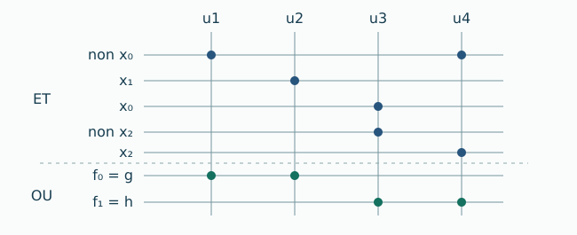

# X · MP · Informatique (option) 2005 — Corrigé brut

*Corrigé rédigé par IA, non officiel. Signalez toute erreur.*

**Rédaction** · GPT-6.2 Astra Ultra · vitesse non renseignée

Épreuve de quatre heures. Les bits sont numérotés du moins significatif au plus significatif. Le code OCaml emploie les opérateurs bit à bit et le type de circuit du sujet. Aucun rapport de jury propre à la session n’a été retrouvé.

## I. Génération de circuits PLA

### 1. Reconnaître une puissance de deux

Si $x>0$ finit par un 1 suivi de $k$ zéros, $x-1$ remplace cette terminaison par un 0 suivi de $k$ uns. Le préfixe supérieur est conservé. Par conséquent $x\mathbin{\wedge}(x-1)$ efface exactement le plus petit bit à 1 de $x$. Il vaut zéro si et seulement si $x$ avait un seul 1, donc si $x=2^k$.

### 2. Distance de Hamming égale à un

```ocaml
let aDistUn x y =
  let z = x lxor y in z<>0 && z land (z-1)=0
```

Le test $z\ne0$ distingue la distance zéro. Le coût est constant selon le modèle des entiers à 30 bits du sujet.

### 3. Les quatre mintermes de $h$

$$h=x_0\bar x_1\bar x_2\;\lor\;x_0 x_1\bar x_2\;\lor\;\bar x_0\bar x_1 x_2\;\lor\;\bar x_0 x_1 x_2.$$

### 4. Réduction de $h$

Chaque paire contient le facteur $x_1\lor\bar x_1=1$. Ainsi $h=x_0\bar x_2\lor\bar x_0x_2=x_0\oplus x_2$. Un seul produit ne suffit pas. Celui qui couvrirait les affectations $(x_0,x_2)=(0,1),(1,0)$ devrait omettre les deux variables et accepterait aussi $(0,0)$.

### 5. Unifier deux produits

```ocaml
type produit = {v:int; m:int}
type somme = produit list
type fnd = somme list

let varEliminable p q = p.m=q.m && aDistUn p.v q.v

let unifier p q =
  let diff = p.v lxor q.v in
  {v=p.v land q.v; m=p.m lxor diff}
```

Sous la précondition d’unification, `diff` est le bit du littéral supprimé. Toutes les autres positions sont identiques et les valeurs restent nulles hors masque. Les deux fonctions coûtent $O(1)$.

### 6. Supprimer les doublons

```ocaml
let compare_produit p q =
  let c = compare p.m q.m in if c<>0 then c else compare p.v q.v

let unique a = List.sort_uniq compare_produit a
```

Une disjonction peut être réordonnée. Le coût est $O(1+\ell\log(1+\ell))$ pour $\ell$ termes.

### 7. Nouveaux produits d’une somme

```ocaml
let nouveauxProduits a =
  let rec paires acc = function
    | [] -> unique acc
    | p::suite ->
        let acc = List.fold_left (fun l q ->
          if varEliminable p q then unifier p q::l else l) acc suite in
        paires acc suite
  in paires [] a
```

Tous les couples sont essayés une fois et les résultats identiques fusionnés. Pour $t$ résultats avant dédoublonnage, le coût est $O(1+\ell^2+t\log(1+t))$, en particulier $O(1+\ell^2\log(2+\ell))$.

### 8. Couches successives pour $h$

On obtient $a_0=\{100,110,001,011\}$, puis $a_1=\{1\text{-}0,0\text{-}1\}$ et $a_2=\varnothing$. Les deux termes de $a_1$ diffèrent à deux positions et ne s’unifient pas. L’ordre à l’intérieur d’une couche est indifférent.

### 9. Développer les couches

```ocaml
let developper a =
  let rec boucle couches courant =
    if courant=[] then couches else
    boucle (courant::couches) (nouveauxProduits courant)
  in boucle [] (unique a)
```

Une fusion élimine exactement un littéral. Il y a au plus $n+1$ couches non vides. Même la dernière est testée pour découvrir l’arrêt. Si $a_0$ est déjà une liste de produits distincts comme au départ du cahier, le coût est $O(1+\sum_{i=0}^k(1+\ell_i^2\log(2+\ell_i)))$. La fonction constamment fausse donne la liste vide.

### 10. Couverture d’un produit

```ocaml
let couvertPar p q =
  p.m<>q.m && p.m land q.m=q.m && p.v land q.m=q.v
```

Il s’agit ici de la couverture stricte définie par une ou plusieurs éliminations. L’inclusion des masques et l’accord des valeurs sont nécessaires et suffisants. Le coût est $O(1)$.

### 11. Réduire une forme disjonctive

```ocaml
let reduire couches =
  let toutes = List.concat couches in
  List.filter_map (fun couche ->
    let gardes = List.filter (fun p ->
      not (List.exists (fun q -> couvertPar p q) toutes)) (unique couche) in
    if gardes=[] then None else Some gardes) couches
```

Toute affectation qui vérifiait un terme supprimé satisfait un terme conservé, car les chaînes de couverture strictes sont finies. Réciproquement chaque terme conservé figurait dans la forme initiale. Avec $L=\sum\ell_i$, le coût est $O(1+L^2)$ pour les couches non vides de 9. Cette réduction conserve les implicants maximaux. Une couverture de cardinal minimal peut en retenir moins.

### 12. Borne en fonction du nombre d’entrées

Il existe $3^n$ produits possibles. Chaque produit distinct n’apparaît qu’à la profondeur correspondant à son nombre de littéraux absents, donc $L\le3^n$. Le développement coûte $O(1+L^2\log(2+L))$, la réduction $O(1+L^2)$. En incluant l’examen de la table initiale de $2^n$ entrées, une borne uniforme est $O(n\,9^n)$ pour $n\ge1$.

### 13.a. Deux plans logiques et exemple

On rend chaque entrée disponible directement et après inversion. Une porte ET connectée aux littéraux de sa colonne calcule un produit. Chaque sortie est le OU des colonnes sélectionnées dans sa ligne. Pour $g=\bar x_0\lor x_1$ et $h=x_0\bar x_2\lor\bar x_0x_2$, prendre $u_1=\bar x_0$, $u_2=x_1$, $u_3=x_0\bar x_2$, $u_4=\bar x_0x_2$. La première sortie réunit $u_1,u_2$, la seconde $u_3,u_4$.



### 13.b. Largeur et surface

Si $P_j$ est l’ensemble des produits choisis pour la sortie $j$, la largeur logique est $k=|\bigcup_{j=0}^{m-1}P_j|$, ici 4. À pas de câblage constant la surface des deux plans est de l’ordre de $k(2n+m)$ quand les deux polarités disposent chacune d’une ligne. Fusionner les doublons, retirer les termes couverts puis choisir des couvertures avec des produits communs peut diminuer $k$. Il est parfois préférable de choisir conjointement les couvertures des sorties.

## II. Génération de circuits combinatoires

### 14. Somme et retenue d’un étage

```ocaml
type circuit = Bit of int | Et of circuit*circuit
             | Ou of circuit*circuit | Non of circuit
type mot = circuit array

let oux x y = Ou (Et (x,Non y),Et (Non x,y))
let bitAdd x y r = oux (oux x y) r
let bitRetenue x y r = Ou (Et (x,y),Et (Ou (x,y),r))
```

Si $x=y=1$, l’étage engendre une retenue. Si une seule des deux entrées vaut 1, il transmet $r$. Les deux résultats vérifient $x+y+r=s+2c$.

### 15. Additionneur série

```ocaml
let addSerie x y =
  let n = Array.length x in
  let z = Array.make (n+1) (Bit 0) and r = ref (Bit 0) in
  for i=0 to n-1 do
    z.(i) <- bitAdd x.(i) y.(i) !r;
    r := bitRetenue x.(i) y.(i) !r
  done;
  z.(n) <- !r; z
```

L’invariant après $i$ étages est que les $i$ sorties de poids faible et la retenue de poids $2^i$ représentent la somme des deux préfixes. La propagation traverse $n$ étages d’un nombre constant de portes. Le délai et le nombre de portes câblées sont $\Theta(n)$. Une retenue déjà construite peut alimenter la sortie locale et l’étage suivant par deux fils.

### 16. Multiplexeur de mots

```ocaml
let mux s x y =
  let ns = Non s in
  Array.mapi (fun i a -> Ou (Et (s,a),Et (ns,y.(i)))) x
```

Pour $s=1$, seul $x_i$ est transmis ; pour $s=0$, seul $y_i$ l’est. La couche de sélection a une profondeur constante.

### 17. Additionneur parallèle par anticipation des deux cas

```ocaml
let rec addPar x y r =
  let n = Array.length x in
  if n=1 then [|bitAdd x.(0) y.(0) r;bitRetenue x.(0) y.(0) r|]
  else
    let b = n/2 in
    let bas a = Array.sub a 0 b and haut a = Array.sub a b (n-b) in
    let xb = bas x and yb = bas y and xh = haut x and yh = haut y in
    let somme_b = addPar xb yb r in
    let haut0 = addPar xh yh (Bit 0) in
    let haut1 = addPar xh yh (Bit 1) in
    let somme_h = mux somme_b.(b) haut1 haut0 in
    Array.append (Array.sub somme_b 0 b) somme_h
```

Pour $n>0$, les deux moitiés ont des longueurs positives sauf au cas de base. La sortie garde les $b$ bits bas et les $n-b+1$ bits hauts sélectionnés. Les trois sous-circuits s’évaluent simultanément. La profondeur vérifie $D(n)\le D(\lceil n/2\rceil)+O(1)$ et vaut $\Theta(\log(n+1))$. Pour $n=2^k$, le nombre de portes vérifie $S(n)=3S(n/2)+\Theta(n)$, soit $\Theta(n^{\log_2 3})$. L’encadrement des tailles entre puissances de deux donne le même ordre en général. On compte les portes construites et câblées avec leurs fils de sortie, sans chercher à identifier d’autres sous-circuits équivalents. Le temps d’évaluation parallèle se mesure par la hauteur, indépendamment du temps séquentiel utilisé par OCaml pour construire la description.

### 18. Comparaison avec un PLA

Un PLA présente une structure régulière, programmable et de profondeur logique constante dans le modèle où ET et OU ont un nombre arbitraire d’entrées. Sa largeur peut cependant être exponentielle pour l’addition. Fixons la retenue entrante à zéro. Pour chacune des $2^n-1$ paires $(x,2^n-x)$, $1\le x<2^n$, la retenue sortante vaut 1, mais éteindre un de ses bits d’entrée à 1 fait repasser la somme sous $2^n$. Un produit vrai sur cette affectation et impliquant la retenue doit donc imposer **tous** ses bits à 1. Il ne peut couvrir une autre de ces affectations minimales, car elles sont incomparables par inclusion des bits à 1. La seule retenue nécessite ainsi au moins $2^n-1$ colonnes. Les additionneurs structurés utilisent un nombre polynomial de portes à deux entrées, au prix d’une profondeur linéaire ou logarithmique.

[Sujet](https://www.wikiprepa.fr/concours/data/x_option-info_mp_2005.pdf) · [Autre exemplaire](https://www.doc-solus.fr/prepa/sci/adc/pdf/enonces.pdf/2005/MP_INFO_X_1_2005.enonce.pdf)
