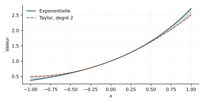

# École polytechnique MP — Première composition de mathématiques 2005 · Corrigé brut

*Corrigé rédigé par IA, non officiel. Signalez toute erreur.*

**Rédaction** · GPT-6.2 Astra Ultra · vitesse non renseignée

**Révision** · GPT-6.2 Astra Ultra · vitesse non renseignée

Les opérateurs de multiplication par la variable et de division d’un accroissement servent à retrouver la formule de Taylor et les noyaux des opérateurs transposés sur les formes linéaires continues.

## Première partie. Multiplication et division par la variable

### Question 1

Pour $0\le k\le p$, la norme uniforme de $(X^p)^{(k)}$ vaut $p!/(p-k)!$, atteinte en $x=1$. Pour $k>p$ elle est nulle. Les valeurs non nulles croissent au sens large avec $k$, donc $\pi_n(X^p)=p!/(p-\min(n,p))!$, valable aussi pour $p=0$.

### Question 2.a

Le produit $xf(x)$ est $C^n$ et, pour $1\le k\le n$, $(A_nf)^{(k)}=xf^{(k)}+kf^{(k-1)}$. Pour $0\le k\le n-1$, $(B_ng)^{(k)}(x)=\int_0^1 t^kg^{(k+1)}(xt)\,dt$. Les dérivées sous l’intégrale sont continues sur le rectangle compact et dominées par $\pi_n(g)$, ce qui justifie les dérivations et la continuité.

### Question 2.b

La linéarité découle des formules. Par 2.a, $\pi_n(A_nf)\le(n+1)\pi_n(f)$. Pour $f(x)=e^{x-1}$, toutes les dérivées ont norme un ; en $x=1$ la dérivée d’ordre $n$ de $xf$ vaut $n+1$ (également pour $n=0$). Donc $\|A_n\|=n+1$. On a aussi $\|(B_ng)^{(k)}\|\le\pi_n(g)/(k+1)$, donc $\|B_n\|\le1$. Pour $g=X$, $B_ng=1$ et $\pi_n(g)=1$, donc égalité. Ces bornes assurent la continuité.

### Question 3

Le théorème fondamental donne $B_ng(x)=(g(x)-g(0))/x$ pour $x\ne0$, et $B_ng(0)=g'(0)$. Ainsi $B_nA_nf=f$ comme élément de $E_{n-1}$ et $A_{n-1}B_ng=g-g(0)$, aussi en zéro par continuité.

### Question 4.a

Si $g=xf$ avec $f$ continue, $g(0)=0$ et $g(x)/x\to f(0)$. Réciproquement, si $g(0)=0$ et ce quotient a une limite finie, le prolonger en zéro par cette limite donne $f\in E_0$ avec $A_0f=g$. Ainsi $\operatorname{Im}A_0=F_0$.

### Question 4.b

Si $g=xf$ avec $f\in C^n$, $g(0)=0$ et $g^{(n)}(x)=xf^{(n)}(x)+nf^{(n-1)}(x)$. Le quotient $(g^{(n)}(x)-g^{(n)}(0))/x$ tend vers $(n+1)f^{(n)}(0)$. Cela prouve l’inclusion.

### Question 4.c

Pour $g\in F_n$, posons $L=\lim_{s\to0}(g^{(n)}(s)-g^{(n)}(0))/s$ et prolongeons ce quotient en zéro par $L$ sous le nom $h(s)$. Pour $x\ne0$, $f=B_ng=g(x)/x$ est bien $C^n$. Par 2.a,
$$\frac{f^{(n-1)}(x)-f^{(n-1)}(0)}x=\int_0^1 t^n h(xt)\,dt\longrightarrow\frac{L}{n+1}.$$
La convergence est uniforme dans l’intégrande puisque $|xt|\le |x|$ et $h$ est continue en zéro. Ainsi $f^{(n)}(0)$ existe et vaut $L/(n+1)$.

### Question 4.d

Pour $x\ne0$, l’identité $g^{(n)}=xf^{(n)}+nf^{(n-1)}$ donne, puisque $g^{(n)}(0)=nf^{(n-1)}(0)$ par 2.a,
$$f^{(n)}(x)=h(x)-n\frac{f^{(n-1)}(x)-f^{(n-1)}(0)}x\longrightarrow L-nL/(n+1)=f^{(n)}(0).$$
On a donc $f\in E_n$ et $g=A_nf$ partout, puisque $g(0)=0$. Avec 4.b, $\operatorname{Im}A_n=F_n$.

L’identité utilisée en zéro se lit directement sur l’intégrale définissant $B_n$. Pour $x=0$, $f^{(n-1)}(0)=g^{(n)}(0)\int_0^1t^{n-1}\,dt=g^{(n)}(0)/n$. Cette étape évite de supposer à l’avance la continuité de $f^{(n)}$.

## Deuxième partie. L’espace des fonctions lisses

### Question 5.a

Pour $s,t\ge0$, $h(t)=t/(1+t)$ est croissante et $h(s+t)=s/(1+s+t)+t/(1+s+t)\le h(s)+h(t)$. Appliquons cela à l’inégalité triangulaire pour chaque $\pi_n$, multiplions par $2^{-n}$ puis sommons. La série est bien définie car $0\le h\le1$.

### Question 5.b

Si $\delta(f_i-f)\to0$, chaque $2^{-n}h(\pi_n(f_i-f))$ tend vers zéro et donc $\pi_n(f_i-f)\to0$, ce qui implique la convergence uniforme de la dérivée d’ordre $n$. Réciproquement, la convergence uniforme de chaque dérivée impose $\pi_n(f_i-f)\to0$ pour chaque $n$ car c’est un maximum fini. Dans la série définissant $\delta$, la queue à partir de $N$ est au plus $\sum_{n\ge N}2^{-n}$ uniformément en $i$, et la somme finie précédente tend vers zéro. D’où l’équivalence.

### Question 5.c

La fonction $2\delta$ vérifie la même inégalité triangulaire et a les mêmes suites convergentes vers zéro, tout en étant différente de $\delta$ sur toute fonction non nulle.

### Question 6.a

Pour $x\ne0$, $Bg(x)=(g(x)-g(0))/x$ et pour $x=0$, $Bg(0)=g'(0)$. Donc $ABg=g-g(0)$ et $BAf=f$ partout, avec $A,B$ agissant sur $E$.

### Question 6.b

Comme $BA=I$, $A$ est injectif et $B$ surjectif. De plus $Bg=0$ équivaut à $g$ constante par 6.a (et toute constante est annulée). L’image de $A$ est l’ensemble des fonctions nulles en zéro : l’inclusion directe est évidente et pour une telle $g$, $g=ABg$.

### Question 7.a

Pour $n=1$, $\varphi_1=1$. Supposons $B^ng(x)=\int_0^1\varphi_n(t)g^{(n)}(xt)dt$. En appliquant $B$ après dérivation sous l’intégrale, on obtient $\int_0^1\int_0^1\varphi_n(t)t g^{(n+1)}(xut)\,dt\,du$. Pour $t>0$, le changement $v=ut$ absorbe le facteur $t$ ; Fubini sur $0\le v\le t\le1$ donne $\varphi_{n+1}(v)=\int_v^1\varphi_n(t)dt$. D’où $\varphi_n(t)=(1-t)^{n-1}/(n-1)!$. Sur le carré, les fonctions sont continues et bornées, ce qui justifie les échanges.

### Question 7.b

La formule de 7.a donne $(B^ng)(0)=g^{(n)}(0)\int_0^1\varphi_n(t)dt=g^{(n)}(0)/n!$.

### Question 7.c

Pour $n=1$ l’identité est 6.a. En général $A^{n+1}B^{n+1}g=A^n(AB)(B^n g)=A^nB^n g-x^n(B^ng)(0)$. Par 7.b et par récurrence,
$$A^nB^ng=g-P_{n-1},\qquad P_{n-1}(x)=\sum_{j=0}^{n-1}g^{(j)}(0)x^j/j!.$$
L’identité est valable sur tout $[-1,1]$.

### Question 7.d

Les questions 7.a et 7.c donnent
$$g(x)=P_{n-1}(x)+\frac{x^n}{(n-1)!}\int_0^1(1-t)^{n-1}g^{(n)}(xt)dt.$$
Pour $x\ne0$, le changement $s=xt$ donne le reste $\int_0^x (x-s)^{n-1}g^{(n)}(s)ds/(n-1)!$ avec intégrale orientée si $x<0$. Pour $x=0$ le reste est nul.

### Question 8

L’image de $A^n$ contient exactement les $g$ dont les dérivées d’ordres $0,\ldots,n-1$ s’annulent en zéro. La nécessité vient de $g=x^nf$, la suffisance de 7.c avec $P_{n-1}=0$. Si $B^n g=0$, 7.c donne $g=P_{n-1}$. Réciproquement tout polynôme de degré $<n$ a dérivée $n$-ième nulle et est annulé par 7.a. Donc $\ker B^n=\mathbb C_{n-1}[X]$ pour $n\ge1$.

## Troisième partie. Opérateurs sur le dual continu

### Question 9

Si $f_i\to f$ pour $\delta$, toutes les $\pi_n(f_i-f)$ tendent vers zéro par 5.b. Or $\pi_n(Ah)\le(n+1)\pi_n(h)$ et $\pi_n(Bh)\le\pi_{n+1}(h)$ par 2.b. Donc $Af_i\to Af$ et $Bf_i\to Bf$ pour $\delta$. Toute forme $\varphi\in E'$ conserve ces limites ; les deux compositions sont linéaires et appartiennent à $E'$.

### Question 10

Comme $B^nA^n=I$, on a $(A')^n(B')^n=I$ sur $E'$. Donc $\operatorname{Im}(A')^n=E'$ et $\ker(B')^n=0$. Une forme est dans $\ker(A')^n$ exactement si elle s’annule sur les fonctions divisibles par $x^n$. Par 7.c, elle est alors déterminée par ses valeurs sur $1,X,\dots,X^{n-1}$ et s’écrit $\sum_{j<n}\varphi(X^j)\varphi_{0;j}/j!$. Ces évaluations sont continues par 5.b et annulent l’image en question par 8. Elles sont indépendantes en les testant sur $X^j/j!$. Elles forment la base demandée.

Pour vérifier la normalisation, $\varphi_{0;i}(X^j/j!)$ vaut $1$ si $i=j$ et $0$ sinon. Pour $i<j$ il reste en zéro une puissance strictement positive de $X$, et pour $i>j$ la dérivée est identiquement nulle.

### Question 11

Par Leibniz, $(x^n f)^{(n)}(0)=n!f(0)$. Une solution particulière est donc $\varphi_{0;n}/n!$. Toutes les solutions sont
$$\psi=\varphi_{0;n}/n!+\sum_{j=0}^{n-1}c_j\varphi_{0;j},\quad c_j\in\mathbb C,$$
par la description du noyau en 10.

### Question 12

Chaque noyau individuel est inclus dans celui du produit par commutation. Réciproquement, raisonnons par récurrence. Si $V=U_1\cdots U_{r-1}$ et $VU_rx=0$, alors $Vx\in\ker U_r$. Chaque $U_i$ pour $i<r$ est surjectif sur $\ker U_r$ par hypothèse, donc leur produit aussi. Il existe $y\in\ker U_r$ avec $Vy=Vx$. Alors $x-y\in\ker V$, qui est par récurrence la somme des $r-1$ premiers noyaux. On retrouve ainsi la somme annoncée.

### Question 13.a

Pour chaque $n$, les dérivées du polynôme $Q$ sont bornées sur $[-1,1]$ et Leibniz donne $\pi_n(Qh)\le C_{Q,n}\pi_n(h)$. Par 5.b, $h\mapsto Qh$ conserve les limites pour $\delta$. La composition de $\varphi$ avec cet opérateur est donc linéaire et continue au sens donné.

### Question 13.b

Supposons $Q\ne0$. Les facteurs $x-\beta$ dont la racine est hors de $[-1,1]$ ont un inverse lisse sur cet intervalle. Ils induisent des automorphismes du dual (Leibniz pour la multiplication par l’inverse). Pour les racines distinctes $a$ dans l’intervalle, de multiplicités $m_a$, les opérateurs $(T'_a)^{m_a}$ sont surjectifs par le résultat admis. Donc $T'_Q$ est surjectif et son image est $E'$.

Le noyau est engendré par les $\varphi_{a;j}$ pour $0\le j<m_a$. En effet, sur les jets au point $a$, multiplier par $(x-b)^{m_b}$ avec $a\ne b$ donne par Leibniz une matrice triangulaire de diagonale $(a-b)^{m_b}\ne0$. Cela vérifie la condition de 12 sur chacun des noyaux et donne la somme. Les familles sont indépendantes ensemble : pour les tester à un point $a$, prendre une fonction égale à $(x-a)^k/k!$ près de $a$, nulle près des autres racines, en utilisant une coupure lisse ; ses jets aux racines isolent le coefficient voulu. Ceci vaut également aux extrémités de l’intervalle. S’il n’y a aucune racine dans l’intervalle, le noyau est nul. Pour le polynôme identiquement nul, l’image est $\{0\}$ et le noyau est $E'$ tout entier : toute base algébrique de cet espace est alors une base du noyau.

Par exemple, pour $Q(X)=(X-a)^2(X-b)$ avec $a,b\in[-1,1]$ distincts, le noyau a pour base l’évaluation en $a$, l’évaluation de la dérivée en $a$ et l’évaluation en $b$. Les multiplicités comptent donc les ordres de dérivation à conserver, y compris pour une racine située au bord.
