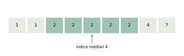
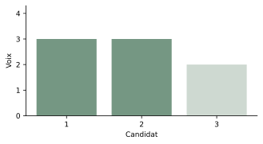
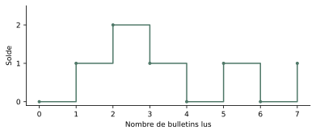

# École polytechnique · PSI et PT · Informatique 2005 · Corrigé brut

*Corrigé rédigé par IA, non officiel. Signalez toute erreur.*

**Rédaction** · GPT-6.2 Astra Ultra · vitesse non renseignée · 25 novembre 2026

**Dépouillement d’élections.** Le langage choisi est Python. Le tableau `a` contient des identifiants entiers positifs et sa longueur est le nombre de bulletins exprimés. Une case peut contenir un identifiant supérieur à la taille du tableau.

## I · Dépouillement du premier tour

### Question 1 · Chercher une majorité stricte sans tri

```python
def nombreVoix(a, candidat):
    total = 0
    for vote in a:
        if vote == candidat:
            total += 1
    return total

def gagnant_tour1(a):
    n = len(a)
    for candidat in a:
        if 2 * nombreVoix(a, candidat) > n:
            return candidat
    return -1
```

Le test doublé évite les nombres flottants et refuse une moitié exacte. Un gagnant, s’il existe, est unique. Au plus $n$ comptages de $n$ bulletins donnent $O(n^2)$ en temps. La valeur $-1$ est disponible puisque les identifiants sont positifs.

### Question 2 · Exploiter le tri du premier tour

```python
def gagnant_tour1_bis(a):
    n = len(a)
    if n == 0:
        return -1
    candidat = a[n // 2]
    if 2 * nombreVoix(a, candidat) > n:
        return candidat
    return -1
```

Dans un tableau trié, les valeurs d’un identifiant sont consécutives. Un bloc situé entièrement à gauche ou entièrement à droite de l’indice $\lfloor n/2\rfloor$ contient au plus $\lfloor n/2\rfloor$ bulletins. Le candidat médian est donc le seul gagnant possible. Il reste nécessaire de vérifier son effectif. Le coût est $\Theta(n)$ pour un tableau non vide.



### Question 3 · Compter le tri avant le dépouillement

Trier en $O(n\log n)$ puis appeler le dépouillement linéaire de la question 2 prend $O(n\log n+n)=O(n\log n)$ pour $n\geqslant2$. Un tableau déjà trié se traite directement en temps linéaire.

## II · Dépouillement du deuxième tour

### Question 4 · Imprimer tous les gagnants du deuxième tour

```python
def gagnants_tour2(a):
    n = len(a)
    maximum = 0
    for candidat in a:
        maximum = max(maximum, nombreVoix(a, candidat))
    for i in range(n):
        deja_vu = False
        for j in range(i):
            if a[j] == a[i]:
                deja_vu = True
                break
        if not deja_vu and nombreVoix(a, a[i]) == maximum:
            print(a[i])
```

Au deuxième tour, la plus grande fréquence suffit. Plusieurs candidats peuvent l’atteindre. La première passe coûte $O(n^2)$ et la seconde aussi. Le préfixe déjà lu assure une impression unique par gagnant, même quand ses bulletins sont séparés dans le tableau.

### Question 5 · Regrouper les gagnants dans un tableau trié

```python
def blocsTries(a):
    debut = 0
    while debut < len(a):
        fin = debut + 1
        while fin < len(a) and a[fin] == a[debut]:
            fin += 1
        yield a[debut], fin - debut
        debut = fin

def gagnants_tour2_bis(a):
    maximum = 0
    for candidat, voix in blocsTries(a):
        maximum = max(maximum, voix)
    for candidat, voix in blocsTries(a):
        if voix == maximum:
            print(candidat)
```

Le générateur `blocsTries` fournit un couple par bloc et ne matérialise pas une liste supplémentaire. La prochaine recherche reprend immédiatement après le bloc qui vient de finir. Les deux passes sont donc linéaires et chacune utilise un espace auxiliaire constant. Le dernier bloc est traité même s’il atteint le bord droit.



### Question 6 · Inclure le tri dans le coût du deuxième tour

Le coût total est $O(n\log n+n)=O(n\log n)$ pour $n\geqslant2$. Imprimer tous les ex æquo ajoute au plus $n$ écritures, comprises dans le terme linéaire.

## III · Dépouillement rapide du premier tour

### Question 7 · Retirer deux éléments distincts

Si $x$ apparaît $m$ fois dans un multiensemble de $n$ éléments et $m>n/2$, il reste après suppression au moins $m-1$ copies de $x$ parmi $n-2$ éléments. Or $m-1>(n-2)/2$. Cela suffit pour préserver la majorité stricte. Le caractère distinct de $y$ et $z$ empêche de perdre deux copies de $x$ d’un coup.

### Question 8 · Retirer un préfixe sans majorité

Soit $m>n/2$ le nombre total de voix pour $x$. Comme aucun élément n’est majoritaire dans les $i$ premiers bulletins, le nombre $p$ de voix pour $x$ dans ce préfixe vérifie $p\leqslant i/2$. Le suffixe en contient donc $m-p>(n-i)/2$. La majorité y reste stricte. Le cas $i=n$ est incompatible avec les deux hypothèses.

### Question 9 · Dépouiller le premier tour par élimination de paires

```python
def gagnant_tour1_ter(a):
    candidat = -1
    solde = 0
    for vote in a:
        if solde == 0:
            candidat = vote
            solde = 1
        elif vote == candidat:
            solde += 1
        else:
            solde -= 1
    if solde > 0 and 2 * nombreVoix(a, candidat) > len(a):
        return candidat
    return -1
```

Après traitement d’un préfixe, ses bulletins se décomposent en paires d’identifiants distincts éliminées et en `solde` exemplaires non appariés de `candidat`. Quand le solde revient à zéro, le préfixe éliminé n’a aucune majorité stricte et la recherche reprend au bulletin suivant. Les questions 7 et 8 garantissent que tout vrai majoritaire survit. En l’absence de majorité, le premier parcours peut laisser un candidat résiduel, par exemple le dernier vote de $[1,2,3]$. Le second parcours vérifie son effectif. Le coût est $O(n)$ en temps et $O(1)$ en mémoire.


