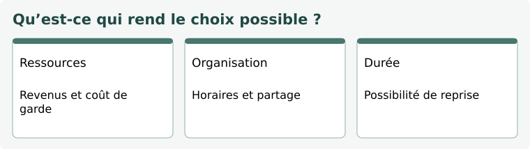
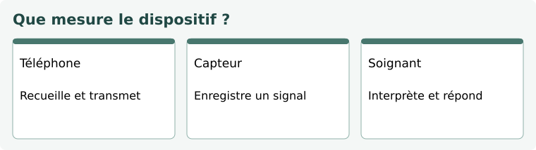
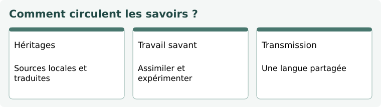
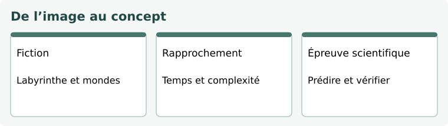
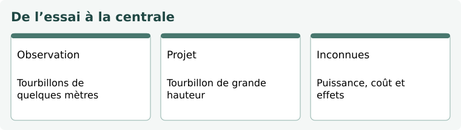

# Banque PT — Langue vivante A 2006 · Corrigé brut

*Corrigé rédigé par IA, non officiel.*

**Rédaction** · GPT-6.2 Astra Ultra · vitesse non renseignée

**Révision** · GPT-6.2 Astra Ultra · vitesse non renseignée

L’épreuve dure trois heures. Chaque candidat traite la langue choisie à l’inscription. La version française vaut 10 points. La question a demande 80 à 100 mots pour 4 points. La question b demande 200 à 250 mots pour 6 points.

[Sujet](https://www.banquept.fr/documents/2006/lv_a_2006.pdf) · [Index des rapports](https://www.banquept.fr/article153.html) · [Grille du livret](https://www.banquept.fr/documents/livret/2006/Livret_Rose_2006_1_2.pdf)

## Allemand

*Le choix de Karin Egger*

### Version française

De « Den ganzen Tag am Computer sitzen » à « ein lustiges Grüppchen ».

Passer toute la journée devant un ordinateur ? Non merci, dit Karin Egger, 35 ans. À l’origine, elle a suivi une formation d’assistante dentaire, mais « on gagne si peu qu’on est obligé de passer tout son salaire dans les frais de garde à la crèche ». Quand on lui demande quelle est sa profession, elle répond « femme au foyer », et ce avec assurance, que les autres la regardent de travers ou non. Bien que son fils ait quinze mois, elle ne songe pas à reprendre le travail. « Il est à un âge passionnant, je manquerais trop de choses. »

Concilier enfants et emploi ? Ce stress-là, elle s’en passe volontiers. Après tout, son mari, qui occupe un bon poste dans une banque, gagne suffisamment. « Comme femme au foyer, c’est moi la patronne », dit-elle. Elle peut décider elle-même si elle va d’abord se promener avec son enfant et son chien, construire un château en Lego avec son fils ou laver le sol de la cuisine. Bien sûr, à l’en croire, la vie de femme au foyer n’est pas toujours une partie de plaisir, par exemple quand, une fois de plus, le petit refuse de dormir. « Je connais chaque irrégularité de notre parquet, tant j’ai passé d’heures à faire les cent pas ici la nuit. » Après une nuit pareille, elle aime retrouver ses amies, femmes au foyer elles aussi, pour bavarder gaiement. Un jour, raconte-t-elle, ces fans de Sex and the City se sont dit en plaisantant qu’il faudrait tourner une série du même genre sur les femmes au foyer. « Parce que nous sommes une joyeuse petite bande. »

### Question a

*Der Text beschreibt das Modell einer «Nur-Hausfrau». Inwiefern kann eine Frau Gefallen an diesem Status finden, der sie anscheinend glücklich macht?*

Karin Egger schätzt vor allem die Zeit, die sie mit ihrem kleinen Sohn verbringen kann. Sie erlebt seine Entwicklung aus der Nähe und bestimmt selbst, wie sie den Tag einteilt. Ein schlecht bezahlter Beruf, dessen Einkommen fast vollständig für die Kinderbetreuung draufginge, erscheint ihr weniger attraktiv. Das Gehalt ihres Mannes ermöglicht ihr diese Entscheidung. Sie verschweigt die anstrengenden Nächte nicht, findet aber Unterstützung und Unterhaltung bei anderen Frauen in derselben Lage. Ihr gefällt also eine bestimmte Form von Selbstständigkeit im Alltag ihrer Familie.

**83 mots**

### Question b

*Die im Text erwähnte Karin Egger verzichtet darauf, Kinder und Job zu vereinbaren. Unter welchen Bedingungen kann eine Frau dem Familienleben gerecht werden aber gleichzeitig auch Freude an einer beruflichen Arbeit, ja sogar an einer Karriere finden?*

Ob eine Frau ihren Beruf mit Freude ausüben kann, hängt auch davon ab, was zu Hause geschieht, während sie arbeitet. Eine Kita hilft wenig, wenn sie schließt, lange bevor der Arbeitstag endet. Für eine Familie, die keine Großeltern in der Nähe hat, können verlässliche Öffnungszeiten deshalb wichtiger sein als eine einmalige finanzielle Unterstützung. Auch für die Ferien und für den Fall, dass ein Kind krank wird, braucht es Absprachen.

Ebenso wichtig ist die Aufteilung der Verantwortung. Wenn beide Eltern arbeiten, aber nur die Mutter Arzttermine vereinbart, Kleidung besorgt und an den Elternabend denkt, endet ihr Arbeitstag sehr spät. Ein Vater, der selbst Arbeitszeit verringern oder Elternzeit nehmen kann, lernt die Bedürfnisse seines Kindes aus eigener Erfahrung kennen. Das erleichtert gemeinsame Entscheidungen und entlastet beide.

Schließlich muss ein Betrieb zeigen, dass kürzere Arbeitszeiten eine berufliche Entwicklung zulassen. Fortbildungen könnten innerhalb der normalen Arbeitszeit stattfinden. Eine leitende Stelle ließe sich unter zwei Personen aufteilen, wenn sie Zeit für die Übergabe bekommen. Dann müsste eine Mutter nicht auf interessante Aufgaben verzichten, nur weil sie an bestimmten Nachmittagen zu Hause sein möchte. Für mich besteht echte Wahlfreiheit darin, dass unterschiedliche Entscheidungen möglich sind und später geändert werden können, ohne dass jemand dafür dauerhaft beruflich oder finanziell bestraft wird.

**204 mots**

## Anglais

*The doctor in your pocket*

### Version française

De « Through a new service » à « whenever the cap is removed ». La dernière phrase traduite s’achève avant l’envoi éventuel d’un rappel.

Grâce à un nouveau service appelé MyFoodPhone, M. Katz se sert de l’appareil photo intégré à son téléphone pour prendre chacun de ses repas en photo. C’est bien plus facile que de tout noter dans un carnet alimentaire, comme l’avait fait ce New-Yorkais de 44 ans la dernière fois qu’il avait dû lutter contre un taux de cholestérol élevé. À la fin de chaque semaine, son nutritionniste lui envoie par courriel un bilan de son alimentation. […]

Jusqu’à présent, la plupart des services mobiles de télésanté comme MyFoodPhone utilisent tout simplement des téléphones portables ordinaires pour recueillir et transmettre des données. L’étape suivante consiste à leur adjoindre des capteurs médicaux spécifiques, qui peuvent même être intégrés directement au téléphone. […]

En Grande-Bretagne, l’Institut de génie biomédical de l’Imperial College de Londres, Tourmaz Technology et Oracle, deuxième éditeur de logiciels au monde, se sont associés pour concevoir un « système de surveillance omniprésent » dont les essais commenceront en 2006. Un petit capteur fixé au moyen d’un sparadrap surveille les battements du cœur du patient et détecte les irrégularités. Les données électrocardiographiques ainsi obtenues sont envoyées sans fil à un téléphone portable situé à proximité, qui les transmet à son tour à un centre de surveillance ou directement à un médecin.

La télésanté mobile n’a toutefois pas besoin d’être aussi perfectionnée. SIMpill, une entreprise sud-africaine, fabrique un petit dispositif qui se fixe sur un flacon de médicaments et envoie un SMS à un ordinateur central chaque fois qu’on retire le bouchon.

### Question a

*In what ways can the mobile phone and telehealth services improve health care?*

A mobile phone can carry information from a patient's daily surroundings to someone qualified to interpret it. In the article, photographs allow a nutritionist to review a week's meals. A sensor can send information about an irregular heartbeat to a doctor without waiting for the next appointment. A medicine bottle can trigger a reminder when its usual opening goes unrecorded. Since a mobile phone is often available where a personal computer is not, these services could also reach patients who would otherwise find it difficult to keep in touch with a clinic.

**92 mots**

### Question b

*Does new technology necessarily mean better health?*

A new device improves health only when the information it produces leads to care that people can actually obtain. A remote monitor may spare someone a long journey and help a clinician notice a change between appointments. But if nobody has time to read the reports, the patient has acquired another device to look after and little else. Before buying equipment, a clinic should decide who will answer and how the patient can reach that person.

It also matters what a measurement can really tell us. An electronic cap records that a bottle has been opened. It cannot establish who opened it or explain why someone has found a prescription difficult to follow. A friendly conversation might reveal that the instructions are unclear or that the pharmacy is too far away. Treating the number on a screen as a complete account of the situation could damage trust.

Lastly, the benefits should reach people with different incomes, languages and levels of confidence. A patient who prefers a visit or a telephone call should retain that option. I would judge an innovation by whether patients feel better supported and receive effective care sooner. The amount of information collected is a poor substitute for those outcomes.

**203 mots**

## Arabe

*العلوم العربية في عصرها الذهبي*

### Version française

De « يؤكد هذا المعرض » à « للمعارف التقنية والمهارات ». Le dernier paragraphe est à traduire jusqu’à cette expression, au milieu du propos d’Ahmed Djebbar.

Par ce qu’elle présente, cette exposition met en évidence la grande contribution de la civilisation arabe aux différentes branches du savoir intellectuel et technique, après qu’elle eut réalisé d’importantes découvertes dans la plupart des domaines scientifiques. Les savants arabes ont commencé par étudier et assimiler les disciplines pratiquées dans les civilisations antérieures, grecque, indienne et mésopotamienne. Ils leur ont donné un nouvel élan et les ont enrichies d’apports inédits en recourant aux sciences expérimentales, ainsi qu’en étudiant des domaines et des techniques qui ne se sont constitués en Europe qu’à une époque tardive. Sans aucun doute, la langue arabe, langue commune dans des contrées qui allaient de l’Inde à l’Andalousie, a contribué au progrès de ce patrimoine scientifique universel. À cela s’ajoutent la prospérité de l’Empire arabe, le mécénat des califes et des princes en faveur des lettres, des sciences et des arts, ainsi qu’une inclination pour la liberté de pensée et l’esprit de tolérance.

Le professeur Ahmed Djebbar, universitaire à Lille, en France, et l’un des organisateurs de cette exposition, déclare qu’à partir du VIIIe siècle de notre ère, après une période de maturation, une civilisation originale et puissante, portée par une religion nouvelle, l’islam, a commencé à s’affirmer en s’exprimant en arabe, dans un espace géographique, politique et économique qui s’étendait des confins de l’Asie centrale aux Pyrénées, en Europe. La richesse et la diversité des activités scientifiques ont été parmi les éléments constitutifs et distinctifs de cette civilisation. Dès les débuts de cette aventure extraordinaire, ses pionniers ont puisé dans le fonds local de connaissances techniques et de savoir-faire.

### Question a

*تحدثوا عن معنى النص العام بلغتكم الخاصة.*

يقدم المقال معرضا في باريس يعرض جوانب من تاريخ العلوم التي ازدهرت بالعربية بين القرنين الثامن والخامس عشر. وقد جمع المعرض قطعا من مؤسسات عديدة ليبين للزائر كيف انتقل العلماء من دراسة معارف سابقة إلى تطوير مسائل وطرائق جديدة. وسهلت اللغة المشتركة تداول الكتب والأفكار بين أقاليم متباعدة، كما سمح دعم بعض الحكام بحرية البحث واستمرار العمل. ويبرز النص أن هذه التجربة شملت شعوبا متعددة، وأن إسهامها دخل في تراث علمي يستفيد منه الناس بصرف النظر عن مكان ولادتهم أو اللغة التي يتحدثونها.

**83 mots**

### Question b

*أعطوا رأيكم في الأسباب التي ساعدت على انحطاط العلوم العربية.*

يصعب في رأيي تفسير تراجع نشاط علمي واسع بسبب واحد، وخصوصا إذا كان يمتد على بلدان وعصور مختلفة. فما يتراجع في مدينة قد يستمر في أخرى، وقد يتغير مركز التعليم من غير أن تختفي المعارف نفسها. لذلك أبدأ بالسؤال عن المؤسسات التي كانت تتيح للباحث أن يتعلم وأن يجد كتابا وأن يناقش زملاءه. حين يضطرب تمويل مكتبة أو يتعذر السفر بين مركزين، قد يتوقف عمل جماعي احتاج إلى سنوات حتى ينشأ.

ومن الأسباب المحتملة أيضا تغير أولويات السلطة والاقتصاد. فالعالم يحتاج إلى وقت يخصصه لمسألة لا تظهر فائدتها فورا، وإلى من يدرب طلابا يخلفونه. وإذا أصبح الدعم مرتبطا برغبة شخص واحد، أمكن أن ينقطع مع رحيله، حتى إن ظل الطلاب مهتمين بالموضوع. ولا أرى في ذلك حكما على لغة أو شعب، إذ يمكن ملاحظة المشكلة نفسها في مجتمع معاصر يغلق مختبرا أو يهمل التعليم زمنا طويلا.

على أن انتقال كتاب إلى لغة أخرى قد يبدو علامة على تراجع مركزه الأول، وهو في الوقت نفسه دليل على استمرار أثره. ولتقدير ما حدث فعلا ينبغي مقارنة مخطوطات ومؤسسات ومناطق محددة، وتجنب صورة عصر ذهبي انتهى في يوم واحد. وأهم ما أستخلصه من المقال أن الشروط التي ساعدت على الازدهار، مثل حرية النقاش وتبادل الخبرات واستقرار التعليم، تستحق أن ندرس كيف تغيرت وأين بقيت حية.

**202 mots**

## Espagnol

*Borges visionario*

### Version française

De « Más de medio siglo atrás » à « percibidor abstracto del mundo ».

Il y a plus d’un demi-siècle, J. L. Borges nous émerveillait avec ses récits fantastiques, Fictions, L’Aleph, Enquêtes, entre autres, et leurs personnages incroyables qui jouaient d’étranges rôles dans des mondes énigmatiques et incertains.

Peu de gens imaginaient alors que ses idées et ses concepts coïncideraient, des décennies plus tard, avec de véritables révolutions scientifiques dans notre conception de la « réalité ». Coïncidence ? Pur hasard ?

Borges parlait de la « réalité » comme d’une illusion (« … l’univers visible était une illusion ou, plus précisément, un sophisme »), des labyrinthes, de la non-linéarité, du chaos et de la complexité (« … Je pensai à un labyrinthe de labyrinthes, à un labyrinthe sinueux et croissant qui embrasserait le passé et l’avenir et qui engloberait en quelque manière les astres. Absorbé par ces images illusoires, j’oubliai mon destin d’homme traqué. Je me sentis, pour un temps indéterminé, un observateur abstrait du monde »).

### Question a

*Analice Usted la relación que establece este texto entre ciencia y literatura visionaria (Julio Verne, J. L. Borges).*

Di Marco establece una relación de anticipación. Julio Verne y Borges imaginaron situaciones que sus lectores podían considerar fantásticas y que después recordaron ciertos avances científicos. En Borges le interesan especialmente los tiempos que se bifurcan, los mundos posibles y la idea de que nuestra percepción no agota la realidad. La literatura permite explorar esas posibilidades mediante personajes e imágenes antes de que existan modelos capaces de discutirlas con precisión. La coincidencia sorprende al autor, aunque el texto no afirma que un cuento constituya por sí mismo una demostración científica.

**90 mots**

### Question b

*¿Qué opina Usted de la visión de «la realidad» que presenta el autor? ¿Le parece posible afirmar que van desapareciendo las antiguas concepciones —filosóficas, religiosas,…— del mundo?*

Comparto con Di Marco la idea de que lo que llamamos realidad no se reduce a lo que percibimos espontáneamente. La experiencia cotidiana nos hace pensar que dos relojes necesariamente medirán el mismo intervalo. La física ha mostrado que intervienen condiciones que esa intuición no considera. Sin embargo, reconocer que una explicación puede cambiar no significa que todas las explicaciones valgan lo mismo. Un modelo gana credibilidad cuando indica qué deberíamos observar y permite comprobar si se cumple su predicción.

Tampoco creo que las antiguas concepciones del mundo desaparezcan en conjunto. Una tradición religiosa puede perder autoridad para explicar un fenómeno natural y conservar importancia para una persona que intenta dar sentido a una pérdida. Una pregunta filosófica sobre qué podemos conocer sigue abierta incluso cuando disponemos de instrumentos mucho más precisos. Eso no impide que critiquemos una afirmación concreta si contradice observaciones bien establecidas.

En ese sentido, leer a Borges hoy ofrece algo distinto de buscar anuncios de futuros descubrimientos. Al seguir a un personaje por un laberinto, el lector siente hasta qué punto su punto de vista limita lo que sabe. La literatura vuelve perceptible esa dificultad, mientras que la ciencia construye métodos para examinarla. Prefiero imaginar un diálogo en el que una forma de pensamiento transforma las preguntas de la otra sin ocupar enteramente su lugar.

**219 mots**

## Italien

*La centrale elettrica del futuro è un generatore di uragani*

### Version française

Les trois derniers paragraphes de la page 10, de « L’idea di Michaud » à « in quelle a carbone ».

L’idée de Michaud repose sur la convection atmosphérique, phénomène par lequel l’air chaud a tendance à s’élever puis à redescendre une fois refroidi. Ce principe est à la base de structures déjà utilisées pour produire de l’énergie alternative, comme les cheminées solaires. Il s’agit de serres où l’air chauffé est contraint de s’engager dans un cylindre creux à la base duquel se trouvent des turbines destinées à produire de l’électricité.

Dans le projet imaginé par Michaud, on introduit de l’air chaud et de la vapeur dans un cylindre de 80 mètres de haut et 200 mètres de large. Il se forme ainsi un premier tourbillon qui s’élève jusqu’à 20 kilomètres d’altitude et s’élargit, tandis que la vapeur se condense en libérant encore de la chaleur. Ici aussi, l’énergie libérée au cours du processus serait récupérée par des turbines. Mais contrairement aux cheminées solaires, dont la puissance est limitée par la hauteur maximale de la structure, les tornades artificielles pourraient s’étendre sur plusieurs kilomètres dans l’atmosphère.

Il s’agit bien entendu de spéculations théoriques. Jusqu’à présent, l’ingénieur canadien n’est parvenu à produire que de petits tourbillons de quelques mètres de haut. Michaud est cependant convaincu qu’avec les financements appropriés, une centrale en état de marche pourrait voir le jour en cinq ans seulement. Peut-être pourrait-on remplacer les tours de refroidissement déjà en service dans les centrales nucléaires et les centrales au charbon par le cylindre destiné à produire les tornades.

### Question a

*Secondo Lei, il progetto potrebbe essere realizzato o è del tutto utopico?*

Il progetto mi sembra fondato su un fenomeno fisico reale, perché l’aria calda sale e la convezione viene già sfruttata nei camini solari. Tuttavia, tra i piccoli vortici osservati in laboratorio e una centrale capace di fornire elettricità con regolarità c’è una distanza considerevole. Prima di parlare di realizzazione industriale bisognerebbe conoscere l’energia effettivamente recuperabile e i costi complessivi. Servirebbero anche valutazioni indipendenti sugli effetti per chi abita nei dintorni. Considererei quindi ragionevole proseguire la ricerca, mentre la scadenza annunciata dall’ingegnere rimane una previsione personale.

**85 mots**

### Question b

*Quali altre energie si potrebbero concepire per salvaguardare il pianeta e a quali costi, il cervello umano avrà limiti o meno? Come vede il mondo fra un secolo?*

Fra un secolo immagino una società che scelga le proprie fonti di energia anche in base alle caratteristiche di ogni luogo. Una città con molti tetti ben esposti potrebbe ricavare una parte dell’elettricità dal sole, mentre una regione ventosa avrebbe altre possibilità. In entrambi i casi occorrerebbero reti, materiali e sistemi per conservare o scambiare l’energia quando cambia il tempo. Il costo di una fonte non coincide quindi con il prezzo del singolo impianto.

Mi sembra altrettanto importante ridurre le necessità evitabili. Una scuola ben isolata offre a generazioni di studenti aule più confortevoli e richiede meno riscaldamento. Il lavoro iniziale costa, ma parte del beneficio dura per decenni. Perché anche i quartieri con minori risorse possano partecipare, le decisioni sugli investimenti dovrebbero tener conto delle condizioni di partenza e coinvolgere chi usa gli edifici.

Il cervello umano può trovare soluzioni oggi imprevedibili, ma non può abolire i limiti fisici delle risorse o sapere in anticipo tutte le conseguenze di una scelta. Per questo spero che la società futura sappia correggere un progetto quando l’esperienza lo richiede. Mi piacerebbe che il successo fosse misurato dalla possibilità di abitare, studiare e lavorare bene senza trasferire i costi ambientali a chi ha meno voce o a chi deve ancora nascere.

**208 mots**

