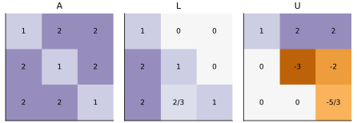
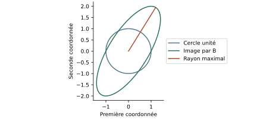

# Banque PT — Mathématiques A 2006 · Corrigé brut

*Corrigé rédigé par IA, non officiel. Signalez toute erreur.*

**Rédaction** · GPT-6.2 Astra Ultra · vitesse non renseignée

Les deux premières parties traitent la factorisation de matrices en facteurs triangulaires. La dernière caractérise la norme d’une matrice pour la norme euclidienne. La grille d’admissibilité attribue à Maths A un coefficient 6 pour l’École polytechnique et 3 pour l’ENS Cachan. [Sujet officiel](https://www.banquept.fr/documents/2006/math_a_2006.pdf) · [Rapport du jury](https://www.banquept.fr/documents/ecrit/rapport/2006/rapport_math_a_ecrit_2006.pdf) · [Grille des coefficients](https://www.banquept.fr/documents/livret/2006/Livret_Rose_2006_1_2.pdf#page=12)

## Préliminaires

### P.1 · Matrice symétrique

Une matrice réelle carrée $A$ est symétrique lorsque $A^{\mathsf T}=A$, soit $a_{ij}=a_{ji}$ pour tous les indices.

### P.2 · Matrice orthogonale

Une matrice réelle carrée $Q$ est orthogonale lorsque $Q^{\mathsf T}Q=I$. Ses colonnes forment alors une base orthonormée. En dimension finie, l’inverse à gauche est aussi l’inverse à droite, donc $Q^{-1}=Q^{\mathsf T}$ et $QQ^{\mathsf T}=I$.

### P.3.a · Compatibilité des formats

Pour $A$ de format $p\times q$ et $B$ de format $m\times n$, le produit $AB$ est défini exactement lorsque $q=m$.

### P.3.b · Format du produit

Le produit comporte $p$ lignes, indexées comme celles de $A$, et $n$ colonnes, indexées comme celles de $B$. Son format est $p\times n$.

### P.3.c · Formule du produit

Pour $1\le i\le p$, $1\le j\le n$, on obtient $(AB)_{ij}=\sum_{k=1}^{q}a_{ik}b_{kj}$, puisque le nombre de termes commun aux deux facteurs est $q=m$.

## Partie I

### I.1 · Deux déterminants

L’énoncé donne
$$
L=\begin{pmatrix}1&0&0\\1&1&0\\1&1&1\end{pmatrix},
\qquad A=\begin{pmatrix}2&0&1\\2&1&3\\2&1&6\end{pmatrix}.
$$
Le déterminant de $L$ vaut 1 par triangularité. Dans $A$, remplacer d’abord la ligne 3 par la différence des lignes 3 et 2, puis la ligne 2 par la différence des lignes 2 et 1. On conserve le déterminant et l’on obtient les lignes $(2,0,1),(0,1,2),(0,0,3)$. Donc $\det A=2\cdot1\cdot3=6$.

### I.2 · Inversibilité et différences successives

Les deux déterminants sont non nuls, donc les matrices sont inversibles. Écrire $y=Lx$ donne $x_1=y_1$, $x_2=y_2-y_1$, $x_3=y_3-y_2$. Ainsi
$$
L^{-1}=\begin{pmatrix}1&0&0\\-1&1&0\\0&-1&1\end{pmatrix}.
$$

### I.3 · Facteur triangulaire supérieur

$U=L^{-1}A$ est la matrice des différences de lignes obtenue en I.1,
$$
U=\begin{pmatrix}2&0&1\\0&1&2\\0&0&3\end{pmatrix}.
$$
Elle est triangulaire supérieure. En cumulant ses lignes, on retrouve celles de $A$, donc $A=LU$.

## Partie II

### II.1 · Conditions de triangularité

$L$ est triangulaire inférieure exactement si $\ell_{ij}=0$ pour $j>i$. De même, $U$ est triangulaire supérieure exactement si $u_{ij}=0$ pour $i>j$. Les coefficients situés dans l’autre moitié, diagonale incluse, sont libres.

### II.2 · Borne de sommation

Pour $A=LU$, $a_{ij}=\sum_{k=1}^n\ell_{ik}u_{kj}$. Dès que $k>i$ le premier facteur est nul, et dès que $k>j$ le second est nul. Ainsi $a_{ij}=\sum_{k=1}^{\min(i,j)}\ell_{ik}u_{kj}$.

### II.3 · Inversibilité de la matrice donnée

Pour la nouvelle matrice $A$, les trois termes du développement donnent
$$
\det\begin{pmatrix}1&2&2\\2&1&2\\2&2&1\end{pmatrix}
=1(1-4)-2(2-4)+2(4-2)=5.
$$
Donc $A$ est inversible.

### II.4.a · Premier pivot

$a_{11}=\ell_{11}u_{11}=u_{11}$ donne $u_{11}=1$.

### II.4.b · Première colonne du facteur inférieur

$a_{i1}=\ell_{i1}u_{11}=\ell_{i1}$, donc $(\ell_{11},\ell_{21},\ell_{31})=(1,2,2)$.

### II.4.c · Première ligne du facteur supérieur

$a_{12}=\ell_{11}u_{12}=u_{12}$ donne $u_{12}=2$.

### II.4.d · Deuxième pivot

$a_{22}=\ell_{21}u_{12}+\ell_{22}u_{22}=4+u_{22}=1$, d’où $u_{22}=-3$.

### II.4.e · Multiplicateur de la dernière ligne

$a_{32}=\ell_{31}u_{12}+\ell_{32}u_{22}=4-3\ell_{32}=2$, soit $\ell_{32}=2/3$.

### II.4.f · Fin de la décomposition

La première ligne donne $u_{13}=a_{13}=2$. La deuxième impose $2=a_{23}=2u_{13}+u_{23}$, donc $u_{23}=-2$. Enfin $1=a_{33}=2u_{13}+(2/3)u_{23}+u_{33}$, donc $u_{33}=-5/3$. Ainsi
$$
L=\begin{pmatrix}1&0&0\\2&1&0\\2&2/3&1\end{pmatrix},
\qquad U=\begin{pmatrix}1&2&2\\0&-3&-2\\0&0&-5/3\end{pmatrix}.
$$
Le produit des pivots est $5$, conformément au déterminant.

### II.5 · Inverses des deux facteurs

Soit $v$ un second membre. Pour $Lz=v$, $z_1=v_1$, $z_2=v_2-2v_1$, puis $z_3=v_3-2v_1-(2/3)z_2$. Pour $Uz=v$, $z_3=-3v_3/5$, $z_2=-(v_2+2z_3)/3$ et $z_1=v_1-2z_2-2z_3$. En regroupant,
$$
U^{-1}=\begin{pmatrix}1&2/3&2/5\\0&-1/3&2/5\\0&0&-3/5\end{pmatrix},
\qquad L^{-1}=\begin{pmatrix}1&0&0\\-2&1&0\\-2/3&-2/3&1\end{pmatrix}.
$$

### II.6 · Résolution du système

Avec $b=(1,0,2)^{\mathsf T}$, $y=L^{-1}b=(1,-2,4/3)^{\mathsf T}$, puis $x=U^{-1}y=(1,6,-4)^{\mathsf T}/5$. Vérification directe par les lignes de $5Ax$ qui valent $1+12-8=5$, $2+6-8=0$ et $2+12-4=10$.

## Partie III

### III.1 · Norme de l’identité

Notons $M(B)=\sup_{x\ne0}\|Bx\|/\|x\|$, où $\|\cdot\|$ est la norme euclidienne. Pour $B=I$, chaque quotient vaut 1, donc $M(I)=1$.

### III.2 · Inégalité sur les vecteurs

Pour $x\ne0$, le quotient $\|Bx\|/\|x\|$ est inférieur ou égal à sa borne supérieure. La multiplication par $\|x\|>0$ donne $\|Bx\|\le M(B)\|x\|$. Pour $x=0$ les deux côtés valent zéro. La borne est finie car on peut prendre le supremum sur la sphère unité, compacte, pour la fonction continue $v\mapsto\|Bv\|$.

### III.3 · Meilleure constante

Si $\|Bx\|\le\alpha\|x\|$ pour tout $x$, la division pour $x\ne0$ donne $\|Bx\|/\|x\|\le\alpha$, donc $M(B)\le\alpha$. Par III.2, $M(B)$ est elle-même admissible et c’est la plus petite constante possible.

### III.4 · Norme d’un produit

On a $\|B_1B_2x\|\le M(B_1)\|B_2x\|\le M(B_1)M(B_2)\|x\|$. D’après III.3, $M(B_1B_2)\le M(B_1)M(B_2)$.

### III.5.a · Effet d’une matrice diagonale

Pour $B=\operatorname{diag}(\lambda_1,\ldots,\lambda_n)$, $Be_i=\lambda_i e_i$.

### III.5.b · Borne euclidienne diagonale

Avec $x=\sum_i x_i e_i$ et $|\lambda_1|\le\cdots\le|\lambda_n|$, l’orthonormalité donne $\|Bx\|^2=\sum_i\lambda_i^2x_i^2\le|\lambda_n|^2\sum_i x_i^2=|\lambda_n|^2\|x\|^2$. En prenant les racines, $\|Bx\|\le|\lambda_n|\|x\|$.

### III.5.c · Vecteur qui atteint la borne

Par III.5.b, $M(B)\le|\lambda_n|$. Pour $x=e_n$, $\|Be_n\|/\|e_n\|=|\lambda_n|$, donc $M(B)=|\lambda_n|$.

### III.6.a · Diagonalisation du produit de Gram

La matrice $S=B^{\mathsf T}B$ est réelle et $S^{\mathsf T}=B^{\mathsf T}B=S$. Par le théorème spectral réel, tout endomorphisme symétrique réel admet une base orthonormée de vecteurs propres. Ainsi $S$ est diagonalisable.

### III.6.b · Signe des valeurs propres

Si $Su=\lambda u$, $u\ne0$, alors $\|Bu\|^2=u^{\mathsf T}Su=\lambda u^{\mathsf T}u=\lambda\|u\|^2$. On en déduit $\lambda=\|Bu\|^2/\|u\|^2\ge0$. La valeur zéro est possible lorsque $B$ a un noyau non trivial.

### III.6.c · Choix de la matrice de passage

D’après III.6.a, il existe une matrice orthogonale $P$ de colonnes propres de $S$. Ainsi $SP=PD$, où $D$ est diagonale réelle. Puisque $P^{\mathsf T}P=I$, on a $D=P^{\mathsf T}SP$.

### III.6.d · Base propre ordonnée

On permute les colonnes de $P$ pour avoir $0\le\lambda_1\le\cdots\le\lambda_n$, en répétant les valeurs propres selon leurs multiplicités. Les colonnes $p_i$ vérifient $Sp_i=\lambda_i p_i$, $p_i^{\mathsf T}p_i=1$ et $p_i^{\mathsf T}p_j=0$ si $i\ne j$, par l’orthogonalité de $P$.

### III.6.e · Normes dans la base propre

Pour $x=\sum_i\alpha_i p_i$, on a $\|x\|=(\sum_i\alpha_i^2)^{1/2}$. De même $\|Bx\|^2=x^{\mathsf T}Sx=\sum_{i,j}\alpha_i\alpha_j\lambda_jp_i^{\mathsf T}p_j=\sum_i\lambda_i\alpha_i^2$. Donc $\|Bx\|=(\sum_i\lambda_i\alpha_i^2)^{1/2}$.

### III.6.f · Norme subordonnée et rayon spectral

Par III.6.e, $\|Bx\|^2\le\lambda_n\|x\|^2$, donc $M(B)\le\sqrt{\lambda_n}$. Pour $x=p_n$ la norme de l’image vaut $\sqrt{\lambda_n}$, ce qui établit l’égalité, aussi lorsque $\lambda_n=0$. Les valeurs propres de $S$ étant positives ou nulles, $\lambda_n=\rho(B^{\mathsf T}B)$ et $M(B)=\sqrt{\rho(B^{\mathsf T}B)}$.

### III.7 · Application numérique exacte

Pour $B=\left(\begin{smallmatrix}1&1\\2&0\end{smallmatrix}\right)$,
$$
B^{\mathsf T}B=\begin{pmatrix}5&1\\1&1\end{pmatrix}.
$$
Son polynôme caractéristique est $(\lambda-5)(\lambda-1)-1=\lambda^2-6\lambda+4$, de racines $3\pm\sqrt5$. Ainsi $M(B)=\sqrt{3+\sqrt5}\simeq2{,}288$. La direction de $(1,\sqrt5-2)^{\mathsf T}$ donne le maximum car c’est un vecteur propre pour $3+\sqrt5$.

