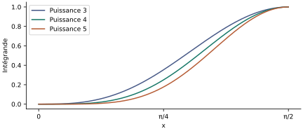
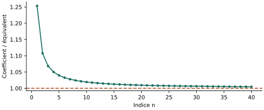

# Banque PT — Mathématiques C 2006 · Corrigé brut

*Corrigé rédigé par IA, non officiel. Signalez toute erreur.*

**Rédaction** · GPT-6.2 Astra Ultra · vitesse non renseignée

Les intégrales de Wallis déterminent une constante de limite. Celle-ci fixe la constante de Stirling, puis l’équivalent des coefficients d’une solution analytique d’équation différentielle. La grille d’admissibilité attribue à Maths C un coefficient 6 pour l’École polytechnique et 3 pour l’ENS Cachan. [Sujet officiel](https://www.banquept.fr/documents/2006/math_c_2006.pdf) · [Rapport du jury](https://www.banquept.fr/documents/ecrit/rapport/2006/rapport_math_c_ecrit_2006.pdf) · [Grille des coefficients](https://www.banquept.fr/documents/livret/2006/Livret_Rose_2006_1_2.pdf#page=12)

## Partie I · Intégrales de Wallis

### I.1 · Premières intégrales

Pour $K_n=\int_0^1(1-t^2)^n\,dt$, on obtient $K_0=1$, $K_1=1-1/3=2/3$ et $K_2=1-2/3+1/5=8/15$.

### I.2 · Somme rationnelle

Le binôme de Newton donne $(1-t^2)^n=\sum_{k=0}^n(-1)^k\binom nk t^{2k}$. Par linéarité de l’intégrale d’une somme finie,
$$
K_n=\sum_{k=0}^n\frac{(-1)^k}{2k+1}\binom nk.
$$

### I.3 · Premiers termes des deux suites

On pose $I_n=\int_0^{\pi/2}\sin^n x\,dx$ et $J_n=\int_0^{\pi/2}\cos^n x\,dx$. Le changement $u=\pi/2-x$ donne $I_n=J_n$. On a $I_0=J_0=\pi/2$, $I_1=J_1=1$ et, par $\sin^2x=(1-\cos(2x))/2$, $I_2=J_2=\pi/4$.

### I.4 · Changement de variable

Posons $t=\sin x$, avec $0\le x\le\pi/2$. Alors $(1-t^2)^n=\cos^{2n}x$ et $dt=\cos x\,dx$. Ainsi $K_n=J_{2n+1}=I_{2n+1}$, donc $N=2n+1$.

### I.5 · Récurrence par intégration par parties

Pour $n\ge2$, en intégrant $\sin^{n-1}x\sin x$ par parties, le terme de bord $[-\sin^{n-1}x\cos x]_0^{\pi/2}$ est nul. Ainsi $I_n=(n-1)\int_0^{\pi/2}\sin^{n-2}x\cos^2x\,dx=(n-1)(I_{n-2}-I_n)$. D’où $I_n=(n-1)I_{n-2}/n$.

### I.6 · Termes pairs et impairs

Notons $W_p=(2p)(2p-2)\cdots2/[(2p-1)(2p-3)\cdots1]$, avec $W_0=1$. La récurrence donne
$$
I_{2p}=\frac{\pi}{2W_p},\qquad I_{2p+1}=\frac{W_p}{2p+1},\qquad
W_p=\frac{4^p(p!)^2}{(2p)!}.
$$
La dernière égalité s’obtient en séparant les facteurs pairs et impairs de $(2p)!$.

### I.7 · Encadrement des exposants voisins

Pour $p\ge1$, on a point par point $0\le\sin^{2p+1}x\le\sin^{2p}x\le\sin^{2p-1}x$. En intégrant, $0<I_{2p+1}\le I_{2p}\le I_{2p-1}$. Les intégrales sont strictement positives car l’intégrande l’est à l’intérieur.

### I.8 · Rapport tendant vers un

Par I.5, $I_{2p-1}/I_{2p+1}=(2p+1)/(2p)$. D’après I.7, $1\le I_{2p}/I_{2p+1}\le(2p+1)/(2p)$. Le théorème d’encadrement donne la limite 1.

### I.9 · Expression exacte du rapport

Pour tout $p\ge0$,
$$
\frac{I_{2p}}{I_{2p+1}}=\frac{\pi(2p+1)}{2W_p^2}.
$$

### I.10 · Constante du produit de Wallis

En réarrangeant I.9, $W_p^2/p=\pi(2p+1)/(2p)\cdot I_{2p+1}/I_{2p}\to\pi$. La définition de $W_p$ donne à la fois la limite du quotient de produits pairs et impairs et celle de $p^{-1}[4^p(p!)^2/(2p)!]^2$.

### I.11.a · Équivalent aux rangs pairs

$W_p/\sqrt p\to\sqrt\pi$, donc $I_{2p}=\pi/(2W_p)\sim\sqrt\pi/(2\sqrt p)$.

### I.11.b · Équivalent aux rangs impairs

Par I.8, $I_{2p+1}\sim I_{2p}\sim\sqrt\pi/(2\sqrt p)$.

### I.11.c · Équivalent commun

Pour $n=2p$, la quantité $\sqrt{\pi/(2n)}$ est exactement $\sqrt\pi/(2\sqrt p)$. Pour $n=2p+1$, elle lui est équivalente. Les deux sous-suites du quotient tendent vers 1, donc $I_n\sim\sqrt{\pi/(2n)}$.

## Partie II · Formule de Stirling

### II.1 · Quotient des termes successifs

Pour $n\ge1$, $u_n=n^n\sqrt n/(e^n n!)>0$. Après simplification de $(n+1)!=(n+1)n!$,
$$
\frac{u_{n+1}}{u_n}=e^{-1}\left(1+\frac1n\right)^{n+1/2}.
$$

### II.2.a · Développement logarithmique

Quand $x\to0$, $\log(1+x)=x-x^2/2+x^3/3+o(x^3)$, par la formule de Taylor au voisinage de zéro.

### II.2.b · Équivalent du logarithme du quotient

En prenant le logarithme dans II.1,
$$
\log(u_{n+1}/u_n)=-1+(n+1/2)\left(\frac1n-\frac1{2n^2}+\frac1{3n^3}+o(n^{-3})\right)
=\frac1{12n^2}+o(n^{-2}).
$$
Le terme général est donc équivalent à $1/(12n^2)$.

### II.3 · Convergence d’une série

Par II.2.b, les valeurs absolues des logarithmes sont équivalentes à $1/(12n^2)$. La série de Riemann d’exposant 2 converge, donc $\sum_{n\ge1}\log(u_{n+1}/u_n)$ converge absolument.

### II.4 · Limite finie strictement positive

Pour $N\ge2$, $\log u_N=\log u_1+\sum_{n=1}^{N-1}\log(u_{n+1}/u_n)$. Le membre de droite a une limite réelle finie $L$. Par continuité de l’exponentielle, $u_N\to\ell=e^L>0$.

### II.5 · Factorielle à une constante près

L’égalité $n!=n^n\sqrt n/(e^n u_n)$ et la limite précédente donnent $n!\sim\ell^{-1}\sqrt n(n/e)^n$.

### II.6 · Identification de la constante

En remplaçant les factorielles dans $W_p=4^p(p!)^2/(2p)!$, on obtient $W_p\sim\sqrt p/(\ell\sqrt2)$. D’après I.10, $W_p^2/p\to\pi$, donc $1/(2\ell^2)=\pi$ et $\ell=1/\sqrt{2\pi}$. Ainsi $n!\sim\sqrt{2\pi n}(n/e)^n$.

## Partie III · Solution en série entière

### III.1 · Récurrence des coefficients

À l’intérieur du rayon, on peut dériver terme à terme $a(x)=\sum_{n\ge0}a_nx^n$. Dans $16(x^2-x)a''+(16x-8)a'-a$, le coefficient de $x^{n-1}$ est
$$
[16(n-1)(n-2)+16(n-1)-1]a_{n-1}-[16n(n-1)+8n]a_n.
$$
Il est nul par unicité des coefficients, puisque la somme s’annule sur $]0,R[$. Cela vaut aussi au rang $n=1$, la dérivation des constantes donnant zéro. Donc
$$
a_n=\frac{(4n-3)(4n-5)}{8n(2n-1)}a_{n-1}\qquad(n\ge1).
$$

### III.2 · Rayon de la solution

Si $a_0=0$, la récurrence imposerait une série nulle, exclue. Les facteurs de la récurrence ne s’annulent pour aucun entier $n\ge1$. Ainsi tous les coefficients sont non nuls et $|a_n/a_{n-1}|\to1$. Le critère de d’Alembert donne le rayon $R=1$.

### III.3 · Formule fermée

Pour $a_0=1$, le produit des numérateurs, de $j=1$ à $n$, est $-(4n-3)!!$ : le premier pas apporte $-1$ et $1$, puis viennent successivement les impairs jusqu’à $4n-3$. Le produit des dénominateurs est $8^n n!(2n-1)!!=4^n(2n)!$. Or $(4n-3)!!=(4n)!/[2^{2n}(2n)!(4n-1)]$. Ainsi
$$
a_n=-\frac{\binom{4n}{2n}}{16^n(4n-1)}\qquad(n\ge1).
$$
En particulier $a_1=-1/8$, en accord avec III.1.

### III.4 · Équivalent des coefficients

Stirling donne $\binom{2m}{m}\sim4^m/\sqrt{\pi m}$, en divisant l’équivalent de $(2m)!$ par celui de $(m!)^2$. Pour $m=2n$, III.3 devient
$$
a_n\sim-\frac1{(4n-1)\sqrt{2\pi n}}\sim-\frac1{4\sqrt{2\pi}\,n^{3/2}}.
$$

