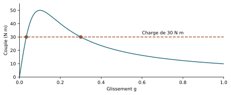
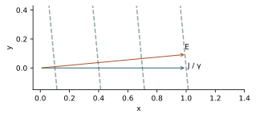
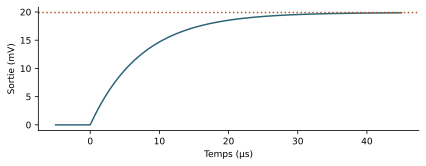
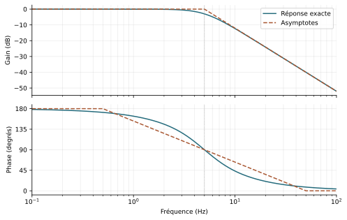

# Banque PT — Physique A 2006 · Corrigé guidé

*Corrigé rédigé par IA, non officiel. Signalez toute erreur.*

**Rédaction** · GPT-6.2 Astra Ultra · vitesse non renseignée

**Révision** · GPT-6.2 Astra Ultra · vitesse non renseignée

Le champ tournant d’un moteur, la tension transversale d’une sonde de Hall et le filtrage d’une puissance instantanée donnent trois applications de l’électromagnétisme. Coefficients d’admissibilité : 6 pour l’École polytechnique, 3 pour l’ENS Cachan. [Sujet officiel et documents](https://www.banquept.fr/documents/2006/phys_a_2006.zip) · [Rapport du jury](https://www.banquept.fr/documents/ecrit/rapport/2006/rapport_phys_a_ecrit_2006.pdf) · [Grille des coefficients](https://www.banquept.fr/documents/livret/2006/Livret_Rose_2006_1_2.pdf#page=12)

Le jury relève les difficultés sur le couple en fonction du glissement, l’effet Hall, les représentations complexes et les unités. Repérer les amplitudes crêtes et efficaces avant de calculer une puissance. Dans le schéma de Rauch, le signe du gain continu se retrouvera dans la phase de Bode.

## A — Moteur asynchrone

### A.1 · Stator et champ tournant

> [!INDICATION]
> Projeter les champs des trois bobines sur la même base.

**1.1 (p. 3).** Pour $\alpha_j=0,2\pi/3,4\pi/3$, $\vec B_j=KI_M\cos(\omega_s t-\alpha_j)(\cos\alpha_j\,\vec e_x+\sin\alpha_j\,\vec e_y)$. Les termes en $2\alpha_j$ se somment en zéro, ainsi
$$B_x=\tfrac32KI_M\cos\omega_s t,\quad B_y=\tfrac32KI_M\sin\omega_s t,\quad B=\tfrac32KI_M$$
pour $K>0$. **1.2.** La norme est fixe et le champ tourne de $x$ vers $y$ à $\omega_s=2\pi f=100\pi$ rad/s. À 50 Hz cela donne $n_s=60f=3000$ tr/min.

### A.2 · Flux, f.é.m. et courant rotorique

> [!INDICATION]
> Le flux dépend de l’angle entre le champ et la normale mobile.

**2.1.** $\Phi=NSB\cos[(\omega_s-\omega)t]=\Phi_M\cos\omega_r t$, $\omega_r=\omega_s-\omega$. **2.2.** La loi de Faraday donne $e=-d\Phi/dt=\Phi_M\omega_r\sin\omega_r t$.

**2.3.a (p. 4).** L’inductance propre conduit à $L\dot i+Ri=e$. **2.3.b.** L’impédance $R+i_{\rm u}L\omega_r$ (où $i_{\rm u}^2=-1$) donne $i(t)=I_M\sin(\omega_rt-\psi)$ avec $I_M=\Phi_M\omega_r/\sqrt{R^2+(L\omega_r)^2}$ et $\psi=\arctan(L\omega_r/R)$. Cette amplitude concerne le rotor. À synchronisme le flux ne varie plus et le courant établi s’annule.

### A.3.1–3.3 · Couple et glissement

> [!INDICATION]
> Le couple du cadre est celui d’un dipôle magnétique dans un champ uniforme.

**3.1.** $\vec\Gamma=NSi\vec n\times\vec B$, soit $\Gamma_z=\Phi_Mi(t)\sin\omega_r t$. **3.2.** La moyenne du produit des sinus déphasés est $\tfrac12\cos\psi$. Donc
$$\Gamma_{\rm em}={\Phi_M^2\over2L}{RL\omega_r\over R^2+(L\omega_r)^2}.$$
**3.3.** $g=(\omega_s-\omega)/\omega_s$ vaut 1 à l’arrêt et 0 au synchronisme.

### A.3.4–3.7 · Maximum et application numérique

> [!INDICATION]
> Ramener l’expression du couple à une seule variable sans dimension.

**3.4.** Poser $\Gamma_0=\Phi_M^2/(2L)$ et $x=gL\omega_s/R$. Alors $\Gamma_{\rm em}=\Gamma_0x/(1+x^2)$. **3.5.** Pour $g=1$, $\Gamma_d=\Gamma_0RL\omega_s/[R^2+(L\omega_s)^2]$. **3.6.** La dérivée a le signe de $1-x^2$. Sous $R\le L\omega_s$, le maximum accessible vaut $\Gamma_0/2$ à $g_{\max}=R/(L\omega_s)$.

**3.7.a.** Pour les données, $\Gamma_d=100(10/101)=9,90$ N m, $g_{\max}=0,10$ et $\Gamma_{\max}=50$ N m. **b.** $n=(1-g)n_s=2700$ tr/min. **c.** À ce glissement, $L\omega_r=R$, $L=40/(100\pi)$ H et $\Phi_M=\sqrt{2L\Gamma_0}$. On trouve $I_{\rm Reff}=I_M/\sqrt2=\Phi_M\omega_r/(2R)\simeq19,8$ A.

### A.3.8–3.9 · Courbe de couple et stabilité

> [!INDICATION]
> Une perturbation de vitesse positive diminue le glissement.

**3.8.** De l’arrêt au synchronisme on lit le graphe de $g=1$ vers $g=0$. Le couple part de $\Gamma_d$, passe par le maximum et rejoint zéro. **3.9.a.** Si $\Gamma_r>\Gamma_d$, le couple moteur initial ne suffit pas à démarrer la charge dans le sens prévu. **b.** Si $\Gamma_d<\Gamma_r<\Gamma_{\max}$, l’horizontale coupe les deux branches, donc deux vitesses positives satisfont l’équilibre.

**c.** $J\dot\omega=\Gamma_{\rm em}(g)-\Gamma_r$. L’équilibre est stable si $d\Gamma_{\rm em}/d\omega<0$, soit $d\Gamma_{\rm em}/dg>0$. Ainsi la branche à faible glissement (grande vitesse) est stable, l’autre instable. **d.** Avec $R=8$ ohms, $x=5$ au démarrage, $\Gamma_d=100(5/26)\simeq19,2$ N m.

### A.4 · Puissance et rendement

> [!INDICATION]
> Comparer le produit du couple par les deux vitesses angulaires.

**4.1.** Si $D=R^2+(L\omega_r)^2$, alors $P_{\rm méca}=\Gamma_{\rm em}\omega=\Gamma_0RL\omega_r\omega/D$ et $P_J=RI_M^2/2=\Gamma_0RL\omega_r^2/D=\Gamma_{\rm em}\omega_r$. **4.2.** $P_{\rm em}=\Gamma_{\rm em}(\omega+\omega_r)=\Gamma_{\rm em}\omega_s$. Hors du point de puissance nulle, $\eta=P_{\rm méca}/P_{\rm em}=\omega/\omega_s=1-g$. **4.3.** Pour $g=0,05$, $\eta=95\,\%$ dans ce modèle.

## B — Sonde à effet Hall

### B.1.1–1.4 · Porteurs et tension transversale

> [!INDICATION]
> Compenser la composante transversale de la force de Lorentz.

**1.1.** $\vec J=nq\vec v$ donne $\vec v=\vec J/(nq)$. **1.2.** L’absence de courant transversal en régime permanent exige $\vec E_H=-\vec v\times\vec B=(JB/(nq))\vec u_y$. Ses composantes $x,z$ sont nulles.

**1.3.** Du bord $A_1$ ($y=-L/2$) au bord $A_2$ ($y=L/2$), $V(A_1)-V(A_2)=\int_{A_1}^{A_2}\vec E_H\cdot d\vec l=JBL/(nq)=C_HIB/h$, $C_H=1/(nq)$ et $J=I/(Lh)$. **1.4.** À sens de courant et de champ connus, le signe identifie la charge des porteurs majoritaires du modèle.

### B.1.5–1.8 · Choix du matériau et géométrie du champ

> [!INDICATION]
> Le nombre de porteurs intervient au dénominateur de la constante de Hall.

**1.5.a.** Le métal donne $C_H\simeq-8,93\times10^{-11}$ m³/C et le semi-conducteur P $+3,125\times10^{-4}$ m³/C. Ce dernier produit la tension de plus grande valeur absolue. **b.** Avec $I=1$ A et $B=0,1$ T, on a $V_H=31,25$ mV pour $h=1$ mm et $312,5$ mV pour $0,1$ mm. L’épaisseur la plus petite favorise la sensibilité dans ce calcul.

**1.6.** Le champ électrique total vérifie $\vec E=\vec J/\gamma-C_H\vec J\times\vec B$, ou $\vec J=\gamma(\vec E+C_H\vec J\times\vec B)$. **1.7.** Dans le matériau P, pour $J,B>0$, le vecteur $\vec J/\gamma$ pointe vers $+x$, $\vec E$ est incliné vers $+y$ et les équipotentielles sont orthogonales à $\vec E$. **1.8.** $\tan\theta=E_y/E_x=\gamma C_HB=0,09375$, donc $\theta\simeq5,36^\circ$ à 1 T.

### B.2.1 · Capteur en boucle ouverte

> [!INDICATION]
> Identifier le gain du montage différentiel en écrivant les potentiels aux deux entrées.

**a.** Avec $B=\mu_0I_p/h$, $V_H=KII_p$, $K=C_H\mu_0/h^2$. **b.** Pour les nouvelles données ($C_H=4\times10^{-4}$ m³/C, $h=1,5$ mm), $K=2,23\times10^{-4}$ V/A², et $V_H=11,2$ mV pour $I=0,1$ A et $I_p=500$ A.

**c (p. 9).** Soient $V_b$ et $V_h$ les tensions basse et haute sur la sonde de la figure 5, $V_H=V_b-V_h$. L’entrée non inverseuse est à $R_2 V_b/(R_1+R_2)$. L’égalité des potentiels et la loi des nœuds à l’entrée inverseuse donnent $v_s=(R_2/R_1)(V_b-V_h)=(R_2/R_1)V_H$. **d.** Pour $k_s=10$ mV/A, il faut $R_2/R_1=k_s/(KI)\simeq448$. Par exemple $R_1=1$ kΩ, $R_2\simeq448$ kΩ (valeur ajustée), avec deux rapports appariés.

### B.2.2 · Capteur en boucle fermée

> [!INDICATION]
> Le courant secondaire s’oppose au champ à mesurer.

**a.** Dans l’entrefer, $W_m=B_s^2Sh/(2\mu_0)=\mu_0N_s^2S i_s^2/(2h)=Li_s^2/2$, donc $L=\mu_0N_s^2S/h\simeq0,838$ mH avec $S=10^{-4}$ m² et $N_s=100$.

**b.** Le champ net donne $V_H=KI(i_p-N_s i_s)$. Dans le modèle électrique indiqué, $L\dot i_s+(R+R_c)i_s=A V_H$. Si $D=R+R_c+AKI N_s$, alors $\tau\dot i_s+i_s=\alpha i_p$, $\tau=L/D$ et $\alpha=AKI/D$, avec $K=C_H\mu_0/h^2$. **c.** Avec $A=1000$, $R=100$ ohms, $R_c=10$ ohms, $D\simeq112,23$ ohms, $\tau\simeq7,46$ microsecondes et $\alpha\simeq1,99\times10^{-4}$.

**d.** Pour un échelon de 10 A et un courant initial nul, $v_c(t)=0$ avant l’échelon, puis $v_c=R_c\alpha I_0(1-e^{-t/\tau})$. À $t=\tau$ la tension vaut 63,2 % du plateau. La valeur finale est $19,9$ mV, soit $v_{c,\infty}/I_0=1,99$ mV/A.

## C — Wattmètre électronique

### C.1 · Puissance absorbée

> [!INDICATION]
> Les tensions et les courants de la question sont des amplitudes crêtes.

**1.1.** Pour $Z=R+jX$, $I_M=V_M/\sqrt{R^2+X^2}$ et $\varphi=\arg Z=\operatorname{atan2}(X,R)$, positif pour un dipôle inductif de résistance positive. **1.2.** $vi=V_MI_M[\cos\varphi+\cos(2\omega t-\varphi)]/2$, d’où $P=V_MI_M\cos\varphi/2$. **1.3.** Pour $5+j10$ ohms et $V_M=320$ V, $I_M=28,6$ A, $\varphi=1,107$ rad ($63,4^\circ$), $P=2048$ W.

### C.2 · Chaîne de conversion

> [!INDICATION]
> Suivre le produit des gains jusqu’au signe du moyenneur.

**2.1.** $v_1=Kk_ak_bvi$ et $\langle v_2\rangle=-\langle v_1\rangle=-Kk_ak_bP$, donc $k_w=-Kk_ak_b$. **2.2.** $k_w=-4,0\times10^{-4}$ V/W et, pour $-1,5$ V en sortie, $P=3750$ W.

### C.3.1–3.4 · Filtre actif de Rauch

> [!INDICATION]
> Le potentiel de l’entrée inverseuse est nul en fonctionnement linéaire.

**3.1.** Poser $p=j\omega$. Les courants au nœud A vérifient $(3+pRC_2)V_A=V_1+V_B+V_2$. Au nœud B, $(V_A-V_B)/R+pC_1(V_2-V_B)=0$ et $V_B=0$. **3.2.** D’où $V_A=-pRC_1V_2$ puis $T=V_2/V_1=-1/(1+3RC_1p+R^2C_1C_2p^2)$.

**3.3.** Identifier $T_0=-1$, $2m/\omega_0=3RC_1$, $1/\omega_0^2=R^2C_1C_2$. **3.4.** À $f_0=5$ Hz, $m=1/\sqrt2$ et $R=470$ kΩ, $C_1=2m/(3R\omega_0)\simeq31,9$ nF et $C_2=3/(2mR\omega_0)\simeq143,7$ nF.

### C.3.5–3.7 · Document-réponse et ondulation résiduelle

> [!INDICATION]
> Tracer en hertz, puis repérer la fréquence du produit, double de celle du secteur dans le modèle.

**3.5.** Avec $x=f/5$, le gain est $-10\log_{10}(1+x^4)$ dB, de 0 dB en basse fréquence à une pente de $-40$ dB/décade après 5 Hz. Il vaut $-3,01$ dB à 5 Hz. Une phase continue est $\pi-\operatorname{atan2}(\sqrt2x,1-x^2)$, de $180^\circ$ à $0^\circ$, par $90^\circ$ à 5 Hz. Le graphique reprend les trois décennies du feuillet-réponse séparé.

**3.6.** L’identification $p=d/dt$ donne $\ddot v_2+2m\omega_0\dot v_2+\omega_0^2v_2=-\omega_0^2v_1$. **3.7.** Avec $A=Kk_ak_bV_MI_M/2=1,28$ V, le signal d’entrée vaut $A[\cos\varphi+\cos(2\omega t-\varphi)]$. La sortie vaut $-A\cos\varphi$ plus une sinusoïde de fréquence 100 Hz et d’amplitude $A_M=A/\sqrt{1+20^4}\simeq3,20$ mV. La moyenne vaut $-0,692$ V pour $\varphi=1$ rad. L’ondulation crête relative est $A_M/(A|\cos\varphi|)\simeq0,463\,\%$.

### C.4 · Transformateur idéal et charge de mesure

> [!INDICATION]
> Appliquer la conservation de puissance avec les deux courants orientés vers les bornes homologues.

**4.1.** La même dérivée du flux donne $u_2/u_1=n_2/n_1$ pour les points homologues du dessin. Les deux courants entrants vérifient $n_1i_1+n_2i_2=0$, donc $i_2/i_1=-n_1/n_2$. **4.2.** Le rapport théorique est $5/230=1/46\simeq0,0217$. Avec $n_1=500$, le nombre théorique $n_2=10,87$ conduit à 11 spires et environ 5,06 V dans le modèle idéal.

**4.3.** Pour la tension primaire crête de 320 V de C.3.7, $P_c=(5/230)^2(320/\sqrt2)^2/(10\,000)\simeq2,42$ mW, très faible devant les $320(20)\cos(1)/2\simeq1,73$ kW de la charge. Avec le gain de capteur arrondi à $k_a=0,02$ de C.2.2, on trouve $2,05$ mW, ce qui conduit à la même conclusion.
