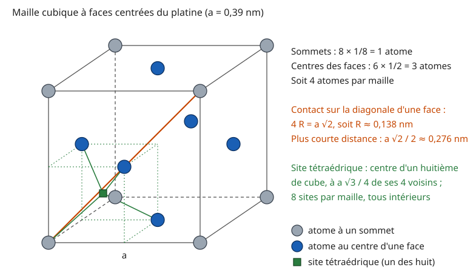
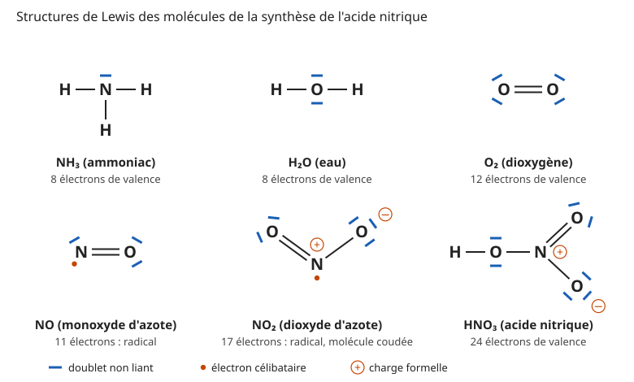

# Banque PT PT — Physique C - Chimie 2006 · Corrigé brut

*Corrigé rédigé par IA, non officiel. Signalez toute erreur.*

**Rédaction** · modèle exact non renseigné (famille Claude) · effort non renseigné · vitesse non renseignée

**Révision (tour 2)** · modèle exact non renseigné (famille Claude) · effort non renseigné · vitesse non renseignée · 28 novembre 2026

Problème de chimie de l'épreuve de Physique C (4 heures pour les deux problèmes, de même barème ; 2 heures conseillées pour la chimie, calculatrice autorisée), consacré au platine : 36 questions en quatre parties indépendantes (élément et cristal, oxydoréduction en solution, catalyse de la synthèse de l'acide nitrique, obtention industrielle du métal), avec une annexe de données. Les 36 questions sont traitées. Les repères sont ceux de l'énoncé, précédés du numéro de la partie et de la lettre de la section. L'énoncé demande trois chiffres significatifs. Deux choix sont signalés à leur place : les masses isotopiques, absentes de l'annexe, sont assimilées aux nombres de masse (I.A.3.b), et l'« oxygène » de la partie III est lu comme le dioxygène (III.1). Le document-réponse joint au sujet ne concerne que le problème de thermodynamique.

[Sujet officiel (archive)](https://www.banquept.fr/documents/2006/phys_c_2006.zip) · [Rapport du jury](https://www.banquept.fr/documents/ecrit/rapport/2006/rapport_phys_c_ecrit_2006.pdf)

## Partie I — Le platine : élément et cristallographie

### Question I.A.1 — Signification des nombres de la notation

Dans la notation $^{195}_{\ 78}\mathrm{Pt}$ :

- $Z = 78$ est le **numéro atomique** : nombre de protons du noyau. Il caractérise l'élément platine ; l'atome neutre possède donc aussi 78 électrons ;
- $A = 195$ est le **nombre de masse** : nombre de nucléons (protons et neutrons) du noyau.

Le noyau de cet isotope contient donc $N = A - Z$ neutrons.

$$\boxed{Z = 78\ \text{protons},\qquad A = 195\ \text{nucléons},\qquad N = A - Z = 117\ \text{neutrons}}$$

### Question I.A.2 — Règles de remplissage et structure électronique

Règles de remplissage (atome dans son état fondamental) :

- *principe d'exclusion de Pauli* : deux électrons d'un même atome ne peuvent avoir leurs quatre nombres quantiques identiques ; une orbitale contient donc au plus deux électrons, de spins opposés, et les sous-couches $s$, $p$, $d$, $f$ contiennent au plus 2, 6, 10 et 14 électrons ;
- *règle de Klechkowski* : les sous-couches se remplissent par valeurs croissantes de $n + \ell$ et, à $n + \ell$ égal, par valeurs croissantes de $n$ ;
- *règle de Hund* : dans une sous-couche incomplète, les électrons occupent le plus grand nombre possible d'orbitales, avec des spins parallèles.

Pour $Z = 78$, l'ordre de Klechkowski donne :

$$1s^2\,2s^2\,2p^6\,3s^2\,3p^6\,4s^2\,3d^{10}\,4p^6\,5s^2\,4d^{10}\,5p^6\,6s^2\,4f^{14}\,5d^{8}$$

Vérification : $2+2+6+2+6+2+10+6+2+10+6+2+14+8 = 78$. En regroupant par couches et en s'appuyant sur le xénon ($Z = 54$) :

$$\boxed{\mathrm{Pt} : [\mathrm{Xe}]\,4f^{14}\,5d^{8}\,6s^{2}}$$

D'après la règle de Hund, la sous-couche $5d^8$ comporte trois orbitales doublement occupées et deux électrons célibataires. Le platine est un élément de transition (bloc $d$, sixième période, dixième colonne).

*Remarque.* La configuration réelle du platine, $[\mathrm{Xe}]\,4f^{14}\,5d^{9}\,6s^{1}$, est une exception à la règle de Klechkowski, les niveaux $5d$ et $6s$ étant très proches ; la réponse attendue est celle que donnent les règles.

### Question I.A.3.a — Notion d'isotopie

Des **isotopes** sont des atomes (ou des noyaux) d'un même élément : ils ont le même numéro atomique $Z$, donc le même nombre de protons et le même cortège électronique, mais des nombres de masse $A$ différents, donc des nombres de neutrons différents. Ils ont pratiquement les mêmes propriétés chimiques et des masses différentes. Les six isotopes naturels du platine ont tous 78 protons et comptent 112, 114, 116, 117, 118 et 120 neutrons.

### Question I.A.3.b — Masse molaire du platine

La masse molaire de l'élément est la moyenne des masses molaires des isotopes, pondérée par leurs abondances (fractions atomiques $x_i$). L'énoncé ne donne pas les masses isotopiques : on assimile la masse molaire de l'isotope de nombre de masse $A_i$ à $A_i\ \mathrm{g\cdot mol^{-1}}$ (l'écart réel est inférieur à $0{,}1\ \%$). La somme des abondances de l'annexe vaut bien $100{,}0\ \%$.

$$M = \sum_i x_i\,A_i$$

$$M = 0{,}0013 \times 190 + 0{,}0078 \times 192 + 0{,}329 \times 194 + 0{,}338 \times 195 + 0{,}252 \times 196 + 0{,}0719 \times 198$$

$$\boxed{M(\mathrm{Pt}) \approx 195{,}1\ \mathrm{g\cdot mol^{-1}},\ \text{soit } 195\ \mathrm{g\cdot mol^{-1}} \text{ avec trois chiffres significatifs}}$$

### Question I.B.1 — Maille élémentaire

La maille conventionnelle est un cube d'arête $a$ ; les atomes de platine occupent les huit sommets et les centres des six faces.

Un atome à un sommet est partagé entre huit mailles, un atome au centre d'une face entre deux mailles :

$$N = 8 \times \frac{1}{8} + 6 \times \frac{1}{2}$$

$$\boxed{N = 4\ \text{atomes de platine par maille}}$$

### Question I.B.2 — Coordinence et distance minimale entre atomes

Les plus proches voisins d'un atome placé à un sommet sont les atomes situés aux centres des faces qui contiennent ce sommet. Trois plans de faces passent par le sommet, et dans chacun quatre faces se touchent en ce sommet : il y a $3 \times 4 = 12$ plus proches voisins, tous à la même distance (demi-diagonale d'une face).

$$\boxed{\text{coordinence } 12}$$

La distance minimale entre deux atomes, comptée de centre à centre, est la demi-diagonale d'une face :

$$d = \frac{a\sqrt{2}}{2}$$

$$d = \frac{0{,}39 \times \sqrt{2}}{2}\ \mathrm{nm}$$

$$\boxed{d \approx 0{,}276\ \mathrm{nm}}$$

### Question I.B.3 — Rayon atomique et compacité

Les atomes, sphères indéformables, sont tangents le long de la diagonale d'une face : cette diagonale, de longueur $a\sqrt{2}$, porte quatre rayons. La distance entre plus proches voisins vaut donc $2R_{\mathrm{Pt}}$.

$$4R_{\mathrm{Pt}} = a\sqrt{2}$$

$$R_{\mathrm{Pt}} = \frac{a\sqrt{2}}{4}$$

$$\boxed{R_{\mathrm{Pt}} \approx 0{,}138\ \mathrm{nm}}$$

La **compacité** $C$ est le rapport du volume réellement occupé par les atomes de la maille au volume de la maille :

$$C = \frac{N \times \dfrac{4}{3}\pi R_{\mathrm{Pt}}^3}{a^3}$$

$$C = \frac{4 \times \dfrac{4}{3}\pi \left(\dfrac{a\sqrt{2}}{4}\right)^3}{a^3}$$

$$\boxed{C = \frac{\pi\sqrt{2}}{6} \approx 0{,}740}$$

*Commentaire.* La compacité ne dépend pas de $a$. La valeur $0{,}74$ est la plus grande possible pour un empilement de sphères identiques (elle est commune au cubique à faces centrées et à l'hexagonal compact) : $74\ \%$ du volume est occupé, $26\ \%$ reste vide et forme les sites interstitiels. Cette compacité maximale, jointe à la masse molaire élevée, explique la forte masse volumique du platine.

### Question I.B.4 — Masse volumique

La maille, de volume $a^3$, contient $N = 4$ atomes, chacun de masse $M/N_A$ :

$$\mu = \frac{4M}{N_A\,a^3}$$

$$\mu = \frac{4 \times 195{,}1\times 10^{-3}}{6{,}023\times 10^{23} \times (0{,}39\times 10^{-9})^3}\ \mathrm{kg\cdot m^{-3}}$$

$$\boxed{\mu \approx 2{,}18\times 10^{4}\ \mathrm{kg\cdot m^{-3}} = 21{,}8\ \mathrm{g\cdot cm^{-3}}}$$

L'ordre de grandeur est correct (valeur tabulée voisine de $21{,}4\ \mathrm{g\cdot cm^{-3}}$ ; l'écart vient de la valeur de $a$, donnée avec deux chiffres seulement). Le platine est bien l'un des métaux les plus denses, comme l'annonce l'introduction.

### Question I.B.5.a — Sites tétraédriques et formule du composé

Un site tétraédrique est la cavité comprise entre quatre atomes tangents formant un tétraèdre régulier. En découpant la maille en huit petits cubes d'arête $a/2$, chaque petit cube a quatre de ses sommets occupés (un sommet de la maille et les centres des trois faces qui s'y coupent) : son centre est le centre d'un site tétraédrique (figure 1).

Il y a donc **8 sites tétraédriques par maille**, aux centres des huit petits cubes, c'est-à-dire aux points de coordonnées $(a/4\ \text{ou}\ 3a/4,\ a/4\ \text{ou}\ 3a/4,\ a/4\ \text{ou}\ 3a/4)$, sur les grandes diagonales du cube au quart de leur longueur à partir de chaque sommet. Ils sont tous intérieurs à la maille et lui appartiennent en propre.

Si tous les sites sont occupés, la maille contient 8 atomes X pour 4 atomes de platine :

$$\boxed{\text{8 sites tétraédriques par maille ; composé de formule } \mathrm{PtX_2}}$$

### Question I.B.5.b — Rayon maximal de l'impureté

Le centre du site est à la demi-diagonale d'un petit cube d'arête $a/2$ de chacun des quatre atomes qui l'entourent, soit à la distance $a\sqrt{3}/4$. L'atome X y loge sans déformer le réseau tant que :

$$R_{\mathrm{X}} + R_{\mathrm{Pt}} \leqslant \frac{a\sqrt{3}}{4}$$

Avec la condition de tangence des atomes de platine, $a = 2\sqrt{2}\,R_{\mathrm{Pt}}$ :

$$R_{\mathrm{X}} + R_{\mathrm{Pt}} \leqslant \sqrt{\frac{3}{2}}\,R_{\mathrm{Pt}}$$

$$\boxed{R_{\mathrm{X,max}} = \left(\sqrt{\frac{3}{2}} - 1\right) R_{\mathrm{Pt}} \approx 0{,}225\,R_{\mathrm{Pt}}}$$

$$R_{\mathrm{X,max}} = 0{,}2247 \times 0{,}1379\ \mathrm{nm}$$

$$\boxed{R_{\mathrm{X,max}} \approx 0{,}0310\ \mathrm{nm} = 31{,}0\ \mathrm{pm}}$$

Seuls de très petits atomes peuvent s'insérer dans ces sites sans dilater le réseau.

## Partie II — Le platine en solution

### Question II.A.1 — Équation globale d'oxydoréduction

Les deux demi-équations de l'énoncé échangent le même nombre $n$ d'électrons :

$$\alpha_1\,\mathrm{Ox_1} + n\,e^- \rightleftarrows \mathrm{Red_1}$$

$$\alpha_2\,\mathrm{Ox_2} + n\,e^- \rightleftarrows \beta_2\,\mathrm{Red_2}$$

Le réducteur 1 étant réactif avec le nombre stœchiométrique $\nu = -1$, on retranche la première demi-équation de la seconde ; les électrons s'éliminent :

$$\boxed{\mathrm{Red_1} + \alpha_2\,\mathrm{Ox_2} = \alpha_1\,\mathrm{Ox_1} + \beta_2\,\mathrm{Red_2}}$$

Cette équation met en jeu $n$ électrons échangés par mole de $\mathrm{Red_1}$.

### Question II.A.2 — Constante d'équilibre et potentiels standard

**Définition.** La constante d'équilibre $K^\circ(T)$ est la valeur que prend, à l'équilibre chimique, le quotient de réaction, produit des activités élevées aux nombres stœchiométriques algébriques ; elle ne dépend que de la température et vérifie $\Delta_r G^\circ(T) = -RT\ln K^\circ(T)$.

$$K^\circ = \left(\frac{a_{\mathrm{Ox_1}}^{\alpha_1}\; a_{\mathrm{Red_2}}^{\beta_2}}{a_{\mathrm{Red_1}}\; a_{\mathrm{Ox_2}}^{\alpha_2}}\right)_{\text{éq}}$$

**Relation avec les potentiels standard.** Les relations de Nernst des deux couples s'écrivent, à 298 K, avec $RT\ln 10/F = 0{,}06\ \mathrm{V}$ :

$$E_1 = E^\circ_1 + \frac{0{,}06}{n}\log\frac{a_{\mathrm{Ox_1}}^{\alpha_1}}{a_{\mathrm{Red_1}}}$$

$$E_2 = E^\circ_2 + \frac{0{,}06}{n}\log\frac{a_{\mathrm{Ox_2}}^{\alpha_2}}{a_{\mathrm{Red_2}}^{\beta_2}}$$

À l'équilibre, le potentiel de la solution est unique, $E_1 = E_2$ :

$$E^\circ_2 - E^\circ_1 = \frac{0{,}06}{n}\log\frac{a_{\mathrm{Ox_1}}^{\alpha_1}\; a_{\mathrm{Red_2}}^{\beta_2}}{a_{\mathrm{Red_1}}\; a_{\mathrm{Ox_2}}^{\alpha_2}}$$

$$\boxed{\log K^\circ = \frac{n\,(E^\circ_2 - E^\circ_1)}{0{,}06} = \frac{nF\,(E^\circ_2 - E^\circ_1)}{RT\ln 10}}$$

avec les potentiels en volts ; $E^\circ_2$ est le potentiel standard du couple dont l'oxydant est réactif, $E^\circ_1$ celui du couple dont le réducteur est réactif. On retrouve le même résultat par $\Delta_r G^\circ = -nF(E^\circ_2 - E^\circ_1) = -RT\ln K^\circ$.

### Question II.A.3.a — Condition pour une réaction « totale »

La réaction est dite totale si $K^\circ > 10^4$, soit $\log K^\circ > 4$ :

$$\frac{n\,\Delta E^\circ}{0{,}06} > 4$$

$$\boxed{\Delta E^\circ = E^\circ_2 - E^\circ_1 > \frac{0{,}24}{n}\ \mathrm{V}}$$

Soit $0{,}24\ \mathrm{V}$ pour un électron échangé, $0{,}12\ \mathrm{V}$ pour deux, $0{,}06\ \mathrm{V}$ pour quatre : l'oxydant 2 doit être nettement plus fort que l'oxydant 1.

### Question II.A.3.b — Condition pour une réaction quasi inexistante

La réaction n'a quasiment pas lieu si $K^\circ < 10^{-4}$, soit $\log K^\circ < -4$ :

$$\boxed{\Delta E^\circ = E^\circ_2 - E^\circ_1 < -\frac{0{,}24}{n}\ \mathrm{V}}$$

L'oxydant mis en présence du réducteur 1 est alors nettement plus faible que l'oxydant conjugué de ce réducteur. Entre les deux seuils, $-0{,}24/n < \Delta E^\circ < 0{,}24/n$, la réaction est équilibrée et son avancement dépend des concentrations.

### Question II.B.1.a — Couples mis en jeu dans l'acide nitrique

L'acide nitrique est un acide fort : la solution contient les ions $\mathrm{H^+_{(aq)}}$ et $\mathrm{NO_3^-}$, chacun à $0{,}1\ \mathrm{mol\cdot L^{-1}}$. La solution étant dégazée, elle ne contient pas de dioxygène dissous : le couple $\mathrm{O_2/H_2O}$ n'intervient pas comme oxydant. Les couples à considérer sont ceux de l'annexe :

- couples du platine, dont le métal est le réducteur : $\mathrm{Pt^{2+}/Pt}$ ($E^\circ = 1{,}19\ \mathrm{V}$) et $\mathrm{Pt^{4+}/Pt}$ ($E^\circ = 1{,}15\ \mathrm{V}$) ; on en déduirait le couple $\mathrm{Pt^{4+}/Pt^{2+}}$ ;
- couples dont l'oxydant est présent dans la solution : $\mathrm{H^+/H_2}$ ($E^\circ = 0{,}00\ \mathrm{V}$) et $\mathrm{NO_3^-/NO}$ ($E^\circ = 0{,}96\ \mathrm{V}$).

$$\boxed{\mathrm{Pt^{2+}/Pt}\ ;\quad \mathrm{Pt^{4+}/Pt}\ ;\quad \mathrm{H^+/H_2}\ ;\quad \mathrm{NO_3^-/NO}}$$

### Question II.B.1.b — Équations des réactions d'oxydation du platine

Demi-équations :

$$\mathrm{Pt^{2+}} + 2\,e^- \rightleftarrows \mathrm{Pt_{(s)}}$$

$$\mathrm{Pt^{4+}} + 4\,e^- \rightleftarrows \mathrm{Pt_{(s)}}$$

$$2\,\mathrm{H^+} + 2\,e^- \rightleftarrows \mathrm{H_{2(g)}}$$

$$\mathrm{NO_3^-} + 4\,\mathrm{H^+} + 3\,e^- \rightleftarrows \mathrm{NO_{(g)}} + 2\,\mathrm{H_2O}$$

Avec le nombre stœchiométrique $-1$ pour le platine, on ajuste la demi-équation de l'oxydant au nombre d'électrons cédés par un atome de platine ($n = 2$ ou $n = 4$), ce qui impose des coefficients fractionnaires avec l'ion nitrate.

Oxydation par les ions $\mathrm{H^+}$ :

$$\boxed{(1)\quad \mathrm{Pt_{(s)}} + 2\,\mathrm{H^+} = \mathrm{Pt^{2+}} + \mathrm{H_{2(g)}} \qquad (n = 2)}$$

$$\boxed{(2)\quad \mathrm{Pt_{(s)}} + 4\,\mathrm{H^+} = \mathrm{Pt^{4+}} + 2\,\mathrm{H_{2(g)}} \qquad (n = 4)}$$

Oxydation par les ions nitrate :

$$\boxed{(3)\quad \mathrm{Pt_{(s)}} + \tfrac{2}{3}\,\mathrm{NO_3^-} + \tfrac{8}{3}\,\mathrm{H^+} = \mathrm{Pt^{2+}} + \tfrac{2}{3}\,\mathrm{NO_{(g)}} + \tfrac{4}{3}\,\mathrm{H_2O} \qquad (n = 2)}$$

$$\boxed{(4)\quad \mathrm{Pt_{(s)}} + \tfrac{4}{3}\,\mathrm{NO_3^-} + \tfrac{16}{3}\,\mathrm{H^+} = \mathrm{Pt^{4+}} + \tfrac{4}{3}\,\mathrm{NO_{(g)}} + \tfrac{8}{3}\,\mathrm{H_2O} \qquad (n = 4)}$$

Vérification de (4) : azote $4/3$ de part et d'autre ; oxygène $4$ et $4/3 + 8/3 = 4$ ; hydrogène $16/3$ de part et d'autre ; charges $-4/3 + 16/3 = +4$ de part et d'autre.

### Question II.B.1.c — Caractère total ou non de ces réactions

On applique le résultat de la partie II.A à chaque équation, $E^\circ_1$ étant le potentiel standard du couple du platine et $E^\circ_2$ celui du couple de l'oxydant :

$$\log K^\circ_1 = \frac{2 \times (0{,}00 - 1{,}19)}{0{,}06} \approx -39{,}7$$

$$\log K^\circ_2 = \frac{4 \times (0{,}00 - 1{,}15)}{0{,}06} \approx -76{,}7$$

$$\log K^\circ_3 = \frac{2 \times (0{,}96 - 1{,}19)}{0{,}06} \approx -7{,}67$$

$$\log K^\circ_4 = \frac{4 \times (0{,}96 - 1{,}15)}{0{,}06} \approx -12{,}7$$

$$\boxed{K^\circ_1 \approx 2{,}15\times 10^{-40}\ ;\quad K^\circ_2 \approx 2{,}15\times 10^{-77}\ ;\quad K^\circ_3 \approx 2{,}15\times 10^{-8}\ ;\quad K^\circ_4 \approx 2{,}15\times 10^{-13}}$$

Les quatre constantes sont inférieures à $10^{-4}$ ; de façon équivalente, les quatre écarts $\Delta E^\circ$ ($-1{,}19$, $-1{,}15$, $-0{,}23$ et $-0{,}19\ \mathrm{V}$) sont inférieurs aux seuils $-0{,}24/n$ ($-0{,}12\ \mathrm{V}$ pour $n = 2$, $-0{,}06\ \mathrm{V}$ pour $n = 4$).

**Aucune de ces réactions n'a quasiment lieu : le platine n'est attaqué ni par les ions $\mathrm{H^+}$ ni par les ions nitrate d'une solution d'acide nitrique.**

### Question II.B.2.a — Nouvelle espèce soluble du platine

L'acide chlorhydrique apporte des ions chlorure, qui sont des ligands. L'annexe donne la constante globale de formation du complexe hexachloroplatinate(IV) à partir des ions $\mathrm{Pt^{4+}}$ et $\mathrm{Cl^-}$ :

$$\mathrm{Pt^{4+}} + 6\,\mathrm{Cl^-} = \mathrm{PtCl_6^{2-}} \qquad \beta = 2{,}15\times 10^{27}$$

$$\boxed{\text{Le platine est engagé dans l'ion complexe } \mathrm{PtCl_6^{2-}}\ \text{(platine au degré +IV)}}$$

### Question II.B.2.b — Nouveau couple et potentiel standard

Le nouveau couple est $\mathrm{PtCl_6^{2-}/Pt}$, de demi-équation :

$$\mathrm{PtCl_6^{2-}} + 4\,e^- \rightleftarrows \mathrm{Pt_{(s)}} + 6\,\mathrm{Cl^-}$$

En présence d'ions chlorure, le potentiel du couple $\mathrm{Pt^{4+}/Pt}$ s'écrit, en remplaçant $[\mathrm{Pt^{4+}}]$ par son expression tirée de $\beta$ (concentrations rapportées à $c^\circ = 1\ \mathrm{mol\cdot L^{-1}}$) :

$$E = E^\circ(\mathrm{Pt^{4+}/Pt}) + \frac{0{,}06}{4}\log[\mathrm{Pt^{4+}}]$$

$$[\mathrm{Pt^{4+}}] = \frac{[\mathrm{PtCl_6^{2-}}]}{\beta\,[\mathrm{Cl^-}]^6}$$

$$E = E^\circ(\mathrm{Pt^{4+}/Pt}) - \frac{0{,}06}{4}\log\beta + \frac{0{,}06}{4}\log\frac{[\mathrm{PtCl_6^{2-}}]}{[\mathrm{Cl^-}]^6}$$

Le dernier terme est le terme de Nernst du couple $\mathrm{PtCl_6^{2-}/Pt}$ ; par identification :

$$E^\circ(\mathrm{PtCl_6^{2-}/Pt}) = E^\circ(\mathrm{Pt^{4+}/Pt}) - \frac{0{,}06}{4}\log\beta$$

$$E^\circ(\mathrm{PtCl_6^{2-}/Pt}) = 1{,}15 - 0{,}015 \times 27{,}33$$

$$\boxed{E^\circ(\mathrm{PtCl_6^{2-}/Pt}) \approx 0{,}740\ \mathrm{V}}$$

La complexation de l'oxydant $\mathrm{Pt^{4+}}$ le stabilise : le potentiel standard baisse de $0{,}41\ \mathrm{V}$, et le platine devient un meilleur réducteur en milieu chlorure.

### Question II.B.2.c — Équation de l'oxydation du platine en milieu chlorhydrique

Dans l'acide chlorhydrique dégazé, le seul oxydant est l'ion $\mathrm{H^+}$ ; l'ion chlorure joue le rôle de ligand. On combine la demi-équation du couple $\mathrm{PtCl_6^{2-}/Pt}$ (lue dans le sens de l'oxydation) et deux fois celle du couple $\mathrm{H^+/H_2}$ :

$$\boxed{\mathrm{Pt_{(s)}} + 4\,\mathrm{H^+} + 6\,\mathrm{Cl^-} = \mathrm{PtCl_6^{2-}} + 2\,\mathrm{H_{2(g)}} \qquad (n = 4)}$$

### Question II.B.2.d — Caractère total ou non de cette réaction

$$\log K^\circ = \frac{4 \times (0{,}00 - 0{,}740)}{0{,}06} \approx -49{,}3$$

$$\boxed{K^\circ \approx 4{,}63\times 10^{-50} < 10^{-4}}$$

(On vérifie que $K^\circ = \beta \times K^\circ_2$, soit $2{,}15\times 10^{27} \times 2{,}154\times 10^{-77}$ ; le troisième chiffre dépend des arrondis intermédiaires : $4{,}64\times 10^{-50}$ si l'on arrondit $E^\circ$ à $0{,}740\ \mathrm{V}$ avant de calculer.) L'écart $\Delta E^\circ = -0{,}74\ \mathrm{V}$ est très inférieur au seuil $-0{,}06\ \mathrm{V}$ : **la réaction n'a quasiment pas lieu**. Malgré la complexation, l'acide chlorhydrique seul n'attaque pas le platine : l'ion $\mathrm{H^+}$ reste un oxydant trop faible.

### Question II.B.3.a — Attaque du platine par l'eau régale

L'eau régale contient à la fois l'oxydant $\mathrm{NO_3^-}$ et le ligand $\mathrm{Cl^-}$. On oppose les couples $\mathrm{NO_3^-/NO}$ et $\mathrm{PtCl_6^{2-}/Pt}$, avec quatre électrons échangés par atome de platine :

$$\boxed{\mathrm{Pt_{(s)}} + \tfrac{4}{3}\,\mathrm{NO_3^-} + \tfrac{16}{3}\,\mathrm{H^+} + 6\,\mathrm{Cl^-} = \mathrm{PtCl_6^{2-}} + \tfrac{4}{3}\,\mathrm{NO_{(g)}} + \tfrac{8}{3}\,\mathrm{H_2O}}$$

$$\log K^\circ = \frac{4 \times (0{,}96 - 0{,}740)}{0{,}06} \approx 14{,}7$$

$$\boxed{K^\circ \approx 4{,}63\times 10^{14} > 10^{4}}$$

(On vérifie que $K^\circ = \beta \times K^\circ_4$, soit $2{,}15\times 10^{27} \times 2{,}154\times 10^{-13}$ ; même remarque sur le troisième chiffre : $4{,}64\times 10^{14}$ avec $E^\circ$ arrondi à $0{,}740\ \mathrm{V}$.) L'écart $\Delta E^\circ = +0{,}22\ \mathrm{V}$ dépasse le seuil $0{,}06\ \mathrm{V}$ pour $n = 4$.

**Conclusion.** La réaction est totale : l'eau régale dissout le platine, alors qu'aucun des deux acides pris séparément ne l'attaque. L'acide nitrique fournit l'oxydant, l'acide chlorhydrique le ligand qui abaisse le potentiel du couple du platine en dessous de celui du couple $\mathrm{NO_3^-/NO}$. Les fortes concentrations en $\mathrm{H^+}$, $\mathrm{NO_3^-}$ et $\mathrm{Cl^-}$ déplacent encore l'équilibre dans le sens de la dissolution.

### Question II.B.3.b — Dégagement d'un gaz roux

La réaction produit du monoxyde d'azote $\mathrm{NO}$, gaz incolore. En se dégageant dans l'atmosphère, il rencontre le dioxygène de l'air, qui l'oxyde spontanément en dioxyde d'azote, gaz roux :

$$\boxed{2\,\mathrm{NO_{(g)}} + \mathrm{O_{2(g)}} = 2\,\mathrm{NO_{2(g)}}}$$

C'est la même réaction que l'étape 2 de la synthèse de l'acide nitrique (partie III), ici sans catalyseur.

### Question II.B.4 — Le platine, métal noble

Les potentiels standard des couples $\mathrm{Pt^{2+}/Pt}$ et $\mathrm{Pt^{4+}/Pt}$ sont très élevés ($1{,}19$ et $1{,}15\ \mathrm{V}$) : le platine est un réducteur très faible. Il n'est oxydé ni par les ions $\mathrm{H^+}$ des acides ($K^\circ \sim 10^{-40}$ à $10^{-77}$), ni même par un acide oxydant comme l'acide nitrique ($K^\circ \sim 10^{-8}$ à $10^{-13}$), ni par l'acide chlorhydrique malgré la complexation ($K^\circ \sim 10^{-50}$). Il faut réunir un oxydant fort et un ligand qui stabilise fortement le platine(IV), comme dans l'eau régale, pour le dissoudre.

**Le platine est donc un métal noble : il reste à l'état métallique, inaltéré, dans presque tous les milieux usuels**, ce qui rejoint l'introduction (résistance à l'oxydation et à la corrosion, métal qui ne ternit pas).

### Question II.B.5.a — Constante d'équilibre de la dismutation

Équation de la dismutation, avec le nombre stœchiométrique $-2$ pour l'ion $\mathrm{Pt^{2+}}$ :

$$\boxed{2\,\mathrm{Pt^{2+}} = \mathrm{Pt_{(s)}} + \mathrm{Pt^{4+}}}$$

Cette équation est la différence entre deux fois la demi-équation $\mathrm{Pt^{2+}} + 2e^- \rightleftarrows \mathrm{Pt}$ et la demi-équation $\mathrm{Pt^{4+}} + 4e^- \rightleftarrows \mathrm{Pt}$. Les enthalpies libres standard se combinent de la même façon :

$$\Delta_r G^\circ = 2 \times \left(-2F E^\circ(\mathrm{Pt^{2+}/Pt})\right) - \left(-4F E^\circ(\mathrm{Pt^{4+}/Pt})\right)$$

$$\Delta_r G^\circ = -4F\left(E^\circ(\mathrm{Pt^{2+}/Pt}) - E^\circ(\mathrm{Pt^{4+}/Pt})\right)$$

$$\log K^\circ = \frac{4 \times \left(E^\circ(\mathrm{Pt^{2+}/Pt}) - E^\circ(\mathrm{Pt^{4+}/Pt})\right)}{0{,}06}$$

$$\log K^\circ = \frac{4 \times (1{,}19 - 1{,}15)}{0{,}06} \approx 2{,}67$$

$$\boxed{K^\circ \approx 464}$$

*Autre présentation.* Le couple $\mathrm{Pt^{4+}/Pt^{2+}}$ a pour potentiel standard $E^\circ = (4 \times 1{,}15 - 2 \times 1{,}19)/2 = 1{,}11\ \mathrm{V}$, inférieur à $E^\circ(\mathrm{Pt^{2+}/Pt}) = 1{,}19\ \mathrm{V}$ : l'ion $\mathrm{Pt^{2+}}$ est un meilleur oxydant que $\mathrm{Pt^{4+}}$ et se dismute. La formule de II.A.2 avec $n = 2$ redonne $\log K^\circ = 2 \times (1{,}19 - 1{,}11)/0{,}06 \approx 2{,}67$.

La constante est supérieure à 1 mais inférieure à $10^4$ : la dismutation est favorable sans être totale.

### Question II.B.5.b — État final pour c = 10⁻² mol·L⁻¹

La solution ne contient initialement que $\mathrm{Pt^{2+}}$ : le quotient de réaction est nul, la réaction évolue dans le sens direct et du platine solide se dépose (son activité vaut 1). Soit $x$ l'avancement volumique à l'équilibre, en $\mathrm{mol\cdot L^{-1}}$ :

$$[\mathrm{Pt^{4+}}] = x \qquad [\mathrm{Pt^{2+}}] = c - 2x$$

$$K^\circ = \frac{[\mathrm{Pt^{4+}}]\,c^\circ}{[\mathrm{Pt^{2+}}]^2} = \frac{x}{(c - 2x)^2}$$

avec les concentrations en $\mathrm{mol\cdot L^{-1}}$. D'où l'équation du second degré, dont on retient la racine comprise entre 0 et $c/2$ :

$$4K^\circ x^2 - (4K^\circ c + 1)\,x + K^\circ c^2 = 0$$

$$x = \frac{4K^\circ c + 1 - \sqrt{8K^\circ c + 1}}{8K^\circ}$$

Pour $c = 10^{-2}\ \mathrm{mol\cdot L^{-1}}$ et $K^\circ = 464$ : $4K^\circ c = 18{,}57$ et $\sqrt{8K^\circ c + 1} = 6{,}175$.

$$\boxed{[\mathrm{Pt^{4+}}] \approx 3{,}61\times 10^{-3}\ \mathrm{mol\cdot L^{-1}}\ ;\qquad [\mathrm{Pt^{2+}}] \approx 2{,}79\times 10^{-3}\ \mathrm{mol\cdot L^{-1}}}$$

Il s'est déposé $3{,}61\times 10^{-3}\ \mathrm{mol}$ de platine par litre de solution. Le taux de dismutation vaut :

$$\tau = \frac{2x}{c} \approx 0{,}721$$

Vérification : $x/(c-2x)^2 = 3{,}61\times 10^{-3}/(2{,}79\times 10^{-3})^2 \approx 464$. **Environ $72\ \%$ des ions $\mathrm{Pt^{2+}}$ se sont dismutés : l'état final est un équilibre où les trois espèces coexistent, et la dismutation est largement avancée sans être totale.**

### Question II.B.5.c — État final pour c = 10⁻⁴ mol·L⁻¹ et comparaison

La même formule avec $c = 10^{-4}\ \mathrm{mol\cdot L^{-1}}$ donne $4K^\circ c = 0{,}1857$ et $\sqrt{8K^\circ c + 1} = 1{,}171$ :

$$\boxed{[\mathrm{Pt^{4+}}] \approx 3{,}94\times 10^{-6}\ \mathrm{mol\cdot L^{-1}}\ ;\qquad [\mathrm{Pt^{2+}}] \approx 9{,}21\times 10^{-5}\ \mathrm{mol\cdot L^{-1}}}$$

$$\tau = \frac{2x}{c} \approx 0{,}0788$$

Vérification : $3{,}94\times 10^{-6}/(9{,}21\times 10^{-5})^2 \approx 464$. **Moins de $8\ \%$ des ions $\mathrm{Pt^{2+}}$ se sont dismutés.**

**Comparaison et commentaire.** Avec la même constante, le taux de dismutation passe de $72\ \%$ à $8\ \%$ quand la solution est cent fois plus diluée. La dismutation consomme deux ions dissous pour n'en former qu'un : elle diminue le nombre d'espèces en solution, et la dilution déplace l'équilibre dans le sens inverse (loi de dilution). Le rapport $[\mathrm{Pt^{4+}}]/[\mathrm{Pt^{2+}}] = K^\circ [\mathrm{Pt^{2+}}]/c^\circ$ est d'autant plus petit que la solution est diluée. Une constante de $464$ ne correspond donc ni à une réaction totale ni à une réaction négligeable : c'est la concentration qui décide. L'hypothèse faite jusqu'à la question B.5 (ion $\mathrm{Pt^{2+}}$ stable) est acceptable en solution très diluée, ce qui est le cas des traces d'ions $\mathrm{Pt^{2+}}$ que formeraient les réactions (1) et (3) ; elle ne l'est plus en solution concentrée.

## Partie III — Le platine : un catalyseur efficace

### Question III.1 — Équations des trois étapes de la synthèse de l'acide nitrique

L'« oxygène » de l'énoncé désigne le dioxygène $\mathrm{O_2}$. Le platine, catalyseur, ne figure pas dans les équations.

$$\boxed{\text{Étape 1 :}\quad 4\,\mathrm{NH_{3(g)}} + 5\,\mathrm{O_{2(g)}} = 4\,\mathrm{NO_{(g)}} + 6\,\mathrm{H_2O_{(g)}}}$$

$$\boxed{\text{Étape 2 :}\quad 2\,\mathrm{NO_{(g)}} + \mathrm{O_{2(g)}} = 2\,\mathrm{NO_{2(g)}}}$$

$$\boxed{\text{Étape 3 :}\quad 4\,\mathrm{NO_{2(g)}} + \mathrm{O_{2(g)}} + 2\,\mathrm{H_2O} = 4\,\mathrm{HNO_3}}$$

Vérification de l'étape 3 : azote 4 ; hydrogène 4 ; oxygène $8 + 2 + 2 = 12$ de part et d'autre. Bilan des trois étapes : $\mathrm{NH_3} + 2\,\mathrm{O_2} = \mathrm{HNO_3} + \mathrm{H_2O}$.

### Question III.2 — Structures de Lewis

**Atomes.** L'azote ($Z = 7$) a pour configuration $1s^2\,2s^2\,2p^3$ : 5 électrons de valence, soit un doublet non liant et trois électrons célibataires (trivalent). L'oxygène ($Z = 8$) a pour configuration $1s^2\,2s^2\,2p^4$ : 6 électrons de valence, soit deux doublets non liants et deux électrons célibataires (divalent). L'hydrogène a un électron de valence. Si l'on comprend « l'azote et l'oxygène » comme les corps simples, le dioxygène figure ci-dessous et le diazote s'écrit $|\mathrm{N{\equiv}N}|$ (10 électrons de valence : une liaison triple et un doublet non liant sur chaque atome).

**Molécules.** Six molécules interviennent dans la synthèse ; leurs structures sont représentées sur la figure 2.

- $\mathrm{NH_3}$ (8 électrons de valence) : trois liaisons simples $\mathrm{N{-}H}$ et un doublet non liant sur l'azote ; octet respecté.
- $\mathrm{H_2O}$ (8 électrons) : deux liaisons simples $\mathrm{O{-}H}$ et deux doublets non liants sur l'oxygène.
- $\mathrm{O_2}$ (12 électrons) : une liaison double $\mathrm{O{=}O}$ et deux doublets non liants sur chaque atome.
- $\mathrm{NO}$ (11 électrons, nombre impair) : molécule radicalaire ; liaison double $\mathrm{N{=}O}$, deux doublets non liants sur l'oxygène, un doublet non liant et un électron célibataire sur l'azote, qui n'est entouré que de 7 électrons.
- $\mathrm{NO_2}$ (17 électrons, nombre impair) : molécule radicalaire ; l'azote, central, forme une liaison double avec un oxygène (porteur de deux doublets non liants) et une liaison simple avec l'autre (porteur de trois doublets non liants et d'une charge formelle $-$) ; il porte un électron célibataire et une charge formelle $+$. Une forme mésomère échange les rôles des deux oxygènes.
- $\mathrm{HNO_3}$ (24 électrons) : l'azote, central, est lié à trois oxygènes : une liaison simple avec l'oxygène du groupe $\mathrm{O{-}H}$ (deux doublets non liants), une liaison double avec un deuxième oxygène (deux doublets non liants), une liaison simple avec le troisième (trois doublets non liants, charge formelle $-$) ; l'azote ne porte aucun doublet non liant et a une charge formelle $+$. L'octet est respecté pour tous les atomes ; deux formes mésomères échangent les deux oxygènes terminaux.

Les charges formelles se contrôlent : dans $\mathrm{HNO_3}$, l'azote possède en propre 4 électrons (la moitié de quatre doublets liants) au lieu de 5, d'où $+1$ ; l'oxygène simplement lié en possède 7 au lieu de 6, d'où $-1$ ; la somme est nulle.

### Question III.3 — Nombres d'oxydation de l'azote

Avec $+\mathrm{I}$ pour l'hydrogène, $-\mathrm{II}$ pour l'oxygène et une somme nulle pour une molécule neutre :

- $\mathrm{NH_3}$ : $x + 3 = 0$, soit $x = -\mathrm{III}$ ;
- $\mathrm{NO}$ : $x - 2 = 0$, soit $x = +\mathrm{II}$ ;
- $\mathrm{NO_2}$ : $x - 4 = 0$, soit $x = +\mathrm{IV}$ ;
- $\mathrm{HNO_3}$ : $1 + x - 6 = 0$, soit $x = +\mathrm{V}$.

$$\boxed{\mathrm{NH_3} : -\mathrm{III}\ ;\quad \mathrm{NO} : +\mathrm{II}\ ;\quad \mathrm{NO_2} : +\mathrm{IV}\ ;\quad \mathrm{HNO_3} : +\mathrm{V}}$$

Les structures de Lewis donnent le même résultat en attribuant les doublets liants à l'atome le plus électronégatif (l'azote, plus électronégatif que l'hydrogène, moins que l'oxygène).

### Question III.4 — Oxydation ou réduction de l'azote

Le nombre d'oxydation de l'azote augmente à chaque étape : de $-\mathrm{III}$ à $+\mathrm{II}$ (étape 1), de $+\mathrm{II}$ à $+\mathrm{IV}$ (étape 2), de $+\mathrm{IV}$ à $+\mathrm{V}$ (étape 3).

**L'élément azote a été oxydé**, de $-\mathrm{III}$ dans l'ammoniac à $+\mathrm{V}$ dans l'acide nitrique, soit 8 électrons cédés par atome d'azote. L'oxydant est le dioxygène, dont l'élément oxygène passe de $0$ à $-\mathrm{II}$ ; le bilan $\mathrm{NH_3} + 2\,\mathrm{O_2} = \mathrm{HNO_3} + \mathrm{H_2O}$ le confirme ($2 \times 4 = 8$ électrons captés par deux molécules de dioxygène).

## Partie IV — Obtention industrielle du platine à partir du minerai

### Question IV.1 — Équation de la réaction R₂

On écrit l'équation avec des coefficients inconnus, le diazote et le chlorure d'ammonium ayant le même coefficient $c$ (quantités égales) :

$$a\,(\mathrm{NH_4})_2\mathrm{PtCl_6} = a'\,\mathrm{Pt} + b\,\mathrm{HCl} + c\,\mathrm{N_2} + c\,\mathrm{NH_4Cl}$$

Conservation de chaque élément :

$$\begin{cases} \text{Pt} : & a = a' \\ \text{N} : & 2a = 2c + c = 3c \\ \text{H} : & 8a = b + 4c \\ \text{Cl} : & 6a = b + c \end{cases}$$

La différence des deux dernières relations redonne $2a = 3c$ : il reste trois relations indépendantes pour quatre inconnues, donc une solution à un facteur près. Les plus petits entiers vérifiant $2a = 3c$ sont $a = 3$ et $c = 2$, d'où $b = 6a - c = 16$ :

$$\boxed{\mathrm{R_2} :\quad 3\,(\mathrm{NH_4})_2\mathrm{PtCl_6} = 3\,\mathrm{Pt} + 16\,\mathrm{HCl} + 2\,\mathrm{N_2} + 2\,\mathrm{NH_4Cl}}$$

Vérification : azote $6 = 4 + 2$ ; hydrogène $24 = 16 + 8$ ; chlore $18 = 16 + 2$. Contrôle par les électrons : trois atomes de platine passent de $+\mathrm{IV}$ à $0$ (12 électrons captés), quatre atomes d'azote passent de $-\mathrm{III}$ à $0$ (12 électrons cédés).

### Question IV.2 — Formule du composé formé par R₃

Le composé cristallisé associe l'anion complexe $\mathrm{PtCl_6^{2-}}$ au cation apporté par le chlorure de sodium, $\mathrm{Na^+}$. L'électroneutralité impose deux cations pour un anion :

$$\boxed{\mathrm{Na_2PtCl_6}\ \text{(hexachloroplatinate(IV) de sodium)}}$$

La réaction $\mathrm{R_4}$ d'échange de cations s'écrit alors :

$$\mathrm{Na_2PtCl_6} + 2\,\mathrm{NH_4Cl} = (\mathrm{NH_4})_2\mathrm{PtCl_6} + 2\,\mathrm{NaCl}$$

ce qui est cohérent avec les produits annoncés par l'énoncé.

### Question IV.3 — Intérêt de la progression R₂ → R₃ → R₄

Le platine obtenu par $\mathrm{R_2}$ est impur : le précipité de $(\mathrm{NH_4})_2\mathrm{PtCl_6}$ formé par $\mathrm{R_1}$ a entraîné d'autres métaux du minerai. La suite $\mathrm{R_2} \to \mathrm{R_3} \to \mathrm{R_4}$ ramène au même composé $(\mathrm{NH_4})_2\mathrm{PtCl_6}$, mais **plus pur** : le platine impur est remis en solution par l'eau régale, engagé sélectivement dans le complexe $\mathrm{PtCl_6^{2-}}$, très stable ($\beta = 2{,}15\times 10^{27}$), isolé sous forme de sel de sodium cristallisé, puis reprécipité sous forme de sel d'ammonium, les impuretés restant en solution à chaque séparation.

**Il s'agit d'un cycle de purification (dissolution, cristallisation, précipitation sélective), analogue à une recristallisation**, que l'on peut répéter jusqu'à la pureté voulue avant la réduction finale $\mathrm{R_5}$.

### Question IV.4 — Équation de la réaction R₅

Le composé $(\mathrm{NH_4})_2\mathrm{PtCl_6}$ apporte deux ions $\mathrm{NH_4^+}$ et un ion $\mathrm{PtCl_6^{2-}}$. Trois transformations se superposent.

Réduction du platine(IV) :

$$\mathrm{PtCl_6^{2-}} + 4\,e^- = \mathrm{Pt_{(s)}} + 6\,\mathrm{Cl^-}$$

Oxydation de l'hydrazine en milieu basique :

$$\mathrm{N_2H_4} + 4\,\mathrm{HO^-} = \mathrm{N_{2(g)}} + 4\,\mathrm{H_2O} + 4\,e^-$$

Réaction acido-basique des ions ammonium avec les ions hydroxyde :

$$2\,\mathrm{NH_4^+} + 2\,\mathrm{HO^-} = 2\,\mathrm{NH_3} + 2\,\mathrm{H_2O}$$

Les deux demi-équations échangent le même nombre d'électrons ; la somme des trois, avec le nombre stœchiométrique $-1$ pour $(\mathrm{NH_4})_2\mathrm{PtCl_6}$, donne :

$$\boxed{\mathrm{R_5} :\quad (\mathrm{NH_4})_2\mathrm{PtCl_6} + \mathrm{N_2H_4} + 6\,\mathrm{HO^-} = \mathrm{Pt} + \mathrm{N_2} + 2\,\mathrm{NH_3} + 6\,\mathrm{H_2O} + 6\,\mathrm{Cl^-}}$$

Vérification : azote $2 + 2 = 2 + 2$ ; hydrogène $8 + 4 + 6 = 6 + 12 = 18$ ; oxygène $6 = 6$ ; chlore $6 = 6$ ; charges $-6 = -6$.

*Remarque.* La seule conservation des éléments et de la charge ne fixe pas les coefficients : avec $a$ pour l'hydrazine, $c$ pour le diazote et $d$ pour l'ammoniac, elle donne 6 pour $\mathrm{HO^-}$ et $\mathrm{H_2O}$, puis $4a + 2 = 3d$ et $2 + 2a = 2c + d$, relations vérifiées aussi par $a = 4$, $c = 2$, $d = 6$ (ce qui revient à ajouter la dismutation de l'hydrazine, $3\,\mathrm{N_2H_4} = \mathrm{N_2} + 4\,\mathrm{NH_3}$). L'équation retenue est celle des plus petits coefficients, où l'ammoniac provient uniquement des ions ammonium et où l'hydrazine cède exactement les quatre électrons captés par le platine.

### Question IV.5 — Réduction du platine et élément oxydé

**Platine.** Le chlore est plus électronégatif que le platine ($3{,}16$ contre $2{,}28$) : dans $\mathrm{PtCl_6^{2-}}$, chaque chlore est à $-\mathrm{I}$, et $x + 6 \times (-1) = -2$ donne $x = +\mathrm{IV}$. Dans le métal, le platine est à $0$. Son nombre d'oxydation diminue de 4 unités : **le platine est réduit** (4 électrons captés par atome).

**Azote.** L'azote est plus électronégatif que l'hydrogène ($3{,}04$ contre $2{,}20$), qui est donc à $+\mathrm{I}$ :

- dans $\mathrm{NH_4^+}$ : $x + 4 = +1$, soit $-\mathrm{III}$ ; dans $\mathrm{NH_3}$ : $-\mathrm{III}$ également. L'azote des ions ammonium n'est ni oxydé ni réduit (réaction acido-basique) ;
- dans l'hydrazine $\mathrm{N_2H_4}$ : $2x + 4 = 0$, soit $-\mathrm{II}$ (la liaison $\mathrm{N{-}N}$ entre atomes identiques ne compte pas) ; dans $\mathrm{N_2}$ : $0$.

**L'élément oxydé est l'azote de l'hydrazine**, qui passe de $-\mathrm{II}$ à $0$ : les deux atomes d'une molécule d'hydrazine cèdent $2 \times 2 = 4$ électrons, exactement ceux que capte l'atome de platine. Le chlore ($-\mathrm{I}$), l'hydrogène ($+\mathrm{I}$) et l'oxygène ($-\mathrm{II}$) gardent leur nombre d'oxydation.

$$\boxed{\mathrm{Pt} : +\mathrm{IV} \to 0\ \text{(réduit)}\ ;\qquad \mathrm{N}\ \text{de}\ \mathrm{N_2H_4} : -\mathrm{II} \to 0\ \text{(oxydé)}}$$
