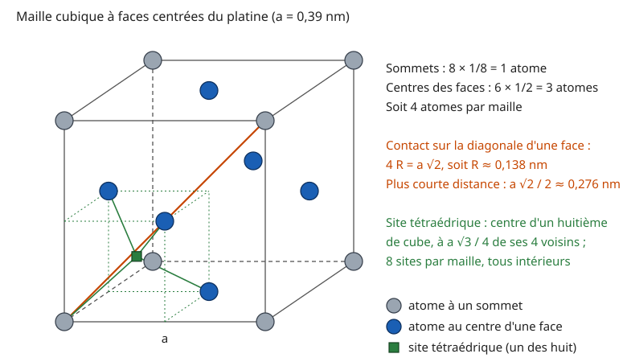
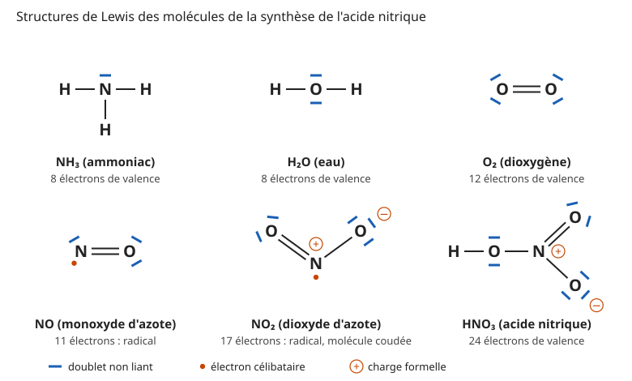

# Banque PT PT — Physique C - Chimie 2006 · Corrigé guidé

*Corrigé rédigé par IA, non officiel. Signalez toute erreur.*

**Rédaction** · modèle exact non renseigné (famille Claude) · effort non renseigné · vitesse non renseignée

## Présentation du sujet

**Thème.** Le platine, de l'atome au métal purifié. L'épreuve de Physique C dure 4 heures pour deux problèmes de même barème, à rendre sur deux copies séparées ; le problème de chimie est prévu pour 2 heures, **calculatrice autorisée**, résultats numériques à donner avec trois chiffres significatifs, et l'énoncé annonce qu'il sera tenu compte de la rédaction. Il comporte 36 questions en quatre parties indépendantes, dont le poids dans le barème est indiqué. Toutes les données sont regroupées dans une annexe d'une page, à consulter régulièrement. Le document-réponse distribué avec le sujet ne sert qu'au problème de thermodynamique.

- *Partie I (10 questions, 27 % du barème)* : notation du noyau, règles de remplissage et structure électronique, isotopie et masse molaire (I.A.1 à I.A.3.b) ; maille cubique à faces centrées, coordinence, rayon, compacité, masse volumique, sites tétraédriques (I.B.1 à I.B.5.b).
- *Partie II (17 questions, 38 %)* : étude générale de la réaction entre deux couples, constante d'équilibre et critères « totale » ou « quasi inexistante » (II.A.1 à II.A.3.b) ; application au platine dans l'acide nitrique, dans l'acide chlorhydrique (complexe hexachloroplatinate), dans l'eau régale, caractère noble du métal, puis dismutation de l'ion $\mathrm{Pt^{2+}}$ (II.B.1.a à II.B.5.c).
- *Partie III (4 questions, 20 %)* : synthèse de l'acide nitrique catalysée par le platine : équations, structures de Lewis, nombres d'oxydation de l'azote (III.1 à III.4).
- *Partie IV (5 questions, 15 %)* : obtention industrielle : équations à établir par conservation de la matière, cycle de purification, réduction par l'hydrazine (IV.1 à IV.5).

**Notions mobilisées.** Structure électronique de l'atome, cristal métallique compact et sites interstitiels, oxydoréduction en solution aqueuse (demi-équations, relation de Nernst, constante d'équilibre, influence de la complexation, dismutation), structures de Lewis et nombres d'oxydation, bilans de matière. Le programme est celui en vigueur à la session 2006, antérieur à la réforme de 2013-2014 ; il couvre les deux années de préparation.

**Difficulté.** Les parties I et III sont proches du cours. La partie II repose sur une convention d'écriture inhabituelle (nombre stœchiométrique $-1$ imposé au platine, d'où des coefficients fractionnaires) qu'il faut suivre sans dévier : une fois la formule $\log K^\circ = n\,\Delta E^\circ/0{,}06$ établie, tout le reste en découle, à condition de trouver dans l'annexe le complexe $\mathrm{PtCl_6^{2-}}$. La dismutation finale (II.B.5) demande une vraie résolution d'équilibre. La partie IV, originale, se traite par des systèmes d'équations de conservation.

**Gestion du temps.** Environ 30 minutes pour la partie I, 50 minutes pour la partie II, 20 minutes pour la partie III et 20 minutes pour la partie IV. Les parties étant indépendantes et la partie III rapide, il est rentable de lire tout le sujet avant de commencer.

> [!JURY]
> Le rapport 2006 décrit un problème en quatre parties indépendantes, fondé sur de « grands classiques » du programme. Les trois premières parties ont été abordées par beaucoup de candidats, signe que la plupart ont consacré un temps convenable à la chimie ; la quatrième est de loin la moins traitée. Le niveau global progresse mais les résultats classiques ne sont pas toujours compris, d'où des erreurs très dommageables : contenu de la maille, demi-équations d'oxydoréduction, équations de la synthèse de l'acide nitrique, formules de Lewis. Le rapport déplore un manque de rigueur dans le raisonnement et dans l'application des définitions de la thermodynamique, et demande d'accorder toute l'attention nécessaire à la rédaction et à la présentation (explications claires, paragraphes, orthographe, formules encadrées, dessins) ainsi qu'à la vérification de l'homogénéité. L'épreuve de Physique C dans son ensemble a pour moyenne 9,39 et pour écart-type 3,53.

[Sujet officiel (archive)](https://www.banquept.fr/documents/2006/phys_c_2006.zip) · [Rapport du jury](https://www.banquept.fr/documents/ecrit/rapport/2006/rapport_phys_c_ecrit_2006.pdf)

Le sujet officiel est une archive de deux fichiers communs aux deux problèmes de Physique C : `phys_c_2006.pdf`, dont la chimie occupe les pages 2 à 6 (annexe en page 6), et `phys_c_doc_reponse_2006.pdf`, feuillet du seul problème de thermodynamique. Le rapport est lui aussi commun aux deux problèmes ; la chimie en occupe les pages 1 à 3.

*Mode d'emploi* : chercher chaque question seul, lire la première indication en cas de blocage, réessayer, puis la seconde, et seulement ensuite la solution.

## Partie I — Le platine : élément et cristallographie

### Question I.A.1

> [!INDICATION]
> Les deux nombres comptent des particules du noyau : lesquelles, et laquelle des deux grandeurs caractérise l'élément ?

#### Solution

Dans la notation $^{195}_{\ 78}\mathrm{Pt}$ :

- $Z = 78$ est le **numéro atomique** : nombre de protons du noyau. Il caractérise l'élément platine ; l'atome neutre possède donc aussi 78 électrons ;
- $A = 195$ est le **nombre de masse** : nombre de nucléons (protons et neutrons) du noyau.

Le noyau de cet isotope contient donc $N = A - Z$ neutrons.

$$\boxed{Z = 78\ \text{protons},\qquad A = 195\ \text{nucléons},\qquad N = A - Z = 117\ \text{neutrons}}$$

> [!JURY]
> Le rapport constate que numéro atomique et nombre de masse sont bien distingués par les candidats, à de rares exceptions près.

### Question I.A.2

> [!INDICATION]
> Trois règles sont attendues, chacune avec son nom : l'une limite le contenu d'une orbitale, l'autre donne l'ordre de remplissage des sous-couches, la troisième répartit les électrons dans une sous-couche incomplète.

> [!INDICATION]
> Ordre de Klechkowski jusqu'à 78 électrons : $1s\,2s\,2p\,3s\,3p\,4s\,3d\,4p\,5s\,4d\,5p\,6s\,4f\,5d$. La sous-couche $4f$ (14 électrons) se remplit avant $5d$.

#### Solution

Règles de remplissage (atome dans son état fondamental) :

- *principe d'exclusion de Pauli* : deux électrons d'un même atome ne peuvent avoir leurs quatre nombres quantiques identiques ; une orbitale contient donc au plus deux électrons, de spins opposés, et les sous-couches $s$, $p$, $d$, $f$ contiennent au plus 2, 6, 10 et 14 électrons ;
- *règle de Klechkowski* : les sous-couches se remplissent par valeurs croissantes de $n + \ell$ et, à $n + \ell$ égal, par valeurs croissantes de $n$ ;
- *règle de Hund* : dans une sous-couche incomplète, les électrons occupent le plus grand nombre possible d'orbitales, avec des spins parallèles.

Pour $Z = 78$, l'ordre de Klechkowski donne :

$$1s^2\,2s^2\,2p^6\,3s^2\,3p^6\,4s^2\,3d^{10}\,4p^6\,5s^2\,4d^{10}\,5p^6\,6s^2\,4f^{14}\,5d^{8}$$

Vérification : $2+2+6+2+6+2+10+6+2+10+6+2+14+8 = 78$. En regroupant par couches et en s'appuyant sur le xénon ($Z = 54$) :

$$\boxed{\mathrm{Pt} : [\mathrm{Xe}]\,4f^{14}\,5d^{8}\,6s^{2}}$$

D'après la règle de Hund, la sous-couche $5d^8$ comporte trois orbitales doublement occupées et deux électrons célibataires. Le platine est un élément de transition (bloc $d$, sixième période, dixième colonne).

*Remarque.* La configuration réelle du platine, $[\mathrm{Xe}]\,4f^{14}\,5d^{9}\,6s^{1}$, est une exception à la règle de Klechkowski, les niveaux $5d$ et $6s$ étant très proches ; la réponse attendue est celle que donnent les règles.

> [!JURY]
> Le rapport juge les règles de remplissage mal sues : beaucoup de candidats n'emploient que le schéma de Klechkowski, et le principe de Pauli ou la règle de Hund sont utilisés sans être nommés, voire oubliés. Il signale à l'inverse quelques copies où ces notions sont remarquablement exposées.

> [!PIEGE]
> Oublier la sous-couche $4f$, que l'énoncé rappelle pourtant : on obtiendrait une configuration à 64 électrons seulement. Toujours recompter les électrons.

### Question I.A.3.a

> [!INDICATION]
> Qu'ont en commun, et qu'ont de différent, les six noyaux de l'annexe ?

#### Solution

Des **isotopes** sont des atomes (ou des noyaux) d'un même élément : ils ont le même numéro atomique $Z$, donc le même nombre de protons et le même cortège électronique, mais des nombres de masse $A$ différents, donc des nombres de neutrons différents. Ils ont pratiquement les mêmes propriétés chimiques et des masses différentes. Les six isotopes naturels du platine ont tous 78 protons et comptent 112, 114, 116, 117, 118 et 120 neutrons.

> [!JURY]
> D'après le rapport, l'isotopie ne pose guère de problème dans la plupart des copies.

### Question I.A.3.b

> [!INDICATION]
> La masse molaire de l'élément est une moyenne pondérée par les abondances. Quelle masse molaire attribuer à chaque isotope, l'énoncé n'en donnant pas ?

> [!INDICATION]
> Prendre $A\ \mathrm{g\cdot mol^{-1}}$ pour l'isotope de nombre de masse $A$, vérifier que la somme des abondances vaut $100\ \%$, puis arrondir à trois chiffres significatifs.

#### Solution

La masse molaire de l'élément est la moyenne des masses molaires des isotopes, pondérée par leurs abondances (fractions atomiques $x_i$). L'énoncé ne donne pas les masses isotopiques : on assimile la masse molaire de l'isotope de nombre de masse $A_i$ à $A_i\ \mathrm{g\cdot mol^{-1}}$ (l'écart réel est inférieur à $0{,}1\ \%$). La somme des abondances de l'annexe vaut bien $100{,}0\ \%$.

$$M = \sum_i x_i\,A_i$$

$$M = 0{,}0013 \times 190 + 0{,}0078 \times 192 + 0{,}329 \times 194 + 0{,}338 \times 195 + 0{,}252 \times 196 + 0{,}0719 \times 198$$

$$\boxed{M(\mathrm{Pt}) \approx 195{,}1\ \mathrm{g\cdot mol^{-1}},\ \text{soit } 195\ \mathrm{g\cdot mol^{-1}} \text{ avec trois chiffres significatifs}}$$

> [!JURY]
> Le rapport s'étonne que la masse molaire du platine soit assez souvent donnée en unité de masse atomique plutôt qu'en $\mathrm{g\cdot mol^{-1}}$, ce qui conduit la plupart du temps à des valeurs numériques fausses.

> [!PIEGE]
> Les abondances sont des pourcentages : diviser par 100. L'hypothèse sur les masses isotopiques doit être écrite, puisqu'elle ne figure pas dans l'énoncé.

### Question I.B.1

> [!INDICATION]
> Cubique à faces centrées : où sont les atomes, et combien de mailles se partagent un atome placé à un sommet, puis au centre d'une face ?

#### Solution

La maille conventionnelle est un cube d'arête $a$ ; les atomes de platine occupent les huit sommets et les centres des six faces.

Un atome à un sommet est partagé entre huit mailles, un atome au centre d'une face entre deux mailles :

$$N = 8 \times \frac{1}{8} + 6 \times \frac{1}{2}$$

$$\boxed{N = 4\ \text{atomes de platine par maille}}$$

> [!JURY]
> Le rapport note que la description de la maille est plutôt réussie, mais range le calcul du contenu d'une maille de platine parmi les résultats classiques mal compris qui ont donné lieu à des erreurs très dommageables.

### Question I.B.2

> [!INDICATION]
> Les plus proches voisins d'un atome placé à un sommet sont les centres des faces qui passent par ce sommet. Combien de faces, toutes mailles confondues ?

> [!INDICATION]
> La distance cherchée est celle des centres de deux atomes voisins : la moitié de la diagonale d'une face.

#### Solution

Les plus proches voisins d'un atome placé à un sommet sont les atomes situés aux centres des faces qui contiennent ce sommet. Trois plans de faces passent par le sommet, et dans chacun quatre faces se touchent en ce sommet : il y a $3 \times 4 = 12$ plus proches voisins, tous à la même distance (demi-diagonale d'une face).

$$\boxed{\text{coordinence } 12}$$

La distance minimale entre deux atomes, comptée de centre à centre, est la demi-diagonale d'une face :

$$d = \frac{a\sqrt{2}}{2}$$

$$d = \frac{0{,}39 \times \sqrt{2}}{2}\ \mathrm{nm}$$

$$\boxed{d \approx 0{,}276\ \mathrm{nm}}$$

> [!JURY]
> Le rapport relève une incompréhension : une minorité de candidats a pris pour distance interatomique celle qui sépare les surfaces des atomes et a trouvé zéro dans le modèle des sphères en contact. La distance attendue est celle des centres des deux atomes.

### Question I.B.3

> [!INDICATION]
> Dans une structure compacte, les sphères voisines se touchent : relier $R_{\mathrm{Pt}}$ à la distance de la question précédente.

> [!INDICATION]
> La compacité est le rapport du volume occupé par les atomes de la maille au volume de la maille : 4 sphères de rayon $R_{\mathrm{Pt}}$ dans un cube d'arête $a = 2\sqrt{2}\,R_{\mathrm{Pt}}$.

#### Solution

Les atomes, sphères indéformables, sont tangents le long de la diagonale d'une face : cette diagonale, de longueur $a\sqrt{2}$, porte quatre rayons. La distance entre plus proches voisins vaut donc $2R_{\mathrm{Pt}}$.

$$4R_{\mathrm{Pt}} = a\sqrt{2}$$

$$R_{\mathrm{Pt}} = \frac{a\sqrt{2}}{4}$$

$$\boxed{R_{\mathrm{Pt}} \approx 0{,}138\ \mathrm{nm}}$$

La **compacité** $C$ est le rapport du volume réellement occupé par les atomes de la maille au volume de la maille :

$$C = \frac{N \times \dfrac{4}{3}\pi R_{\mathrm{Pt}}^3}{a^3}$$

$$C = \frac{4 \times \dfrac{4}{3}\pi \left(\dfrac{a\sqrt{2}}{4}\right)^3}{a^3}$$

$$\boxed{C = \frac{\pi\sqrt{2}}{6} \approx 0{,}740}$$

*Commentaire.* La compacité ne dépend pas de $a$. La valeur $0{,}74$ est la plus grande possible pour un empilement de sphères identiques (elle est commune au cubique à faces centrées et à l'hexagonal compact) : $74\ \%$ du volume est occupé, $26\ \%$ reste vide et forme les sites interstitiels. Cette compacité maximale, jointe à la masse molaire élevée, explique la forte masse volumique du platine.

### Question I.B.4

> [!INDICATION]
> Masse des atomes contenus dans une maille divisée par le volume de la maille ; attention aux unités de $a$ et de $M$.

#### Solution

La maille, de volume $a^3$, contient $N = 4$ atomes, chacun de masse $M/N_A$ :

$$\mu = \frac{4M}{N_A\,a^3}$$

$$\mu = \frac{4 \times 195{,}1\times 10^{-3}}{6{,}023\times 10^{23} \times (0{,}39\times 10^{-9})^3}\ \mathrm{kg\cdot m^{-3}}$$

$$\boxed{\mu \approx 2{,}18\times 10^{4}\ \mathrm{kg\cdot m^{-3}} = 21{,}8\ \mathrm{g\cdot cm^{-3}}}$$

L'ordre de grandeur est correct (valeur tabulée voisine de $21{,}4\ \mathrm{g\cdot cm^{-3}}$ ; l'écart vient de la valeur de $a$, donnée avec deux chiffres seulement). Le platine est bien l'un des métaux les plus denses, comme l'annonce l'introduction.

> [!PIEGE]
> Convertir $a$ en mètres et $M$ en $\mathrm{kg\cdot mol^{-1}}$ (ou tout en centimètres et en grammes). Le paramètre $a$ n'ayant que deux chiffres significatifs et intervenant au cube, le troisième chiffre de $\mu$ est donné parce que l'énoncé le demande, sans être réellement garanti.

### Question I.B.5.a

> [!INDICATION]
> Découper la maille en huit petits cubes d'arête $a/2$ : quels atomes occupent les sommets de chacun, et où se trouve le point équidistant de ces atomes ?

#### Solution

Un site tétraédrique est la cavité comprise entre quatre atomes tangents formant un tétraèdre régulier. En découpant la maille en huit petits cubes d'arête $a/2$, chaque petit cube a quatre de ses sommets occupés (un sommet de la maille et les centres des trois faces qui s'y coupent) : son centre est le centre d'un site tétraédrique (figure 1).

Il y a donc **8 sites tétraédriques par maille**, aux centres des huit petits cubes, c'est-à-dire aux points de coordonnées $(a/4\ \text{ou}\ 3a/4,\ a/4\ \text{ou}\ 3a/4,\ a/4\ \text{ou}\ 3a/4)$, sur les grandes diagonales du cube au quart de leur longueur à partir de chaque sommet. Ils sont tous intérieurs à la maille et lui appartiennent en propre.

Si tous les sites sont occupés, la maille contient 8 atomes X pour 4 atomes de platine :

$$\boxed{\text{8 sites tétraédriques par maille ; composé de formule } \mathrm{PtX_2}}$$

> [!JURY]
> Le rapport retrouve ici, de loin en loin, la confusion habituelle entre sites tétraédriques et sites octaédriques.

> [!METHODE]
> Pour ne pas confondre : les sites octaédriques du cubique à faces centrées sont au centre du cube et aux milieux des arêtes (4 par maille, autant que d'atomes) ; les sites tétraédriques sont aux centres des huitièmes de cube (8 par maille, le double).

### Question I.B.5.b

> [!INDICATION]
> Quelle est la distance du centre d'un petit cube d'arête $a/2$ à l'un de ses sommets ? L'impureté la plus grosse touche tout juste ses quatre voisins.

> [!INDICATION]
> Écrire $R_{\mathrm{X}} + R_{\mathrm{Pt}} = a\sqrt{3}/4$ puis éliminer $a$ avec $a = 2\sqrt{2}\,R_{\mathrm{Pt}}$.

#### Solution

Le centre du site est à la demi-diagonale d'un petit cube d'arête $a/2$ de chacun des quatre atomes qui l'entourent, soit à la distance $a\sqrt{3}/4$. L'atome X y loge sans déformer le réseau tant que :

$$R_{\mathrm{X}} + R_{\mathrm{Pt}} \leqslant \frac{a\sqrt{3}}{4}$$

Avec la condition de tangence des atomes de platine, $a = 2\sqrt{2}\,R_{\mathrm{Pt}}$ :

$$R_{\mathrm{X}} + R_{\mathrm{Pt}} \leqslant \sqrt{\frac{3}{2}}\,R_{\mathrm{Pt}}$$

$$\boxed{R_{\mathrm{X,max}} = \left(\sqrt{\frac{3}{2}} - 1\right) R_{\mathrm{Pt}} \approx 0{,}225\,R_{\mathrm{Pt}}}$$

$$R_{\mathrm{X,max}} = 0{,}2247 \times 0{,}1379\ \mathrm{nm}$$

$$\boxed{R_{\mathrm{X,max}} \approx 0{,}0310\ \mathrm{nm} = 31{,}0\ \mathrm{pm}}$$

Seuls de très petits atomes peuvent s'insérer dans ces sites sans dilater le réseau.

> [!JURY]
> Le rapport observe que le calcul du rayon maximal des impuretés logeables dans les sites tétraédriques a paru peu évident aux candidats.

## Partie II — Le platine en solution

### Question II.A.1

> [!INDICATION]
> Le réducteur 1 est réactif avec le nombre stœchiométrique $-1$ : la première demi-équation est donc lue de droite à gauche, une seule fois. Les deux demi-équations échangent déjà le même nombre $n$ d'électrons.

#### Solution

Les deux demi-équations de l'énoncé échangent le même nombre $n$ d'électrons :

$$\alpha_1\,\mathrm{Ox_1} + n\,e^- \rightleftarrows \mathrm{Red_1}$$

$$\alpha_2\,\mathrm{Ox_2} + n\,e^- \rightleftarrows \beta_2\,\mathrm{Red_2}$$

Le réducteur 1 étant réactif avec le nombre stœchiométrique $\nu = -1$, on retranche la première demi-équation de la seconde ; les électrons s'éliminent :

$$\boxed{\mathrm{Red_1} + \alpha_2\,\mathrm{Ox_2} = \alpha_1\,\mathrm{Ox_1} + \beta_2\,\mathrm{Red_2}}$$

Cette équation met en jeu $n$ électrons échangés par mole de $\mathrm{Red_1}$.

> [!JURY]
> Le rapport indique que les conventions d'écriture imposées (nombre stœchiométrique fixé pour le réducteur 1) ont gêné certains candidats, qui sont revenus à leurs habitudes ; la partie théorique est néanmoins réussie dans l'ensemble.

### Question II.A.2

> [!INDICATION]
> La constante d'équilibre est la valeur du quotient de réaction à l'équilibre. À l'équilibre, que peut-on dire des potentiels de Nernst des deux couples ?

> [!INDICATION]
> Écrire les deux relations de Nernst avec le même $n$, les égaler et regrouper les logarithmes : le quotient de réaction apparaît.

#### Solution

**Définition.** La constante d'équilibre $K^\circ(T)$ est la valeur que prend, à l'équilibre chimique, le quotient de réaction, produit des activités élevées aux nombres stœchiométriques algébriques ; elle ne dépend que de la température et vérifie $\Delta_r G^\circ(T) = -RT\ln K^\circ(T)$.

$$K^\circ = \left(\frac{a_{\mathrm{Ox_1}}^{\alpha_1}\; a_{\mathrm{Red_2}}^{\beta_2}}{a_{\mathrm{Red_1}}\; a_{\mathrm{Ox_2}}^{\alpha_2}}\right)_{\text{éq}}$$

**Relation avec les potentiels standard.** Les relations de Nernst des deux couples s'écrivent, à 298 K, avec $RT\ln 10/F = 0{,}06\ \mathrm{V}$ :

$$E_1 = E^\circ_1 + \frac{0{,}06}{n}\log\frac{a_{\mathrm{Ox_1}}^{\alpha_1}}{a_{\mathrm{Red_1}}}$$

$$E_2 = E^\circ_2 + \frac{0{,}06}{n}\log\frac{a_{\mathrm{Ox_2}}^{\alpha_2}}{a_{\mathrm{Red_2}}^{\beta_2}}$$

À l'équilibre, le potentiel de la solution est unique, $E_1 = E_2$ :

$$E^\circ_2 - E^\circ_1 = \frac{0{,}06}{n}\log\frac{a_{\mathrm{Ox_1}}^{\alpha_1}\; a_{\mathrm{Red_2}}^{\beta_2}}{a_{\mathrm{Red_1}}\; a_{\mathrm{Ox_2}}^{\alpha_2}}$$

$$\boxed{\log K^\circ = \frac{n\,(E^\circ_2 - E^\circ_1)}{0{,}06} = \frac{nF\,(E^\circ_2 - E^\circ_1)}{RT\ln 10}}$$

avec les potentiels en volts ; $E^\circ_2$ est le potentiel standard du couple dont l'oxydant est réactif, $E^\circ_1$ celui du couple dont le réducteur est réactif. On retrouve le même résultat par $\Delta_r G^\circ = -nF(E^\circ_2 - E^\circ_1) = -RT\ln K^\circ$.

> [!JURY]
> Le rapport signale l'erreur classique de ceux qui oublient de passer au logarithme décimal dans la relation avec les potentiels standard.

> [!PIEGE]
> Le nombre $n$ est celui des électrons échangés dans l'équation telle qu'elle est écrite. Multiplier l'équation par un facteur multiplie $n$ et $\log K^\circ$ par ce facteur : la constante n'a de sens qu'associée à une équation.

### Question II.A.3.a

> [!INDICATION]
> Traduire $K^\circ > 10^4$ en une inégalité sur $\log K^\circ$, puis utiliser la relation de la question précédente.

#### Solution

La réaction est dite totale si $K^\circ > 10^4$, soit $\log K^\circ > 4$ :

$$\frac{n\,\Delta E^\circ}{0{,}06} > 4$$

$$\boxed{\Delta E^\circ = E^\circ_2 - E^\circ_1 > \frac{0{,}24}{n}\ \mathrm{V}}$$

Soit $0{,}24\ \mathrm{V}$ pour un électron échangé, $0{,}12\ \mathrm{V}$ pour deux, $0{,}06\ \mathrm{V}$ pour quatre : l'oxydant 2 doit être nettement plus fort que l'oxydant 1.

### Question II.A.3.b

> [!INDICATION]
> Même raisonnement avec $K^\circ < 10^{-4}$ ; attention au sens de l'inégalité et au signe.

#### Solution

La réaction n'a quasiment pas lieu si $K^\circ < 10^{-4}$, soit $\log K^\circ < -4$ :

$$\boxed{\Delta E^\circ = E^\circ_2 - E^\circ_1 < -\frac{0{,}24}{n}\ \mathrm{V}}$$

L'oxydant mis en présence du réducteur 1 est alors nettement plus faible que l'oxydant conjugué de ce réducteur. Entre les deux seuils, $-0{,}24/n < \Delta E^\circ < 0{,}24/n$, la réaction est équilibrée et son avancement dépend des concentrations.

### Question II.B.1.a

> [!INDICATION]
> Quelles espèces contient une solution d'acide nitrique, acide fort ? Lesquelles sont des oxydants ? Les couples utiles figurent dans l'annexe.

#### Solution

L'acide nitrique est un acide fort : la solution contient les ions $\mathrm{H^+_{(aq)}}$ et $\mathrm{NO_3^-}$, chacun à $0{,}1\ \mathrm{mol\cdot L^{-1}}$. La solution étant dégazée, elle ne contient pas de dioxygène dissous : le couple $\mathrm{O_2/H_2O}$ n'intervient pas comme oxydant. Les couples à considérer sont ceux de l'annexe :

- couples du platine, dont le métal est le réducteur : $\mathrm{Pt^{2+}/Pt}$ ($E^\circ = 1{,}19\ \mathrm{V}$) et $\mathrm{Pt^{4+}/Pt}$ ($E^\circ = 1{,}15\ \mathrm{V}$) ; on en déduirait le couple $\mathrm{Pt^{4+}/Pt^{2+}}$ ;
- couples dont l'oxydant est présent dans la solution : $\mathrm{H^+/H_2}$ ($E^\circ = 0{,}00\ \mathrm{V}$) et $\mathrm{NO_3^-/NO}$ ($E^\circ = 0{,}96\ \mathrm{V}$).

$$\boxed{\mathrm{Pt^{2+}/Pt}\ ;\quad \mathrm{Pt^{4+}/Pt}\ ;\quad \mathrm{H^+/H_2}\ ;\quad \mathrm{NO_3^-/NO}}$$

> [!JURY]
> Le rapport constate que le couple $\mathrm{NO_3^-/NO}$ manque assez fréquemment dans la liste, et en conclut que la formule de l'acide nitrique n'est pas connue de tous.

### Question II.B.1.b

> [!INDICATION]
> Deux oxydants possibles ($\mathrm{H^+}$ et $\mathrm{NO_3^-}$), deux produits possibles ($\mathrm{Pt^{2+}}$ et $\mathrm{Pt^{4+}}$) : quatre équations. Écrire d'abord les demi-équations.

> [!INDICATION]
> La demi-équation du couple $\mathrm{NO_3^-/NO}$ échange 3 électrons. Le platine devant garder le nombre stœchiométrique $-1$, il faut accepter des coefficients fractionnaires : $2/3$ ou $4/3$ pour l'ion nitrate.

#### Solution

Demi-équations :

$$\mathrm{Pt^{2+}} + 2\,e^- \rightleftarrows \mathrm{Pt_{(s)}}$$

$$\mathrm{Pt^{4+}} + 4\,e^- \rightleftarrows \mathrm{Pt_{(s)}}$$

$$2\,\mathrm{H^+} + 2\,e^- \rightleftarrows \mathrm{H_{2(g)}}$$

$$\mathrm{NO_3^-} + 4\,\mathrm{H^+} + 3\,e^- \rightleftarrows \mathrm{NO_{(g)}} + 2\,\mathrm{H_2O}$$

Avec le nombre stœchiométrique $-1$ pour le platine, on ajuste la demi-équation de l'oxydant au nombre d'électrons cédés par un atome de platine ($n = 2$ ou $n = 4$), ce qui impose des coefficients fractionnaires avec l'ion nitrate.

Oxydation par les ions $\mathrm{H^+}$ :

$$\boxed{(1)\quad \mathrm{Pt_{(s)}} + 2\,\mathrm{H^+} = \mathrm{Pt^{2+}} + \mathrm{H_{2(g)}} \qquad (n = 2)}$$

$$\boxed{(2)\quad \mathrm{Pt_{(s)}} + 4\,\mathrm{H^+} = \mathrm{Pt^{4+}} + 2\,\mathrm{H_{2(g)}} \qquad (n = 4)}$$

Oxydation par les ions nitrate :

$$\boxed{(3)\quad \mathrm{Pt_{(s)}} + \tfrac{2}{3}\,\mathrm{NO_3^-} + \tfrac{8}{3}\,\mathrm{H^+} = \mathrm{Pt^{2+}} + \tfrac{2}{3}\,\mathrm{NO_{(g)}} + \tfrac{4}{3}\,\mathrm{H_2O} \qquad (n = 2)}$$

$$\boxed{(4)\quad \mathrm{Pt_{(s)}} + \tfrac{4}{3}\,\mathrm{NO_3^-} + \tfrac{16}{3}\,\mathrm{H^+} = \mathrm{Pt^{4+}} + \tfrac{4}{3}\,\mathrm{NO_{(g)}} + \tfrac{8}{3}\,\mathrm{H_2O} \qquad (n = 4)}$$

Vérification de (4) : azote $4/3$ de part et d'autre ; oxygène $4$ et $4/3 + 8/3 = 4$ ; hydrogène $16/3$ de part et d'autre ; charges $-4/3 + 16/3 = +4$ de part et d'autre.

> [!JURY]
> Le rapport regrette que quelques candidats, par aversion pour les coefficients stœchiométriques fractionnaires, n'aient pas suivi la convention demandée par l'énoncé. Il note que les difficultés d'adaptation aux conventions d'écriture reviennent dans cette étude pratique chez les mêmes candidats, alors que tout cela relève du cours de première année, et il range l'écriture des demi-équations d'oxydoréduction parmi les résultats classiques mal compris.

> [!PIEGE]
> Écrire $3\,\mathrm{Pt} + 2\,\mathrm{NO_3^-} + \dots$ donne une équation juste mais contraire à la consigne, et surtout change $n$ (6 au lieu de 2) dans la formule de $\log K^\circ$ : source d'erreur à la question suivante.

### Question II.B.1.c

> [!INDICATION]
> Appliquer $\log K^\circ = n\,(E^\circ_2 - E^\circ_1)/0{,}06$ à chacune des quatre équations : $E^\circ_2$ est le potentiel du couple de l'oxydant réactif, $E^\circ_1$ celui du couple du platine concerné.

#### Solution

On applique le résultat de la partie II.A à chaque équation, $E^\circ_1$ étant le potentiel standard du couple du platine et $E^\circ_2$ celui du couple de l'oxydant :

$$\log K^\circ_1 = \frac{2 \times (0{,}00 - 1{,}19)}{0{,}06} \approx -39{,}7$$

$$\log K^\circ_2 = \frac{4 \times (0{,}00 - 1{,}15)}{0{,}06} \approx -76{,}7$$

$$\log K^\circ_3 = \frac{2 \times (0{,}96 - 1{,}19)}{0{,}06} \approx -7{,}67$$

$$\log K^\circ_4 = \frac{4 \times (0{,}96 - 1{,}15)}{0{,}06} \approx -12{,}7$$

$$\boxed{K^\circ_1 \approx 2{,}15\times 10^{-40}\ ;\quad K^\circ_2 \approx 2{,}15\times 10^{-77}\ ;\quad K^\circ_3 \approx 2{,}15\times 10^{-8}\ ;\quad K^\circ_4 \approx 2{,}15\times 10^{-13}}$$

Les quatre constantes sont inférieures à $10^{-4}$ ; de façon équivalente, les quatre écarts $\Delta E^\circ$ ($-1{,}19$, $-1{,}15$, $-0{,}23$ et $-0{,}19\ \mathrm{V}$) sont inférieurs aux seuils $-0{,}24/n$ ($-0{,}12\ \mathrm{V}$ pour $n = 2$, $-0{,}06\ \mathrm{V}$ pour $n = 4$).

**Aucune de ces réactions n'a quasiment lieu : le platine n'est attaqué ni par les ions $\mathrm{H^+}$ ni par les ions nitrate d'une solution d'acide nitrique.**

> [!JURY]
> Selon le rapport, l'appréciation du caractère total ou non des transformations est assez bien réussie, bien que la technique de calcul ait été découverte à l'occasion du problème.

### Question II.B.2.a

> [!INDICATION]
> Que contient l'acide chlorhydrique en plus des ions $\mathrm{H^+}$ ? Relire la partie II de l'annexe.

#### Solution

L'acide chlorhydrique apporte des ions chlorure, qui sont des ligands. L'annexe donne la constante globale de formation du complexe hexachloroplatinate(IV) à partir des ions $\mathrm{Pt^{4+}}$ et $\mathrm{Cl^-}$ :

$$\mathrm{Pt^{4+}} + 6\,\mathrm{Cl^-} = \mathrm{PtCl_6^{2-}} \qquad \beta = 2{,}15\times 10^{27}$$

$$\boxed{\text{Le platine est engagé dans l'ion complexe } \mathrm{PtCl_6^{2-}}\ \text{(platine au degré +IV)}}$$

> [!JURY]
> Le rapport fait de cette question un test de lecture attentive de l'énoncé, la réponse figurant dans l'annexe : la majorité des candidats l'a trouvée, mais pas l'écrasante majorité attendue. Or cette réponse conditionnait la fin du paragraphe 2 et tout le paragraphe 3.

### Question II.B.2.b

> [!INDICATION]
> Écrire la demi-équation entre le complexe et le métal, puis la relation de Nernst du couple $\mathrm{Pt^{4+}/Pt}$ en remplaçant $[\mathrm{Pt^{4+}}]$ grâce à $\beta$.

> [!INDICATION]
> On peut aussi combiner les enthalpies libres standard : $-4FE^\circ(\mathrm{PtCl_6^{2-}/Pt}) = -4FE^\circ(\mathrm{Pt^{4+}/Pt}) + RT\ln\beta$.

#### Solution

Le nouveau couple est $\mathrm{PtCl_6^{2-}/Pt}$, de demi-équation :

$$\mathrm{PtCl_6^{2-}} + 4\,e^- \rightleftarrows \mathrm{Pt_{(s)}} + 6\,\mathrm{Cl^-}$$

En présence d'ions chlorure, le potentiel du couple $\mathrm{Pt^{4+}/Pt}$ s'écrit, en remplaçant $[\mathrm{Pt^{4+}}]$ par son expression tirée de $\beta$ (concentrations rapportées à $c^\circ = 1\ \mathrm{mol\cdot L^{-1}}$) :

$$E = E^\circ(\mathrm{Pt^{4+}/Pt}) + \frac{0{,}06}{4}\log[\mathrm{Pt^{4+}}]$$

$$[\mathrm{Pt^{4+}}] = \frac{[\mathrm{PtCl_6^{2-}}]}{\beta\,[\mathrm{Cl^-}]^6}$$

$$E = E^\circ(\mathrm{Pt^{4+}/Pt}) - \frac{0{,}06}{4}\log\beta + \frac{0{,}06}{4}\log\frac{[\mathrm{PtCl_6^{2-}}]}{[\mathrm{Cl^-}]^6}$$

Le dernier terme est le terme de Nernst du couple $\mathrm{PtCl_6^{2-}/Pt}$ ; par identification :

$$E^\circ(\mathrm{PtCl_6^{2-}/Pt}) = E^\circ(\mathrm{Pt^{4+}/Pt}) - \frac{0{,}06}{4}\log\beta$$

$$E^\circ(\mathrm{PtCl_6^{2-}/Pt}) = 1{,}15 - 0{,}015 \times 27{,}33$$

$$\boxed{E^\circ(\mathrm{PtCl_6^{2-}/Pt}) \approx 0{,}740\ \mathrm{V}}$$

La complexation de l'oxydant $\mathrm{Pt^{4+}}$ le stabilise : le potentiel standard baisse de $0{,}41\ \mathrm{V}$, et le platine devient un meilleur réducteur en milieu chlorure.

> [!METHODE]
> Complexer (ou précipiter) l'oxydant d'un couple abaisse son potentiel standard ; complexer le réducteur l'élève. Le sens de variation se contrôle toujours ainsi avant le calcul.

### Question II.B.2.c

> [!INDICATION]
> Le seul oxydant de la solution est l'ion $\mathrm{H^+}$ (l'ion chlorure est un réducteur et un ligand). Combien d'électrons cède un atome de platine ?

#### Solution

Dans l'acide chlorhydrique dégazé, le seul oxydant est l'ion $\mathrm{H^+}$ ; l'ion chlorure joue le rôle de ligand. On combine la demi-équation du couple $\mathrm{PtCl_6^{2-}/Pt}$ (lue dans le sens de l'oxydation) et deux fois celle du couple $\mathrm{H^+/H_2}$ :

$$\boxed{\mathrm{Pt_{(s)}} + 4\,\mathrm{H^+} + 6\,\mathrm{Cl^-} = \mathrm{PtCl_6^{2-}} + 2\,\mathrm{H_{2(g)}} \qquad (n = 4)}$$

### Question II.B.2.d

> [!INDICATION]
> Même formule qu'en II.A.2, avec $E^\circ_1 = 0{,}740\ \mathrm{V}$ et $E^\circ_2 = 0{,}00\ \mathrm{V}$.

#### Solution

$$\log K^\circ = \frac{4 \times (0{,}00 - 0{,}740)}{0{,}06} \approx -49{,}3$$

$$\boxed{K^\circ \approx 4{,}63\times 10^{-50} < 10^{-4}}$$

(On vérifie que $K^\circ = \beta \times K^\circ_2$, soit $2{,}15\times 10^{27} \times 2{,}15\times 10^{-77}$.) L'écart $\Delta E^\circ = -0{,}74\ \mathrm{V}$ est très inférieur au seuil $-0{,}06\ \mathrm{V}$ : **la réaction n'a quasiment pas lieu**. Malgré la complexation, l'acide chlorhydrique seul n'attaque pas le platine : l'ion $\mathrm{H^+}$ reste un oxydant trop faible.

### Question II.B.3.a

> [!INDICATION]
> L'eau régale réunit l'oxydant de l'acide nitrique et le ligand de l'acide chlorhydrique : quels sont alors les deux couples à opposer ?

> [!INDICATION]
> Couples $\mathrm{NO_3^-/NO}$ ($0{,}96\ \mathrm{V}$) et $\mathrm{PtCl_6^{2-}/Pt}$ ($0{,}740\ \mathrm{V}$), quatre électrons par atome de platine.

#### Solution

L'eau régale contient à la fois l'oxydant $\mathrm{NO_3^-}$ et le ligand $\mathrm{Cl^-}$. On oppose les couples $\mathrm{NO_3^-/NO}$ et $\mathrm{PtCl_6^{2-}/Pt}$, avec quatre électrons échangés par atome de platine :

$$\boxed{\mathrm{Pt_{(s)}} + \tfrac{4}{3}\,\mathrm{NO_3^-} + \tfrac{16}{3}\,\mathrm{H^+} + 6\,\mathrm{Cl^-} = \mathrm{PtCl_6^{2-}} + \tfrac{4}{3}\,\mathrm{NO_{(g)}} + \tfrac{8}{3}\,\mathrm{H_2O}}$$

$$\log K^\circ = \frac{4 \times (0{,}96 - 0{,}740)}{0{,}06} \approx 14{,}7$$

$$\boxed{K^\circ \approx 4{,}63\times 10^{14} > 10^{4}}$$

(On vérifie que $K^\circ = \beta \times K^\circ_4$.) L'écart $\Delta E^\circ = +0{,}22\ \mathrm{V}$ dépasse le seuil $0{,}06\ \mathrm{V}$ pour $n = 4$.

**Conclusion.** La réaction est totale : l'eau régale dissout le platine, alors qu'aucun des deux acides pris séparément ne l'attaque. L'acide nitrique fournit l'oxydant, l'acide chlorhydrique le ligand qui abaisse le potentiel du couple du platine en dessous de celui du couple $\mathrm{NO_3^-/NO}$. Les fortes concentrations en $\mathrm{H^+}$, $\mathrm{NO_3^-}$ et $\mathrm{Cl^-}$ déplacent encore l'équilibre dans le sens de la dissolution.

> [!JURY]
> Le rapport précise que ce paragraphe n'a été traité que par les candidats ayant trouvé le complexe à la question II.B.2.a, et que ceux-là s'en sont bien sortis dans l'ensemble.

### Question II.B.3.b

> [!INDICATION]
> Le gaz produit par la réaction est incolore. Que rencontre-t-il en quittant la solution ?

#### Solution

La réaction produit du monoxyde d'azote $\mathrm{NO}$, gaz incolore. En se dégageant dans l'atmosphère, il rencontre le dioxygène de l'air, qui l'oxyde spontanément en dioxyde d'azote, gaz roux :

$$\boxed{2\,\mathrm{NO_{(g)}} + \mathrm{O_{2(g)}} = 2\,\mathrm{NO_{2(g)}}}$$

C'est la même réaction que l'étape 2 de la synthèse de l'acide nitrique (partie III), ici sans catalyseur.

### Question II.B.4

> [!INDICATION]
> Rassembler les conclusions des questions II.B.1 à II.B.3 : que valent les potentiels standard des couples du platine, et que faut-il pour l'oxyder ?

#### Solution

Les potentiels standard des couples $\mathrm{Pt^{2+}/Pt}$ et $\mathrm{Pt^{4+}/Pt}$ sont très élevés ($1{,}19$ et $1{,}15\ \mathrm{V}$) : le platine est un réducteur très faible. Il n'est oxydé ni par les ions $\mathrm{H^+}$ des acides ($K^\circ \sim 10^{-40}$ à $10^{-77}$), ni même par un acide oxydant comme l'acide nitrique ($K^\circ \sim 10^{-8}$ à $10^{-13}$), ni par l'acide chlorhydrique malgré la complexation ($K^\circ \sim 10^{-50}$). Il faut réunir un oxydant fort et un ligand qui stabilise fortement le platine(IV), comme dans l'eau régale, pour le dissoudre.

**Le platine est donc un métal noble : il reste à l'état métallique, inaltéré, dans presque tous les milieux usuels**, ce qui rejoint l'introduction (résistance à l'oxydation et à la corrosion, métal qui ne ternit pas).

### Question II.B.5.a

> [!INDICATION]
> Dans la dismutation, $\mathrm{Pt^{2+}}$ est à la fois l'oxydant du couple $\mathrm{Pt^{2+}/Pt}$ et le réducteur du couple $\mathrm{Pt^{4+}/Pt^{2+}}$. Le potentiel standard de ce dernier n'est pas donné : comment l'obtenir ?

> [!INDICATION]
> Les potentiels standard ne s'ajoutent pas, les $\Delta_r G^\circ = -nFE^\circ$ si : $2E^\circ(\mathrm{Pt^{4+}/Pt^{2+}}) = 4E^\circ(\mathrm{Pt^{4+}/Pt}) - 2E^\circ(\mathrm{Pt^{2+}/Pt})$. On peut aussi combiner directement les deux demi-équations de l'annexe.

#### Solution

Équation de la dismutation, avec le nombre stœchiométrique $-2$ pour l'ion $\mathrm{Pt^{2+}}$ :

$$\boxed{2\,\mathrm{Pt^{2+}} = \mathrm{Pt_{(s)}} + \mathrm{Pt^{4+}}}$$

Cette équation est la différence entre deux fois la demi-équation $\mathrm{Pt^{2+}} + 2e^- \rightleftarrows \mathrm{Pt}$ et la demi-équation $\mathrm{Pt^{4+}} + 4e^- \rightleftarrows \mathrm{Pt}$. Les enthalpies libres standard se combinent de la même façon :

$$\Delta_r G^\circ = 2 \times \left(-2F E^\circ(\mathrm{Pt^{2+}/Pt})\right) - \left(-4F E^\circ(\mathrm{Pt^{4+}/Pt})\right)$$

$$\Delta_r G^\circ = -4F\left(E^\circ(\mathrm{Pt^{2+}/Pt}) - E^\circ(\mathrm{Pt^{4+}/Pt})\right)$$

$$\log K^\circ = \frac{4 \times \left(E^\circ(\mathrm{Pt^{2+}/Pt}) - E^\circ(\mathrm{Pt^{4+}/Pt})\right)}{0{,}06}$$

$$\log K^\circ = \frac{4 \times (1{,}19 - 1{,}15)}{0{,}06} \approx 2{,}67$$

$$\boxed{K^\circ \approx 464}$$

*Autre présentation.* Le couple $\mathrm{Pt^{4+}/Pt^{2+}}$ a pour potentiel standard $E^\circ = (4 \times 1{,}15 - 2 \times 1{,}19)/2 = 1{,}11\ \mathrm{V}$, inférieur à $E^\circ(\mathrm{Pt^{2+}/Pt}) = 1{,}19\ \mathrm{V}$ : l'ion $\mathrm{Pt^{2+}}$ est un meilleur oxydant que $\mathrm{Pt^{4+}}$ et se dismute. La formule de II.A.2 avec $n = 2$ redonne $\log K^\circ = 2 \times (1{,}19 - 1{,}11)/0{,}06 \approx 2{,}67$.

La constante est supérieure à 1 mais inférieure à $10^4$ : la dismutation est favorable sans être totale.

> [!JURY]
> Le rapport indique que ce paragraphe n'a guère été traité, hormis l'écriture, simple, de l'équation de dismutation, et que la discussion de la dismutation des ions $\mathrm{Pt^{2+}}$ a été très mal comprise, par manque de rigueur dans le raisonnement et dans l'application des définitions de la thermodynamique.

> [!PIEGE]
> $E^\circ(\mathrm{Pt^{4+}/Pt^{2+}})$ n'est ni $1{,}15 - 1{,}19$ ni $1{,}15 + 1{,}19$ : seules les grandeurs $nE^\circ$ s'ajoutent.

### Question II.B.5.b

> [!INDICATION]
> Tableau d'avancement volumique : si $x$ est la concentration finale en $\mathrm{Pt^{4+}}$, que vaut celle en $\mathrm{Pt^{2+}}$ ? Le platine solide a une activité égale à 1.

> [!INDICATION]
> On obtient $K^\circ (c - 2x)^2 = x$, équation du second degré dont on garde la racine inférieure à $c/2$.

#### Solution

La solution ne contient initialement que $\mathrm{Pt^{2+}}$ : le quotient de réaction est nul, la réaction évolue dans le sens direct et du platine solide se dépose (son activité vaut 1). Soit $x$ l'avancement volumique à l'équilibre, en $\mathrm{mol\cdot L^{-1}}$ :

$$[\mathrm{Pt^{4+}}] = x \qquad [\mathrm{Pt^{2+}}] = c - 2x$$

$$K^\circ = \frac{[\mathrm{Pt^{4+}}]\,c^\circ}{[\mathrm{Pt^{2+}}]^2} = \frac{x}{(c - 2x)^2}$$

avec les concentrations en $\mathrm{mol\cdot L^{-1}}$. D'où l'équation du second degré, dont on retient la racine comprise entre 0 et $c/2$ :

$$4K^\circ x^2 - (4K^\circ c + 1)\,x + K^\circ c^2 = 0$$

$$x = \frac{4K^\circ c + 1 - \sqrt{8K^\circ c + 1}}{8K^\circ}$$

Pour $c = 10^{-2}\ \mathrm{mol\cdot L^{-1}}$ et $K^\circ = 464$ : $4K^\circ c = 18{,}57$ et $\sqrt{8K^\circ c + 1} = 6{,}175$.

$$\boxed{[\mathrm{Pt^{4+}}] \approx 3{,}61\times 10^{-3}\ \mathrm{mol\cdot L^{-1}}\ ;\qquad [\mathrm{Pt^{2+}}] \approx 2{,}79\times 10^{-3}\ \mathrm{mol\cdot L^{-1}}}$$

Il s'est déposé $3{,}61\times 10^{-3}\ \mathrm{mol}$ de platine par litre de solution. Le taux de dismutation vaut :

$$\tau = \frac{2x}{c} \approx 0{,}721$$

Vérification : $x/(c-2x)^2 = 3{,}61\times 10^{-3}/(2{,}79\times 10^{-3})^2 \approx 464$. **Environ $72\ \%$ des ions $\mathrm{Pt^{2+}}$ se sont dismutés : l'état final est un équilibre où les trois espèces coexistent, et la dismutation est largement avancée sans être totale.**

### Question II.B.5.c

> [!INDICATION]
> Même équation avec la nouvelle valeur de $c$. Pour le commentaire : dans quel sens la dilution déplace-t-elle un équilibre dont le sens direct diminue le nombre d'espèces dissoutes ?

#### Solution

La même formule avec $c = 10^{-4}\ \mathrm{mol\cdot L^{-1}}$ donne $4K^\circ c = 0{,}1857$ et $\sqrt{8K^\circ c + 1} = 1{,}171$ :

$$\boxed{[\mathrm{Pt^{4+}}] \approx 3{,}94\times 10^{-6}\ \mathrm{mol\cdot L^{-1}}\ ;\qquad [\mathrm{Pt^{2+}}] \approx 9{,}21\times 10^{-5}\ \mathrm{mol\cdot L^{-1}}}$$

$$\tau = \frac{2x}{c} \approx 0{,}0788$$

Vérification : $3{,}94\times 10^{-6}/(9{,}21\times 10^{-5})^2 \approx 464$. **Moins de $8\ \%$ des ions $\mathrm{Pt^{2+}}$ se sont dismutés.**

**Comparaison et commentaire.** Avec la même constante, le taux de dismutation passe de $72\ \%$ à $8\ \%$ quand la solution est cent fois plus diluée. La dismutation consomme deux ions dissous pour n'en former qu'un : elle diminue le nombre d'espèces en solution, et la dilution déplace l'équilibre dans le sens inverse (loi de dilution). Le rapport $[\mathrm{Pt^{4+}}]/[\mathrm{Pt^{2+}}] = K^\circ [\mathrm{Pt^{2+}}]/c^\circ$ est d'autant plus petit que la solution est diluée. Une constante de $464$ ne correspond donc ni à une réaction totale ni à une réaction négligeable : c'est la concentration qui décide. L'hypothèse faite jusqu'à la question B.5 (ion $\mathrm{Pt^{2+}}$ stable) est acceptable en solution très diluée, ce qui est le cas des traces d'ions $\mathrm{Pt^{2+}}$ que formeraient les réactions (1) et (3) ; elle ne l'est plus en solution concentrée.

> [!METHODE]
> Pour une constante intermédiaire ($10^{-4} < K^\circ < 10^{4}$), ne pas conclure sur la seule valeur de $K^\circ$ : poser le tableau d'avancement et résoudre. Le résultat se contrôle toujours en recalculant le quotient de réaction.

## Partie III — Le platine : un catalyseur efficace

### Question III.1

> [!INDICATION]
> Écrire réactifs et produits de chaque étape en formules, puis équilibrer. L'« oxygène » de l'énoncé est le gaz du même nom : quelle est sa formule ?

#### Solution

L'« oxygène » de l'énoncé désigne le dioxygène $\mathrm{O_2}$. Le platine, catalyseur, ne figure pas dans les équations.

$$\boxed{\text{Étape 1 :}\quad 4\,\mathrm{NH_{3(g)}} + 5\,\mathrm{O_{2(g)}} = 4\,\mathrm{NO_{(g)}} + 6\,\mathrm{H_2O_{(g)}}}$$

$$\boxed{\text{Étape 2 :}\quad 2\,\mathrm{NO_{(g)}} + \mathrm{O_{2(g)}} = 2\,\mathrm{NO_{2(g)}}}$$

$$\boxed{\text{Étape 3 :}\quad 4\,\mathrm{NO_{2(g)}} + \mathrm{O_{2(g)}} + 2\,\mathrm{H_2O} = 4\,\mathrm{HNO_3}}$$

Vérification de l'étape 3 : azote 4 ; hydrogène 4 ; oxygène $8 + 2 + 2 = 12$ de part et d'autre. Bilan des trois étapes : $\mathrm{NH_3} + 2\,\mathrm{O_2} = \mathrm{HNO_3} + \mathrm{H_2O}$.

> [!JURY]
> Le rapport juge cette partie relativement bien réalisée : les trois équations ont été écrites correctement par nombre de candidats. Il reconnaît qu'une coquille de l'énoncé (« oxygène » pour « dioxygène », alors qu'on parle plus loin de diazote) en a gêné certains, qui ont écrit $\mathrm{O}$ au lieu de $\mathrm{O_2}$ dans leurs équations. Il classe néanmoins l'écriture de ces équations parmi les sources d'erreurs dommageables.

### Question III.2

> [!INDICATION]
> Compter d'abord les électrons de valence de chaque molécule (5 pour N, 6 pour O, 1 pour H). Un nombre impair annonce un radical.

> [!INDICATION]
> Dans $\mathrm{NO_2}$ et $\mathrm{HNO_3}$, l'azote ne peut dépasser l'octet (deuxième période) : il faut faire apparaître des charges formelles, $+$ sur l'azote et $-$ sur un oxygène.

#### Solution

**Atomes.** L'azote ($Z = 7$) a pour configuration $1s^2\,2s^2\,2p^3$ : 5 électrons de valence, soit un doublet non liant et trois électrons célibataires (trivalent). L'oxygène ($Z = 8$) a pour configuration $1s^2\,2s^2\,2p^4$ : 6 électrons de valence, soit deux doublets non liants et deux électrons célibataires (divalent). L'hydrogène a un électron de valence.

**Molécules.** Six molécules interviennent dans la synthèse ; leurs structures sont représentées sur la figure 2.

- $\mathrm{NH_3}$ (8 électrons de valence) : trois liaisons simples $\mathrm{N{-}H}$ et un doublet non liant sur l'azote ; octet respecté.
- $\mathrm{H_2O}$ (8 électrons) : deux liaisons simples $\mathrm{O{-}H}$ et deux doublets non liants sur l'oxygène.
- $\mathrm{O_2}$ (12 électrons) : une liaison double $\mathrm{O{=}O}$ et deux doublets non liants sur chaque atome.
- $\mathrm{NO}$ (11 électrons, nombre impair) : molécule radicalaire ; liaison double $\mathrm{N{=}O}$, deux doublets non liants sur l'oxygène, un doublet non liant et un électron célibataire sur l'azote, qui n'est entouré que de 7 électrons.
- $\mathrm{NO_2}$ (17 électrons, nombre impair) : molécule radicalaire ; l'azote, central, forme une liaison double avec un oxygène (porteur de deux doublets non liants) et une liaison simple avec l'autre (porteur de trois doublets non liants et d'une charge formelle $-$) ; il porte un électron célibataire et une charge formelle $+$. Une forme mésomère échange les rôles des deux oxygènes.
- $\mathrm{HNO_3}$ (24 électrons) : l'azote, central, est lié à trois oxygènes : une liaison simple avec l'oxygène du groupe $\mathrm{O{-}H}$ (deux doublets non liants), une liaison double avec un deuxième oxygène (deux doublets non liants), une liaison simple avec le troisième (trois doublets non liants, charge formelle $-$) ; l'azote ne porte aucun doublet non liant et a une charge formelle $+$. L'octet est respecté pour tous les atomes ; deux formes mésomères échangent les deux oxygènes terminaux.

Les charges formelles se contrôlent : dans $\mathrm{HNO_3}$, l'azote possède en propre 4 électrons (la moitié de quatre doublets liants) au lieu de 5, d'où $+1$ ; l'oxygène simplement lié en possède 7 au lieu de 6, d'où $-1$ ; la somme est nulle.

> [!JURY]
> Le rapport dit avoir vu à peu près toutes les structures imaginables, sans égard pour la règle de l'octet que chacun connaît de nom sans l'appliquer ; les espèces radicalaires, en particulier, ont posé à certains candidats des difficultés insurmontables. L'écriture des formules de Lewis figure parmi les erreurs dommageables citées dans son commentaire général.

> [!METHODE]
> Compter les électrons de valence, placer l'atome central, relier par des liaisons simples, compléter les octets des atomes périphériques, puis former des liaisons multiples si l'atome central manque d'électrons ; terminer par les charges formelles et vérifier que leur somme est la charge de l'édifice.

> [!PIEGE]
> Dessiner cinq liaisons autour de l'azote dans $\mathrm{HNO_3}$ (deux liaisons doubles $\mathrm{N{=}O}$) : l'azote, élément de la deuxième période, ne peut s'entourer de plus de huit électrons.

### Question III.3

> [!INDICATION]
> L'hydrogène est à $+\mathrm{I}$, l'oxygène à $-\mathrm{II}$, et la somme des nombres d'oxydation d'une molécule neutre est nulle.

#### Solution

Avec $+\mathrm{I}$ pour l'hydrogène, $-\mathrm{II}$ pour l'oxygène et une somme nulle pour une molécule neutre :

- $\mathrm{NH_3}$ : $x + 3 = 0$, soit $x = -\mathrm{III}$ ;
- $\mathrm{NO}$ : $x - 2 = 0$, soit $x = +\mathrm{II}$ ;
- $\mathrm{NO_2}$ : $x - 4 = 0$, soit $x = +\mathrm{IV}$ ;
- $\mathrm{HNO_3}$ : $1 + x - 6 = 0$, soit $x = +\mathrm{V}$.

$$\boxed{\mathrm{NH_3} : -\mathrm{III}\ ;\quad \mathrm{NO} : +\mathrm{II}\ ;\quad \mathrm{NO_2} : +\mathrm{IV}\ ;\quad \mathrm{HNO_3} : +\mathrm{V}}$$

Les structures de Lewis donnent le même résultat en attribuant les doublets liants à l'atome le plus électronégatif (l'azote, plus électronégatif que l'hydrogène, moins que l'oxygène).

> [!JURY]
> Le rapport note que les nombres d'oxydation ont été obtenus par le calcul classique, en attribuant $-\mathrm{II}$ à l'oxygène, la formule de Lewis n'étant pas toujours dessinée.

### Question III.4

> [!INDICATION]
> Comparer le nombre d'oxydation de l'azote au départ et à l'arrivée ; quel est l'oxydant ?

#### Solution

Le nombre d'oxydation de l'azote augmente à chaque étape : de $-\mathrm{III}$ à $+\mathrm{II}$ (étape 1), de $+\mathrm{II}$ à $+\mathrm{IV}$ (étape 2), de $+\mathrm{IV}$ à $+\mathrm{V}$ (étape 3).

**L'élément azote a été oxydé**, de $-\mathrm{III}$ dans l'ammoniac à $+\mathrm{V}$ dans l'acide nitrique, soit 8 électrons cédés par atome d'azote. L'oxydant est le dioxygène, dont l'élément oxygène passe de $0$ à $-\mathrm{II}$ ; le bilan $\mathrm{NH_3} + 2\,\mathrm{O_2} = \mathrm{HNO_3} + \mathrm{H_2O}$ le confirme ($2 \times 4 = 8$ électrons captés par deux molécules de dioxygène).

## Partie IV — Obtention industrielle du platine à partir du minerai

### Question IV.1

> [!INDICATION]
> Nommer les coefficients inconnus et écrire la conservation de chaque élément (Pt, N, H, Cl), en imposant le même coefficient au diazote et au chlorure d'ammonium.

> [!INDICATION]
> Avec $a\,(\mathrm{NH_4})_2\mathrm{PtCl_6} = a\,\mathrm{Pt} + b\,\mathrm{HCl} + c\,\mathrm{N_2} + c\,\mathrm{NH_4Cl}$ : l'azote donne $2a = 3c$. Chercher les plus petits entiers.

#### Solution

On écrit l'équation avec des coefficients inconnus, le diazote et le chlorure d'ammonium ayant le même coefficient $c$ (quantités égales) :

$$a\,(\mathrm{NH_4})_2\mathrm{PtCl_6} = a'\,\mathrm{Pt} + b\,\mathrm{HCl} + c\,\mathrm{N_2} + c\,\mathrm{NH_4Cl}$$

Conservation de chaque élément :

$$\begin{cases} \text{Pt} : & a = a' \\ \text{N} : & 2a = 2c + c = 3c \\ \text{H} : & 8a = b + 4c \\ \text{Cl} : & 6a = b + c \end{cases}$$

La différence des deux dernières relations redonne $2a = 3c$ : il reste trois relations indépendantes pour quatre inconnues, donc une solution à un facteur près. Les plus petits entiers vérifiant $2a = 3c$ sont $a = 3$ et $c = 2$, d'où $b = 6a - c = 16$ :

$$\boxed{\mathrm{R_2} :\quad 3\,(\mathrm{NH_4})_2\mathrm{PtCl_6} = 3\,\mathrm{Pt} + 16\,\mathrm{HCl} + 2\,\mathrm{N_2} + 2\,\mathrm{NH_4Cl}}$$

Vérification : azote $6 = 4 + 2$ ; hydrogène $24 = 16 + 8$ ; chlore $18 = 16 + 2$. Contrôle par les électrons : trois atomes de platine passent de $+\mathrm{IV}$ à $0$ (12 électrons captés), quatre atomes d'azote passent de $-\mathrm{III}$ à $0$ (12 électrons cédés).

> [!JURY]
> Le rapport précise qu'il ne s'agissait pas d'essayer des combinaisons de chiffres au hasard, mais d'établir un jeu d'équations donnant les coefficients. Les correcteurs ont apprécié les copies qui ont posé ces équations et ont repéré celles où le candidat avait « tenté sa chance » ; les réponses numériquement justes relevaient presque toujours d'un traitement mécanique, le calcul complet étant rarement présent.

> [!METHODE]
> Autant d'équations de conservation que d'éléments ; le système est homogène, donc défini à un facteur près : on fixe ce facteur en cherchant les plus petits entiers. Un contrôle par les électrons échangés détecte une erreur de recopie.

### Question IV.2

> [!INDICATION]
> L'anion est donné, le cation vient du sel ajouté ; le composé est électriquement neutre.

#### Solution

Le composé cristallisé associe l'anion complexe $\mathrm{PtCl_6^{2-}}$ au cation apporté par le chlorure de sodium, $\mathrm{Na^+}$. L'électroneutralité impose deux cations pour un anion :

$$\boxed{\mathrm{Na_2PtCl_6}\ \text{(hexachloroplatinate(IV) de sodium)}}$$

La réaction $\mathrm{R_4}$ d'échange de cations s'écrit alors :

$$\mathrm{Na_2PtCl_6} + 2\,\mathrm{NH_4Cl} = (\mathrm{NH_4})_2\mathrm{PtCl_6} + 2\,\mathrm{NaCl}$$

ce qui est cohérent avec les produits annoncés par l'énoncé.

### Question IV.3

> [!INDICATION]
> Le platine issu de $\mathrm{R_2}$ est qualifié d'impur, et $\mathrm{R_4}$ redonne le composé de départ de $\mathrm{R_2}$ : à quoi sert de refaire le chemin ?

#### Solution

Le platine obtenu par $\mathrm{R_2}$ est impur : le précipité de $(\mathrm{NH_4})_2\mathrm{PtCl_6}$ formé par $\mathrm{R_1}$ a entraîné d'autres métaux du minerai. La suite $\mathrm{R_2} \to \mathrm{R_3} \to \mathrm{R_4}$ ramène au même composé $(\mathrm{NH_4})_2\mathrm{PtCl_6}$, mais **plus pur** : le platine impur est remis en solution par l'eau régale, engagé sélectivement dans le complexe $\mathrm{PtCl_6^{2-}}$, très stable ($\beta = 2{,}15\times 10^{27}$), isolé sous forme de sel de sodium cristallisé, puis reprécipité sous forme de sel d'ammonium, les impuretés restant en solution à chaque séparation.

**Il s'agit d'un cycle de purification (dissolution, cristallisation, précipitation sélective), analogue à une recristallisation**, que l'on peut répéter jusqu'à la pureté voulue avant la réduction finale $\mathrm{R_5}$.

### Question IV.4

> [!INDICATION]
> Séparer les rôles : le platine(IV) du complexe est réduit, l'hydrazine est oxydée en diazote, et les ions ammonium réagissent avec les ions hydroxyde. Écrire les demi-équations en milieu basique.

> [!INDICATION]
> $\mathrm{PtCl_6^{2-}} + 4e^- = \mathrm{Pt} + 6\,\mathrm{Cl^-}$ et $\mathrm{N_2H_4} + 4\,\mathrm{HO^-} = \mathrm{N_2} + 4\,\mathrm{H_2O} + 4e^-$ ; ajouter $2\,\mathrm{NH_4^+} + 2\,\mathrm{HO^-} = 2\,\mathrm{NH_3} + 2\,\mathrm{H_2O}$.

#### Solution

Le composé $(\mathrm{NH_4})_2\mathrm{PtCl_6}$ apporte deux ions $\mathrm{NH_4^+}$ et un ion $\mathrm{PtCl_6^{2-}}$. Trois transformations se superposent.

Réduction du platine(IV) :

$$\mathrm{PtCl_6^{2-}} + 4\,e^- = \mathrm{Pt_{(s)}} + 6\,\mathrm{Cl^-}$$

Oxydation de l'hydrazine en milieu basique :

$$\mathrm{N_2H_4} + 4\,\mathrm{HO^-} = \mathrm{N_{2(g)}} + 4\,\mathrm{H_2O} + 4\,e^-$$

Réaction acido-basique des ions ammonium avec les ions hydroxyde :

$$2\,\mathrm{NH_4^+} + 2\,\mathrm{HO^-} = 2\,\mathrm{NH_3} + 2\,\mathrm{H_2O}$$

Les deux demi-équations échangent le même nombre d'électrons ; la somme des trois, avec le nombre stœchiométrique $-1$ pour $(\mathrm{NH_4})_2\mathrm{PtCl_6}$, donne :

$$\boxed{\mathrm{R_5} :\quad (\mathrm{NH_4})_2\mathrm{PtCl_6} + \mathrm{N_2H_4} + 6\,\mathrm{HO^-} = \mathrm{Pt} + \mathrm{N_2} + 2\,\mathrm{NH_3} + 6\,\mathrm{H_2O} + 6\,\mathrm{Cl^-}}$$

Vérification : azote $2 + 2 = 2 + 2$ ; hydrogène $8 + 4 + 6 = 6 + 12 = 18$ ; oxygène $6 = 6$ ; chlore $6 = 6$ ; charges $-6 = -6$.

*Remarque.* La seule conservation des éléments et de la charge ne fixe pas les coefficients : avec $a$ pour l'hydrazine, $c$ pour le diazote et $d$ pour l'ammoniac, elle donne 6 pour $\mathrm{HO^-}$ et $\mathrm{H_2O}$, puis $4a + 2 = 3d$ et $2 + 2a = 2c + d$, relations vérifiées aussi par $a = 4$, $c = 2$, $d = 6$ (ce qui revient à ajouter la dismutation de l'hydrazine, $3\,\mathrm{N_2H_4} = \mathrm{N_2} + 4\,\mathrm{NH_3}$). L'équation retenue est celle des plus petits coefficients, où l'ammoniac provient uniquement des ions ammonium et où l'hydrazine cède exactement les quatre électrons captés par le platine.

> [!JURY]
> Le rapport observe que cette partie est de loin la moins traitée et n'a guère rapporté de points ; il se demande si, plus originale, elle n'exigeait pas une lecture plus attentive que les autres.

> [!PIEGE]
> En milieu basique, ni $\mathrm{H^+}$ ni $\mathrm{NH_4^+}$ ne doivent subsister dans l'équation finale : les ions ammonium du sel sont transformés en ammoniac, comme l'annonce l'énoncé.

### Question IV.5

> [!INDICATION]
> Calculer le nombre d'oxydation du platine dans le complexe, puis celui de l'azote dans chacune des espèces azotées, de part et d'autre de l'équation. Les électronégativités de l'annexe disent à quel atome attribuer les doublets.

#### Solution

**Platine.** Le chlore est plus électronégatif que le platine ($3{,}16$ contre $2{,}28$) : dans $\mathrm{PtCl_6^{2-}}$, chaque chlore est à $-\mathrm{I}$, et $x + 6 \times (-1) = -2$ donne $x = +\mathrm{IV}$. Dans le métal, le platine est à $0$. Son nombre d'oxydation diminue de 4 unités : **le platine est réduit** (4 électrons captés par atome).

**Azote.** L'azote est plus électronégatif que l'hydrogène ($3{,}04$ contre $2{,}20$), qui est donc à $+\mathrm{I}$ :

- dans $\mathrm{NH_4^+}$ : $x + 4 = +1$, soit $-\mathrm{III}$ ; dans $\mathrm{NH_3}$ : $-\mathrm{III}$ également. L'azote des ions ammonium n'est ni oxydé ni réduit (réaction acido-basique) ;
- dans l'hydrazine $\mathrm{N_2H_4}$ : $2x + 4 = 0$, soit $-\mathrm{II}$ (la liaison $\mathrm{N{-}N}$ entre atomes identiques ne compte pas) ; dans $\mathrm{N_2}$ : $0$.

**L'élément oxydé est l'azote de l'hydrazine**, qui passe de $-\mathrm{II}$ à $0$ : les deux atomes d'une molécule d'hydrazine cèdent $2 \times 2 = 4$ électrons, exactement ceux que capte l'atome de platine. Le chlore ($-\mathrm{I}$), l'hydrogène ($+\mathrm{I}$) et l'oxygène ($-\mathrm{II}$) gardent leur nombre d'oxydation.

$$\boxed{\mathrm{Pt} : +\mathrm{IV} \to 0\ \text{(réduit)}\ ;\qquad \mathrm{N}\ \text{de}\ \mathrm{N_2H_4} : -\mathrm{II} \to 0\ \text{(oxydé)}}$$

> [!PIEGE]
> Ne pas attribuer l'oxydation à l'azote des ions ammonium : il reste à $-\mathrm{III}$ dans l'ammoniac. L'équation contient de l'azote dans deux réactifs différents, il faut les suivre séparément.

## Bilan

**Ce qu'il faut retenir.**

- *Atome* : $^{A}_{Z}\mathrm{X}$, $Z$ protons, $A - Z$ neutrons ; trois règles de remplissage à nommer (Pauli, Klechkowski, Hund) ; masse molaire d'un élément, moyenne des masses isotopiques pondérée par les abondances, en $\mathrm{g\cdot mol^{-1}}$.
- *Cristal cubique à faces centrées* : 4 atomes par maille, coordinence 12, contact sur la diagonale d'une face ($4R = a\sqrt2$), compacité $\pi\sqrt2/6 \approx 0{,}74$, $\mu = 4M/(N_A a^3)$ ; 8 sites tétraédriques aux centres des huitièmes de cube, de rayon $(\sqrt{3/2} - 1)R$, et 4 sites octaédriques.
- *Réaction entre deux couples* : $\log K^\circ = n\,(E^\circ_{\text{oxydant réactif}} - E^\circ_{\text{réducteur réactif}})/0{,}06$ à 298 K, $n$ étant le nombre d'électrons de l'équation telle qu'elle est écrite ; totale si $\Delta E^\circ > 0{,}24/n$, quasi inexistante si $\Delta E^\circ < -0{,}24/n$.
- *Complexation* : complexer l'oxydant abaisse le potentiel standard, $E^\circ(\mathrm{ML}_p/\mathrm{M}) = E^\circ(\mathrm{M}^{z+}/\mathrm{M}) - (0{,}06/z)\log\beta$ ; c'est ce qui rend l'eau régale efficace.
- *Potentiels standard* : ils ne s'ajoutent pas ; on combine les $\Delta_r G^\circ = -nFE^\circ$. Une espèce intermédiaire se dismute si elle est meilleur oxydant que l'espèce supérieure ; avec une constante modérée, l'avancement dépend de la concentration (la dilution défavorise le sens qui diminue le nombre de solutés).
- *Lewis* : compter les électrons de valence ; un nombre impair signale un radical ; pas plus de huit électrons autour d'un atome de la deuxième période, d'où des charges formelles.
- *Équations-bilans* : une relation de conservation par élément, plus la charge ; contrôle par les électrons échangés.

**Résultats numériques.** $Z = 78$, $A = 195$, 117 neutrons ; $[\mathrm{Xe}]\,4f^{14}\,5d^{8}\,6s^{2}$ ; $M(\mathrm{Pt}) \approx 195\ \mathrm{g\cdot mol^{-1}}$ ; coordinence 12, $d \approx 0{,}276\ \mathrm{nm}$, $R_{\mathrm{Pt}} \approx 0{,}138\ \mathrm{nm}$, $C \approx 0{,}740$, $\mu \approx 2{,}18\times 10^{4}\ \mathrm{kg\cdot m^{-3}}$ ; $\mathrm{PtX_2}$, $R_{\mathrm{X,max}} \approx 0{,}225\,R_{\mathrm{Pt}} \approx 0{,}0310\ \mathrm{nm}$. Constantes : $2{,}15\times 10^{-40}$, $2{,}15\times 10^{-77}$, $2{,}15\times 10^{-8}$ et $2{,}15\times 10^{-13}$ dans l'acide nitrique ; $E^\circ(\mathrm{PtCl_6^{2-}/Pt}) \approx 0{,}740\ \mathrm{V}$ ; $4{,}63\times 10^{-50}$ dans l'acide chlorhydrique ; $4{,}63\times 10^{14}$ dans l'eau régale ; dismutation $K^\circ \approx 464$, taux de $72\ \%$ à $10^{-2}\ \mathrm{mol\cdot L^{-1}}$ et de $7{,}9\ \%$ à $10^{-4}\ \mathrm{mol\cdot L^{-1}}$. Azote : $-\mathrm{III}$, $+\mathrm{II}$, $+\mathrm{IV}$, $+\mathrm{V}$. $\mathrm{R_2}$ : coefficients 3, 3, 16, 2, 2 ; $\mathrm{R_3}$ : $\mathrm{Na_2PtCl_6}$ ; $\mathrm{R_5}$ : une hydrazine et six ions hydroxyde par mole de sel.

**Points signalés par le jury.** Contenu de la maille mal calculé ; règles de remplissage non nommées ; masse molaire donnée en unité de masse atomique ; distance interatomique prise entre les surfaces des atomes ; confusion entre sites tétraédriques et octaédriques ; conventions d'écriture et coefficients fractionnaires non respectés ; logarithme oublié dans la relation entre constante et potentiels standard ; couple $\mathrm{NO_3^-/NO}$ omis ; complexe donné en annexe non repéré ; dismutation de $\mathrm{Pt^{2+}}$ mal comprise ; structures de Lewis fantaisistes, surtout pour les radicaux ; coefficients de la partie IV obtenus par tâtonnement au lieu d'un système d'équations.

**Pour s'entraîner.** Refaire sans aide l'enchaînement II.A.2, II.B.1.b, II.B.2.b et II.B.3.a en respectant la convention de l'énoncé, puis la résolution de II.B.5.b, enfin les structures de Lewis de $\mathrm{NO}$, $\mathrm{NO_2}$ et $\mathrm{HNO_3}$ et les équations $\mathrm{R_2}$ et $\mathrm{R_5}$ en posant le système de conservation.
