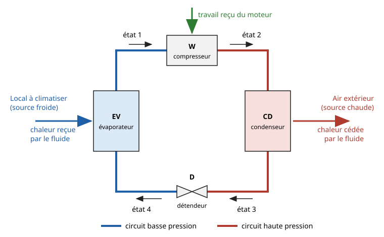

# Banque PT PT — Physique C - Thermodynamique 2006 · Corrigé guidé

*Corrigé rédigé par IA, non officiel. Signalez toute erreur.*

**Rédaction** · modèle exact non renseigné (famille Claude) · effort non renseigné · vitesse non renseignée

## Présentation du sujet

**Thème.** Étude d'une climatisation fonctionnant en « producteur de froid » : principe de la machine frigorifique, puissance thermique qui traverse un mur en régime stationnaire, cycle du fluide frigorigène dans le diagramme enthalpique $(h, \log P)$, améliorations du cycle (surchauffe, désurchauffe, sous-refroidissement), refroidissement de l'air du local. L'épreuve de Physique C dure 4 heures pour deux problèmes, chimie et thermodynamique, aux barèmes identiques : le sujet conseille d'y consacrer le même temps, soit 2 heures pour cette partie. **Calculatrices autorisées.** Le problème comporte 29 questions numérotées de A-1 à E-29 et un feuillet mobile (figure 3, diagramme du R134A) à compléter et à rendre avec la copie.

- *Partie A (questions A-1 à A-3, 20 % du barème)* : fonctionnement qualitatif, sens des transferts, efficacité.
- *Partie B (questions B-4 à B-7, 20 %)* : conduction dans un mur composite, loi de Newton aux parois, puissance transmise.
- *Partie C (questions C-8 à C-16, 30 %)* : premier principe en écoulement permanent, nature des transformations, lecture des diagrammes, efficacités du cycle réel et du cycle de Carnot.
- *Partie D (questions D-17 à D-27, 20 %)* : cycle optimisé, débit massique, puissance du compresseur, vitesse de rotation.
- *Partie E (questions E-28 et E-29, 10 %)* : température de changement d'état et débit d'air.

**Notions mobilisées.** Machines dithermes réceptrices, efficacité, cycle de Carnot ; loi de Fourier, régime stationnaire, résistances thermiques en série ; premier principe pour un fluide en écoulement permanent ; identité thermodynamique $\mathrm{d}h = T\,\mathrm{d}s + v\,\mathrm{d}P$ ; changement d'état d'un corps pur, titre en vapeur ; gaz parfait.

**Documents à lire.** La figure 1 (schéma du climatiseur, états 1 à 4), la figure 2 (allure du cycle), les tableaux 1 et 2 (conductivités, épaisseurs, coefficients de Newton), le tableau 3 à compléter, et surtout les deux diagrammes enthalpiques : figure 3 pour le R134A (feuillet mobile, avec isothermes, isentropiques et isotitres) et figure 4 pour le R22. Sur ces diagrammes, l'enthalpie massique est graduée tous les $20\ \mathrm{kJ\cdot kg^{-1}}$ et la pression est en échelle logarithmique. Les isothermes sont repérées par leur température en °C sur la courbe de saturation, les isentropiques par leur étiquette $s = 1{,}70$ ; $1{,}75$ ; $1{,}80$… en $\mathrm{kJ\cdot kg^{-1}\cdot K^{-1}}$.

**Difficulté.** Les parties A et B sont proches du cours mais demandent de la rigueur sur les signes. La partie C contient deux démonstrations (C-9 et C-15) et une lecture de diagramme soignée. La partie D est une suite de lectures et de petits bilans : elle va vite si le tableau de C-14 est juste.

**Gestion du temps.** Environ 20 minutes pour A, 25 minutes pour B, 40 minutes pour C, 25 minutes pour D et 10 minutes pour E.

> [!JURY]
> Le rapport 2006 signale encore quelques copies brouillonnes, sans résultat souligné ni encadré et mal rédigées : elles sont minoritaires et pénalisées. Il constate que la démonstration du premier principe pour les systèmes ouverts, pourtant redemandée, est maîtrisée par très peu de candidats, et que la notion d'efficacité n'est pas toujours bien comprise. Il juge malgré tout satisfaisant le niveau d'ensemble en thermodynamique, la thermodynamique industrielle restant un point fort de la filière.

[Sujet officiel (archive réunissant les deux parties de Physique C)](https://www.banquept.fr/documents/2006/phys_c_2006.zip) · [Rapport du jury](https://www.banquept.fr/documents/ecrit/rapport/2006/rapport_phys_c_ecrit_2006.pdf)

*Mode d'emploi* : chercher chaque question seul, lire la première indication en cas de blocage, réessayer, puis la seconde, et seulement ensuite la solution. Convention : travaux et transferts thermiques sont comptés positivement quand ils sont reçus par le fluide. Les lectures sur les diagrammes sont faites à environ $1\ \mathrm{kJ\cdot kg^{-1}}$ près : une copie qui trouve des valeurs voisines de une ou deux unités est tout aussi juste.

## Partie A — Fonctionnement d'une climatisation

### Question A-1 — Sens des transferts thermiques

> [!INDICATION]
> Raisonner sur le fluide frigorigène, pas sur l'air : quel changement d'état subit-il dans chacun des deux échangeurs ?

> [!INDICATION]
> Une vaporisation demande de l'énergie au milieu extérieur (elle est endothermique pour le fluide), une liquéfaction en libère.
#### Solution

Le système étudié est le fluide frigorigène. Les deux échangeurs sont isobares et sans pièce mobile : le fluide n'y reçoit aucun travail utile, il n'y échange que de la chaleur.

**Condenseur.** Le fluide y entre à l'état de vapeur (état 2, sortie du compresseur) et en sort liquide (état 3) : il se liquéfie. La liquéfaction d'un corps pur à pression constante libère de l'énergie (son enthalpie massique diminue de l'enthalpie de vaporisation). Le transfert thermique reçu par le fluide est donc négatif :

$$\boxed{\text{dans le condenseur, le fluide cède de la chaleur à l'air qui baigne l'échangeur}}$$

**Évaporateur.** Le fluide y entre sous forme de mélange liquide-vapeur (état 4, sortie du détendeur) et en sort à l'état de vapeur (état 1) : le liquide se vaporise. La vaporisation est endothermique pour le fluide : son enthalpie massique augmente.

$$\boxed{\text{dans l'évaporateur, le fluide reçoit de la chaleur de l'air qui baigne l'échangeur}}$$

Ces sens sont cohérents avec le second principe : la chaleur va spontanément du corps le plus chaud vers le plus froid. Le fluide du condenseur, à haute pression, est plus chaud que l'air qui l'entoure ; le fluide de l'évaporateur, à basse pression, est plus froid que l'air qui l'entoure. Pendant le changement d'état à pression constante, la température du fluide reste uniforme et constante.

> [!JURY]
> D'après le rapport, il suffisait ici de rappeler le caractère endothermique ou exothermique du changement d'état et d'en tirer les conséquences. Il relève dans cette partie un manque de rigueur et de réflexion : confusion classique entre l'air (du local ou de l'extérieur) et le fluide de la machine, et évocation d'un gradient de température pendant le changement d'état, que le rapport juge improbable.

### Question A-2 — Circuits haute et basse pression, place du local

> [!INDICATION]
> Quels sont les deux organes qui font varier la pression ? Ils séparent le circuit en deux moitiés.

> [!INDICATION]
> Refroidir le local, c'est lui prendre de la chaleur : quel échangeur contient un fluide qui reçoit de la chaleur ?
#### Solution

Le fluide circule dans l'ordre compresseur W, condenseur CD, détendeur D, évaporateur EV (états 1, 2, 3, 4 de la figure 1 du sujet).

- **Circuit haute pression** : de la sortie du compresseur (état 2) à l'entrée du détendeur (état 3), en passant par le condenseur.
- **Circuit basse pression** : de la sortie du détendeur (état 4) à l'entrée du compresseur (état 1), en passant par l'évaporateur.

Le compresseur fait passer le fluide de la basse à la haute pression, le détendeur fait l'inverse ; les pertes de charge sont négligées partout ailleurs.

**Place du local.** Produire du froid dans le local, c'est en extraire de l'énergie thermique : l'air du local doit céder de la chaleur au fluide. Or le seul organe où le fluide reçoit de la chaleur est l'évaporateur (question A-1).

$$\boxed{\text{le local à climatiser est en contact thermique avec l'évaporateur ; l'air extérieur avec le condenseur}}$$

> [!JURY]
> Le rapport note que la majorité des candidats ont eu du mal à identifier clairement la source froide et la source chaude.

### Question A-3 — Principe d'une installation frigorifique, efficacité

> [!INDICATION]
> Trois échanges d'énergie pour le fluide sur un cycle : un travail et deux transferts thermiques. Donner le signe de chacun.

> [!INDICATION]
> L'efficacité est le rapport de l'énergie utile (celle que l'on cherche à obtenir) à l'énergie coûteuse (celle que l'on paie).
#### Solution

**Schéma de principe.** Le fluide décrit un cycle au contact de deux sources (la figure 1 ci-dessus porte les trois transferts) :

- il reçoit le travail $W > 0$ du compresseur (énergie électrique consommée par le moteur) ;
- il reçoit le transfert thermique $Q_F > 0$ de la source froide, l'air du local, à la température $T_F$, dans l'évaporateur ;
- il reçoit le transfert thermique $Q_C < 0$ de la source chaude, l'air extérieur, à la température $T_C$, dans le condenseur : il lui cède en réalité $|Q_C|$.

Le détendeur n'échange ni travail ni chaleur.

**Principe.** Sur un cycle, le premier principe donne $W + Q_C + Q_F = 0$, soit $|Q_C| = Q_F + W$. La machine prélève de la chaleur à la source froide et la rejette, augmentée du travail reçu, à la source chaude. Ce transfert du froid vers le chaud n'est pas spontané : le second principe impose de fournir un travail $W > 0$.

**Efficacité.** La grandeur utile est la chaleur prélevée au local, la grandeur coûteuse est le travail fourni au compresseur :

$$\boxed{\varepsilon = \frac{Q_F}{W}}$$

Avec des puissances, $\varepsilon = P_f / P_{\mathrm{COMP}}$, où $P_f$ est la puissance frigorifique.

**Économies d'énergie.** La puissance frigorifique nécessaire est fixée par le bilan thermique du local. La puissance consommée vaut $P_{\mathrm{COMP}} = P_f/\varepsilon$ : plus l'efficacité est grande, moins on consomme d'énergie électrique pour le même service, et moins on rejette de chaleur dans l'atmosphère, puisque la puissance rejetée vaut $P_f + P_{\mathrm{COMP}} = P_f\,(1 + 1/\varepsilon)$.

> [!PIEGE]
> Une efficacité n'est pas un rendement : elle peut dépasser 1, et c'est le cas ici (environ 4). Elle reste positive et bornée par l'efficacité de Carnot (question C-15).

## Partie B — Bilan thermique de l'installation à climatiser

### Question B-4 — Loi de Fourier

> [!INDICATION]
> La densité de flux thermique est proportionnelle au gradient de température et de sens opposé.
#### Solution

Dans un milieu de conductivité thermique $\lambda$, le vecteur densité de flux thermique est proportionnel au gradient de température et dirigé vers les températures décroissantes : $\vec{J}_{th} = -\lambda\,\overrightarrow{\mathrm{grad}}\,T$. Si la température ne dépend que de $x$ :

$$\boxed{\vec{J}_{th} = -\lambda\,\frac{\mathrm{d}T}{\mathrm{d}x}\,\vec{u}_x}$$

$J_{th}$ s'exprime en $\mathrm{W\cdot m^{-2}}$, $\lambda$ en $\mathrm{W\cdot m^{-1}\cdot K^{-1}}$ et $\mathrm{d}T/\mathrm{d}x$ en $\mathrm{K\cdot m^{-1}}$ : la relation est homogène. Le signe moins traduit le sens spontané du transfert, du chaud vers le froid.

> [!JURY]
> Le rapport signale trop d'expressions non homogènes de la densité de flux et se demande si l'opérateur gradient est bien maîtrisé.

### Question B-5 — Densité de flux uniforme, relations entre les températures

> [!INDICATION]
> Faire le bilan d'énergie d'une tranche de mur comprise entre $x$ et $x + \mathrm{d}x$ : en régime stationnaire, son énergie interne ne varie pas.

> [!INDICATION]
> Si $J_{th}$ est constant dans une couche homogène, la loi de Fourier donne un profil de température affine : $J_{th} = \lambda \times$ (écart de température) / (épaisseur). L'axe va de l'extérieur, plus chaud, vers l'intérieur : tous les écarts s'écrivent « amont moins aval ».
#### Solution

**Uniformité de la densité de flux.** On considère la tranche de mur de section $S$ comprise entre les abscisses $x$ et $x + \mathrm{d}x$. Pendant la durée $\mathrm{d}t$, elle reçoit l'énergie $J_{th}(x)\,S\,\mathrm{d}t$ par sa face d'abscisse $x$ et cède l'énergie $J_{th}(x + \mathrm{d}x)\,S\,\mathrm{d}t$ par l'autre face. Il n'y a ni travail ni source d'énergie dans le mur. En régime stationnaire, l'énergie interne de la tranche ne varie pas :

$$0 = J_{th}(x)\,S\,\mathrm{d}t - J_{th}(x + \mathrm{d}x)\,S\,\mathrm{d}t$$

d'où

$$\frac{\mathrm{d}J_{th}}{\mathrm{d}x} = 0$$

Le raisonnement vaut dans le ciment comme dans la brique, et pour une tranche à cheval sur une interface (pas d'accumulation d'énergie sur l'interface) : le flux se conserve à la traversée des interfaces.

$$\boxed{J_{th} \text{ a la même valeur en tout point du mur}}$$

**Relations dans les trois couches.** Dans une couche homogène, $J_{th} = -\lambda\,\mathrm{d}T/\mathrm{d}x$ est constant, donc la température est une fonction affine de $x$ et $\mathrm{d}T/\mathrm{d}x$ est le rapport de l'écart de température à l'épaisseur. En parcourant le mur dans le sens de l'axe (de l'extérieur vers l'intérieur), on rencontre $T_{pe}$, $T'$, $T''$ puis $T_{pi}$ :

$$\boxed{J_{th} = \lambda_c\,\frac{T_{pe} - T'}{e_c}}$$

$$\boxed{J_{th} = \lambda_b\,\frac{T' - T''}{e_b}}$$

$$\boxed{J_{th} = \lambda_c\,\frac{T'' - T_{pi}}{e_c}}$$

**Écart entre les deux parois.** On écrit chaque écart de température en fonction de $J_{th}$ et on additionne :

$$T_{pe} - T_{pi} = (T_{pe} - T') + (T' - T'') + (T'' - T_{pi})$$

$$\boxed{T_{pe} - T_{pi} = J_{th}\left(\frac{2\,e_c}{\lambda_c} + \frac{e_b}{\lambda_b}\right)}$$

**Relations aux parois (loi de Newton).** La formule de l'énoncé donne la puissance cédée par une paroi au fluide : $P = K\,S\,(T_p - T_f)$. La densité de flux $J_{th}$ est comptée positivement dans le sens de l'axe, de l'extérieur vers l'intérieur.

- Côté extérieur, le flux va de l'air vers la paroi : la paroi reçoit $K_{ae}\,(T_e - T_{pe})$ par unité de surface, et c'est ce flux qui entre dans le mur.
- Côté intérieur, le flux va de la paroi vers l'air : la paroi cède $K_{ai}\,(T_{pi} - T_i)$ par unité de surface, et c'est le flux qui sort du mur.

$$\boxed{J_{th} = K_{ae}\,(T_e - T_{pe})}$$

$$\boxed{J_{th} = K_{ai}\,(T_{pi} - T_i)}$$

Les cinq relations ont la même forme : la densité de flux, positive puisque $T_e > T_i$, est le produit d'un coefficient positif par un écart de température « amont moins aval ». On a donc $T_e > T_{pe} > T' > T'' > T_{pi} > T_i$.

> [!JURY]
> Le rapport observe que beaucoup de candidats admettent que la densité de flux est uniforme en régime stationnaire sans le démontrer, et que ceux qui prennent la peine de le prouver montrent une bonne assimilation du cours.

> [!METHODE]
> Chaque relation se lit « écart de température = résistance thermique surfacique × densité de flux », avec les résistances $e/\lambda$ pour une couche et $1/K$ pour une paroi. Les cinq couches sont traversées par le même flux : elles sont en série et leurs résistances s'ajoutent.

### Question B-6 — Densité de flux et puissance transmise par le mur

> [!INDICATION]
> Ajouter les écarts de température de l'air extérieur à l'air intérieur : les températures intermédiaires s'éliminent.

> [!INDICATION]
> Vérifier le résultat : tous les termes du dénominateur doivent être positifs et s'ajouter.
#### Solution

On décompose l'écart total en trois écarts, tous positifs :

$$T_e - T_i = (T_e - T_{pe}) + (T_{pe} - T_{pi}) + (T_{pi} - T_i)$$

En remplaçant chaque écart par son expression de la question B-5 :

$$T_e - T_i = J_{th}\left(\frac{1}{K_{ae}} + \frac{2\,e_c}{\lambda_c} + \frac{e_b}{\lambda_b} + \frac{1}{K_{ai}}\right)$$

$$\boxed{J_{th} = \frac{T_e - T_i}{\dfrac{1}{K_{ae}} + \dfrac{2\,e_c}{\lambda_c} + \dfrac{e_b}{\lambda_b} + \dfrac{1}{K_{ai}}}}$$

La puissance qui traverse le mur de surface $S$, de l'air extérieur vers la pièce, est $P_1 = J_{th}\,S$ :

$$\boxed{P_1 = \frac{S\,(T_e - T_i)}{\dfrac{1}{K_{ae}} + \dfrac{2\,e_c}{\lambda_c} + \dfrac{e_b}{\lambda_b} + \dfrac{1}{K_{ai}}}}$$

**Contrôles.** Chaque terme du dénominateur est en $\mathrm{m^2\cdot K\cdot W^{-1}}$ : $P_1$ est bien en watts. La puissance est positive quand $T_e > T_i$, elle s'annule si les deux températures sont égales, et elle diminue quand on épaissit le mur ou quand on choisit un matériau moins conducteur. Tous les termes du dénominateur s'ajoutent : la puissance ne peut pas devenir infinie.

> [!JURY]
> Le rapport relève beaucoup d'erreurs de signe dans le calcul de la puissance transmise, faute de contrôle de cohérence : tous les flux ont le même sens, donc le même signe, et un signe moins au dénominateur autoriserait une puissance infinie, ce qui n'est pas réaliste. Il note aussi que beaucoup de candidats n'aboutissent pas à l'expression de la densité de flux ou abandonnent le calcul, alors que plusieurs introduisent d'eux-mêmes la résistance thermique et concluent rapidement.

### Question B-7 — Puissance frigorifique due au mur seul

> [!INDICATION]
> En régime permanent, le climatiseur doit évacuer exactement la puissance qui entre. Convertir les épaisseurs en mètres.
#### Solution

Pour maintenir la température intérieure constante, le climatiseur doit extraire de la pièce la puissance qui y entre. Si les seules entrées sont celles du mur :

$$\boxed{P_f = P_1 = \frac{S\,(T_e - T_i)}{\dfrac{1}{K_{ae}} + \dfrac{2\,e_c}{\lambda_c} + \dfrac{e_b}{\lambda_b} + \dfrac{1}{K_{ai}}}}$$

**Application numérique.** Surface du mur : $S = 15 \times 3{,}50 = 52{,}5\ \mathrm{m^2}$. Écart de température : $T_e - T_i = 33 - 20 = 13\ \mathrm{K}$. Résistances surfaciques, avec $e_c = 0{,}02\ \mathrm{m}$ et $e_b = 0{,}12\ \mathrm{m}$ :

| Terme | Expression | Valeur ($\mathrm{m^2\cdot K\cdot W^{-1}}$) |
|---|---|---|
| Paroi extérieure | $1/K_{ae} = 1/16{,}7$ | $0{,}060$ |
| Deux couches de ciment | $2\,e_c/\lambda_c = 2 \times 0{,}02/0{,}02$ | $2{,}00$ |
| Brique creuse | $e_b/\lambda_b = 0{,}12/0{,}5$ | $0{,}24$ |
| Paroi intérieure | $1/K_{ai} = 1/9{,}1$ | $0{,}110$ |
| Total | | $2{,}41$ |

$$J_{th} = \frac{13}{2{,}41} \approx 5{,}4\ \mathrm{W\cdot m^{-2}}$$

$$\boxed{P_f = 5{,}39 \times 52{,}5 \approx 2{,}8 \times 10^{2}\ \mathrm{W} \approx 0{,}28\ \mathrm{kW}}$$

Avec les valeurs du tableau 1, ce sont les deux couches de ciment qui portent l'essentiel de la résistance. La puissance trouvée est dix fois plus faible que les $3\ \mathrm{kW}$ retenus ensuite par l'énoncé : les fenêtres, l'ensoleillement, les occupants et les appareils électriques dominent le bilan réel.

## Partie C — Étude du cycle du fluide frigorigène

### Question C-8 — Sens de parcours du cycle

> [!INDICATION]
> Placer les états 1 à 4 de la figure 1 sur le cycle de la figure 2 : le point 1 y est déjà indiqué, sur la courbe de saturation côté vapeur, à 2 bar.
#### Solution

Le point 1 (entrée du compresseur) est sur la branche vapeur de la courbe de saturation, à la basse pression. Le fluide parcourt ensuite, dans le diagramme $(h, P)$ :

- 1 vers 2 : compression, vers le haut et vers la droite (la pression et l'enthalpie augmentent) ; le point 2 est dans le domaine de la vapeur sèche, à la haute pression ;
- 2 vers 3 : palier horizontal à haute pression parcouru vers la gauche, jusqu'à la branche liquide de la courbe de saturation (condenseur) ;
- 3 vers 4 : segment vertical descendant (détendeur) ; le point 4 est dans le domaine diphasé, à la basse pression ;
- 4 vers 1 : palier horizontal à basse pression parcouru vers la droite (évaporateur).

$$\boxed{\text{le cycle 1-2-3-4 est parcouru dans le sens trigonométrique (inverse des aiguilles d'une montre) dans le diagramme } (h, P)}$$

Le cycle complet est tracé sur la figure 2 du corrigé, à la question C-14.

### Question C-9 — Premier principe pour un système ouvert en régime stationnaire

> [!INDICATION]
> Le premier principe ne s'applique qu'à un système fermé. En construire un : le fluide contenu dans l'organe à l'instant $t$, plus la petite masse $\mathrm{d}m$ qui va y entrer pendant $\mathrm{d}t$.

> [!INDICATION]
> Ne pas oublier le travail des forces de pression exercées par le fluide en amont (il pousse) et en aval (il est repoussé) : $+P_e\,v_e\,\mathrm{d}m$ et $-P_s\,v_s\,\mathrm{d}m$. Ce sont ces termes qui transforment $u$ en $h$.
#### Solution

**Système.** On considère un organe (compresseur, échangeur ou détendeur) traversé par le fluide en régime stationnaire, entre une section d'entrée $e$ et une section de sortie $s$. On note $\Sigma_0$ le fluide contenu dans l'organe (système ouvert). On définit le système fermé $\Sigma$ :

- à l'instant $t$ : le fluide contenu dans $\Sigma_0$ et la masse $\mathrm{d}m_e$ qui va entrer pendant $\mathrm{d}t$ ;
- à l'instant $t + \mathrm{d}t$ : le fluide contenu dans $\Sigma_0$ et la masse $\mathrm{d}m_s$ qui est sortie pendant $\mathrm{d}t$.

**Bilan de masse.** La masse de $\Sigma$ est constante, et celle de $\Sigma_0$ aussi (régime stationnaire), donc $\mathrm{d}m_e = \mathrm{d}m_s = \mathrm{d}m$.

**Variation d'énergie interne de $\Sigma$.** En régime stationnaire, l'énergie interne du fluide contenu dans $\Sigma_0$ est la même aux deux instants. Avec $u$ l'énergie interne massique :

$$\mathrm{d}U_\Sigma = \left[U_{\Sigma_0} + u_s\,\mathrm{d}m\right] - \left[U_{\Sigma_0} + u_e\,\mathrm{d}m\right] = (u_s - u_e)\,\mathrm{d}m$$

**Énergie reçue par $\Sigma$ pendant $\mathrm{d}t$.**

- Travail des forces de pression à l'entrée : le fluide en amont pousse la masse $\mathrm{d}m$, de volume $v_e\,\mathrm{d}m$, sous la pression $P_e$ : $\delta W_e = +P_e\,v_e\,\mathrm{d}m$.
- Travail des forces de pression à la sortie : la masse $\mathrm{d}m$, de volume $v_s\,\mathrm{d}m$, repousse le fluide en aval sous la pression $P_s$ : $\delta W_s = -P_s\,v_s\,\mathrm{d}m$.
- Travail utile (ou indiqué) fourni par les parties mobiles de la machine : $\delta W_u = w\,\mathrm{d}m$.
- Transfert thermique à travers les parois : $\delta Q = q\,\mathrm{d}m$.

**Premier principe appliqué à $\Sigma$**, les variations d'énergie cinétique et d'énergie potentielle étant négligées :

$$(u_s - u_e)\,\mathrm{d}m = P_e\,v_e\,\mathrm{d}m - P_s\,v_s\,\mathrm{d}m + w\,\mathrm{d}m + q\,\mathrm{d}m$$

En regroupant et en introduisant l'enthalpie massique $h = u + P\,v$ :

$$\boxed{h_s - h_e = w + q}$$

où $w$ est le travail utile massique reçu des parties mobiles et $q$ le transfert thermique massique reçu. En multipliant par le débit massique $D_m$ : $D_m\,(h_s - h_e) = P_u + P_{th}$.

> [!JURY]
> Le rapport indique que cette démonstration, pourtant redemandée, n'a été faite que rarement, et y voit le signe que très peu de candidats ont assimilé les raisonnements délicats de leur cours.

> [!PIEGE]
> Le travail $w$ de la relation finale n'est pas le travail total des forces de pression : le travail de transvasement (amont et aval) est déjà contenu dans l'enthalpie.

### Question C-10 — Nature des transformations

> [!INDICATION]
> Relire la description de chaque organe dans l'énoncé (adiabatique, réversible, calorifugé, sans pièce mobile, isobare) et appliquer le résultat de C-9.

> [!INDICATION]
> Pour un corps pur en équilibre liquide-vapeur, pression et température sont liées : un palier isobare dans le domaine diphasé est aussi isotherme.
#### Solution

**Compression 1 vers 2 : isentropique.** L'énoncé la suppose adiabatique et réversible. Le second principe, pour une masse de fluide qui traverse le compresseur, donne $s_2 - s_1 = s_{\text{échangée}} + s_{\text{créée}}$, avec une entropie échangée nulle (adiabatique) et une entropie créée nulle (réversible).

**Condensation 2 vers 3 : isobare.** Le condenseur est un échangeur isobare, à la haute pression. La transformation n'est pas isotherme dans son ensemble : la vapeur sèche se refroidit d'abord jusqu'à la courbe de saturation, puis se liquéfie à température constante (palier isobare et isotherme dans le domaine diphasé).

**Détente 3 vers 4 : isenthalpique.** Le détendeur est calorifugé ($q = 0$) et ne comporte aucune pièce mobile ($w = 0$). Le premier principe de la question C-9 donne $h_4 - h_3 = 0$. Cette détente est irréversible : elle n'est pas isentropique.

**Évaporation 4 vers 1 : isobare et isotherme.** L'évaporateur est isobare, à la basse pression, et le fluide y reste diphasé jusqu'au point 1 situé sur la courbe de saturation : la température est celle de l'équilibre liquide-vapeur à cette pression.

$$\boxed{1 \to 2 \text{ isentropique} \;;\; 2 \to 3 \text{ isobare} \;;\; 3 \to 4 \text{ isenthalpique} \;;\; 4 \to 1 \text{ isobare et isotherme}}$$

> [!PIEGE]
> Adiabatique ne veut pas dire isentropique : le détendeur est adiabatique, mais la détente y est irréversible et l'entropie massique du fluide augmente. C'est l'enthalpie qui s'y conserve.

### Question C-11 — Transferts énergétiques massiques

> [!INDICATION]
> Appliquer $h_s - h_e = w + q$ à chaque organe, en annulant le terme qui convient : $q = 0$ pour un organe adiabatique, $w = 0$ pour un organe sans pièce mobile.
#### Solution

On applique à chaque organe la relation $h_s - h_e = w + q$ de la question C-9. On note $w_{ij}$ et $q_{ij}$ le travail utile massique et le transfert thermique massique reçus par le fluide entre les états $i$ et $j$.

**Compresseur (1 vers 2).** Compression adiabatique : $q_{12} = 0$.

$$\boxed{w_{12} = h_2 - h_1 > 0 \qquad q_{12} = 0}$$

**Condenseur (2 vers 3).** Aucune pièce mobile : $w_{23} = 0$.

$$\boxed{q_{23} = h_3 - h_2 < 0 \qquad w_{23} = 0}$$

**Détendeur (3 vers 4).** Calorifugé et sans pièce mobile.

$$\boxed{w_{34} = 0 \qquad q_{34} = 0 \qquad h_4 = h_3}$$

**Évaporateur (4 vers 1).** Aucune pièce mobile : $w_{41} = 0$.

$$\boxed{q_{41} = h_1 - h_4 > 0 \qquad w_{41} = 0}$$

**Contrôle.** Sur le cycle, $w_{12} + q_{23} + q_{41} = (h_2 - h_1) + (h_3 - h_2) + (h_1 - h_4) = h_3 - h_4 = 0$ : le bilan d'énergie du cycle est bien nul.

### Question C-12 — Efficacité en fonction des enthalpies

> [!INDICATION]
> Énergie utile : la chaleur prise à la source froide, dans l'évaporateur. Énergie coûteuse : le travail du compresseur.
#### Solution

L'énergie utile est le transfert thermique reçu par le fluide dans l'évaporateur, $q_{41}$, prélevé à l'air du local. L'énergie coûteuse est le travail reçu dans le compresseur, $w_{12}$.

$$\boxed{\varepsilon = \frac{q_{41}}{w_{12}} = \frac{h_1 - h_4}{h_2 - h_1} = \frac{h_1 - h_3}{h_2 - h_1}}$$

Dans le diagramme enthalpique, c'est le rapport de deux longueurs horizontales : la longueur du palier d'évaporation divisée par la projection horizontale de la compression.

> [!JURY]
> Le rapport général note que la notion d'efficacité n'est pas toujours bien comprise.

### Question C-13 — Allure des isentropiques et des isothermes

> [!INDICATION]
> Partir de l'identité $\mathrm{d}h = T\,\mathrm{d}s + v\,\mathrm{d}P$. Le long d'une isentropique, $\mathrm{d}s = 0$ ; remplacer $v$ grâce à l'équation d'état du gaz parfait, et faire apparaître $\mathrm{d}(\ln P)$ puisque l'ordonnée est logarithmique.

> [!INDICATION]
> Pour un gaz parfait, l'enthalpie ne dépend que de la température. Pour le liquide, supposé incompressible, comparer $v\,\Delta P$ à l'échelle des enthalpies du diagramme.
#### Solution

On note $r = R/M$ la constante massique du gaz, de sorte que l'équation d'état s'écrit $P\,v = r\,T$.

**Isentropiques de la vapeur (gaz parfait).** L'identité thermodynamique $\mathrm{d}h = T\,\mathrm{d}s + v\,\mathrm{d}P$ donne, à entropie constante,

$$\mathrm{d}h = v\,\mathrm{d}P = r\,T\,\frac{\mathrm{d}P}{P} = r\,T\,\mathrm{d}(\ln P)$$

La pente d'une isentropique dans le diagramme $(h, \ln P)$ est donc

$$\boxed{\left(\frac{\partial \ln P}{\partial h}\right)_s = \frac{1}{r\,T} > 0}$$

Les isentropiques sont des courbes croissantes. Le long d'une isentropique, la température augmente avec la pression (compression adiabatique réversible), donc la pente $1/(rT)$ diminue quand on monte : les courbes sont de moins en moins raides, leur concavité est tournée vers le bas. C'est bien l'allure observée sur les figures 3 et 4.

**Isothermes de la vapeur (gaz parfait).** L'enthalpie massique d'un gaz parfait ne dépend que de la température (seconde loi de Joule). À température fixée, $h$ est fixée :

$$\boxed{\text{pour un gaz parfait, les isothermes sont des droites verticales}}$$

**Commentaire.** Sur les diagrammes, les isothermes de la vapeur sont bien verticales aux basses pressions, loin de la courbe de saturation. Elles s'incurvent en revanche vers la gauche en s'approchant de la courbe de saturation et aux fortes pressions : à température fixée, l'enthalpie diminue quand la pression augmente. La vapeur ne se comporte donc comme un gaz parfait qu'à faible pression ; près de la saturation, les interactions entre molécules ne sont plus négligeables.

**Isothermes à l'intérieur de la courbe de saturation.** Le fluide y est en équilibre liquide-vapeur : pour un corps pur, la pression d'équilibre ne dépend que de la température. Une isotherme est donc aussi une isobare :

$$\boxed{\text{dans le domaine diphasé, les isothermes sont des segments horizontaux}}$$

**Isothermes du liquide.** Le liquide est considéré comme incompressible et indilatable : son volume massique $v$ est constant et son entropie ne dépend que de la température, $\mathrm{d}s = c\,\mathrm{d}T/T$. L'identité thermodynamique devient

$$\mathrm{d}h = c\,\mathrm{d}T + v\,\mathrm{d}P$$

Le long d'une isotherme, $\mathrm{d}h = v\,\mathrm{d}P$. Le volume massique d'un liquide est très petit : avec l'ordre de grandeur $v \approx 10^{-3}\ \mathrm{m^3\cdot kg^{-1}}$ (valeur typique d'un liquide, non fournie par le sujet), une variation de pression de $10\ \mathrm{bar}$ ne change l'enthalpie que de

$$v\,\Delta P \approx 10^{-3} \times 10^{6} = 10^{3}\ \mathrm{J\cdot kg^{-1}} = 1\ \mathrm{kJ\cdot kg^{-1}}$$

soit un vingtième de carreau sur le diagramme. Le terme $v\,\mathrm{d}P$ est négligeable : $h$ ne dépend pratiquement que de $T$.

$$\boxed{\text{pour le liquide, les isothermes sont des verticales}}$$

> [!JURY]
> Le rapport juge cette étude mieux traitée : un nombre important de candidats exploitent correctement les identités thermodynamiques et les propriétés du gaz parfait, sans oublier de commenter l'écart au modèle que le diagramme fourni peut mettre en évidence.

### Question C-14 — Tableau des états pour le R134A, efficacité

> [!INDICATION]
> Placer les points dans l'ordre 1, 3, 4, 2. Les points 1 et 3 sont sur la courbe de saturation (vapeur à 2 bar, liquide à 10 bar). Le point 4 est à la verticale de 3. Le point 2 s'obtient en remontant depuis 1 parallèlement aux isentropiques jusqu'à 10 bar.

> [!INDICATION]
> Le point 1 tombe entre les isentropiques $s = 1{,}70$ et $s = 1{,}75$ : garder la même position relative entre ces deux courbes jusqu'à l'horizontale 10 bar. Le titre du point 4 se lit sur les isotitres ou se calcule par la règle des moments.
#### Solution

**Lectures sur la figure 3 (feuillet mobile).**

- *Point 1* : vapeur saturante à $2\ \mathrm{bar}$. L'horizontale $2\ \mathrm{bar}$ coupe la branche vapeur de la courbe de saturation exactement au repère $-10\ \mathrm{°C}$, à l'abscisse $h_1 \approx 391\ \mathrm{kJ\cdot kg^{-1}}$ (un peu plus d'un demi-carreau après la graduation 380). Titre en vapeur : 1.
- *Point 3* : liquide saturant à $10\ \mathrm{bar}$. L'horizontale $10\ \mathrm{bar}$ coupe la branche liquide juste sous le repère $40\ \mathrm{°C}$, soit $T_3 \approx 39\ \mathrm{°C}$, à l'abscisse $h_3 \approx 256\ \mathrm{kJ\cdot kg^{-1}}$. Titre en vapeur : 0.
- *Point 4* : détente isenthalpique, $h_4 = h_3 \approx 256\ \mathrm{kJ\cdot kg^{-1}}$, à $2\ \mathrm{bar}$. Le point est dans le domaine diphasé, donc à la température du palier, $-10\ \mathrm{°C}$. Il se place entre les isotitres $0{,}30$ et $0{,}40$, plus près de la première.
- *Point 2* : compression isentropique jusqu'à $10\ \mathrm{bar}$. À $2\ \mathrm{bar}$, les isentropiques $s = 1{,}70$ et $s = 1{,}75$ passent aux abscisses 384 et 397 environ : le point 1 est un peu au-delà du milieu, soit $s_1 \approx 1{,}73\ \mathrm{kJ\cdot kg^{-1}\cdot K^{-1}}$. À $10\ \mathrm{bar}$, ces deux isentropiques passent aux abscisses 416 et 432 environ. En gardant la même position relative, $h_2 \approx 425\ \mathrm{kJ\cdot kg^{-1}}$. Sur l'horizontale $10\ \mathrm{bar}$, la vapeur saturante ($39\ \mathrm{°C}$) est à l'abscisse 419 et l'isotherme $50\ \mathrm{°C}$ à l'abscisse 430 : $T_2 \approx 45\ \mathrm{°C}$. Le point 2 est dans le domaine de la vapeur sèche.

**Titre du point 4 par le calcul.** Le liquide saturant à $2\ \mathrm{bar}$ a pour enthalpie $h_l \approx 187\ \mathrm{kJ\cdot kg^{-1}}$ (lecture sur la branche liquide, au repère $-10\ \mathrm{°C}$). La règle des moments donne

$$x_4 = \frac{h_4 - h_l}{h_1 - h_l} = \frac{256 - 187}{391 - 187} \approx 0{,}34$$

en accord avec la lecture sur les isotitres.

**Tableau 3 complété (R134A).**

| État du fluide | 1 | 2 | 3 | 4 |
|---|---|---|---|---|
| Pression (bar) | 2 | 10 | 10 | 2 |
| Température (°C) | $-10$ | $45$ | $39$ | $-10$ |
| Enthalpie massique ($\mathrm{kJ\cdot kg^{-1}}$) | $391$ | $425$ | $256$ | $256$ |
| Titre en vapeur | $1$ | vapeur sèche (surchauffée) | $0$ | $0{,}34$ |

Le tableau 3 du sujet indique pour l'enthalpie massique l'unité « $\mathrm{kJ\cdot kg^{-1}\cdot K^{-1}}$ » : c'est une coquille, l'enthalpie massique s'exprime en $\mathrm{kJ\cdot kg^{-1}}$, comme sur l'axe du diagramme.

**Efficacité.** Avec la relation de la question C-12 :

$$\varepsilon = \frac{h_1 - h_4}{h_2 - h_1} = \frac{391 - 256}{425 - 391} = \frac{135}{34}$$

$$\boxed{\varepsilon \approx 4{,}0}$$

Une erreur de lecture de $1\ \mathrm{kJ\cdot kg^{-1}}$ sur $h_2$ ou sur $h_1$ change le dénominateur de 3 % : l'efficacité n'est connue qu'à quelques dixièmes près.

> [!JURY]
> Le rapport juge la lecture du diagramme satisfaisante dans l'ensemble. Il regrette toutefois qu'un nombre non négligeable de candidats s'étonnent de trouver des efficacités voisines de 4 ou 5, ou annoncent sans réagir des valeurs comme 655,7 ou des efficacités négatives : il y voit une méconnaissance des ordres de grandeur et une absence de réflexion.

> [!METHODE]
> Sur une échelle logarithmique, on ne lit que des pressions repérées par un trait du quadrillage (ici 2 et 10 bar, tracées). En abscisse, l'échelle est linéaire : mesurer à la règle la distance au trait de quadrillage le plus proche et la convertir (un carreau vaut $20\ \mathrm{kJ\cdot kg^{-1}}$).

### Question C-15 — Efficacité du cycle de Carnot

> [!INDICATION]
> Cycle ditherme réversible : écrire le premier principe sur un cycle, puis l'égalité de Clausius.

> [!INDICATION]
> Les deux sources proposées sont l'air extérieur ($33\ \mathrm{°C}$) et l'air intérieur ($20\ \mathrm{°C}$). Les températures doivent être en kelvins dans la formule.
#### Solution

**Démonstration.** Le fluide décrit un cycle réversible au contact de deux sources seulement : la source chaude à $T_C$ et la source froide à $T_F$. Sur un cycle, l'énergie interne et l'entropie du fluide reprennent leur valeur.

Premier principe :

$$W + Q_C + Q_F = 0$$

Second principe, pour un cycle réversible (entropie créée nulle) :

$$\frac{Q_C}{T_C} + \frac{Q_F}{T_F} = 0$$

La seconde relation donne $Q_C = -Q_F\,T_C/T_F$. En reportant dans la première :

$$W = -Q_C - Q_F = Q_F\left(\frac{T_C}{T_F} - 1\right) = Q_F\,\frac{T_C - T_F}{T_F}$$

$$\boxed{\varepsilon_c = \frac{Q_F}{W} = \frac{T_F}{T_C - T_F}}$$

Pour un cycle irréversible, l'inégalité de Clausius $Q_C/T_C + Q_F/T_F < 0$ conduit à $\varepsilon < \varepsilon_c$ : l'efficacité de Carnot est la valeur maximale entre ces deux sources.

**Application numérique.** Source froide : l'air du local, $T_F = 20\ \mathrm{°C} = 293\ \mathrm{K}$. Source chaude : l'air extérieur, $T_C = 33\ \mathrm{°C} = 306\ \mathrm{K}$.

$$\boxed{\varepsilon_c = \frac{293}{306 - 293} = \frac{293}{13} \approx 23}$$

**Commentaire.** Le cycle réel a une efficacité de 4 seulement. La raison principale est que le fluide n'est pas aux températures des sources : il s'évapore à $-10\ \mathrm{°C}$ et se condense à $39\ \mathrm{°C}$, pour que les transferts thermiques avec l'air se fassent avec une surface d'échange raisonnable. Un cycle de Carnot fonctionnant entre ces deux températures aurait déjà une efficacité limitée à $263/49 \approx 5{,}4$. S'y ajoutent l'irréversibilité de la détente et le refroidissement de la vapeur sèche à l'entrée du condenseur.

> [!PIEGE]
> Les températures doivent être absolues au numérateur : $20/13 \approx 1{,}5$ est faux. Au dénominateur, un écart de température a la même valeur en kelvins et en degrés Celsius.

### Question C-16 — Efficacité avec le fluide R22

> [!INDICATION]
> Même démarche qu'en C-14 sur la figure 4 : il suffit de trois enthalpies, $h_1$ (vapeur saturante à 2 bar), $h_3$ (liquide saturant à 10 bar) et $h_2$ (isentropique issue de 1, à 10 bar).

> [!INDICATION]
> Le point 1 est juste à gauche de l'isentropique $s = 1{,}80$ : la suivre, en restant légèrement à sa gauche, jusqu'à l'horizontale 10 bar.
#### Solution

**Lectures sur la figure 4 (R22).**

- *Point 1* : vapeur saturante à $2\ \mathrm{bar}$. L'horizontale $2\ \mathrm{bar}$ coupe la branche vapeur à mi-distance des repères $-30\ \mathrm{°C}$ et $-20\ \mathrm{°C}$, soit $T_1 \approx -25\ \mathrm{°C}$, à l'abscisse $h_1 \approx 395\ \mathrm{kJ\cdot kg^{-1}}$.
- *Point 3* : liquide saturant à $10\ \mathrm{bar}$, entre les repères $20\ \mathrm{°C}$ et $30\ \mathrm{°C}$, soit $T_3 \approx 23\ \mathrm{°C}$, à l'abscisse $h_3 \approx 229\ \mathrm{kJ\cdot kg^{-1}}$.
- *Point 4* : $h_4 = h_3 \approx 229\ \mathrm{kJ\cdot kg^{-1}}$, à $2\ \mathrm{bar}$ et $-25\ \mathrm{°C}$.
- *Point 2* : à $2\ \mathrm{bar}$, l'isentropique $s = 1{,}80$ passe à l'abscisse 397, juste à droite du point 1 (l'isentropique $s = 1{,}75$ passe à l'abscisse 385). À $10\ \mathrm{bar}$, les isentropiques $s = 1{,}75$ et $s = 1{,}80$ passent aux abscisses 422 et 438. En gardant la même position relative, $h_2 \approx 435\ \mathrm{kJ\cdot kg^{-1}}$. L'isotherme $50\ \mathrm{°C}$ coupe l'horizontale $10\ \mathrm{bar}$ à l'abscisse 434 : $T_2 \approx 51\ \mathrm{°C}$.

**Efficacité.**

$$\varepsilon_{\mathrm{R22}} = \frac{h_1 - h_4}{h_2 - h_1} = \frac{395 - 229}{435 - 395} = \frac{166}{40}$$

$$\boxed{\varepsilon_{\mathrm{R22}} \approx 4{,}2}$$

**Commentaire.** Entre les mêmes pressions, les deux fluides ont des efficacités très voisines, celle du R22 étant légèrement supérieure (l'écart est de l'ordre de l'incertitude de lecture). Les températures de changement d'état diffèrent en revanche : $-25\ \mathrm{°C}$ et $23\ \mathrm{°C}$ pour le R22, contre $-10\ \mathrm{°C}$ et $39\ \mathrm{°C}$ pour le R134A. Avec une condensation à $23\ \mathrm{°C}$, le R22 ne pourrait d'ailleurs pas céder de chaleur à un air extérieur à $33\ \mathrm{°C}$ : ce réglage de pressions ne lui convient pas. Le tableau de l'énoncé montre surtout que le R134A ne détruit pas l'ozone (indice ODP nul) et contribue moins à l'effet de serre : c'est ce critère environnemental, et non l'efficacité, qui conduit à le retenir.

## Partie D — Comment améliorer l'efficacité du cycle

### Question D-17 — Intérêt de la première surchauffe

> [!INDICATION]
> Que craint un compresseur ? Et d'où vient la chaleur de cette première surchauffe ?
#### Solution

La première surchauffe se fait dans l'évaporateur, au contact de l'air du local. Elle a deux intérêts.

- **Protéger le compresseur.** Elle garantit que tout le liquide est vaporisé à la sortie de l'évaporateur : le compresseur n'aspire que de la vapeur sèche. Un liquide, presque incompressible, endommagerait le piston et les clapets.
- **Produire un peu plus de froid.** La chaleur correspondante est prise à l'air de l'installation à rafraîchir : elle s'ajoute au transfert thermique utile, qui passe de $h_1 - h_4$ à $h_{1'} - h_4$.

$$\boxed{\text{la première surchauffe protège le compresseur et augmente la chaleur prélevée au local}}$$

La seconde surchauffe, due à l'air extérieur, n'apporte au contraire aucun froid utile et élève la température d'aspiration, donc le travail de compression : il faut la réduire en isolant la tuyauterie d'aspiration.

> [!JURY]
> Le rapport indique que la dernière partie a été abordée de façon sporadique. Il regrette que d'assez nombreux candidats répondent machinalement « pour augmenter l'efficacité » à plusieurs questions, et salue ceux qui apportent des réponses pertinentes et bien rédigées, signe qu'ils sont entrés dans le problème.

### Question D-18 — Points 1' et 2'

> [!INDICATION]
> Le point 1' est à 2 bar, à la température $-10 + 5 = -5\ \mathrm{°C}$ : à mi-chemin entre la courbe de saturation et l'isotherme $0\ \mathrm{°C}$ sur l'horizontale 2 bar.

> [!INDICATION]
> Le point 1' tombe presque sur l'isentropique $s = 1{,}75$ : la suivre jusqu'à 10 bar pour obtenir 2', puis repérer l'isotherme la plus proche.
#### Solution

**Point 1'.** La surchauffe est isobare : le point 1' est sur l'horizontale $2\ \mathrm{bar}$, à la température

$$T_{1'} = T_1 + 5 = -5\ \mathrm{°C}$$

Sur l'horizontale $2\ \mathrm{bar}$, la courbe de saturation ($-10\ \mathrm{°C}$) est à l'abscisse 391 et l'isotherme $0\ \mathrm{°C}$ à l'abscisse 400. Le point 1' est à mi-chemin :

$$\boxed{h_{1'} \approx 396\ \mathrm{kJ\cdot kg^{-1}}}$$

**Point 2'.** La compression reste isentropique et le refoulement se fait à $10\ \mathrm{bar}$. Le point 1' est pratiquement sur l'isentropique $s = 1{,}75$ (abscisse 397 à $2\ \mathrm{bar}$), très légèrement à sa gauche. Cette isentropique coupe l'horizontale $10\ \mathrm{bar}$ à l'abscisse 432 ; le point 2' est juste à sa gauche :

$$\boxed{h_{2'} \approx 431\ \mathrm{kJ\cdot kg^{-1}}}$$

L'isotherme $50\ \mathrm{°C}$ coupe l'horizontale $10\ \mathrm{bar}$ à l'abscisse 430 :

$$\boxed{T_{2'} \approx 50\ \mathrm{°C}}$$

Les points 1' et 2' sont reportés sur le feuillet mobile et figurent sur la figure 2 du corrigé (question C-14).

### Question D-19 — Désurchauffe

> [!INDICATION]
> Comparer la température de sortie du compresseur à la température de condensation sous 10 bar.
#### Solution

**Pourquoi ce nom.** À la sortie du compresseur, la vapeur est à $50\ \mathrm{°C}$ sous $10\ \mathrm{bar}$, alors que la température d'équilibre liquide-vapeur à cette pression est de $39\ \mathrm{°C}$ : c'est une vapeur sèche surchauffée de $11\ \mathrm{°C}$. La refroidir à pression constante vers la température de saturation, c'est réduire cette surchauffe, d'où le terme de désurchauffe.

**Comment elle s'opère.** Le tuyau de refoulement n'est pas calorifugé. La vapeur à $50\ \mathrm{°C}$ y cède de la chaleur à l'air extérieur, plus froid ($33\ \mathrm{°C}$), par conduction à travers la paroi et convection. La pression ne change pas : le point représentatif se déplace vers la gauche sur l'horizontale $10\ \mathrm{bar}$.

**Intérêt.** Une partie de la chaleur à évacuer l'est gratuitement, avant le condenseur. Celui-ci reçoit une vapeur plus proche de la saturation : sa surface sert davantage à la liquéfaction proprement dite, ce qui permet un condenseur plus petit ou, à taille donnée, favorise une liquéfaction complète et un sous-refroidissement du liquide. Le travail du compresseur n'est pas modifié.

### Question D-20 — Entrée du condenseur, point 2''

> [!INDICATION]
> Retrancher 6 °C à $T_{2'}$, puis comparer le résultat à la température de saturation sous 10 bar avant de conclure sur l'état du fluide.
#### Solution

La désurchauffe est de $6\ \mathrm{°C}$ :

$$\boxed{T_{2''} = T_{2'} - 6 \approx 44\ \mathrm{°C}}$$

Cette température reste supérieure à la température de saturation sous $10\ \mathrm{bar}$ ($39\ \mathrm{°C}$).

$$\boxed{\text{à l'entrée du condenseur, le fluide est encore une vapeur sèche surchauffée, d'environ } 5\ \mathrm{°C}}$$

Il n'est pas à l'état de vapeur saturante : la liquéfaction ne commence qu'à $39\ \mathrm{°C}$, dans le condenseur.

Le point 2'' se place sur l'horizontale $10\ \mathrm{bar}$, entre la courbe de saturation (abscisse 419) et l'isotherme $50\ \mathrm{°C}$ (abscisse 430), un peu avant le milieu : $h_{2''} \approx 424\ \mathrm{kJ\cdot kg^{-1}}$.

> [!JURY]
> Le rapport signale une réponse très fréquente et qu'il juge très surprenante sur l'état du fluide après la désurchauffe : la vapeur saturée sèche.

### Question D-21 — Sous-refroidissement, point 3'

> [!INDICATION]
> La chaleur prélevée au local par kilogramme de fluide est $h_{1'} - h_4$, avec $h_4 = h_3$. Comment la faire grandir sans toucher au compresseur ?

> [!INDICATION]
> Augmenter de 5 % la valeur $h_{1'} - h_3$ de la question D-18, à débit fixé, donne la nouvelle enthalpie $h_{3'}$. Dans le liquide, les isothermes sont verticales : interpoler entre l'isotherme $30\ \mathrm{°C}$ et le point de saturation.
#### Solution

**Intérêt.** Le liquide sous-refroidi a une enthalpie plus faible que le liquide saturant. La détente étant isenthalpique, le point 4' est décalé vers la gauche sur le palier $2\ \mathrm{bar}$ : le fluide entre dans l'évaporateur avec un titre en vapeur plus faible, il y a davantage de liquide à vaporiser. La chaleur prélevée au local par kilogramme de fluide, $h_{1'} - h_{4'}$, augmente alors que le travail de compression $h_{2'} - h_{1'}$ est inchangé : la puissance frigorifique et l'efficacité augmentent. Le sous-refroidissement garantit aussi que le détendeur ne reçoit que du liquide.

**Valeur nécessaire.** Dans la situation de la question D-18 (surchauffe seule), le transfert thermique massique utile vaut

$$q_f = h_{1'} - h_3 = 396 - 256 = 140\ \mathrm{kJ\cdot kg^{-1}}$$

À débit massique fixé, la puissance frigorifique $D_{mf}\,q_f$ est proportionnelle à $q_f$. Pour gagner 5 %, il faut

$$h_{1'} - h_{3'} = 1{,}05 \times 140 = 147\ \mathrm{kJ\cdot kg^{-1}}$$

$$\boxed{h_{3'} = 396 - 147 = 249\ \mathrm{kJ\cdot kg^{-1}}}$$

soit une baisse de $7\ \mathrm{kJ\cdot kg^{-1}}$ par rapport au liquide saturant.

**Température.** Le point 3' est sur l'horizontale $10\ \mathrm{bar}$, dans le domaine du liquide, où les isothermes sont verticales (question C-13). L'isotherme $30\ \mathrm{°C}$ est à l'abscisse 244 et le liquide saturant ($39\ \mathrm{°C}$) à l'abscisse 256. Par interpolation :

$$T_{3'} \approx 30 + 9 \times \frac{249 - 244}{256 - 244} \approx 34\ \mathrm{°C}$$

$$\boxed{T_{3'} \approx 34\ \mathrm{°C} \text{, soit un sous-refroidissement d'environ } 5\ \mathrm{°C}}$$

À la précision de la lecture ($1\ \mathrm{°C}$ correspond à un peu plus de $1\ \mathrm{kJ\cdot kg^{-1}}$, soit moins d'un millimètre sur le feuillet), ce résultat s'accorde avec la valeur $T_{3'} = 35\ \mathrm{°C}$ que l'énoncé retient pour la suite. On garde $h_{3'} \approx 249\ \mathrm{kJ\cdot kg^{-1}}$. Le point 4', à la verticale de 3' sur le palier $2\ \mathrm{bar}$, a pour titre $(249 - 187)/(391 - 187) \approx 0{,}31$ au lieu de $0{,}34$.

> [!PIEGE]
> Les 5 % portent sur la puissance frigorifique, donc sur la différence $h_{1'} - h_{3}$, et non sur l'enthalpie $h_3$ elle-même.

### Question D-22 — Réglage du débit par le détendeur

> [!INDICATION]
> La puissance thermique que l'air peut céder au fluide dans l'évaporateur est limitée par l'échangeur. Comment évolue l'état de sortie si moins de fluide se partage cette puissance ?
#### Solution

La puissance thermique que l'air du local transmet au fluide dans l'évaporateur est fixée par l'échangeur (surface, écart de température entre l'air et le fluide). Cette puissance se répartit sur le fluide qui passe : chaque kilogramme reçoit d'autant plus d'énergie que le débit est faible.

- Si le débit est trop grand, chaque kilogramme reçoit trop peu d'énergie pour être entièrement vaporisé : du liquide sort de l'évaporateur et risque d'être aspiré par le compresseur.
- Si l'on réduit le débit, chaque kilogramme reçoit davantage : tout le liquide se vaporise, puis la vapeur se réchauffe au-delà de la température de saturation.

$$\boxed{\text{il faut diminuer le débit (fermer le pointeau) pour assurer la vaporisation complète et obtenir une surchauffe}}$$

### Question D-23 — Débit massique nécessaire

> [!INDICATION]
> Appliquer le premier principe à l'évaporateur, en puissance : $P_f = D_{mf}\,(h_{1'} - h_{4'})$.
#### Solution

Le premier principe appliqué au fluide qui traverse l'évaporateur (aucune pièce mobile), multiplié par le débit massique, donne la puissance frigorifique :

$$P_f = D_{mf}\,(h_{1'} - h_{4'}) \qquad \text{avec } h_{4'} = h_{3'}$$

$$D_{mf} = \frac{P_f}{h_{1'} - h_{3'}} = \frac{3{,}0}{396 - 249} = \frac{3{,}0\ \mathrm{kW}}{147\ \mathrm{kJ\cdot kg^{-1}}}$$

$$\boxed{D_{mf} \approx 0{,}020\ \mathrm{kg\cdot s^{-1}}}$$

C'est la valeur de réglage indiquée par l'énoncé (le calcul donne $0{,}0204\ \mathrm{kg\cdot s^{-1}}$). Cela représente environ $73\ \mathrm{kg}$ de fluide par heure.

### Question D-24 — Pressions d'aspiration et de refoulement

> [!INDICATION]
> Les pertes de charge sont négligées : chaque moitié du circuit est à pression uniforme.
#### Solution

Les pertes de charge étant négligées, la pression est uniforme dans chacune des deux parties du circuit. Le compresseur aspire le fluide à la pression de l'évaporateur et le refoule à celle du condenseur :

$$\boxed{P_{\text{aspiration}} = 2\ \mathrm{bar} \qquad P_{\text{refoulement}} = 10\ \mathrm{bar}}$$

Le taux de compression vaut 5.

### Question D-25 — Puissance consommée par le compresseur

> [!INDICATION]
> Premier principe appliqué au compresseur adiabatique, entre les états 1' et 2', multiplié par le débit massique.
#### Solution

La compression est adiabatique : le premier principe en écoulement permanent donne le travail massique $w = h_{2'} - h_{1'}$, d'où la puissance

$$P_{\mathrm{COMP}} = D_{mf}\,(h_{2'} - h_{1'}) = 0{,}020 \times (431 - 396) = 0{,}020 \times 35\ \mathrm{kW}$$

$$\boxed{P_{\mathrm{COMP}} \approx 0{,}70\ \mathrm{kW}}$$

### Question D-26 — Efficacité du système optimisé

> [!INDICATION]
> Même définition qu'en C-12, avec les points 1', 2' et 4'. La désurchauffe ne change ni le numérateur ni le dénominateur.
#### Solution

$$\varepsilon' = \frac{h_{1'} - h_{4'}}{h_{2'} - h_{1'}} = \frac{396 - 249}{431 - 396} = \frac{147}{35}$$

$$\boxed{\varepsilon' \approx 4{,}2}$$

En puissances, avec le débit de $0{,}020\ \mathrm{kg\cdot s^{-1}}$ : la puissance frigorifique vaut $0{,}020 \times 147 \approx 2{,}9\ \mathrm{kW}$ pour $0{,}70\ \mathrm{kW}$ consommé, ce qui redonne $4{,}2$.

L'efficacité passe de $4{,}0$ à $4{,}2$ : le gain, d'environ 5 %, vient de la surchauffe utile et surtout du sous-refroidissement, qui allongent le palier d'évaporation. Il est du même ordre que l'incertitude de lecture : c'est le sens de la variation qui est significatif. La désurchauffe n'intervient pas dans ce rapport, puisqu'elle ne modifie ni le travail de compression ni la chaleur prélevée au local.

### Question D-27 — Vitesse de rotation du compresseur

> [!INDICATION]
> Passer du débit massique au débit volumique à l'aspiration grâce au volume massique $v$. À chaque tour (une course aller et une course retour), le compresseur aspire et refoule un volume égal à la cylindrée.
#### Solution

Le débit volumique de vapeur aspirée est

$$D_v = D_{mf}\,v = 0{,}020 \times 0{,}12 = 2{,}4 \times 10^{-3}\ \mathrm{m^3\cdot s^{-1}}$$

À chaque tour, le piston effectue une course aller (aspiration) et une course retour (refoulement) : le compresseur aspire un volume égal à sa cylindrée $C = 200\ \mathrm{cm^3} = 2{,}00 \times 10^{-4}\ \mathrm{m^3}$. Le nombre de tours par seconde est donc

$$N = \frac{D_{mf}\,v}{C} = \frac{2{,}4 \times 10^{-3}}{2{,}00 \times 10^{-4}} = 12\ \mathrm{tr\cdot s^{-1}}$$

$$\boxed{N = \frac{D_{mf}\,v}{C} \approx 7{,}2 \times 10^{2}\ \mathrm{tr\cdot min^{-1}}}$$

Soit 720 tours par minute, valeur raisonnable pour un compresseur à piston.

> [!PIEGE]
> Deux conversions à ne pas manquer : $200\ \mathrm{cm^3} = 2 \times 10^{-4}\ \mathrm{m^3}$ (et non $2 \times 10^{-2}$), puis le passage des tours par seconde aux tours par minute.

## Partie E — Refroidissement de l'air

### Question E-28 — Température maximale du changement d'état

> [!INDICATION]
> L'air doit céder de la chaleur au fluide tout au long de l'évaporateur, y compris là où l'air est le plus froid.
#### Solution

Dans l'évaporateur, la chaleur doit passer spontanément de l'air vers le fluide : en tout point de l'échangeur, le fluide doit être plus froid que l'air. L'air entre à $23\ \mathrm{°C}$ et sort à $17\ \mathrm{°C}$ : la condition la plus sévère est à la sortie de l'air.

$$\boxed{T_{\text{changement d'état}} < 17\ \mathrm{°C}}$$

La température maximale du changement d'état est donc $17\ \mathrm{°C}$, valeur limite pour laquelle l'échange deviendrait infiniment lent à la sortie de l'air (il faudrait une surface d'échange infinie).

Dans le cas étudié, le fluide se vaporise à $-10\ \mathrm{°C}$ sous $2\ \mathrm{bar}$, et sort de l'évaporateur à $-5\ \mathrm{°C}$ après surchauffe : la condition est largement remplie.

### Question E-29 — Débit volumique d'air

> [!INDICATION]
> L'air, à pression constante, cède la puissance frigorifique : $P_f = D_a\,\rho_a\,c_p\,\Delta T$. Il reste à exprimer la capacité thermique massique $c_p$ d'un gaz parfait diatomique.

> [!INDICATION]
> $c_p = \dfrac{\gamma}{\gamma - 1}\,\dfrac{R}{M}$, avec $M$ en $\mathrm{kg\cdot mol^{-1}}$.
#### Solution

**Capacité thermique massique de l'air.** Pour un gaz parfait, la relation de Mayer $c_p - c_v = R/M$ et la définition $\gamma = c_p/c_v$ donnent

$$c_p = \frac{\gamma}{\gamma - 1}\,\frac{R}{M} = \frac{7}{2} \times \frac{8{,}314}{29 \times 10^{-3}} \approx 1{,}00 \times 10^{3}\ \mathrm{J\cdot kg^{-1}\cdot K^{-1}}$$

(la constante $R = 8{,}314\ \mathrm{J\cdot K^{-1}\cdot mol^{-1}}$ est supposée connue).

**Bilan sur l'air.** L'air traverse l'évaporateur en écoulement permanent, à pression constante et sans recevoir de travail utile. Le premier principe donne, pour le débit massique d'air $\rho_a\,D_a$, la puissance thermique reçue par l'air :

$$P_{\text{air}} = \rho_a\,D_a\,c_p\,(T_{\text{sortie}} - T_{\text{entrée}}) < 0$$

L'air cède au fluide la puissance frigorifique $P_f = -P_{\text{air}}$ :

$$P_f = \rho_a\,D_a\,c_p\,(T_{\text{entrée}} - T_{\text{sortie}})$$

$$\boxed{D_a = \frac{P_f}{\rho_a\,c_p\,(T_{\text{entrée}} - T_{\text{sortie}})}}$$

**Application numérique.** Avec $P_f = 3{,}0\ \mathrm{kW}$ et un refroidissement de $23 - 17 = 6\ \mathrm{K}$ :

$$D_a = \frac{3{,}0 \times 10^{3}}{1{,}3 \times 1{,}00 \times 10^{3} \times 6} \approx 0{,}38\ \mathrm{m^3\cdot s^{-1}}$$

$$\boxed{D_a \approx 1{,}4 \times 10^{3}\ \mathrm{m^3\cdot h^{-1}}}$$

Le mur périphérique de $15\ \mathrm{m}$ de long et de $3{,}50\ \mathrm{m}$ de haut délimite une pièce de quelques dizaines de mètres cubes : le ventilateur brasse plusieurs dizaines de fois le volume de la pièce par heure. Le débit trouvé est élevé parce que l'air n'est refroidi que de $6\ \mathrm{K}$ à chaque passage.

> [!PIEGE]
> Le débit demandé est en $\mathrm{m^3\cdot h^{-1}}$ : multiplier par 3600 le résultat obtenu en unités du système international. La masse molaire doit être en $\mathrm{kg\cdot mol^{-1}}$ dans $c_p$.

## Bilan

**Résultats à retenir.**

| Résultat | Expression ou valeur |
|---|---|
| Efficacité d'une machine frigorifique (A-3, C-12) | $\varepsilon = Q_F/W = (h_1 - h_4)/(h_2 - h_1)$ |
| Densité de flux à travers le mur (B-6) | $J_{th} = (T_e - T_i)\,/\,(1/K_{ae} + 2e_c/\lambda_c + e_b/\lambda_b + 1/K_{ai})$ |
| Puissance due au mur seul (B-7) | $P_f \approx 0{,}28\ \mathrm{kW}$ |
| Premier principe en écoulement permanent (C-9) | $h_s - h_e = w + q$ |
| Pente d'une isentropique de gaz parfait (C-13) | $(\partial \ln P/\partial h)_s = 1/(rT)$ |
| Cycle du R134A entre 2 et 10 bar (C-14) | $h_1 = 391$, $h_2 = 425$, $h_3 = h_4 = 256\ \mathrm{kJ\cdot kg^{-1}}$ ; $\varepsilon \approx 4{,}0$ |
| Efficacité de Carnot entre 20 °C et 33 °C (C-15) | $\varepsilon_c = T_F/(T_C - T_F) \approx 23$ |
| Cycle du R22 (C-16) | $\varepsilon \approx 4{,}2$ |
| Cycle optimisé (D-18 à D-26) | $h_{1'} = 396$, $h_{2'} = 431$, $h_{3'} = 249\ \mathrm{kJ\cdot kg^{-1}}$ ; $D_{mf} \approx 0{,}020\ \mathrm{kg\cdot s^{-1}}$ ; $P_{\mathrm{COMP}} \approx 0{,}70\ \mathrm{kW}$ ; $\varepsilon' \approx 4{,}2$ |
| Vitesse de rotation (D-27) | $N \approx 720\ \mathrm{tr\cdot min^{-1}}$ |
| Débit d'air (E-29) | $D_a \approx 1{,}4 \times 10^{3}\ \mathrm{m^3\cdot h^{-1}}$ |

**Méthodes à retenir.**

- Raisonner sur le fluide frigorigène : son changement d'état dans chaque échangeur donne le sens du transfert thermique, donc la place des deux sources.
- Mur composite en régime stationnaire : même flux dans toutes les couches, écarts de température qui s'ajoutent, résistances en série.
- Un organe, une ligne : $h_s - h_e = w + q$, avec $q = 0$ pour un organe adiabatique et $w = 0$ pour un organe sans pièce mobile.
- Lecture d'un diagramme enthalpique : points de saturation d'abord, détente à la verticale, compression le long d'une isentropique interpolée entre les deux courbes tracées les plus proches.
- Passer d'une grandeur massique à une puissance en multipliant par le débit massique.

**Points de vigilance.**

- Ne pas confondre l'air (du local ou de l'extérieur) et le fluide de la machine.
- Contrôler les signes : dans le mur, tous les flux ont le même sens et toutes les résistances s'ajoutent.
- Une efficacité frigorifique vaut ici 4 à 5 ; elle est positive et inférieure à l'efficacité de Carnot.
- Après une désurchauffe partielle, la vapeur est encore sèche et surchauffée, pas saturante.
- Températures en kelvins dans l'efficacité de Carnot ; conversions des $\mathrm{cm^3}$, des heures et des minutes en fin de problème.
