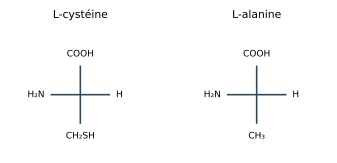
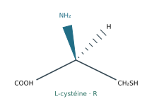
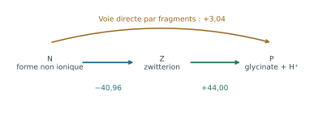
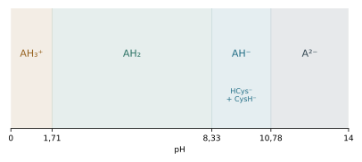
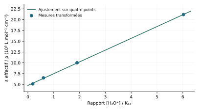
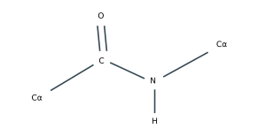
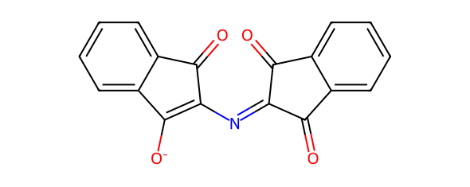

# ENS de Lyon — Second concours, Chimie 2006 · Corrigé brut

*Corrigé rédigé par IA, non officiel.*

**Rédaction (tour 1)** · GPT-6.2 Astra Ultra · vitesse non renseignée

Ces éditions traitent 49 des 51 questions du scan. Les questions 5.3.1 et 5.3.2 sur la protection expérimentale du thiol sont hors couverture. Les données du cycle thermodynamique et les quatre valeurs spectrophotométriques sont exploitées avec leurs unités imprimées. Les deux spectres RMN sont lus dans l’annexe. L’archive du second concours ne rattache pas de rapport écrit à cette épreuve.

## 1. Stéréochimie de la cystéine

### Question 1.1.1 — Stéréoisomères de la cystéine

Le carbone α est lié à H, $\mathrm{NH_2}$, $\mathrm{COOH}$ et $\mathrm{CH_2SH}$. C’est l’unique carbone asymétrique. Les stéréoisomères ont la même constitution et diffèrent par la disposition spatiale des atomes. Les deux configurations de ce centre donnent **deux énantiomères**, images l’un de l’autre dans un miroir et non superposables.

### Question 1.1.2 — Projection de Fischer et rotation

Dans la projection de Fischer de la **L-cystéine**, placer COOH en haut, $\mathrm{CH_2SH}$ en bas, $\mathrm{NH_2}$ à gauche et H à droite. Les liaisons horizontales pointent vers l’observateur. « Lévogyre » signifie que la substance fait tourner le plan de polarisation vers la gauche, suivant la convention de mesure, soit une rotation négative. La lettre L indique une configuration relative. Elle ne permet pas de conclure au caractère lévogyre. Le signe dépend d’une mesure dans des conditions précisées.

### Question 1.1.3 — Cram et configuration absolue

Dans la représentation de Cram de la figure, H et $\mathrm{NH_2}$ sont respectivement en arrière et en avant. L’azote est prioritaire. Au rang suivant, le carbone de $\mathrm{CH_2SH}$ porte $[\mathrm{S,H,H}]$, celui de COOH porte $[\mathrm{O,O,O}]$ au sens CIP. Le soufre précède l’oxygène. L’ordre complet est $\mathrm{NH_2>CH_2SH>COOH>H}$ et la **L-cystéine est R**.

### Question 1.2.1 — Comparaison avec la L-alanine

Pour la L-alanine, COOH est en haut, $\mathrm{CH_3}$ en bas, $\mathrm{NH_2}$ à gauche et H à droite. Parmi les groupes carbonés, COOH précède maintenant $\mathrm{CH_3}$, dont le second rang est $[\mathrm{H,H,H}]$. Avec H projeté en avant il faut inverser la lecture sur le papier. La **L-alanine est S**.

### Question 1.2.2 — Deux systèmes de nomenclature

Les séries D et L comparent des configurations à une référence conventionnelle. R et S suivent le classement CIP des substituants dans la molécule considérée. Les deux exemples de série L portent des descripteurs absolus opposés. Il n’existe donc pas de correspondance universelle entre L et S ou entre D et R.

## 2. Thermodynamique des formes neutres

### Question 2.1.1 — Deux formes de la glycine

La forme non ionique est $\mathrm{H_2N{-}CH_2{-}COOH}$. La forme zwitterionique est $\mathrm{^{+}H_3N{-}CH_2{-}COO^-}$. Elles sont toutes deux globalement neutres et se distinguent par la répartition interne des charges.

### Question 2.1.2 — Stabilité dans le vide

Pour la glycine isolée dans le vide, la forme non ionique est privilégiée. La séparation de charges nécessaire au zwitterion est coûteuse en l’absence de stabilisation par un solvant polaire, malgré l’attraction entre les deux groupes chargés.

### Question 2.2.1 — Dissociation de l’acide formique dans deux milieux

Pour la dissociation de l’acide formique en phase gazeuse, $\Delta H=+1432\,\mathrm{kJ\,mol^{-1}}$ et $\Delta S=+108\,\mathrm{J\,mol^{-1}\,K^{-1}}$. Séparer des ions coûte de l’énergie et une particule gazeuse en donne deux. En solution, $\Delta H$ vaut seulement **$+40\,\mathrm{J\,mol^{-1}}$** dans la table, l’hydratation compensant presque le coût de formation des ions. L’organisation de l’eau autour des charges explique $\Delta S=-72\,\mathrm{J\,mol^{-1}\,K^{-1}}$ malgré l’augmentation du nombre d’espèces dissoutes.

### Question 2.2.2 — Cycle d’enthalpie

Notons N la glycine non ionique aqueuse, Z son zwitterion, et P l’état final glycinate + proton en solution. L’approximation par fragments donne, pour N vers P, la dissociation gazeuse de la glycine corrigée par la différence entre dissociations aqueuse et gazeuse de l’acide formique. Ainsi $\Delta H_{N\to P}=1435+0{,}040-1432=3{,}040\,\mathrm{kJ\,mol^{-1}}$. Comme $\Delta H_{Z\to P}=44\,\mathrm{kJ\,mol^{-1}}$, la loi de Hess donne **$\Delta H_{N\to Z}=-40{,}96\,\mathrm{kJ\,mol^{-1}}$**.

### Question 2.2.3 — Énergie libre du transfert de proton

$\Delta S_{N\to Z}=112-108-72-(-39)=-29\,\mathrm{J\,mol^{-1}\,K^{-1}}$. À $298\,\mathrm K$, $\Delta G_{N\to Z}\simeq-40{,}96-298(-0{,}029)=-32{,}3\,\mathrm{kJ\,mol^{-1}}$. Dans le modèle du sujet, le **zwitterion** est la forme globalement neutre favorisée en eau. On attend la même préférence pour la cystéine lorsque la chaîne latérale conserve son thiol.

### Question 2.2.4 — Interprétation en solution

L’eau polaire stabilise le carboxylate et l’ammonium par hydratation. Ce gain enthalpique compense la pénalité entropique due notamment à l’organisation locale du solvant. À 25 °C, le bilan d’énergie libre favorise ainsi le transfert interne de proton.

## 3. Acidités et spectrophotométrie

### Question 3.1.1 — Les trois fonctions titrables

Les fonctions sont le carboxyle, l’ammonium conjugué de l’amine, et le thiol. Les équilibres locaux sont $\mathrm{RCOOH+H_2O\rightleftharpoons RCOO^-+H_3O^+}$, $\mathrm{RNH_3^++H_2O\rightleftharpoons RNH_2+H_3O^+}$ et $\mathrm{RSH+H_2O\rightleftharpoons RS^-+H_3O^+}$. Le groupement R porte ici le reste de l’acide aminé dans l’état de protonation considéré.

### Question 3.1.2 — Ordres de grandeur des acidités

Le carboxyle se situe vers pH 2, les dérivés appropriés donnant $1{,}9$. Le thiol est dans une plage voisine de $8{,}6$ à $10{,}3$ selon l’environnement (jusqu’à $9{,}5$ pour le dérivé N-acétylé). L’ammonium se situe également dans une large plage, environ $7$ à $11$ pour les analogues proposés, avec $8{,}7$ pour la S-éthyl-cystéine et $10{,}6$ pour la méthylamine protonée. L’ester éthylique donne deux valeurs apparentes $6{,}7$ et $9{,}2$. Ces intervalles repèrent le chevauchement des acidités et ne déterminent pas chacun des équilibres microscopiques.

### Question 3.1.3 — Portée du titrage

La courbe permet d’obtenir des **constantes macroscopiques successives**, compatibles avec le nombre de protons libérés. Deux sites différents peuvent conduire à des espèces de même charge après la même étape de neutralisation. Le titrage seul ne sépare pas leurs populations et ne donne pas toutes les constantes propres à chaque fonction.

### Question 3.2.1 — Prédominance et monoanions

Les frontières successives sont $1{,}71$, $8{,}33$ et $10{,}78$. Les formes globalement prédominantes quand le pH croît sont $\mathrm{AH_3^+}$, $\mathrm{AH_2}$, $\mathrm{AH^-}$ et $\mathrm{A^{2-}}$. Dans la classe monoanionique coexistent **HCys⁻** (carboxylate, ammonium, thiolate) et **CysH⁻** (carboxylate, amine, thiol). Leurs charges totales sont identiques. Le titrage situe l’intervalle de prédominance de leur somme, sans imposer l’égalité de leurs concentrations.

### Question 3.3.1 — Beer–Lambert

$A=\log_{10}(I_0/I)=\ell\sum_i\varepsilon_i c_i$. Pour $\ell$ en cm et $c_i$ en mol par litre, $\varepsilon_i$ s’exprime en $\mathrm{L\,mol^{-1}\,cm^{-1}}$ et $A$ est sans dimension. La loi suppose notamment une bande spectrale assez étroite, une solution homogène et peu diffusante, des concentrations suffisamment faibles et des espèces absorbantes correctement identifiées.

### Question 3.3.2 — Mesurer un coefficient molaire

Mesurer à la même longueur d’onde et avec le même trajet optique un blanc puis une gamme d’étalons de concentrations connues. Le milieu et le pH doivent conserver la même espèce absorbante. Ajuster l’absorbance corrigée du blanc en fonction de la concentration dans le domaine linéaire. La pente vaut $\varepsilon\ell$, d’où $\varepsilon$ après division par $\ell$.

### Question 3.4.1 — Absorbeurs à 240 nm

La somme de Beer–Lambert laisse $\varepsilon_{\rm eff}=(\varepsilon_H[\mathrm{HCys^-}]+\varepsilon_2[\mathrm{A^{2-}}])/T$, où $\varepsilon_H$ et $\varepsilon_2$ désignent les deux coefficients molaires à 240 nm. $T$ désigne ici la concentration analytique totale et non la température.

### Question 3.4.2 — Droite d’exploitation

Posons $h=[\mathrm{H_3O^+}]$, $K=[\mathrm{HCys^-}]/[\mathrm{CysH^-}]$ et $\rho=[\mathrm{A^{2-}}]/T$. Comme $[\mathrm{AH^-}]/[\mathrm{A^{2-}}]=h/K_{A3}$ et $[\mathrm{HCys^-}]/[\mathrm{AH^-}]=K/(1+K)$, il vient $\varepsilon_{\rm eff}/\rho=\varepsilon_2+\varepsilon_H[K/(1+K)]\,h/K_{A3}$. L’ordonnée à l’origine est $\beta=\varepsilon_2$ et la pente $\alpha=\varepsilon_H K/(1+K)$. $K_{A1}$ et $K_{A2}$ interviennent dans $\rho$ et disparaissent de cette expression linéaire.

### Question 3.4.3 — Fraction de dianion

En remontant les trois équilibres successifs, $\rho=\left[1+h/K_{A3}+h^2/(K_{A2}K_{A3})+h^3/(K_{A1}K_{A2}K_{A3})\right]^{-1}$. À pH très élevé $h$ tend vers zéro et la fraction tend bien vers un.

### Question 3.5.1 — Quatre points expérimentaux

Dans l’ordre des pH $10{,}0$, $10{,}5$, $11{,}0$, $11{,}5$, les abscisses $h/K_{A3}$ sont **6,026 ; 1,905 ; 0,603 ; 0,191**. Les fractions $\rho$ sont respectivement **0,1398 ; 0,3427 ; 0,6235 ; 0,8399**. Les quatre ordonnées $\varepsilon_{\rm eff}/\rho$ valent **21 170 ; 10 007 ; 6 507 ; 5 115** en $\mathrm{L\,mol^{-1}\,cm^{-1}}$.

### Question 3.5.2 — Régression sur les données

L’ajustement par moindres carrés de $y=\alpha x+\beta$ sans imposer l’ordonnée à l’origine donne **$\alpha\simeq2{,}730\times10^3$** et **$\beta\simeq4{,}745\times10^3\,\mathrm{L\,mol^{-1}\,cm^{-1}}$**. L’abscisse est sans dimension et les deux paramètres portent la même unité. Les écarts des quatre points justifient de limiter la précision des constantes déduites.

### Question 3.6.1 — Équilibre des deux monoanions

Sous l’hypothèse $\varepsilon_H\simeq\varepsilon_2$, on a $\alpha/\beta\simeq K/(1+K)$. Ainsi $K\simeq\alpha/(\beta-\alpha)=\mathbf{1{,}35}$ pour la réaction $\mathrm{CysH^-\rightleftharpoons HCys^-}$.

### Question 3.6.2 — Branche majoritaire

Parmi les monoanions, HCys⁻ représente $K/(1+K)\simeq57{,}5\,\%$ et CysH⁻ environ $42{,}5\,\%$. La branche où le thiol est déprotoné est donc légèrement majoritaire. Les deux branches contribuent sensiblement à la mesure.

### Question 3.6.3 — Distribution à pH physiologique

À pH $7{,}4$, les fractions des quatre classes sont proportionnelles à $h^3$, $K_{A1}h^2$, $K_{A1}K_{A2}h$ et $K_{A1}K_{A2}K_{A3}$. Après normalisation et partage des monoanions, les pourcentages sont **AH₃⁺ 0,00018 % ; AH₂ 89,48 % ; HCys⁻ 6,05 % ; CysH⁻ 4,46 % ; A²⁻ 0,0044 %**. La classe neutre est largement majoritaire et sa forme zwitterionique est favorisée en solution.

### Question 3.6.4 — Constantes microscopiques

Pour la déprotonation de $\mathrm{AH_2}$, les deux constantes sont $k_H=K_{A2}K/(1+K)$ vers HCys⁻ et $k_C=K_{A2}/(1+K)$ vers CysH⁻. Leur somme vaut $K_{A2}$. On trouve **$\mathrm p k_H\simeq8{,}57$** (déprotonation de SH) et **$\mathrm p k_C\simeq8{,}70$** (déprotonation de l’ammonium).

### Question 3.6.5 — Cas de l’acide phosphorique

Dans le modèle usuel, les sites OH équivalents de l’acide phosphorique ne créent pas deux familles fonctionnellement distinctes analogues à thiol et ammonium. Les équilibres macroscopiques suffisent à décrire les classes $\mathrm{H_3PO_4}$, $\mathrm{H_2PO_4^-}$, $\mathrm{HPO_4^{2-}}$ et $\mathrm{PO_4^{3-}}$. Des facteurs statistiques de sites équivalents peuvent intervenir dans une définition microscopique sans exiger la séparation spectrale réalisée ici.

## 4. Spectres de RMN

### Question 4.1.1 — Attribution du spectre de l’alanine

Le groupe $\mathrm{CH_3}$ donne le signal vers **1,5 ppm** (trois protons). Le CH α, plus déblindé du fait de ses voisins azoté et carboxylique, apparaît vers **3,8 ppm** (un proton). Le signal près de **4,9 ppm** appartient essentiellement à l’eau résiduelle HOD dans $\mathrm{D_2O}$. Les protons échangeables de l’acide aminé participent aux échanges avec le solvant. La référence est près de 0 ppm.

### Question 4.1.2 — Couplage du fragment CH–CH₃

Les trois H équivalents du méthyle sont couplés au seul H du CH, d’où un **doublet** de rapport 1:1. Réciproquement, le CH est couplé aux trois H équivalents du méthyle, d’où un **quadruplet** 1:3:3:1. L’écart entre raies adjacentes de chaque multiplet correspond au même $^3J$ en hertz.

### Question 4.1.3 — Signal de l’eau et fréquence de mesure

À proximité de 4,9 ppm, l’eau résiduelle et les échanges rapides des protons labiles contribuent à un signal non finement résolu. Son aire dépend de la quantité d’eau protonée et ne sert pas à compter les hydrogènes portés par le carbone de l’alanine. Si la fréquence du spectromètre augmente, des déplacements différents en ppm sont plus éloignés en hertz alors que les constantes $J$ en hertz changent peu. À température et milieu identiques, la position en ppm de HOD reste voisine de la même valeur. La meilleure dispersion ne garantit pas la résolution d’espèces en échange rapide.

### Question 4.2.1 — Deux équivalences en RMN

Deux protons chimiquement équivalents ont le même déplacement chimique dans les conditions considérées. Pour être magnétiquement équivalents, ils doivent en plus avoir les mêmes constantes de couplage avec chacun des autres noyaux du système. Des signaux accidentellement superposés ne démontrent pas ces identités.

### Question 4.2.2 — Système de trois spins de la cystéine

La figure donne trois signaux carbonés d’aire comparable vers **3,3**, **2,9** et **2,6 ppm**, outre l’eau résiduelle. On attribue le plus déblindé, vers 3,3 ppm, au CH α. Les deux autres correspondent aux deux H du $\mathrm{CH_2}$ voisin du soufre. Ils ne sont pas équivalents. Chaque H du méthylène présente un couplage géminé avec l’autre H (table, 12 à 15 Hz) et un couplage vicinal avec Hα (2 à 10 Hz). Hα possède deux couplages vicinaux généralement différents. On attend donc trois doubles doublets en première approximation, avec des chevauchements possibles. Le spectre imprimé seul ne fixe pas une attribution pro-R/pro-S des deux H du méthylène.

## 5. Peptides et électrophorèse

### Question 5.1.1 — Dipeptide d’alanine

En écriture non ionique, Ala–Ala s’écrit $\mathrm{H_2N{-}CH(CH_3){-}C(=O){-}NH{-}CH(CH_3){-}COOH}$. L’extrémité N est à gauche et l’extrémité C à droite. La liaison peptidique est la liaison C–N du motif central $\mathrm{{-}C(=O){-}NH{-}}$.

### Question 5.1.2 — Planéité de la liaison peptidique

Le doublet de N se délocalise vers le carbonyle, ce que traduisent $\mathrm{{-}C(=O){-}NH{-}}$ et $\mathrm{{-}C(-O^-){=}N^+H{-}}$. La liaison C–N peptidique est plus courte qu’une liaison simple d’amine et la liaison C–O est un peu plus longue que la double liaison C=O d’une cétone comparable. Les deux carbones α, C carbonylé, O, N et H porté par N se placent approximativement dans le même plan. La rotation C–N est freinée et la forme trans des substituants carbonés est usuellement favorisée.

### Question 5.2.1 — Hydrolyse, déplacement à l’acyle

Dans le mécanisme acido-catalysé, la protonation de l’oxygène carbonylé active le carbone de l’amide. L’eau attaque ce carbone et les électrons π passent à O, donnant un intermédiaire tétraédrique. Des transferts de protons convertissent l’azote en groupe partant protoné. Le doublet de O reforme C=O tandis que la liaison C–N se rompt. Les échanges de protons donnent le fragment acide carboxylique et le fragment aminé, ce dernier étant majoritairement ammonium en milieu acide.

*Question 5.3.1 hors couverture.*

*Question 5.3.2 hors couverture.*

### Question 5.4.1 — Électrophorèse et pI

Dans un champ électrique, un cation migre vers la cathode négative et un anion vers l’anode positive. La mobilité dépend aussi des frottements et du milieu. Le point isoélectrique $pI$ est le pH où la charge moyenne de la molécule est nulle, entraînant en première approximation une mobilité électrophorétique nulle.

### Question 5.4.2 — Choix de pH pour la séparation

Les valeurs donnent $pI_{\rm Cys}\simeq(1{,}71+8{,}33)/2=5{,}02$ et $pI_{\rm Arg}\simeq(9{,}04+12{,}48)/2=10{,}76$. Entre les deux, la cystéine migre vers l’anode et l’arginine vers la cathode. Un choix favorable est **pH voisin de 8,7**, où les charges moyennes calculées sont proches de $-0{,}70$ et $+0{,}70$. Pour maintenir la cystéine au dépôt en écartant l’arginine, on peut choisir pH 5,02. Un optimum de résolution au sens instrumental demanderait les mobilités et les propriétés du support.

## 6. Révélation des acides aminés

### Question 6.1.1 — De la forme hydratée à A

La protonation d’un des deux OH du diol géminé permet le départ d’eau. Simultanément ou dans l’écriture par étapes, l’autre oxygène fournit le doublet qui forme le carbonyle. Sa déprotonation régénère le catalyseur acide. **A est l’indane-1,2,3-trione**, où les deux carbonyles latéraux sont conservés.

### Question 6.2.1 — Sites nucléophile et électrophile

Le nucléophile est l’azote de la forme aminée non protonée de l’alanine. L’électrophile est le carbone du carbonyle central de A, rendu particulièrement électrophile par les deux carbonyles adjacents. Les équilibres de protonation règlent la fraction d’amine nucléophile disponible.

### Question 6.2.2 — Formation de la carbinolamine

Le doublet de N forme une liaison avec le carbone central pendant que le doublet π de C=O se déplace vers O. Des transferts de protons donnent **B**, portant sur ce carbone $\mathrm{OH}$ et $\mathrm{NH{-}CH(CH_3){-}COOH}$. C’est une carbinolamine. La protonation initiale de l’oxygène constitue une autre écriture de l’activation en milieu acide.

### Question 6.3.1 — Formation de C

La protonation de OH dans B en fait un groupe partant sous forme d’eau. Le doublet de N établit la liaison C=N et l’eau part. La déprotonation de l’iminium donne **l’imine C**, de motif $\mathrm{C_{central}{=}N{-}CH(CH_3){-}COOH}$. L’imine est aussi appelée base de Schiff.

### Question 6.3.2 — Nom de la transformation globale

L’union de deux molécules avec élimination d’une petite molécule est une **condensation**. Ici, l’amine et la cétone se condensent avec perte d’eau pour donner une imine.

### Question 6.4.1 — Décarboxylation de l’acide malonique

Dans un état de transition cyclique à six centres, l’oxygène carbonylé du carboxyle conservé capte le proton du carboxyle partant. Les électrons de O–H forment la seconde liaison C=O de $\mathrm{CO_2}$ et ceux de la liaison C–C rompue forment C=C du côté restant, tandis que les électrons π du carbonyle vont à O. On obtient $\mathrm{CH_2=C(OH)_2+CO_2}$. La tautomérie conduit ensuite à $\mathrm{CH_3COOH}$.

### Question 6.4.2 — Départ du carboxyle de l’alanine

Dans C, la rupture de la liaison entre le carbone α de l’alanine et son carboxyle libère $\mathrm{CO_2}$. Le doublet libéré au carbone α peut former $\mathrm{N{=}CHCH_3}$, tandis que les électrons de la liaison imine initiale se déplacent vers le carbone central du noyau. La charge se délocalise sur le carbonyle voisin et son oxygène est protoné. On obtient D sous forme énolique, avec la liaison imine désormais **du côté du fragment issu de l’alanine**. Les transferts de protons se représentent également dans un réarrangement cyclique, en faisant accepter le proton du carboxyle par l’oxygène voisin du système conjugué.

### Question 6.5.1 — De D à l’amine E

La protonation de l’imine $\mathrm{{-}N{=}CHCH_3}$ facilite l’addition de l’eau au carbone $\mathrm{CHCH_3}$. Après transferts de protons, l’intermédiaire carbinolamine se scinde. La reformation du carbonyle rompt C–N. On retrouve sur le noyau le groupe $\mathrm{{-}NH_2}$ de E et, sur le fragment à deux carbones, un aldéhyde.

### Question 6.5.2 — Second produit de l’hydrolyse

Le produit carbonylé est **l’éthanal**, $\mathrm{CH_3CHO}$, un aldéhyde. Le carboxyle de l’acide aminé avait fourni le carbone du dioxyde de carbone à l’étape précédente.

### Question 6.5.3 — Origine des atomes de E

Pour les acides α-aminés primaires suivant ce schéma, le squelette carboné de E vient du noyau de ninhydrine et le groupe aminé lui est transféré. La chaîne latérale de l’acide aminé se retrouve dans l’aldéhyde. **E est donc le même** pour ces acides aminés. Une amine secondaire sort des hypothèses de ce schéma.

### Question 6.6.1 — Chromophore final

L’azote de E se lie au carbone central d’un second noyau tricarbonylé avec perte d’eau. Les deux unités indaniques sont réunies par un azote au centre du système conjugué. La forme acide de condensation a pour formule $\mathrm{C_{18}H_9NO_4}$ (E + A moins eau). La déprotonation fournit **$\mathrm{C_{18}H_8NO_4^-}$**, anion du pourpre de Ruhemann. La figure représente une de ses formes mésomères.

### Question 6.6.2 — Origine de la couleur

La délocalisation électronique s’étend sur les deux fragments carbonylés par l’azote central. Les transitions électroniques correspondantes peuvent absorber dans le visible, notamment vers la région jaune–verte. La lumière restante donne la teinte violette à bleu-violet du pourpre de Ruhemann. Le spectre d’absorption et l’observation de la couleur sont deux descriptions complémentaires.
