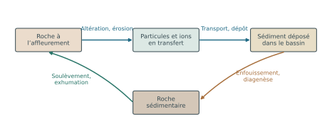
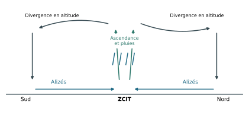
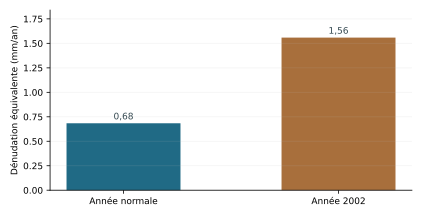
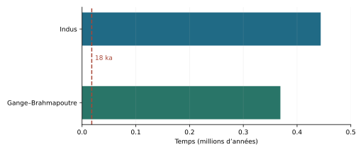
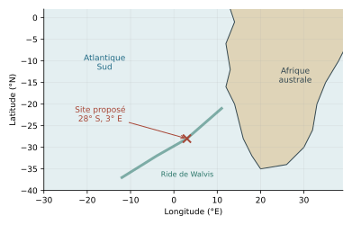

# ENS de Lyon — Second concours, Géosciences 2006 · Corrigé brut

*Corrigé rédigé par IA, non officiel.*

**Rédaction (tour 1)** · GPT-6.2 Astra Ultra · vitesse non renseignée

Les 60 questions imprimées sont traitées. L’original passe de 3.3 à 3.5. Le renvoi de 4.6 est explicité. Les calculs de transport adoptent les 92 jours de juin à août et distinguent les deux masses volumiques du sujet. Cinq schémas originaux comprennent le report cartographique demandé en 5.6. L’archive de 2006 ne rattache pas de rapport écrit à cette épreuve.

## 1. Origine et transformation des sédiments

### Question 1.1 — Représenter le cycle externe

Le soulèvement et l’érosion mettent les roches à l’affleurement. L’altération en libère des particules et des ions dissous. Les agents de transport les conduisent vers un bassin où se déposent détritus, précipités chimiques et restes d’organismes. L’enfouissement, la compaction et la cimentation forment une roche sédimentaire. Son soulèvement et son exhumation permettent un nouveau cycle. Une partie des sédiments est enfouie plus profondément et rejoint le cycle interne.

### Question 1.2 — Nommer les moteurs

L’énergie solaire entretient le cycle de l’eau et les circulations atmosphérique et océanique. La gravité entraîne ruissellement, transport et sédimentation vers les points bas. La dynamique interne de la Terre crée et renouvelle les reliefs par la tectonique et entretient les bassins où s’accumulent les dépôts. Le vivant module ces transformations.

### Question 1.3 — Identifier les fournisseurs du sédiment

L’érosion des roches préexistantes fournit les fragments lithiques et les minéraux détritiques. L’altération livre aussi des ions qui peuvent précipiter à partir de l’eau. Les organismes fournissent matière organique, coquilles et squelettes minéralisés. Les apports volcaniques, éoliens et les précipités authigènes complètent localement ces sources.

### Question 1.4 — Distinguer deux familles d’altération

L’altération physique fragmente la roche sans en changer directement la composition minérale. L’altération chimique transforme ou dissout les minéraux et redistribue les éléments entre produits solides et solution. Les fractures augmentent la surface accessible aux réactions, qui peuvent à leur tour fragiliser la roche.

### Question 1.5 — Relier agents et effets

L’eau liquide assure la dissolution, l’hydrolyse et le transport des solutés. Le gel–dégel, les variations thermiques, la décompression et la cristallisation de sels peuvent fragmenter les roches. Le dioxygène intervient dans l’oxydation et le CO₂ dissous modifie l’acidité de l’eau. Racines, lichens et micro-organismes modifient le milieu au contact des minéraux.

### Question 1.6 — Illustrer quatre réactions d’altération

**Dissolution.** La halite se dissout en ions sodium et chlorure dans l’eau. **Hydratation.** L’anhydrite fixe deux molécules d’eau par unité de CaSO₄ et devient du gypse. **Hydrolyse.** Un feldspath potassique altéré peut livrer des argiles telles que la kaolinite, de la silice dissoute et des ions potassium. **Oxydoréduction.** L’oxydation du fer ferreux de minéraux silicatés en fer ferrique favorise la formation d’oxyhydroxydes, par exemple la goethite.

### Question 1.7 — Identifier les minéraux secondaires

L’hydrolyse des silicates produit notamment des **minéraux argileux**, par exemple kaolinite ou smectites. Leur famille dépend de la roche initiale, du drainage, du climat et de la durée d’altération.

### Question 1.8 — Nommer la transformation après dépôt

La **diagenèse** regroupe les transformations physiques, chimiques et biologiques du sédiment après son dépôt. La compaction réduit sa porosité, la cimentation lie ses grains et la recristallisation peut modifier ses minéraux. La lithification est l’acquisition de la cohésion d’une roche.

## 2. Sédimentation marine

### Question 2.1 — Reconnaître l’apport continental

L’altération puis l’érosion des continents fournissent les sédiments terrigènes, des graviers et sables aux silts et argiles. Ils sont abondants sur les marges. De fines poussières continentales contribuent aussi aux argiles rouges pélagiques, et l’érosion glaciaire produit une fraction détritique.

### Question 2.2 — Suivre le transport vers la mer

Les cours d’eau apportent l’essentiel des détritus à la côte. Vent, glaciers et glaces flottantes transportent aussi des particules. Courants littoraux, houle, glissements et courants de turbidité redistribuent ensuite ces matériaux du plateau au domaine profond.

### Question 2.3 — Reconnaître les boues biogènes

Les boues calcaires sont riches en tests et débris carbonatés. Les boues siliceuses sont riches en squelettes d’opale biogène. La matière organique peut également être préservée lorsque production et enfouissement l’emportent sur la reminéralisation.

### Question 2.4 — Citer les quatre grands producteurs

Les foraminifères et les coccolithophoridés fournissent une grande partie des tests et plaques calcaires pélagiques. Les diatomées et les radiolaires fournissent des squelettes siliceux.

### Question 2.5 — Expliquer la carte des fonds océaniques

Les marges et les débouchés des grands fleuves concentrent les apports terrigènes. Aux hautes latitudes, notamment autour de l’Antarctique, s’ajoutent les dépôts glaciaires provenant des glaciers et des glaces flottantes. Les boues calcaires occupent de larges surfaces de l’Atlantique et de l’océan Indien ainsi que des reliefs océaniques où les carbonates se conservent au-dessus de la profondeur de compensation. Les boues siliceuses se développent dans des ceintures productives, notamment autour de l’Antarctique et dans des secteurs équatoriaux ou nord-pacifiques riches en nutriments. Les argiles rouges dominent là où les apports sont très faibles et les carbonates dissous, comme dans de vastes plaines abyssales du Pacifique. La carte montre le sédiment dominant, des mélanges existent.

## 3. Mousson et érosion himalayenne

### Question 3.1 — Expliquer la ZCIT

La zone de convergence intertropicale est une bande de basses pressions où convergent les alizés des deux hémisphères. L’air chaud et humide s’élève, se refroidit, condense sa vapeur d’eau et produit de fortes pluies convectives. En altitude l’air diverge vers les branches descendantes des cellules de Hadley. La ceinture se déplace selon la saison. En été boréal son déplacement vers l’Asie et le contraste thermique terre–océan favorisent l’arrivée d’air humide de mousson depuis l’océan Indien.

### Question 3.2 — Interpréter la carte des pluies de mousson

L’humidité arrive de la baie du Bengale vers les plaines de l’est et longe le front méridional de l’Himalaya. Les pluies sont abondantes au nord-est de l’Inde, au voisinage du Shillong et sur les versants exposés. En traversant la chaîne vers le nord, on rencontre une chute des précipitations sur le plateau tibétain sous le vent. Vers l’ouest, l’éloignement de la source d’humidité s’accompagne globalement d’un affaiblissement des pluies, avec des maxima locaux liés au relief.

### Question 3.3 — Situer les régions sèches

Sur la carte, une grande partie du Pakistan est peu arrosée relativement au front oriental. Le haut Tibet est également sec, protégé par la barrière montagneuse. L’hypothèse du sujet, qui concentre la pluie pendant la mousson, rend ce contraste pertinent pour l’année. Le nord-est montagneux du Pakistan et les franges du Tibet présentent des exceptions. Au sens climatique strict, l’aridité se définit aussi par la demande évaporative.

### Question 3.5 — Lire le profil moyen A

Dans le profil de l’est du Bhoutan, la pluie moyenne part d’environ 1 m/an au sud, augmente à plusieurs m/an et présente un large ensemble de maxima d’environ 4–5,5 m/an entre approximativement 100 et 200 km. À proximité du plateau de Shillong puis dans son arrière-pays, elle chute vers 1–2 m/an et montre des oscillations secondaires. Au nord de 350–400 km, elle devient très faible, alors que l’altitude moyenne remonte vers plusieurs kilomètres sur le plateau tibétain. L’ascendance humide affecte les pentes exposées et l’ombre pluviométrique s’étend derrière elles.

### Question 3.6 — Identifier le rôle du Shillong

Le Shillong, d’altitude moyenne de l’ordre de **1 à 2 km** suivant le trajet de la bande, forme un premier obstacle à l’air de la baie du Bengale. L’ascendance sur son flanc au vent déclenche de fortes pluies, puis l’air appauvri redescend ou poursuit sa route en donnant moins de pluie sous le vent. Une partie de l’eau tombe donc avant le front principal de l’Himalaya.

### Question 3.7 — Comparer sud et nord

De la plaine au versant au vent, la pluie peut d’abord augmenter fortement. Après un ou deux maxima sur les premiers reliefs, elle diminue sur le versant interne et devient faible au Tibet. Le contraste entre front humide et arrière-pays sec est commun aux profils, même si les maxima ne se trouvent pas aux mêmes distances.

### Question 3.8 — Comparer les profils le long de la chaîne

L’est reçoit les plus fortes précipitations, particulièrement en amont de l’obstacle de Shillong, avec plus de 5 m/an en A. L’ouest du Bhoutan montre un maximum voisin de 3–3,5 m/an. Au Népal, deux bandes au vent se distinguent, de l’ordre de 2 à 3 m/an. Vers le Sutlej, les maxima moyens sont plus faibles et séparés par des secteurs peu arrosés. L’épuisement progressif de l’humidité depuis la baie du Bengale et l’agencement des reliefs expliquent cette répartition le long du front.

### Question 3.9 — Comparer les moyennes des deux stations

La station de Simla est souvent vers 800–1 200 mm/an, avec des valeurs plus élevées certaines années. Une moyenne graphique voisine de **1 m/an** est raisonnable. Sangla est souvent vers 150–300 mm/an, avec des pics vers 500–800 mm/an, soit une moyenne de l’ordre de **0,25 à 0,30 m/an**. L’échelle allant jusqu’à 1 600 doit se lire en millimètres par an au vu du tableau, malgré l’impression de l’unité m/an sur l’axe.

### Question 3.10 — Relier position et altitude

Sangla, nettement plus sèche, correspond au site intérieur à altitude plus élevée dans la vallée de la Baspa, sous le vent du premier relief. Simla correspond à un secteur plus méridional et davantage exposé à la mousson. C’est le contexte du profil D, et non une règle générale pluie–altitude, qui autorise cette attribution.

### Question 3.11 — Comparer la variabilité temporelle

Sangla possède un fond sec assez stable interrompu par de fortes pointes isolées. Le contraste relatif entre un événement humide et une année ordinaire y est important. À Simla, les fluctuations sont plus continues sur un fond humide. On distingue notamment des années très arrosées au début de la série et de forts écarts interannuels ailleurs. Les années exceptionnelles de Sangla n’y forment pas une série de pics relatifs aussi nette.

### Question 3.12 — Estimer le temps de retour apparent

Les dates retenues sont 1957, 1968, 1978, 1990 et 2002. Les intervalles valent 11, 10, 12 et 12 ans, soit une moyenne de $45/4=11,25$ ans. Il s’agit d’une récurrence approximative d’une dizaine d’années sur cinq événements, sans périodicité stricte établie.

### Question 3.13 — Comparer débit et précipitations

La Baspa présente un débit de mousson de l’ordre de 100 m³/s en année ordinaire, avec des hausses marquées lors de plusieurs épisodes humides, notamment en 2002. Le débit a tendance à suivre l’apport d’eau régional. La concordance avec un pluviomètre ponctuel n’est pas exacte. Fonte de neige ou de glace, humidité antérieure du bassin et localisation des pluies interviennent aussi. Simla est située dans une autre vallée et sa pluie n’est pas une entrée locale directe de la Baspa.

### Question 3.14 — Quantifier le contraste de débits

Pour la Baspa, $169-96=73$ m³/s supplémentaires en 2002. Rapportée à la valeur normale, la hausse vaut $100(169-96)/96=76\,\%$. Le débit de 2002 est donc 1,76 fois le débit normal. Le graphique donne le même ordre de grandeur, d’une centaine à environ 170 m³/s.

### Question 3.15 — Comparer satellite et pluviomètre

Sur la courte portion commune, les carrés satellitaires sont généralement plus élevés que les ronds du pluviomètre de Sangla. Des années ordinaires donnent environ 0,5–0,8 m/an par satellite contre souvent 0,15–0,30 m à la station. En 2002 les deux séries montent, jusqu’à environ 1,4 m dans l’estimation satellitaire contre environ 0,75–0,8 m au sol. La calibration au sol conserve donc une partie du signal temporel sans garantir l’égalité à cette station de vallée.

### Question 3.16 — Expliquer les écarts de mesure

Le satellite estime la pluie sur un pixel et à partir de passages ou d’une restitution radiométrique. Il mélange versants arrosés, crêtes et fond de vallée. Le pluviomètre est ponctuel, peut être abrité, subir l’effet du vent et moins bien recueillir les précipitations solides. La calibration régionale, l’échantillonnage temporel et le relief marqué produisent des différences. La même mousson touche l’ensemble de la région, ce qui permet aux deux séries de repérer certains événements simultanés.

### Question 3.17 — Relier le signal spatial au débit

La forte valeur satellitaire de 2002 accompagne un fort débit. À partir de 1992, certaines variations du satellite suivent mieux la réponse du bassin que la mesure ponctuelle de Sangla, car la pluie restituée couvre une surface plus large. La correspondance n’est ni parfaite ni proportionnelle. Le débit inclut stockage et fonte, et l’étude porte sur une courte période commune.

### Question 3.18 — Relier les extrêmes à l’érosion

Les pluies rares qui pénètrent dans les vallées sèches déclenchent des hausses de débit et peuvent mobiliser en peu de temps des matériaux accumulés. L’érosion n’y est donc pas nécessairement faible durant chaque événement, même si les précipitations moyennes sont modestes. Débit et pluie suggèrent cette possibilité. Il faut la concentration en sédiments du tableau pour quantifier la masse effectivement exportée.

### Question 3.19 — Calculer la masse exportée en suspension

On prend juin, juillet et août, soit 92 jours ou $7\,948\,800$ s. Une concentration de 1 g/L vaut 1 kg/m³. En année normale, $0,95\times96=91,2$ kg/s, puis $M_n=91,2\times7\,948\,800/1\,000\simeq7,25\times10^5$ t/an. En 2002, $1,23\times169=207,87$ kg/s, d’où $M_h\simeq1,65\times10^6$ t/an. Les deux quantités sont des masses annuelles parce que le sujet concentre tout le transport dans la mousson.

### Question 3.20 — Rapporter la masse à l’aire drainée

En divisant par 757 km², on obtient environ $724\,931/757=958$ t/(km²·an) en année normale et $1\,652\,317/757=2\,183$ t/(km²·an) en 2002. Une convention de 90 jours au lieu de 92 réduit les deux résultats d’environ 2 %.

### Question 3.21 — Convertir le rendement en dénudation

Avec $\rho=1,4$ t/m³, 958 t/km² représentent 684 m³/km². Répartis sur $10^6$ m², ils correspondent à **0,684 mm/an**. En 2002, $2\,183/1,4\simeq1\,559$ m³/km², soit **1,56 mm/an**. Cette épaisseur équivalente applique la masse volumique des sédiments en suspension donnée par la question.

### Question 3.22 — Interpréter les minima

La lame équivalente de 2002 est environ $1,56/0,684=2,28$ fois celle d’une année normale. L’augmentation de débit et l’augmentation de concentration agissent ensemble. La charge de fond et certains épisodes torrentiels manquent aux mesures. Les deux taux obtenus sous-estiment ainsi l’export total, possiblement davantage dans les années de crues très énergiques. Une masse exportée peut aussi provenir d’un dépôt temporairement stocké dans le bassin.

### Question 3.23 — Pondérer les années humides

La part de la masse livrée par les années humides est $M_h/(M_h+10,25M_n)\simeq1,652/(1,652+10,25\times0,725)=0,182$, soit **environ 18 %**. Ces années représentent environ 9 % du temps. Si l’on cherche seulement l’excédent qu’elles apportent au-delà de leur contribution normale, la part est $(M_h-M_n)/(M_h+10,25M_n)\simeq10\,\%$. La première proportion répond à la question sur la contribution totale.

### Question 3.24 — Identifier un autre déclencheur

Les séismes déclenchent des glissements de terrain et des éboulements qui livrent de grands volumes de matériaux aux vallées. Des barrages naturels peuvent se former puis céder. Les crues ultérieures évacuent une partie de ce stock, de sorte que la production et l’export ne sont pas nécessairement simultanés.

### Question 3.25 — Intégrer l’apport de la Baspa pendant deux millions d’années

La moyenne vaut $\bar M=(10,25M_n+M_h)/11,25\simeq8,07\times10^5$ t/an. En 2 Ma, $M\simeq1,61\times10^{12}$ tonnes. À 1,4 t/m³, le volume équivalent est **$1,15\times10^{12}$ m³, soit environ 1 150 km³**. Cela suppose un régime stationnaire et la livraison de toute la masse calculée au cône, sans stockage net ou dérivation. À la densité de roche consolidée 2,8 t/m³ employée ensuite pour le cône, la même masse occuperait environ 577 km³.

## 4. Les cônes de l’Indus et du Bengale

### Question 4.1 — Comparer les deux apports actuels

Le Gange et le Brahmapoutre fournissent aujourd’hui environ 1 402 Mt/an au Bengale contre 385 Mt/an pour l’Indus, soit environ 3,6 fois plus. La partie orientale du système himalayen reçoit davantage de précipitations de mousson et livre de gros débits par deux réseaux fluviaux. Relief, étendue drainée, stockage en plaine et aménagements influencent aussi la quantité qui atteint chaque cône.

### Question 4.2 — Comparer présent et moyenne quaternaire

Au Bengale, 1 402 Mt/an aujourd’hui contre 1 285 en moyenne représentent un excès d’environ 9 %. Pour l’Indus, 385 contre 475 représentent un déficit d’environ 19 %. Les valeurs demeurent du même ordre, avec une prédominance durable du Bengale. Elles ne prouvent pas un taux constant pendant 2 Ma. Les moyennes cumulent les cycles climatiques, les modifications de drainage et les épisodes de stockage.

### Question 4.3 — Intégrer les masses quaternaires

Pour le Bengale, $1\,285\times10^6\times2\times10^6=2,57\times10^{15}$ t. Pour l’Indus, $475\times10^6\times2\times10^6=9,50\times10^{14}$ t. Il s’agit des sédiments accumulés dans chaque cône pendant les deux derniers millions d’années.

### Question 4.4 — Déduire les volumes consolidés

Au Bengale, $2,57\times10^{15}/2,8=9,18\times10^{14}$ m³, soit **918 000 km³** environ. Pour l’Indus, $9,50\times10^{14}/2,8=3,39\times10^{14}$ m³, soit **339 000 km³** environ. La même densité de roche est appliquée aux deux masses.

### Question 4.5 — Calculer l’érosion moyenne des bassins

Pour $10^6$ km² par bassin, les volumes représentent environ 0,918 km d’épaisseur au Bengale et 0,339 km pour l’Indus sur 2 Ma. Les taux moyens sont donc **0,46 et 0,17 mm/an**, respectivement. Ce sont des moyennes à grande échelle, inférieures aux épisodes de forte dénudation d’une vallée active comme la Baspa. Les ordres de grandeur supposent conservation de la masse, densité représentative et aire constante.

### Question 4.6 — Comparer Baspa et cône de l’Indus

En prenant les volumes littéralement obtenus aux questions 3.25 et 4.4, $100\times1\,153/339\,286\simeq0,34\,\%$. Le numérateur utilise 1,4 t/m³ et le dénominateur 2,8 t/m³. Ramenés à l’état consolidé commun, les 577 km³ de la Baspa représentent **0,17 %**, identique au pourcentage des masses. Le renvoi imprimé à 3.24 vise le calcul effectué en 3.25.

### Question 4.7 — Établir un historique des dépôts

Des profils de sismique-réflexion cartographient les horizons et l’épaisseur des séquences sur le cône. Des forages et carottages datent et identifient les niveaux, notamment par biostratigraphie et magnétostratigraphie. Après conversion temps–profondeur, correction ou discussion de la compaction et intégration spatiale, le volume entre deux horizons est divisé par leur intervalle d’âge. Datation, corrélation et géométrie expliquent une partie de la bande d’incertitude.

### Question 4.8 — Nommer l’intervalle géologique

Les 65 derniers millions d’années couvrent presque tout le **Cénozoïque**, depuis le début du Paléogène puis le Néogène et le Quaternaire jusqu’à aujourd’hui. L’intervalle cité commence légèrement après la limite actuelle fixée vers 66 Ma.

### Question 4.9 — Dater la collision Inde–Asie

Le début de la collision continentale Inde–Asie est classiquement situé vers **50 Ma**, avec un ordre de grandeur de 55–45 Ma selon le secteur et le critère adopté. La convergence et la croissance de l’Himalaya se poursuivent après ce premier contact.

### Question 4.10 — Comparer les histoires des cônes

Les deux séries montrent un apport initial vers 65 Ma puis des taux faibles sur une partie de l’intervalle paléogène. Au Bengale, le taux croît nettement par paliers depuis environ 25 Ma, puis davantage au Néogène récent et au Quaternaire. Celui de l’Indus reste plus faible, présente des fluctuations, dont un relèvement vers 20–25 Ma, puis un maximum très récent. Les derniers intervalles atteignent environ $1,2$ à $2,2\times10^5$ km³/Ma pour l’Indus et $3$ à $6\times10^5$ km³/Ma pour le Bengale. Le relief issu de la collision augmente les matériaux érodables. La mousson, les glaciations, les réorganisations du drainage, la capacité de stockage alluvial et la préservation peuvent différer entre les deux bassins. Un changement de taux dans le cône peut ainsi être décalé par rapport à l’événement en amont.

### Question 4.11 — Comparer les volumes graphiques et calculés

En retenant l’enveloppe récente, l’Indus donne environ $(1,2\text{ à }2,2)\times10^5\times2$, soit **0,24 à 0,44 million de km³**. Le Bengale donne environ $(3\text{ à }6)\times10^5\times2$, soit **0,6 à 1,2 million de km³**. Les volumes calculés en 4.4, 0,339 et 0,918 million de km³, sont contenus dans ces plages.

### Question 4.12 — Calculer la proportion récente

Pour l’Indus, $100\times0,339/3,3\simeq10,3\,\%$. Pour le Bengale, $100\times0,918/12\simeq7,7\,\%$. Les 2 Ma récents ne représentent qu’environ 3 % de l’intervalle de 65 Ma. Les deux proportions traduisent une accumulation relativement élevée au cours de la période récente.

### Question 4.13 — Calculer le temps de réponse de chaque bassin

Pour le Gange–Brahmapoutre, $\tau_r\simeq(2,4\times10^6)(3\times10^5)(2\times10^2)/(3,9\times10^8)\simeq3,69\times10^5$ ans, soit **0,37 Ma**. Pour l’Indus, $(1\times10^6)(2\times10^5)(2\times10^2)/(0,9\times10^8)\simeq4,44\times10^5$ ans, soit **0,44 Ma**. Les longueurs sont en mètres et le débit en m³/an.

### Question 4.14 — Tester l’enregistrement du dernier maximum glaciaire

Depuis le maximum glaciaire pris à 18 ka, il ne s’est écoulé qu’environ 4–5 % des temps de réponse calculés. Sa durée propre est également courte devant plusieurs centaines de milliers d’années. Les plaines alluviales amortissent et retardent le signal détritique. Une signature de débit liée au seul maximum serait donc faible et étalée dans ces grands cônes, aujourd’hui comme après transfert des matériaux. Le modèle porte sur la réponse moyenne de l’export sédimentaire. Des événements individuels directement enregistrés en mer peuvent laisser d’autres marqueurs.

## 5. Archives mondiales du climat et de l’érosion

### Question 5.1 — Comparer les bassins mondiaux

Dans de nombreux bassins de contextes différents, des taux relativement bas dans les intervalles anciens font place à des taux plus élevés au Néogène récent ou au Quaternaire. Les deux cônes indiens présentent aussi cette accélération récente. La date, l’ampleur relative et la continuité de la hausse varient entre bassins. Les histogrammes normalisés ne comparent pas les débits absolus. La récurrence géographique suggère un facteur climatique commun, auquel se superposent tectonique locale, différences de surface drainée et biais de préservation des archives anciennes.

### Question 5.2 — Définir les foraminifères

Les foraminifères sont des eucaryotes unicellulaires à pseudopodes réticulés. Beaucoup fabriquent un test à loges, souvent calcaire. Leurs tests fossiles préservés dans les sédiments peuvent être identifiés et analysés séparément.

### Question 5.3 — Préciser le mode de vie benthique

Un foraminifère **benthique** vit sur le fond marin ou dans les premiers centimètres du sédiment. Ses conditions de calcification reflètent donc l’eau du fond ou l’eau interstitielle superficielle. Les espèces planctoniques vivent dans la colonne d’eau.

### Question 5.4 — Définir le delta isotopique

En posant $R={}^{18}\!O/{}^{16}\!O$, on définit $\delta^{18}O=1\,000(R_{\rm éch}/R_{\rm réf}-1)$ en ‰. Un delta positif signifie que l’échantillon est relativement enrichi en isotope lourd par rapport à la référence considérée. Le standard des carbonates doit être précisé lorsque l’on compare des mesures.

### Question 5.5 — Interpréter l’oxygène des tests

L’oxygène incorporé à la calcite du test garde une relation avec la température et le $\delta^{18}O$ de l’eau ambiante. À composition de l’eau donnée, une eau plus froide favorise un test plus riche en ¹⁸O. Quand des calottes stockent de l’eau appauvrie en ¹⁸O, l’océan résiduel s’enrichit en ¹⁸O. Les séries benthiques renseignent ainsi sur la température des eaux profondes et le volume global de glace, deux contributions à distinguer dans l’interprétation.

### Question 5.6 — Choisir un site de carottage pour les tests

Sur la carte 2.1, on peut porter une croix dans la zone calcaire de l’Atlantique Sud oriental, sur un relief océanique du secteur de la ride de Walvis (environ 28° S, 3° E). Cette position est reportée sur le croquis ci-dessous. Un bon site offre une série pélagique continue, suffisamment ancienne, au-dessus de la profondeur de compensation des carbonates, loin de forts apports détritiques. Il faut contrôler la conservation des tests et la datation sur la carotte.

### Question 5.7 — Lire la tendance isotopique

De 25 à environ 15 Ma, les valeurs oscillent autour de 1 à 1,5 ‰. Une augmentation par étapes conduit ensuite vers environ 2 à 2,5 ‰. Dans les derniers millions d’années, la moyenne augmente encore vers 3–4 ‰ et l’amplitude des oscillations s’accroît, avec des pointes supérieures à 4 ‰. La variabilité rapide se superpose donc à l’enrichissement à long terme.

### Question 5.8 — Traduire l’enrichissement isotopique

L’enrichissement des tests traduit un refroidissement des eaux profondes et/ou un enrichissement isotopique de l’océan à mesure que croissent les calottes. Les oscillations récentes sont compatibles avec des alternances glaciaires–interglaciaires. L’amplitude de température locale ne s’obtient pas de ce seul signal. Il faudrait séparer l’effet de température et celui du volume des glaces.

### Question 5.9 — Relier climat, érosion et stockage dans les bassins

À l’échelle de plusieurs millions d’années, refroidissement et glaciations modifient la couverture végétale, accélèrent par endroits la fragmentation et l’abrasion glaciaire et multiplient les remaniements lors des dégels. L’accentuation des contrastes hydrologiques peut augmenter l’export moyen des reliefs. Une telle tendance persistante peut traverser le stockage alluvial et contribuer à la hausse des dépôts observée dans plusieurs bassins. En revanche, un épisode bref ou un cycle isolé est atténué par rapport au temps de réponse des grands systèmes. Le parallélisme temporel ne sépare pas à lui seul climat, soulèvement tectonique, variations du niveau marin et conservation des séries.
