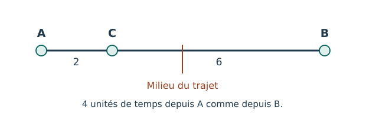
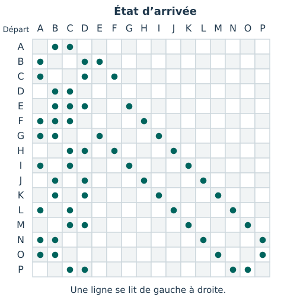
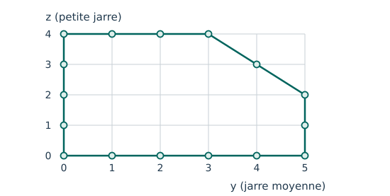

# ENS de Lyon · Second concours · Informatique 2006 — corrigé brut

*Corrigé rédigé par IA, non officiel. Signalez toute erreur.*

**Rédaction** · GPT-6.2 Astra Ultra · vitesse non renseignée · 25 novembre 2026

Dans le réseau routier, une arête porte une durée et une probabilité. Dans le jeu de jarres, elle représente un transvasement complet entre deux récipients.

## 1. Recherche d’itinéraires

### Question 1 · Décomposer au dernier arc

Fixons la source $u$. On initialise $d^{(0)}(u,u)=0$ et $d^{(0)}(u,v)=+\infty$ pour $v\ne u$. Un trajet **non vide** de longueur au plus $k+1$ se termine par une route $(w,v)$ précédée d’au plus $k$ routes. Sa durée est donc au moins $d^{(k)}(u,w)+\delta(w,v)$. Inversement, un trajet réalisant cette dernière borne, prolongé par la route $(w,v)$, est autorisé. On minimise sur les arcs entrants, avec $\min\varnothing=+\infty$.

La formule imprimée du sujet vaut ainsi pour $v\ne u$. Sur la diagonale, le trajet vide reste autorisé : un graphe réduit à un seul sommet sans arc donne déjà un contre-exemple à la formule imprimée. Une récurrence valable pour tous les couples est

$$
d^{(k+1)}(u,v)=\min\left(d^{(k)}(u,v),\;\min_{(w,v)\in R}\bigl[d^{(k)}(u,w)+\delta(w,v)\bigr]\right).
$$

Le premier terme conserve les anciens itinéraires. On peut aussi ajouter un arc fictif de durée nulle de chaque sommet à lui-même.

### Question 2 · Rang de stabilisation

Si un itinéraire repasse dans une ville, supprimer la portion comprise entre les deux passages donne un itinéraire de mêmes extrémités, de durée inférieure ou égale puisque les durées sont non négatives. En répétant, on obtient un chemin simple. Un tel chemin visite au plus $n=|V|$ villes, donc emploie au plus $n-1$ routes. Les chemins simples étant en nombre fini, la durée minimale est réalisée pour chaque destination accessible. Les autres gardent la valeur $+\infty$. Ainsi $N=n-1$ convient simultanément pour toutes les paires.

### Question 3 · Durée et itinéraire optimaux

Pour une source fixée $u$, appliquer la récurrence de 1 pendant $n-1$ tours. Chaque tour copie le tableau de distances dans un nouveau tableau et lit **l’ancien** pour parcourir les arcs. Lorsqu’un arc $(w,v)$ améliore strictement le nouveau coût en $v$, conserver $w$ comme prédécesseur de cette case. Une case simplement recopiée porte le marqueur « conserver ». Une ligne sans amélioration termine la recherche, car l’application de la même récurrence ne la changera plus.

Si la distance finale de $v$ est infinie, aucun chemin n’existe. Sinon, remonter depuis $v$ dans la table des tours. Pour une case améliorée, noter son dernier arc et passer au prédécesseur. Pour une case conservée, rester à la même ville. Dans les deux cas on remonte **d’un tour** et on atteint la source dans la ligne initiale. Lire les arcs en ordre inverse. Pour $v=u$, on peut renvoyer immédiatement le trajet vide.

Le coût est $O(n(n+m))$ pour $m=|R|$, avec $O(n^2)$ de mémoire pour les choix et $O(n)$ pour les deux lignes numériques. L’algorithme calcule en même temps une distance et un itinéraire vers **chaque** destination. Les poids non négatifs autorisent également Dijkstra avec liste de successeurs, tas binaire et un prédécesseur par ville, en $O((n+m)\log(n+1))$.

### Question 4 · Itinéraire le plus fiable

Minimiser la probabilité d’au moins un accident revient à maximiser le produit $\pi(\gamma)$ des probabilités de traversée sans accident. Pour les arcs de probabilité strictement positive, poser $c(w,v)=-\ln\pi(w,v)\ge0$. La somme des coûts d’un itinéraire est $-\ln\pi(\gamma)$. Un plus court chemin pour ces coûts réalise donc le maximum de fiabilité. Une route de probabilité 1 a un coût nul et ne pose aucune difficulté.

S’il n’existe aucun chemin composé d’arcs de probabilité positive, faire un parcours dans le graphe complet. Si $v$ est accessible, tous les chemins possibles ont une fiabilité nulle et n’importe lequel réalise le maximum. Sinon il n’existe aucun itinéraire. Cette distinction traite les routes de probabilité 0 autorisées par la définition. Le trajet vide a fiabilité 1.

### Question 5 · Arbitrer entre la durée et le risque

Fixer un paramètre $\lambda>0$, exprimant le temps que l’on accepte d’échanger contre une unité de risque logarithmique. Attribuer à chaque route de probabilité positive le coût

$$
c_\lambda(w,v)=\delta(w,v)+\lambda[-\ln\pi(w,v)].
$$

La somme le long d’un itinéraire vaut $\delta(\gamma)-\lambda\ln\pi(\gamma)$. Un plus court chemin pour ces coûts fournit un compromis. Si un autre trajet le dominait, en étant à la fois au moins aussi rapide et au moins aussi fiable avec une amélioration stricte, il aurait un coût strictement inférieur. Quand tous les trajets ont une fiabilité nulle, leur durée départage les possibilités. Le choix de $\lambda$ relève de la préférence donnée aux deux critères.

### Question 6 · Rencontre de deux chantiers

Représentons les étapes possibles par les sommets et les tronçons par des arêtes pondérées par le temps de construction. Notons $a,b$ les deux villes de départ. Si la rencontre doit se faire à une étape $z$, calculer les distances minimales $d_a(z),d_b(z)$ depuis chaque origine. Les deux équipes travaillent en parallèle, d’où

$$
T_* = \min_{z\in V}\max\{d_a(z),d_b(z)\}.
$$

Pour un lieu $z$ fixé, aucune équipe ne peut y parvenir plus tôt que son meilleur trajet. En suivant les chemins donnés par les prédécesseurs, elles le peuvent effectivement, la première attendant la seconde si besoin. Si les trajets se rencontrent auparavant, cette rencontre donne déjà une solution au moins aussi bonne. Ignorer les sommets inaccessibles depuis l’une des sources. Deux Dijkstra et un balayage des sommets coûtent $O((n+m)\log(n+1))$.

Si l’on autorise aussi une rencontre **à l’intérieur** d’un tronçon, supposons les temps symétriques et proportionnels à la fraction construite. Le temps optimal est alors $d(a,b)/2$. Les deux réalisations construites en temps $T$ forment ensemble un trajet de longueur temporelle au plus $2T$. Cela impose $2T\ge d(a,b)$. Partir des deux extrémités d’un plus court chemin et construire jusqu’à son milieu en temps réalise cette borne. Un seul Dijkstra suffit dans ce modèle.



### Question 7 · Atteindre une durée exacte

Construire implicitement les états $(w,t)$ avec $w\in V$ et $0\le t\le d$. L’état initial est $(u,0)$. Depuis $(w,t)$ et une route $(w,z)$ de durée entière $c$, on peut atteindre $(z,t+c)$ si $t+c\le d$. Faire un parcours en largeur ou en profondeur, marquer chaque état à sa première visite et y enregistrer l’état précédent. Si $(v,d)$ apparaît, remonter les prédécesseurs pour reconstituer la suite des villes. S’il n’apparaît pas, répondre que la durée est impossible.

Une marche du réseau de durée $d$ engendre ces états avec ses durées cumulées successives. Inversement, une suite de transitions jusqu’à $(v,d)$ fournit cette marche. Les durées étant non négatives, aucun préfixe d’une solution ne dépasse $d$. Le marquage évite les boucles même si certaines durées valent zéro. Temps $O((d+1)(n+m))$, mémoire $O((d+1)n)$ en plus du réseau. La dépendance en la valeur entière de $d$ est pseudo-polynomiale.

## 2. Jeux de jarres

### Question 8 · Contraintes sur les volumes

Les volumes sont entiers, $0\le x\le X$, $0\le y\le Y$, $0\le z\le Z$, et $x+y+z=X$. Après un versement, une jarre est vide ou pleine, puisque la source est épuisée ou que la destination a atteint sa capacité. L’état initial satisfait aussi cette propriété. Si $g=\gcd(X,Y,Z)$, chaque volume reste un multiple de $g$ : la quantité versée est le minimum du contenu de la source et de la place libre dans la destination. Ces contraintes sont nécessaires.

### Question 9 · Graphe des états pour les capacités 8, 5, 3

Pour chaque état, les six choix ordonnés de jarres fournissent les successeurs suivants. Les lettres codent des triplets dans l’ordre des capacités $(8,5,3)$.

| État | $(x,y,z)$ | Successeurs distincts |
|---|---|---|
| A | $(8,0,0)$ | B, C |
| B | $(3,5,0)$ | A, D, E |
| C | $(5,0,3)$ | A, D, F |
| D | $(0,5,3)$ | B, C |
| E | $(3,2,3)$ | B, C, D, G |
| F | $(5,3,0)$ | A, B, C, H |
| G | $(6,2,0)$ | A, B, E, I |
| H | $(2,3,3)$ | C, D, F, J |
| I | $(6,0,2)$ | A, C, G, K |
| J | $(2,5,1)$ | B, D, H, L |
| K | $(1,5,2)$ | B, D, I, M |
| L | $(7,0,1)$ | A, C, J, N |
| M | $(1,4,3)$ | C, D, K, O |
| N | $(7,1,0)$ | A, B, L, P |
| O | $(4,4,0)$ | A, B, M, P |
| P | $(4,1,3)$ | C, D, N, O |

Tous sont atteints par le parcours partant de A. La liste est fermée par les transvasements, donc exhaustive. Il y a **16 états et 58 arcs orientés**. En oubliant le sens, 41 paires d’états distincts sont adjacentes. Par exemple E peut revenir en C, mais C ne peut pas atteindre E en un seul coup.



### Question 10 · Deux chemins sans répétition

Avec les lettres de 9, deux chemins convenables sont

$$
A,B,E,G,I,K,M,O\qquad\text{et}\qquad A,C,F,H,J,L,N,P,O.
$$

Chaque transition figure dans la ligne du sommet précédent, et aucun sommet n’apparaît deux fois dans une même liste. Le premier emploie sept transvasements, le second huit.

### Question 11 · Récurrence et énumération

Soit $A_k(s)$ le booléen « $s$ est accessible en au plus $k$ coups ». Posons $A_0(s)=[s=(X,0,0)]$. Avec $r\to s$ pour un transvasement de volume non nul,

$$
A_{k+1}(s)=A_k(s)\ \lor\!\bigvee_{r\to s}A_k(r).
$$

L’égalité résulte de la décomposition au dernier coup. Comme il y a un nombre fini d’états, l’ensemble croissant des états marqués finit par se stabiliser. Le parcours suivant calcule directement cette limite. Sa table de prédécesseurs donnera aussi un chemin minimal en 13.

```python
from collections import deque

def etats(capacites):
    depart = (capacites[0], 0, 0)
    precedent = {depart: None}
    file = deque([depart])
    while file:
        s = file.popleft()
        for i in range(3):
            for j in range(3):
                if i == j:
                    continue
                q = min(s[i], capacites[j] - s[j])
                if q == 0:
                    continue
                t = list(s)
                t[i] -= q
                t[j] += q
                t = tuple(t)
                if t not in precedent:
                    precedent[t] = s
                    file.append(t)
    return precedent
```

Le dictionnaire contient exactement les états atteints. Chaque état est développé une seule fois, avec au plus six essais.

### Question 12 · Énumérer sur le bord d’un polygone

On retrouve $x=X-y-z$. Les points possibles appartiennent au rectangle entier $[0,Y]\times[0,Z]$ coupé par $y+z\le X$. D’après 8, un point accessible est sur le bord du polygone obtenu : $y=0,Y$, $z=0,Z$, ou $y+z=X$ pour une première jarre vide. Une première jarre pleine donne l’origine. On peut donc énumérer les points entiers des côtés, identifier les extrémités communes, puis ne conserver que les points atteints depuis $(0,0)$ par les transitions de 11. Cette dernière étape prend en compte les contraintes arithmétiques.

Lorsque $X\ge Y+Z$, le polygone est le rectangle entier. Son bord compte $2(Y+1)+2(Z+1)-4=2(Y+Z)$ points. Lorsque $X<Y+Z$, posons $h=Y+Z-X>0$. On coupe le coin supérieur droit. Le chemin de bord remplacé avait $2h$ pas unité, contre $h$ pas diagonaux sur le nouveau segment. Le nombre de points distincts d’un contour fermé étant égal au nombre de ses pas, on obtient la borne

$$
2(Y+Z)-h=X+Y+Z.
$$

L’ordre $X>Y>Z$ garantit que la coupe rencontre le côté supérieur et le côté droit avant les deux autres. Pour $(8,5,3)$, la borne vaut 16 et la table de 9 montre qu’elle est atteinte.



### Question 13 · Minimiser le nombre de transvasements

Le partage demandé suppose que $X$ est pair et que $Y\ge X/2$. Sinon il est impossible. Lancer le parcours en largeur de 11. Si la cible $(X/2,X/2,0)$ figure dans le dictionnaire, remonter ses prédécesseurs jusqu’à l’état initial, puis inverser la liste. Le nombre de coups est la longueur de cette liste moins un. L’ordre FIFO explore d’abord tous les états à $k$ coups, puis ceux à $k+1$, d’où la minimalité. Si la cible manque, elle est inaccessible.

Chaque état ayant au plus six arcs sortants et le nombre d’états étant majoré par $2(Y+Z)$, le temps et l’espace sont $O(Y+Z)$ en comptant une opération sur des volumes entiers comme élémentaire. Le coût vaut $O(S)$ si l’on note $S$ le nombre effectif d’états visités, avec accès aux marques en temps constant (en moyenne pour le dictionnaire du code). Pour l’exemple, O apparaît au septième niveau, par le premier chemin de 10.

### Question 14 · Minimiser le volume total transvasé

Donner à un arc $s\to t$ le poids $q$ effectivement versé. Multiplier tous les poids par le même coefficient physique positif ne changerait pas le meilleur chemin. Les arcs étant positifs, utiliser Dijkstra depuis l’état initial, avec un tas de couples (coût, état). Pour un arc de poids $q$, améliorer la distance et le prédécesseur de $t$ si $d(s)+q<d(t)$. À l’extraction définitive de la cible, remonter les prédécesseurs. Si la file se vide sans l’atteindre, le partage est impossible.

Avec $S$ états et au plus $6S$ arcs, temps $O(S\log(S+1))$, espace $O(S)$. En 8, 5, 3, le coût minimal est **22 pintes** pour le chemin A, B, E, G, I, K, M, O. Les volumes successivement versés sont $5,3,3,2,5,1,3$.
