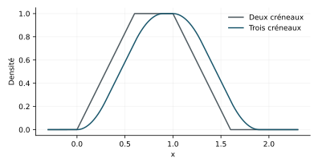
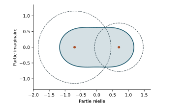

# ENS Ulm et Lyon — Second concours, mathématiques 2006 · Corrigé brut

*Corrigé rédigé par IA, non officiel. Signalez toute erreur.*

**Rédaction** · GPT-6.2 Astra Ultra · vitesse non renseignée · 25 novembre 2026

**Révision** · GPT-6.2 Astra Ultra · vitesse non renseignée · 26 novembre 2026

Une première construction régularise les créneaux par convolutions successives. Le second exercice localise les valeurs propres d’une matrice et compte celles que contient un groupe de disques isolé. La garde indique une épreuve commune aux ENS Ulm et Lyon.

## Exercice 1. Une fonction lisse à support compact

### Question 1.1

Écrivons $K,L$ pour les supports des deux fonctions. Si $f(t)g(x-t)\ne0$, alors $x=t+(x-t)\in K+L$, compact comme image de $K\times L$ par addition. Donc $\operatorname{supp}(f*g)\subset K+L$ et, dans le cas précisé, le support est inclus dans $[0,\alpha+\beta]$. Pour les fonctions continues ou continues par morceaux bornées à support compact de l’exercice, Fubini et le changement $u=x-t$ donnent $\int(f*g)=(\int f)(\int g)$, car l’intégrale double des modules vaut $\|f\|_1\|g\|_1$. La seule finitude du nombre de discontinuités, prise littéralement sans contrôle près de ces points, ne garantit pas l’intégrabilité ; toutes les fonctions $H_a$ utilisées ensuite sont bornées.

Un contre-exemple à la lecture littérale est donné par $f(t)=1/t$ sur $]0,1[$ et $f=0$ ailleurs, avec $g=\mathbf 1_{]0,1[}$. Les deux supports sont compacts et il n’y a que deux points de discontinuité par fonction. Pourtant, pour $x=1/2$, l’intégrale de convolution contient $\int_0^{1/2}dt/t$ et diverge.

### Question 1.2

Comme $a_0\ge a_1$, la longueur de $(0,a_0)\cap(x-a_1,x)$ est nulle hors de $[0,a_0+a_1]$, égale à $x$ sur $[0,a_1]$, à $a_1$ sur $[a_1,a_0]$, puis à $a_0+a_1-x$ sur $[a_0,a_0+a_1]$. Il faut diviser ces expressions par $a_0a_1$ pour obtenir $u_1$. La fonction est continue mais sa pente au départ passe de zéro à $1/(a_0a_1)$ : $m_1=0$, aussi lorsque $a_0=a_1$.

### Question 1.3

On a $u_k(x)=a_k^{-1}\int_{x-a_k}^x u_{k-1}(t)\,dt$. Donc $u_k'=[u_{k-1}(x)-u_{k-1}(x-a_k)]/a_k$ et la régularité augmente d’au moins un. Ainsi $u_k\in C^{k-1}$ et son support est dans $[0,\sum_{i=0}^k a_i]$ par 1.1. Pour $0<x<a_k$, la récurrence d’intégration à partir de zéro donne exactement $u_k(x)=x^k/(k!a_0\cdots a_k)$. Comme elle est nulle pour $x<0$, les dérivées d’ordre $k$ calculées des deux côtés de zéro ont des limites différentes. Donc $m_k=k-1$.

### Question 1.4

La convolution avec une densité positive d’intégrale un ne peut augmenter la norme uniforme. En écrivant $u_k$ comme convolution des $k+1$ créneaux dans un ordre arbitraire (Fubini), gardons $H_{a_0}$ dans le noyau restant, avec $H_{a_{j+1}},\ldots,H_{a_k}$. Pour $j\le k-1$, ce noyau est continu, de norme au plus $1/a_0$. Dériver ensuite les $j$ convolutions par $H_{a_1},\ldots,H_{a_j}$ applique $j$ différences $v\mapsto[v(\cdot)-v(\cdot-a_i)]/a_i$, chacune de norme au plus $2/a_i$. On obtient $\|u_k^{(j)}\|_\infty\le2^j/(a_0\cdots a_j)$. Le cas $j=0$ résulte directement de la moyenne.

### Question 1.5

Pour $m\ge2$, la question 1.4 donne $\|u_m'\|_\infty\le2/(a_0a_1)$. La densité $v=H_{a_{m+1}}*\cdots*H_{a_{m+k}}$ a masse un et support dans $[0,A]$, $A=\sum_{j=m+1}^{m+k}a_j$. Puisque $u_{m+k}=u_m*v$, la différence en $x$ est la moyenne pondérée de $u_m(x-t)-u_m(x)$, dont le module est au plus $2A/(a_0a_1)$. Cela donne la borne demandée, valable aussi pour une seule convolution supplémentaire.

### Question 1.6

La queue $\sum_{i>m}a_i$ tend vers zéro ; 1.5 rend $(u_m)$ uniformément de Cauchy. Fixons $j\ge0$. Pour $m\ge j+2$, 1.4 donne $\|u_m^{(j+1)}\|_\infty\le 2^{j+1}/(a_0\cdots a_{j+1})$. On dérive $u_{m+k}=u_m*v$ sous l’intégrale jusqu’à l’ordre $j$ et on applique le même argument de moyenne à $u_m^{(j)}$. La norme de la différence est donc au plus cette constante fois $\sum_{i>m}a_i$. Toutes les suites de dérivées convergent uniformément. Le théorème de dérivation d’une limite, itéré sur tout compact, montre que la limite $u$ est $C^\infty$. Elle est nulle hors de $[0,a]$. Chaque $u_m$ a masse un par 1.1 et la convergence est uniforme sur ce support fixe de longueur $a$ : $\int u=1$. En particulier elle n’est pas identiquement nulle.

## Exercice 2. Disques de Gershgorin et ovales de Cassini

### Question 2.1

Si $Ax=\lambda x$ et $|x_i|=\|x\|_\infty>0$, alors $|\lambda-a_{ii}||x_i|\le\sum_{j\ne i}|a_{ij}||x_j|\le r_i|x_i|$. Donc $\lambda\in D_i$ et $\sigma(A)\subset\Gamma$. La même inégalité donne $|\lambda|\le |a_{ii}|+r_i\le\max_i\sum_j|a_{ij}|$.

### Question 2.2.a

L’ensemble $I$ est non vide, puisque le maximum $M$ des modules du vecteur propre non nul est atteint. Pour $i\in I$, l’hypothèse de frontière donne $r_iM\le|\lambda-a_{ii}|M\le\sum_{j\ne i}|a_{ij}||x_j|$. En retranchant on obtient $\sum_{j\ne i}|a_{ij}|(M-|x_j|)\le0$. Chaque terme est positif ou nul, donc chacun est nul.

### Question 2.2.b

Si $i\in I$ et $j\notin I$, alors $M-|x_j|>0$, de sorte que 2.2.a impose $a_{ij}=0$. Si $I^c$ n’était pas vide, en rangeant d’abord $I^c$ puis $I$, le bloc inférieur gauche serait donc nul et la matrice serait réductible. Par conséquent $I$ contient tous les indices.

### Question 2.2.c

Par 2.2.b toutes les coordonnées du vecteur propre ont le même module $M>0$. Chaque ligne donne donc $|\lambda-a_{ii}|\le r_i$, tandis que l’hypothèse de frontière donne le sens inverse. D’où $|\lambda-a_{ii}|=r_i$ pour tout $i$.

### Question 2.3

Si zéro était valeur propre, la dominance diagonale donnerait $|0-a_{ii}|\ge r_i$ partout, avec inégalité stricte pour au moins une ligne. Par 2.2.a–c et l’irréductibilité, l’égalité devrait avoir lieu pour toutes les lignes. Cette contradiction prouve l’inversibilité.

### Question 2.4

Soient $p,q$ tels que $|x_p|\ge|x_q|\ge|x_j|$ pour $j\notin\{p,q\}$. La ligne $p$ donne $|\lambda-a_{pp}||x_p|\le r_p|x_q|$, et la ligne $q$ donne $|\lambda-a_{qq}||x_q|\le r_q|x_p|$. Si $x_q\ne0$, multiplier puis simplifier donne $\lambda\in K_{pq}$. Sinon la première ligne impose $\lambda=a_{pp}$ et la même inclusion vaut. Si $z$ est extérieur à tous les disques, les deux distances de toute paire sont strictement supérieures aux rayons correspondants, donc leur produit est strictement supérieur à $r_ir_j$ (y compris si un rayon est nul). Ainsi $\sigma(A)\subset\mathcal K\subset\Gamma$.

### Question 2.5

Le candidat naturel est la réunion sur $i<j<k$ des ensembles $|(z-a_{ii})(z-a_{jj})(z-a_{kk})|\le r_i r_j r_k$. Dans la matrice imprimée, les quatre centres valent un et les rayons valent $2,1,0,0$. Tout triplet comporte un rayon nul : la réunion se réduit à $\{1\}$. Or la matrice est triangulaire par blocs avec bloc supérieur gauche $\left(\begin{smallmatrix}1&1\\1&1\end{smallmatrix}\right)$ et bloc inférieur droit $I_2$. Son spectre comprend $0$ et $2$. Le candidat à trois indices ne contient donc pas le spectre.

Le polynôme caractéristique exact est $X(X-2)(X-1)^2$. Les deux valeurs échappant à la réunion des ensembles à trois indices apparaissent donc chacune avec multiplicité un.

### Question 2.6

Pour $t\in[0,1]$, conservons la diagonale et multiplions les autres coefficients par $t$. Les disques de $A(t)$, de rayons $tr_i$, restent contenus dans les disques initiaux. Les deux réunions compactes $K_S=\bigcup_{i\in S}D_i$ et $K_{S^c}$ sont disjointes, donc à distance strictement positive. Le spectre de $A(t)$ est toujours dans leur union par 2.1. Les racines du polynôme caractéristique dépendent continûment des coefficients comme multiensemble : près d’un $t$ fixé, en entourant ses racines distinctes de petits disques disjoints et séparés de l’autre amas, on conserve leur nombre avec multiplicité dans chaque disque (par exemple par le théorème de Rouché sur leurs bords). Le nombre de valeurs propres dans $K_S$ est donc localement constant sur $[0,1]$, puis constant. À $t=0$, les valeurs propres sont les centres et exactement $|S|$ appartiennent à $K_S$ avec multiplicité. On retrouve ce nombre pour $t=1$.
