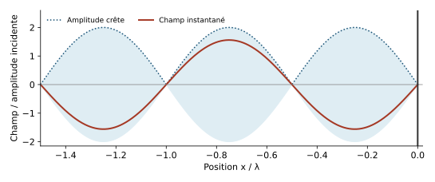
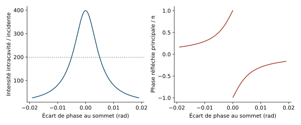
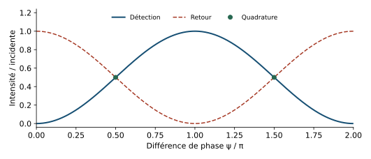

# ENS de Lyon, second concours 2006 — Physique · Corrigé brut

*Corrigé rédigé par IA, non officiel. Signalez toute erreur.*

**Rédaction** · GPT-6.2 Astra Ultra · vitesse non renseignée

## I.a — Miroir parfait

### Question I.a.1 — Réflexion sur le conducteur

À incidence normale, le champ électrique est tangent à la surface du conducteur parfait et s’y annule. Les amplitudes complexes à $x=0$ vérifient $E_{\rm in}+E_\rho=0$. Le coefficient de réflexion du champ est donc $\rho=-1$, de module unité et de phase $\pi$.

### Question I.a.2 — Somme des champs

Avec la convention temporelle $e^{-i\omega t}$, l’amplitude totale dans $x<0$ est $E_{\rm in}(e^{ikx}-e^{-ikx})=2iE_{\rm in}\sin(kx)$. En prenant $E_{\rm in}$ réel par choix de la phase, le champ physique est $\mathcal E(x,t)=2E_{\rm in}\sin(kx)\sin(\omega t)$.

### Question I.a.3 — Nœuds et ventres fixes

L’amplitude crête est $2|E_{\rm in}\sin(kx)|$. Les nœuds sont à $x=-m\lambda/2$ et les ventres à $x=-(2m+1)\lambda/4$, pour $m=0,1,\ldots$ sur le demi-axe considéré. Les positions de ces extrema ne se déplacent pas pendant que le champ oscille, ce qui justifie le terme d’onde stationnaire.

## I.b — Lame séparatrice

### Question I.b.1 — Conservation dans la séparatrice

Avec les deux entrées du fascicule et $r,t$ réels, $|tE_1-rE_2|^2+|rE_1+tE_2|^2=(r^2+t^2)(|E_1|^2+|E_2|^2)$, les termes d’interférence se compensant. Pour une séparatrice idéale sans pertes ni stockage net, la conservation de la puissance impose $R+T=1$.

### Question I.b.2 — Épaisseur de la lame

Une épaisseur finie ajoute du chemin optique et un retard de phase aux rayons qui traversent le verre. À incidence normale, une traversée augmente le chemin optique de $(n-1)e$ par rapport à la même épaisseur de vide. À incidence oblique, la réfraction décale aussi latéralement le faisceau émergent et change sa phase au plan de comparaison. Selon le traitement des faces, des réflexions internes supplémentaires peuvent intervenir.

### Question I.b.3 — Coefficients de champ

Dans la convention du sujet, le signe de la réflexion sur l’autre face est déjà inscrit dans les équations. On choisit $r,t\ge0$. Pour le coupleur, $r=\sqrt{0.99}\simeq0.99499$ et $t=\sqrt{0.01}=0.10$. Pour la séparatrice équilibrée, $r=t=1/\sqrt2\simeq0.7071$.

## II — Fabry–Pérot asymétrique

### Question II.1 — Équations au coupleur

À $x=0$, le champ intracavité allant à droite satisfait $E=tE_{\rm in}-rE'$. Le retour extérieur vaut $E_\rho=rE_{\rm in}+tE'$. Les signes sont ceux de la matrice de la séparatrice, le retour intracavité arrivant par la face opposée.

### Question II.2 — Un aller-retour

Le parcours aller et retour sur la longueur $L$ ajoute la phase $\varphi=2kL=4\pi L/\lambda$. Le miroir parfait change le signe du champ. Ramené au plan du coupleur, le retour vaut $E'=-e^{i\varphi}E$. La phase $\varphi$ représente la propagation seule.

### Question II.3 — Amplification du champ intracavité

L’équation au coupleur donne $E/E_{\rm in}=t/(1-re^{i\varphi})$. En notant $B$ le rapport des intensités de l’onde progressive intracavité et de l’onde incidente, on a
$$
B=\frac{1-r^2}{(1-r)^2+4r\sin^2(\varphi/2)}.
$$
Lorsque $L=p\lambda/2$, la phase vaut $2p\pi$ et les contributions des tours successifs s’ajoutent. À résonance $B_{\max}=(1+r)/(1-r)\simeq398$. À mi-chemin entre résonances $B_{\min}=(1-r)/(1+r)\simeq0.00251$. L’intensité de l’onde progressive stockée peut excéder l’intensité incidente sans enfreindre le bilan de puissance extérieur.

### Question II.4 — Largeur et finesse

Comme $|E'|=|E|$, on trace le même rapport $B$. Deux pics sont séparés de $2\pi$. À la moitié du maximum, $4r\sin^2(\delta\varphi/2)=(1-r)^2$. La largeur totale vaut $4\arcsin[(1-r)/(2\sqrt r)]$. La finesse est donc $\mathcal F=\pi/\{2\arcsin[(1-r)/(2\sqrt r)]\}\simeq\pi\sqrt r/(1-r)\simeq625$ pour le miroir à 99 %. L’approximation utilise la faible largeur du pic.

### Question II.5 — Réflexion totale de la cavité

Avec $E'=-e^{i\varphi}tE_{\rm in}/(1-re^{i\varphi})$, l’équation de retour donne $\rho=E_\rho/E_{\rm in}=(r-e^{i\varphi})/(1-re^{i\varphi})$. Les modules au carré du numérateur et du dénominateur valent tous deux $1+r^2-2r\cos\varphi$. Ainsi $\mathcal R=|\rho|^2=1$ à toutes les fréquences. La cavité idéale fermée à droite ne transmet rien et modifie la phase de l’onde réfléchie.

### Question II.6 — Onde stationnaire à l’entrée

La somme complexe des ondes dans $x<0$ est $E_{\rm in}[e^{ikx}+e^{i\theta}e^{-ikx}]e^{-i\omega t}$. Sa partie réelle vaut $2E_{\rm in}\cos(\theta/2-kx)\cos(\theta/2-\omega t)$. À résonance $\rho=-1$, donc $\theta=\pi$. On retrouve les nœuds à $x=-m\lambda/2$ et les ventres à $x=-(2m+1)\lambda/4$. Le schéma de I.a.3 s’applique avec un nœud sur le coupleur.

### Question II.7 — Trois lectures de la phase réfléchie

**a)** Hors du créneau étroit de résonance, avec $r$ proche de un, $\rho$ est proche de $+1$ et $\theta$ de zéro modulo $2\pi$. À l’antirésonance, c’est exact. **b)** Augmenter la réflectivité rend le pic et sa zone de variation de phase plus étroits. La demi-largeur est de l’ordre de $(1-r)/\sqrt r$. **c)** En phase continue, un balayage complet à travers une résonance fait croître la phase de près de $2\pi$ entre les deux ailes. La représentation principale du sujet atteint $+\pi$ puis reprend à $-\pi$. Le saut graphique résulte du choix de branche et le champ reste continu.

### Question II.8 — Observer la résonance

On peut interférer le faisceau réfléchi avec une référence issue de la même source, puis balayer lentement $L$ ou la fréquence optique. L’intensité de cette somme dépend de la phase $\theta$ et varie rapidement près de résonance. Les nœuds de l’onde stationnaire à l’entrée se décalent aussi avec $\theta$. Une mesure de la seule puissance réfléchie par cette cavité idéale donnerait une constante.

### Question II.9 — Développement près du sommet

Écrivons $\varphi=2p\pi+\delta\varphi$ avec $|\delta\varphi|\ll1$. À l’ordre un dans les exponentielles, $e^{i\varphi}\simeq1+i\delta\varphi$. En conservant le quotient, on trouve $\rho\simeq-(1-r+i\delta\varphi)/(1-r-ir\delta\varphi)$. Cette première étape conserve l’effet du petit dénominateur $1-r$.

### Question II.10 — Pente de la phase à résonance

Dans la partie centrale du pic, $|\delta\varphi|\ll(1-r)/\sqrt r$. Pour $r$ proche de un, on a alors aussi $|\delta\varphi|\ll1-r$. Le développement du quotient donne $\rho\simeq-[1+i(1+r)\delta\varphi/(1-r)]$. La variation de la phase déroulée est $\delta\theta=G\delta\varphi$, avec $G=(1+r)/(1-r)\simeq398$. Ce résultat est la pente locale à résonance.

### Question II.11 — Insertion d’une lame dans la cavité

À incidence normale, la lame remplace du vide et augmente le chemin de chaque traversée de $(n-1)e$. Ainsi $\delta\varphi=2k(n-1)e$. Au même ordre $p$, la condition étroite est $2k|n-1|e\ll(1-r)/\sqrt r$. Avec $\lambda=1\,\mu\mathrm m$ à titre d’exemple, le chemin supplémentaire par traversée doit être très inférieur à environ $0.40$ nm. Une lame usuelle de verre d’épaisseur macroscopique ne satisfait pas cette condition à longueur géométrique fixée. Un réglage de la cavité ou une nouvelle résonance d’ordre différent relève d’une condition différente.

## III — Michelson et interféromètre Virgo

### Question III.1 — Champs des deux bras

Référençons les amplitudes au centre $O$ et posons $\phi_j=2kn_jL_j$. Dans une convention compatible avec la séparatrice, $E_A=tE_{\rm in}$ et $E_B=rE_{\rm in}$. Après propagation aller-retour et réflexion sur les miroirs, $E'_A=-tE_{\rm in}e^{i\phi_A}$ et $E'_B=-rE_{\rm in}e^{i\phi_B}$. Ici $r=t=1/\sqrt2$. On conserve la même orientation des champs à la recombinaison.

### Question III.2 — Sorties complémentaires

Au retour, on peut écrire $E_\tau=-rE'_A+tE'_B=rtE_{\rm in}(e^{i\phi_A}-e^{i\phi_B})$ et $E_\rho=tE'_A+rE'_B=-E_{\rm in}(t^2e^{i\phi_A}+r^2e^{i\phi_B})$. Pour $\psi=\phi_B-\phi_A$, les intensités sont $I_t=I_{\rm in}\sin^2(\psi/2)$ et $I_r=I_{\rm in}\cos^2(\psi/2)$. L’orientation de référence du port de sortie peut changer le signe global de son amplitude.

### Question III.3 — Bilan de puissance

L’identité $\sin^2(\psi/2)+\cos^2(\psi/2)=1$ donne $I_t+I_r=I_{\rm in}$. Les sections de faisceau étant identiques dans le modèle, il y a conservation de la puissance totale. L’interférence redistribue la lumière entre les deux ports.

### Question III.4 — Courbe des franges

$I_t/I_{\rm in}=(1-\cos\psi)/2$ oscille entre 0 et 1 avec la période $2\pi$. Les minima correspondent à $\psi=2m\pi$, les maxima à $(2m+1)\pi$. À mi-hauteur, $\psi=\pi/2+m\pi$ et la pente en valeur absolue est maximale.

### Question III.5 — Sensibilité différentielle

Au premier ordre, $I_t(\psi+\delta\psi)=I_{\rm in}[\sin^2(\psi/2)+\tfrac12\sin\psi\,\delta\psi]+O(\delta\psi^2)$. La sensibilité absolue est maximale à $\psi=\pi/2+m\pi$, où elle vaut $I_{\rm in}/2$ par radian. Ce sont les points de plus forte pente. Au sommet ou au creux, une petite variation n’agit qu’au second ordre en intensité.

### Question III.6 — Quasi-stationnarité pour un aller-retour

Pour un bras de $3$ km, $2L/c\simeq2.0\times10^{-5}$ s, alors qu’à $1$ kHz la période de l’onde gravitationnelle est $10^{-3}$ s. La durée du trajet ne représente que $2$ % d’une période. L’optique effectue en outre un très grand nombre d’oscillations durant ce temps. Au premier ordre du modèle de Michelson simple, l’indice effectif peut donc être pris constant sur un aller-retour. La mémoire de cavités à haute finesse appelle un contrôle distinct.

### Question III.7 — Signal de phase du Michelson simple

Le changement d’indice dans $B$ vaut $+\epsilon/2$, celui dans $A$ vaut $-\epsilon/2$. Alors $\delta\psi=2k[L_B\epsilon/2-L_A(-\epsilon/2)]=k\epsilon(L_A+L_B)$. Le signal dépend de la somme des longueurs, car les deux effets sont de signes opposés avant de prendre la différence des bras.

### Question III.8 — Application aux longueurs de Virgo

Pour $\lambda=1\,\mu\mathrm m$, $\epsilon=10^{-21}$ et $L_A+L_B\simeq6000$ m, on trouve $\delta\psi\simeq3.77\times10^{-11}$ rad. À quadrature, $|\delta I_t|_{\max}=I_{\rm in}|\delta\psi|/2\simeq1.88\times10^{-11}\,\mathrm{W\,cm^{-2}}$, soit $1.88\times10^{-7}\,\mathrm{W\,m^{-2}}$. La petite différence de longueur règle la phase de travail, tandis que la somme intervient dans le signal.

### Question III.9 — Bras munis de cavités

À résonance, les deux cavités renvoient chacune le champ avec $\rho=-1$. Remplacer chaque miroir par un coupleur et un miroir parfait réglés à résonance reproduit ainsi l’action d’un miroir parfait au niveau du coupleur. Dans la configuration décrite, les deux longueurs de cavité sont identiques et leur phase de propagation commune se retranche dans la différence. À trajet extérieur identique, le Michelson conserve donc son intensité de base en l’absence d’onde gravitationnelle.

### Question III.10 — Longueur utile des cavités

La phase d’un aller-retour affecté par la variation d’indice est proportionnelle à la longueur $L$. C’est sur la partie comprise entre le coupleur et le miroir final que la résonance multiplie la variation de phase. À longueur d’instrument fixée, étendre cette partie accroît le signal calculé dans le modèle quasi statique.

### Question III.11 — Phase de travail sans perturbation

Les phases de réflexion à résonance sont identiques et s’éliminent. La différence de phase est donc $\psi=2k(\ell_B-\ell_A)$ modulo $2\pi$ pour les deux courts trajets extérieurs dans le vide.

### Question III.12 — Phase différentielle amplifiée

Les phases aller-retour des deux cavités changent de $+kL\epsilon$ dans $B$ et de $-kL\epsilon$ dans $A$. Pour chacune, le coefficient de réponse en phase vaut $G=(1+r)/(1-r)$. En négligeant les courts trajets, la différence supplémentaire vaut $\delta\psi=2kL\epsilon G$.

### Question III.13 — Intensité transmise avec les cavités

Substituer $\delta\psi=2kL\epsilon G$ dans la réponse différentielle du Michelson donne $I_t\simeq I_{\rm in}[\sin^2(\psi/2)+kL\epsilon(1+r)\sin\psi/(1-r)]$. La ligne de base est celle du Michelson sans perturbation et le signal linéaire est multiplié par $G$ dans cette approximation.

### Question III.14 — Valeur numérique et domaine du modèle

Le calcul demandé donne $\delta I_t\simeq7.50\times10^{-9}\sin\psi\,\mathrm{W\,cm^{-2}}$. À quadrature, le maximum en module est $7.50\times10^{-9}\,\mathrm{W\,cm^{-2}}$ ou $7.50\times10^{-5}\,\mathrm{W\,m^{-2}}$. Il s’agit de la valeur quasi statique du fascicule. Pour interpréter une mesure à $1$ kHz avec ces cavités, la durée d’accumulation ne se réduit plus au simple aller-retour. Leur intervalle spectral libre est $c/(2L)\simeq50$ kHz et la largeur totale en fréquence est environ $50\,000/625\simeq80$ Hz. Une réponse dynamique est donc nécessaire pour prédire le signal effectif à $1$ kHz.
