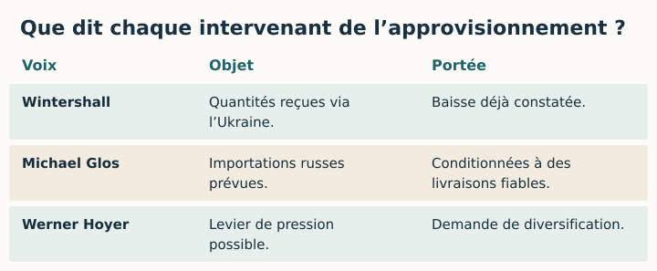

# ENS Rennes · D1 · Allemand 2006 — Corrigé guidé

*Corrigé rédigé par IA, non officiel. Signalez toute erreur.*

**Rédaction** · GPT-6.2 Astra Ultra · vitesse non renseignée

Écrit de l’ENS de Cachan, conservé dans les archives D1 de Rennes. « Jedes Land sollte Weltmarktpreise zahlen », Spiegel Online, 2 janvier 2006.

## Version française

**« Chaque pays devrait payer les prix du marché mondial »**

Le différend gazier russo-ukrainien a provoqué un débat sur la dépendance de l'Allemagne à l'égard du gaz russe. Pourtant, la hausse des prix réclamée par les Russes se justifie par de bonnes raisons. La manière dont on entend l'imposer peut certes prêter à discussion.

Les conséquences du conflit gazier entre la Russie et l'Ukraine se sont déjà fait sentir en Allemagne. Wintershall, l'un des plus grands importateurs de gaz naturel russe, a déclaré aujourd'hui que les quantités livrées en République fédérale par les gazoducs traversant l'Ukraine avaient sensiblement diminué.

Avec une part de 35 %, la Russie est le premier fournisseur de gaz de l'Allemagne. Les entreprises assurent, il est vrai, que l'approvisionnement de la République fédérale est garanti. Un débat s'est néanmoins engagé sur la dépendance de l'Allemagne vis-à-vis du gaz russe. Le ministre fédéral de l'Économie, Michael Glos, a déclaré que l'Allemagne ne pourrait accroître comme prévu ses importations de gaz en provenance de Russie que si les livraisons étaient fiables. « La Russie préside le G8 et, là aussi, il faut naturellement se montrer responsable », a-t-il ajouté.

Werner Hoyer, spécialiste des affaires étrangères au FDP, s'est exprimé plus franchement. « Qui nous garantit au fond qu'un jour la Russie ne se servira pas aussi du robinet du gaz à l'égard d'autres pays, par exemple de l'Allemagne, pour faire pression sur eux ou les rappeler à l'ordre ? » a demandé le libéral. Selon lui, l'Allemagne doit absolument diversifier son approvisionnement énergétique.

## Expression en allemand

Expliquer en allemand, en 100 mots, comment l’Allemagne peut faire face à la hausse des prix de l’énergie.

Deutschland kann den Weltmarktpreis für Energie kaum bestimmen. Es kann aber dafür sorgen, dass eine Preissteigerung Haushalte und Unternehmen weniger hart trifft. Gut gedämmte Wohnungen brauchen weniger Gas, und ein zuverlässiger öffentlicher Verkehr senkt den Ölverbrauch. Zugleich kann der Ausbau verschiedener Energiequellen die Abhängigkeit von einzelnen Lieferanten verringern. Das kostet zunächst Geld, schützt aber langfristig vor Erpressung und plötzlichen Engpässen. Kurzfristig würde ich einkommensschwache Haushalte gezielt unterstützen. Eine allgemeine Verbilligung des Verbrauchs wäre teuer und würde auch diejenigen belohnen, die problemlos sparen könnten. Entscheidend ist, den Energiebedarf dauerhaft zu senken und zugleich unterschiedliche Bezugsquellen für die verbleibenden Mengen zu sichern.

*100 mots, comptés par espaces.*

## Comment construire la réponse

**Distinguer prix et moyen de pression.** Le premier paragraphe admet que la hausse demandée peut se justifier. Ce qui prête à discussion est son mode d'application. Avec *lässt sich*, la phrase indique que le débat est possible. Elle n'attribue pas une opinion unique à l'ensemble des autorités allemandes.

**Répartir les voix.** Wintershall est une entreprise importatrice qui observe un débit en baisse. Les assurances des entreprises portent sur la sécurité d'approvisionnement. Le ministre demande des livraisons fiables. Le député du FDP pose une question sur un risque futur. Les formes du discours rapporté aident à retrouver ces quatre voix.

**Définir ce qui est maîtrisable.** Pour répondre sur les prix, distinguer le tarif mondial et la dépense réellement supportée. Réduire la quantité consommée ou diversifier les achats peut limiter la facture et l'exposition à une interruption sans prétendre fixer le cours mondial.

[Feuillet original, p. 4](https://www.ens-rennes.fr/medias/fichier/2006-annales-d1_1423060020336-pdf#page=4) · [Rapport du jury, partie écrite](https://www.ens-rennes.fr/medias/fichier/2006-rapport-d1_1423060025947-pdf#page=1)
