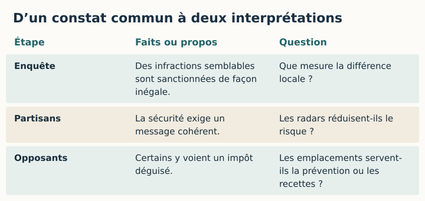

# ENS Rennes · D1 · Anglais 2006 — Corrigé brut

*Corrigé rédigé par IA, non officiel. Signalez toute erreur.*

**Rédaction** · GPT-6.2 Astra Ultra · vitesse non renseignée

Écrit de l’ENS de Cachan, conservé dans les archives D1 de Rennes. David Millward, « Postcode lottery of speed camera fines », adapté du Daily Telegraph, 31 décembre 2005.

## Version française

**Amendes des radars automatiques, une loterie selon le secteur**

D'après les chiffres rendus publics hier, les conducteurs pris en excès de vitesse ou en train de franchir un feu rouge risquent beaucoup plus d'être poursuivis dans certaines régions que dans d'autres.

Les renseignements obtenus par le *Daily Telegraph* indiquent qu'une sorte de loterie s'est instaurée autour des radars. La probabilité qu'un contrevenant se voie infliger une amende est plus de deux fois plus élevée dans certains services de police que dans d'autres.

Les comptes de trente-cinq organismes partenaires chargés des radars de sécurité ont montré que, dans certaines régions, plus de la moitié des conducteurs pris en faute échappaient à l'amende automatique et à l'inscription de points sur leur permis, tandis qu'ailleurs tous les contrevenants étaient sanctionnés.

Partisans et adversaires des radars se sont retrouvés hier soir pour condamner ces disparités dans l'application des règles. Selon eux, elles remettent en question un élément essentiel de la politique de sécurité routière du gouvernement.

« Le message adressé aux conducteurs doit être le même partout », a déclaré un porte-parole de Brake, association de sécurité routière favorable aux radars.

Présenté par le gouvernement comme une arme essentielle dans sa campagne pour réduire la mortalité routière, le radar n'est guère aux yeux de certains qu'une vache à lait destinée à soutirer de l'argent aux automobilistes.

Chris Grayling, porte-parole conservateur chargé des transports, a estimé que ces chiffres révélaient un peu plus le vrai visage de la stratégie du gouvernement en matière de radars. « Il est devenu clair ces dernières semaines qu'on s'en sert pour prélever un impôt déguisé et non à des fins de sécurité routière. De quoi tourner en dérision l'argument selon lequel ils constituent un instrument important pour réduire le nombre de victimes. »

## Expression en anglais

Présenter les arguments des partisans et des adversaires des radars en anglais, en 100 mots.

Supporters argue that cameras make a speed limit credible even when no police officer is visible. Slower traffic gives drivers more time to react and can reduce the severity of a collision. Cameras can free officers to deal with offences requiring judgement on the spot. Opponents question whether every camera is placed where it will prevent accidents. A highly profitable site may look like a source of revenue, especially when comparable offences elsewhere go unpunished. Publishing the reasons for each location and comparing casualty figures before and after installation would help drivers assess both claims on evidence they can check.

*100 mots, comptés par espaces.*

[Feuillet original, p. 5](https://www.ens-rennes.fr/medias/fichier/2006-annales-d1_1423060020336-pdf#page=5) · [Rapport du jury, partie écrite](https://www.ens-rennes.fr/medias/fichier/2006-rapport-d1_1423060025947-pdf#page=4)
