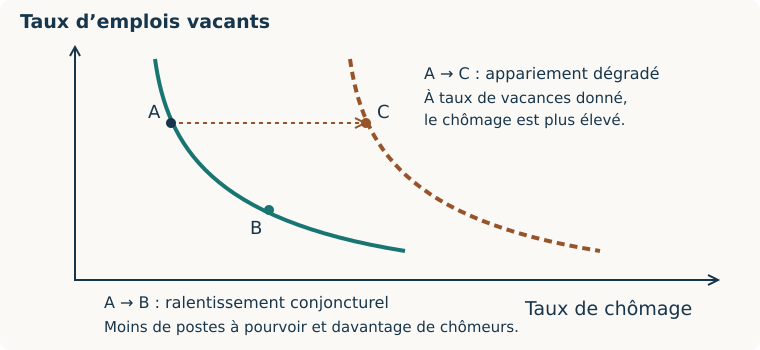

# ENS de Cachan D1 — Composition d’ordre économique et social 2006 · Corrigé brut

*Corrigé rédigé par IA, non officiel. Signalez toute erreur.*

**Rédaction** · GPT-6.2 Astra Ultra · vitesse non renseignée

## Le retour au plein-emploi est-il possible en France ?

### Introduction

Dans sa note de mars 2006, l’Insee estimait que le taux de chômage au sens du Bureau international du travail était passé de 10,1 % à la fin du premier trimestre 2005 à 9,6 % en décembre. Cette baisse signale une amélioration. Peut-on en extrapoler le retour à la situation des décennies de reconstruction, quand la France connaissait des difficultés de recrutement dans une économie de forte croissance ? La convention n° 122 de l’Organisation internationale du travail donne pour objectif un « plein emploi, productif et librement choisi ». Cette formulation engage à regarder la durée de la recherche, l’accès effectif à un emploi et sa qualité.

Le plein-emploi tolère un chômage de transition, le temps de chercher un poste compatible avec ses qualifications. Il suppose toutefois que les personnes souhaitant travailler dans des conditions usuelles puissent en général trouver un emploi dans un délai raisonnable. La France peut-elle durablement réduire le chômage involontaire sans simplement retirer de la population active ceux qui rencontrent le plus de difficultés ? Une partie du chemin peut être parcourue par la reprise de l’activité, mais le diagnostic français révèle aussi des obstacles à la rencontre entre travailleurs et postes. Un retour durable au plein-emploi réclame donc des politiques coordonnées de création d’emplois, de qualification et de participation.

### I. La reprise rend concevable le retour au plein-emploi, mais sa portée dépend de l’origine du chômage

#### A. L’histoire et les comptes d’emploi indiquent à quelles conditions la croissance peut faire reculer le chômage

Le mot « retour » invite à examiner l’après-guerre. La reconstruction, le rattrapage technologique, l’investissement et l’expansion de la consommation soutenaient simultanément la productivité et les débouchés. Les employeurs embauchaient, parfois en recourant à l’immigration. Ce précédent montre qu’une économie moderne peut durablement se rapprocher du plein-emploi. Il s’accompagnait cependant d’une répartition très différente de l’emploi entre secteurs, d’un autre niveau de participation féminine et de transitions école-travail plus courtes. L’objectif de 2006 concerne l’ensemble des personnes souhaitant travailler dans une économie ouverte, largement tertiaire et membre de la zone euro.

Une identité précise le rôle de la croissance. Si $Y$ représente la production, $E$ l’emploi et $p=Y/E$ la productivité par emploi, alors $E=Y/p$. Une hausse de la production de 3 % et de la productivité par emploi de 2 % augmente l’emploi d’environ 1 %. Si la population active croît presque aussi vite, la baisse du chômage sera faible. Ainsi, la croissance économique ne produit pas à chaque date le même nombre d’embauches. Après un ralentissement, une entreprise peut d’abord accroître les heures ou mieux utiliser ses équipes avant de recruter. À plus long terme, la productivité permet des hausses de salaires réels, d’investissement et de consommation qui ouvrent à leur tour de nouveaux débouchés. Bloquer les gains de productivité pour préserver mécaniquement un nombre de postes ferait perdre cette dimension dynamique.

Le taux de chômage rapporte les chômeurs à la population active. Le taux d’emploi rapporte les personnes en emploi à la population en âge de travailler. Une sortie du chômage vers l’inactivité fait donc baisser le premier indicateur même en l’absence de création d’un seul emploi. Inversement, une reprise prometteuse peut ramener des personnes découragées sur le marché du travail et retarder la baisse du taux de chômage mesuré malgré les embauches. En 2000, le Conseil européen de Lisbonne avait précisément fixé pour l’Union un objectif de taux d’emploi global aussi proche que possible de 70 % en 2010. Cet indicateur complète celui du chômage, sous réserve d’observer également le temps partiel subi et la durée des emplois.

#### B. Le volume insuffisant des débouchés et les difficultés de recrutement appellent des diagnostics différents

Dans une lecture keynésienne, les entreprises embauchent pour produire ce qu’elles pensent pouvoir vendre. Une baisse de la demande anticipée réduit la production et les commandes adressées aux fournisseurs. La perte de revenu des ménages entretient alors le recul des achats. Même une baisse générale des salaires peut, en déprimant les revenus, contrecarrer l’effet favorable qu’un employeur isolé attendrait d’une baisse de son coût salarial. Ce chômage conjoncturel peut reculer lorsque les débouchés se redressent et que subsistent des capacités inutilisées. La fin des années 1990 en France a montré qu’une expansion pouvait s’accompagner de créations d’emplois et d’une diminution du chômage. Elle ne prouve pas qu’un point de croissance produira toujours les mêmes effets.

D’autres difficultés résistent au seul redressement de la demande. Des emplois vacants peuvent exiger une qualification particulière, se situer loin du logement abordable ou être proposés à des horaires incompatibles avec la garde d’un enfant. Le rapprochement entre offres et demandes, ou appariement, prend alors du temps. Dans sa note de mars 2006, l’Insee évaluait fin 2005 le taux de chômage des moins de vingt-cinq ans à 22,1 %, contre 8,8 % pour les 25–49 ans. Le premier pourcentage concerne les actifs de cet âge, dont beaucoup de jeunes en études ne font pas partie. Il invite à examiner l’entrée dans l’emploi, l’expérience et la formation, sans attribuer à tous les jeunes le même risque. Une longue période sans emploi peut elle-même déprécier les compétences et affaiblir les contacts avec les employeurs. Ainsi un choc de demande transitoire peut laisser des traces durables, phénomène que Blanchard et Summers ont analysé en termes d’hystérèse.

La courbe de Beveridge aide à formuler le diagnostic. Dans un ralentissement, les postes vacants diminuent tandis que le chômage augmente. À postes vacants comparables, un chômage durablement plus élevé peut au contraire signaler une moindre efficacité de l’appariement. Les deux évolutions n’appellent pas la même réponse, et la courbe seule n’identifie pas la cause de chaque déplacement.

### II. La France peut viser le plein-emploi en combinant soutien à l’activité et accès durable aux postes créés

#### A. Soutenir les débouchés en présence de capacités inutilisées et préparer la capacité de production

Lorsque la demande fait défaut, laisser fonctionner les stabilisateurs automatiques limite la contraction. Les allocations préservent une partie de la consommation des ménages touchés et les recettes fiscales diminuent avec les revenus. Un investissement public utile peut aussi créer des commandes immédiates puis réduire des coûts futurs, par exemple lorsqu’un transport collectif relie un quartier à un bassin d’emplois. L’effet dépend du degré d’utilisation des capacités, du délai de mise en œuvre et du contenu en importations. Le financement et l’entretien de l’investissement doivent être supportables. Le même accroissement de demande adressé à un secteur déjà à saturation risque d’y augmenter surtout les prix.

L’euro change l’échelle de l’intervention. En 2006 la politique monétaire est décidée pour la zone, avec un objectif premier de stabilité des prix. La France ne peut pas choisir seule une baisse du taux directeur ou une dévaluation du franc. Elle conserve une politique budgétaire nationale encadrée par des engagements européens. Une expansion coordonnée avec des partenaires également en sous-emploi peut accroître les débouchés croisés et limiter la fuite de demande subie par chacun isolément. En revanche, si un seul pays présente des tensions particulières de recrutement, une baisse uniforme des taux est mal ciblée. Mesurer les tensions sectorielles et l’évolution des prix permet d’ajuster le soutien. L’hypothèse d’un chômage compatible avec la stabilité de l’inflation décrit une contrainte de court ou moyen terme, et sa valeur dépend des institutions, des anticipations et de la productivité. Elle ne fixe pas un plafond à toute amélioration future.

#### B. Rendre les postes accessibles, en évaluant les résultats sur l’emploi et la participation

Les allégements de cotisations patronales concentrés sur les bas salaires peuvent réduire le coût d’une embauche dont la productivité attendue est proche du coût total du travail, sans diminuer immédiatement le salaire net. L’effet dépend de la sensibilité de la demande de travail et du financement de la mesure. Des embauches subventionnées auraient eu lieu en son absence, d’autres remplacent des postes voisins. Les emplois nets créés diffèrent donc du nombre de contrats bénéficiant de l’allégement. Former les demandeurs à des qualifications effectivement recherchées, proposer des périodes d’apprentissage en entreprise et diffuser l’information sur les offres améliorent l’appariement. Une formation longue imposée à un demandeur déjà proche d’un emploi peut en revanche retarder son retour. Pour apprécier un dispositif, il faut comparer des trajectoires de personnes comparables, en tenant compte de la durée et de la qualité des postes retrouvés.

Les conditions de participation comptent autant que le coût d’un poste. Des modes d’accueil des enfants, des transports fiables ou un accompagnement personnalisé rendent possibles des candidatures qui ne l’étaient pas. La prime pour l’emploi peut rendre la reprise financièrement plus attractive pour certains ménages modestes. L’incitation demeure insuffisante quand aucun employeur ne recrute à proximité. À l’autre extrémité des âges, recourir aux préretraites pour libérer des postes suppose à tort qu’un départ donne automatiquement lieu à l’embauche d’un jeune avec les mêmes qualifications. Le retrait peut abaisser le chômage enregistré tout en diminuant le taux d’activité. Le maintien en emploi des seniors suppose notamment des postes adaptés, une formation continue et des perspectives de mobilité. Ces politiques se renforcent lorsqu’une demande soutenue ouvre des débouchés aux personnes formées, et que les recrutements ainsi facilités évitent qu’une reprise bute trop vite sur des pénuries.

### Conclusion

Au printemps 2006, un retour français au plein-emploi est économiquement possible, mais une baisse ponctuelle du taux de chômage n’en établit ni la date ni la réalisation. La reprise doit créer des postes plus vite que la population active ne croît, et les travailleurs doivent pouvoir les occuper dans la durée. Une réponse française associe stabilisation de la demande à l’échelle appropriée, accès aux qualifications et levée des obstacles à la participation. Son succès se jugerait conjointement à la hausse du taux d’emploi, au recul du chômage de longue durée et à la réduction du sous-emploi subi, y compris chez les groupes que la reprise atteint en dernier.

[Sujet de la session](https://www.ens-rennes.fr/medias/fichier/2006-annales-d1_1423060020336-pdf#page=13) · [Insee, note de conjoncture de mars 2006, pp. 95–96](https://www.insee.fr/fr/statistiques/fichier/1407600/mars2006_f2.pdf) · [OIT, convention n° 122 de 1964, article 1](https://www.ilo.org/fr/resource/c122-convention-sur-la-politique-de-lemploi-1964) · [Conseil européen de Lisbonne, mars 2000, § 30](https://www.europarl.europa.eu/summits/lis1_fr.htm)
