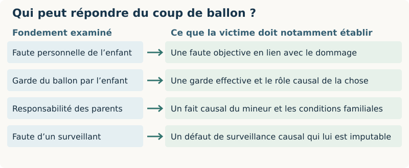

# ENS de Cachan D1 — Droit civil 2006 · Corrigé guidé

*Corrigé rédigé par IA, non officiel. Signalez toute erreur.*

**Lecture du rapport du jury** · GPT-6.2 Astra Ultra · vitesse non renseignée

**Rédaction** · GPT-6.2 Astra Ultra · vitesse non renseignée

## L’enfant et la responsabilité civile

### Introduction

> [!INDICATION]
> Un enfant en blesse un autre au cours d’un jeu. Inscrire les deux noms au brouillon. Pour le premier on recherche un fait générateur et les personnes susceptibles d’en répondre. Pour le second on recherche un dommage réparable et l’effet éventuel de son propre comportement.

Un enfant de trois ans peut-il être gardien d’un bâton au sens du droit de la responsabilité ? Dans l’affaire *Gabillet*, l’Assemblée plénière a admis le 9 mai 1984 que les juges puissent constater la garde chez un très jeune enfant sans rechercher son discernement. L’âge qui interdit de passer seul la plupart des actes juridiques ne gouverne donc pas dans les mêmes termes l’obligation de réparer un dommage.

Le mineur est « l’individu de l’un ou l’autre sexe qui n’a point encore l’âge de dix-huit ans accomplis » (Code civil, art. 388, rédaction de 2006). La responsabilité civile tend à réparer le dommage juridiquement imputable à une personne. Le mineur peut être victime ou auteur du dommage. Dans ce dernier cas, sa famille, voire l’organisme auquel il a été confié, entre parfois dans le champ de l’action. Comment le droit français de 2006 concilie-t-il la vulnérabilité de l’enfant avec le droit à réparation de la personne lésée ? Il admet d’abord une appréciation largement objective du rôle personnel du mineur. Il attache ensuite à certaines relations d’autorité ou de prise en charge une responsabilité qui élargit les recours de la victime.

### I. L’enfant peut personnellement devoir ou obtenir réparation

#### A. Le fait du mineur peut engager son patrimoine indépendamment de son discernement

L’enfant est titulaire d’un patrimoine bien avant de pouvoir l’administrer lui-même. L’article 1382 du Code civil alors en vigueur oblige celui par la faute duquel un dommage est arrivé à le réparer. L’incapacité de conclure seul un contrat n’est donc pas une immunité pour le fait dommageable. Les arrêts *Derguini* et *Lemaire* de l’Assemblée plénière du 9 mai 1984 ont admis, à propos de la faute d’enfants victimes, une qualification objective de leur comportement, sans exiger que les juges recherchent leur capacité à discerner les conséquences de leurs actes. Le même mouvement d’objectivation permet de retenir une faute personnelle d’un mineur auteur. Encore faut-il caractériser une conduite fautive et sa relation causale avec un dommage certain. Un simple rôle matériel dans un jeu normal ne suffit pas à prouver cette faute.

Une chose peut, par ailleurs, avoir été l’instrument de l’accident. Pour mettre en œuvre l’article 1384, alinéa premier, la victime doit établir le rôle de la chose et la garde exercée sur elle à l’époque des faits. Dans *Gabillet*, un enfant tenant un bâton avait blessé un camarade en tombant. La Cour approuve la constatation des pouvoirs d’usage, de direction et de contrôle, sans exiger une appréciation morale de la conduite de l’enfant. L’âge ne désigne toutefois pas automatiquement le gardien. Pour un équipement resté sous la maîtrise effective d’un adulte, il faudrait reprendre l’enquête sur les pouvoirs exercés. Faute personnelle et fait des choses sont deux fondements distincts, et les conditions de l’un peuvent être réunies quand celles de l’autre font défaut.

#### B. Le mineur victime a droit à une réparation que sa propre conduite peut affecter

> [!INDICATION]
> Demander d’abord si la victime était conductrice, passagère ou piétonne. Le résultat de l’arrêt Derguini, rendu en 1984, ne se transpose pas mécaniquement à un accident de la circulation relevant en 2006 de la loi du 5 juillet 1985.

La minorité ne réduit pas les chefs de préjudice réparables. Une atteinte corporelle peut entraîner douleurs, gêne durable dans la vie quotidienne, frais de soins et incidence sur le parcours scolaire ou professionnel. Le juge doit rattacher chaque poste au fait dommageable et à la situation de la victime. Par exemple, la perte de la chance réelle de suivre une orientation ne se confond pas avec la totalité des gains qu’aurait procurés une carrière supposée certaine. Le droit à réparation appartient à l’enfant. L’exercice de l’action se fait en principe par représentation du mineur non émancipé, avec intervention d’un administrateur ad hoc si ses intérêts s’opposent à ceux de ses représentants légaux. Les proches peuvent en outre agir pour leurs propres préjudices par ricochet lorsqu’ils sont établis.

En droit commun, une faute du mineur victime qui a concouru au dommage peut limiter l’indemnisation qui lui est due. Dans *Lemaire*, la Cour a admis que les juges retiennent la faute d’un jeune qui n’avait pas coupé le courant avant d’intervenir sur une ampoule, sans rechercher s’il avait discerné les conséquences de son acte. Cette objectivation peut donc peser sur l’enfant créancier de réparation. Le législateur a cependant établi des protections spéciales. Lorsqu’un véhicule terrestre à moteur est impliqué dans un accident de la circulation au sens de la loi du 5 juillet 1985, l’article 3 garantit une protection particulière au non-conducteur de moins de seize ans pour les atteintes à sa personne. Sa faute, même inexcusable, ne lui est pas opposable, sous réserve du cas où il a volontairement recherché le dommage qu’il a subi. Le piéton de quinze ans et le conducteur de cyclomoteur du même âge ne relèvent donc pas du même régime. La faute du conducteur peut limiter ou exclure son indemnisation selon l’article 4.

### II. La relation des adultes ou des institutions avec l’enfant ouvre d’autres recours à la victime

#### A. Les parents répondent de plein droit du fait causal du mineur sous des conditions propres

> [!INDICATION]
> Un enfant court de façon ordinaire et heurte un camarade. Pour agir contre ses parents, la victime a-t-elle besoin de qualifier cette course d’imprudente ? Vérifier séparément le fait causal et les conditions de l’article 1384, alinéa 4.

Selon l’article 1384, alinéa 4, dans sa rédaction applicable en 2006, le père et la mère, en tant qu’ils exercent l’autorité parentale, sont solidairement responsables du dommage causé par leurs enfants mineurs habitant avec eux. Le fait de l’enfant doit être la cause directe du dommage. La jurisprudence *Fullenwarth* (Ass. plén., 9 mai 1984), puis *Levert* (2e civ., 10 mai 2001) et les arrêts d’Assemblée plénière du 13 décembre 2002 n’exigent pas que ce fait soit fautif. Un geste accompli pendant un jeu peut ainsi mettre en cause les parents alors même que la faute personnelle du joueur n’est pas établie. Une demande dirigée aussi contre le mineur ne remplit pas pour ce seul motif les conditions de l’article 1382.

La cohabitation s’apprécie juridiquement. Dans le droit jurisprudentiel de la session, un séjour de vacances chez les grands-parents ne rompt pas à lui seul la cohabitation avec les parents. En cas de séparation, la résidence habituelle de l’enfant fixe en principe le foyer de cohabitation pertinent, y compris lorsque l’autorité parentale est exercée conjointement. Un parent qui ne remplit pas les conditions de l’alinéa 4 peut néanmoins répondre d’une faute personnelle prouvée. L’arrêt *Bertrand* (2e civ., 19 février 1997, n° 94-21.111) a consacré le caractère de plein droit de la responsabilité parentale. Prouver la qualité de l’éducation ou une surveillance irréprochable ne suffit plus à s’exonérer. La force majeure ou la faute de la victime peuvent produire un effet exonératoire dans les conditions du régime applicable. Ces règles permettent à la victime d’agir contre des débiteurs autres que l’enfant et, lorsqu’une garantie joue, de bénéficier d’une couverture d’assurance.

#### B. La mission de prise en charge détermine la responsabilité des autres répondants

L’article 1384, alinéa premier, permet de rechercher la responsabilité d’une personne chargée d’organiser et de contrôler à titre permanent le mode de vie d’autrui. L’arrêt *Blieck* (Ass. plén., 29 mars 1991) concernait un adulte handicapé accueilli par une association. Le principe a ensuite trouvé application à des organismes auxquels un mineur a été confié par décision judiciaire. La mission d’organisation et de contrôle explique l’imputation, indépendamment d’une négligence précise d’un éducateur. Lorsque la mission judiciaire demeure en vigueur, une absence temporaire de l’enfant n’y met pas nécessairement fin. Il faut examiner la décision de placement, la nature de la mission et sa durée au jour des faits. La simple présence d’un enfant dans les locaux d’une association ne suffit pas.

D’autres missions sont plus limitées. Une association sportive organise, dirige et contrôle une activité déterminée de ses membres. À la date du concours, la jurisprudence exige à ce titre une faute caractérisée par une violation des règles du jeu imputable à un ou plusieurs membres, même non identifiés (2e civ., 20 novembre 2003). Un accident de jeu ne suffit donc pas, à lui seul, pour condamner le club sur ce fondement. Un grand-parent qui accueille ponctuellement un mineur ne devient pas davantage son répondant de plein droit par le seul hébergement. Sa propre négligence dans la surveillance peut en revanche engager sa responsabilité si elle est établie et a causé le dommage. De même, pour mettre en jeu le régime des instituteurs, la victime doit établir la faute de surveillance, avec substitution de l’État lorsque les conditions de l’article L. 911-4 du Code de l’éducation sont réunies. Distinguer une mission permanente, une activité organisée et une surveillance occasionnelle évite de transformer tout adulte présent en garant de l’enfant.

### Conclusion

Les règles de 2006 font du mineur un sujet à part entière du droit de la réparation. Sa conduite ou la garde d’une chose peuvent engager son patrimoine. Victime, il peut agir par représentation et bénéficie, dans certains régimes, d’une protection renforcée. La responsabilité des parents et celle de certains organismes ne présupposent pas toutes la responsabilité personnelle du mineur. Pour un même accident, il faut donc identifier celui qui demande réparation, celui dont le fait a causé le dommage et celui à qui la loi ou la jurisprudence en impose la charge.

> [!INDICATION]
> Dans l’exemple du ballon, écrire deux phrases finales distinctes. La faute du joueur reste à établir si l’action repose sur son fait personnel. Le geste causal peut en revanche suffire pour l’action dirigée contre les parents lorsque les conditions familiales sont remplies. Un éventuel cumul des fondements ne permet de réparer qu’une fois le même dommage.

[Sujet de la session](https://www.ens-rennes.fr/medias/fichier/2006-annales-d1_1423060020336-pdf) · [Rapport du jury](https://www.ens-rennes.fr/medias/fichier/2006-rapport-d1_1423060025947-pdf#page=11) · [Code civil en avril 2006](https://www.legifrance.gouv.fr/codes/texte_lc/LEGITEXT000006070721/2006-04-01/) · [Loi du 5 juillet 1985 en avril 2006](https://www.legifrance.gouv.fr/loda/id/JORFTEXT000000693454/2006-04-01/)
