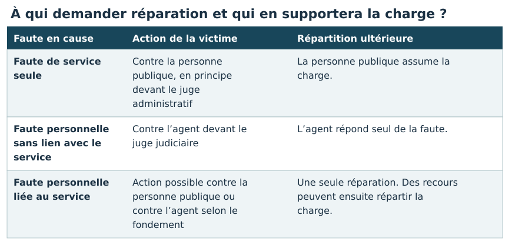

# ENS de Cachan D1 — Droit public 2006 · Corrigé brut

*Corrigé rédigé par IA, non officiel. Signalez toute erreur.*

**Rédaction** · GPT-6.2 Astra Ultra · vitesse non renseignée

## La faute comme source de la responsabilité de la puissance publique

### Introduction

Le promeneur blessé près d’une fête communale doit-il prouver la négligence d’un service, poursuivre personnellement le maire ou établir que la manifestation lui faisait courir un risque particulier ? L’arrêt *Époux Lemonnier* du 26 juillet 1918 montre les conséquences concrètes d’une qualification. Savoir qu’un dommage est survenu pendant une activité publique ne suffit pas à désigner le débiteur de la réparation.

La responsabilité en cause est celle par laquelle une personne publique doit réparer le dommage extracontractuel imputable à son activité. Depuis le Tribunal des conflits, *Blanco*, 8 février 1873, cette responsabilité obéit pour une part à des règles propres, tenant aux nécessités du service et aux droits des particuliers. Le rapport de 2006 demande d’étudier, entre autres, « faute lourde ou faute simple ? faute prouvée ou faute présumée ? ». Reste une question préalable à l’indemnisation : à qui le manquement est-il juridiquement imputable ? La faute fonde une obligation de réparation à des conditions variables selon les activités. Sa qualification comme faute de service ou faute personnelle détermine ensuite les actions ouvertes à la victime et la charge définitive de la dette.

### I. La faute est un fondement ordinaire de responsabilité dont la portée dépend de la causalité, de la gravité et de la preuve

#### A. Un manquement imputable au service doit avoir causé un préjudice indemnisable

La faute peut être une action, une abstention ou un retard fautif. Un service ne répond pas dans un délai raisonnable à une demande urgente, un agent prend une décision illégale ou un hôpital organise mal la transmission des consignes. Le fonctionnement global du service peut être défectueux sans que la victime connaisse le nom de l’agent en cause. Une illégalité constitue en elle-même une faute de nature à engager la responsabilité (Conseil d’État, 26 janvier 1973, *Driancourt*). La victime doit cependant établir un préjudice personnel, direct et certain ainsi qu’un lien de causalité avec la faute. Ainsi l’annulation pour incompétence d’un refus ne fait pas automatiquement naître un droit à tout le bénéfice que l’administré espérait retirer de l’autorisation. Il faut encore examiner ce qu’aurait décidé l’autorité compétente et quelle perte a réellement résulté de l’irrégularité.

Un préjudice matériel comme des frais de soins, un préjudice corporel ou un préjudice moral peuvent donner lieu à réparation. La perte certaine d’une chance sérieuse se distingue du bénéfice intégral du résultat espéré. Une faute de la victime peut réduire l’indemnisation si elle a contribué au dommage. Une force majeure, extérieure, imprévisible et irrésistible, peut rompre le lien causal. Enfin, la faute n’épuise pas les sources de la responsabilité de la puissance publique. *Cames* (Conseil d’État, 21 juin 1895) illustre une réparation fondée sur le risque professionnel, *Couitéas* (30 novembre 1923) une rupture de l’égalité devant les charges publiques à la suite d’un refus légal de concours de la force publique. Ces décisions situent la faute dans le système : un acte régulier peut, sous les conditions de son régime propre, aussi ouvrir droit à réparation.

#### B. Le seuil exigé et la charge de la preuve sont deux variables indépendantes

La faute simple est en principe suffisante. Pour certaines activités réputées délicates, la faute lourde a longtemps été requise afin d’éviter qu’une difficulté normale d’exécution n’engage trop facilement la responsabilité. Ce seuil recule selon les secteurs. Après *Tomaso Grecco* (10 février 1905), les opérations de police ne bénéficient plus d’une irresponsabilité de principe, mais leur difficulté concrète peut influer sur l’exigence de gravité. En matière hospitalière, l’arrêt d’Assemblée *Époux V.*, du 10 avril 1992, abandonne l’exigence de faute lourde pour les actes médicaux. La loi du 4 mars 2002 pose, à l’article L. 1142-1 du Code de la santé publique, un principe de responsabilité pour faute des professionnels et établissements pour les conséquences d’actes de prévention, de diagnostic ou de soins, assorti de régimes particuliers, notamment pour les infections nosocomiales. En 2006, la faute lourde garde en revanche une place dans la responsabilité du fait du fonctionnement des juridictions administratives, sous les réserves propres à ce contentieux. L’arrêt *Magiera* du 28 juin 2002 admet une réparation du préjudice lié à une durée de jugement excessive.

La preuve répond à une autre question. Le demandeur doit en principe apporter des éléments établissant le manquement ; l’instruction menée par le juge peut compléter le dossier. Dans certains régimes, il bénéficie d’un aménagement. L’usager d’un ouvrage public endommagé par l’état de l’ouvrage établit notamment le dommage et son lien avec celui-ci. Il appartient alors à la personne responsable de l’ouvrage de prouver l’entretien normal pour s’exonérer sur ce terrain. La présomption ainsi susceptible d’être renversée ne transforme pas ce régime en responsabilité sans faute. Et le caractère lourd ou simple d’une faute ne dit pas à lui seul qui doit la prouver.

### II. L’imputation de la faute répartit la protection de la victime et la charge de l’indemnisation

#### A. La distinction entre faute de service et faute personnelle identifie un premier débiteur

Depuis le Tribunal des conflits, *Pelletier*, 30 juillet 1873, on distingue le fait du service et la faute personnelle détachable. L’erreur d’organisation ou la maladresse ordinaire dans l’accomplissement des tâches relève normalement du service. La recherche d’un intérêt privé, une intention de nuire ou un comportement d’une particulière gravité peuvent révéler la faute personnelle. Le seul fait que l’auteur ait pu être identifié ne fait pas de son acte une faute personnelle. De même, l’existence d’une infraction pénale ne tranche pas à elle seule la qualification administrative (Tribunal des conflits, *Thépaz*, 14 janvier 1935).

Pour une faute de service, la victime dirige en principe son action contre la personne publique devant le juge administratif. Pour une faute personnelle dépourvue de tout lien avec le service, elle recherche la responsabilité civile de l’agent devant le juge judiciaire. Des lois spéciales peuvent modifier ce schéma, comme la loi du 31 décembre 1957 sur les dommages causés par les véhicules, qui attribue le contentieux au juge judiciaire. La distinction de principe reste décisive en dehors de ces régimes. Il faut examiner le contexte, le but poursuivi et les moyens utilisés. Un comportement commis hors des horaires de service peut conserver un lien avec celui-ci si le service en a procuré les moyens.

#### B. Les cumuls améliorent les chances de réparation sans autoriser une double indemnité

Dans *Anguet* (Conseil d’État, 3 février 1911), la fermeture prématurée d’un bureau de poste et les violences commises par ses agents concourent au dommage. Une faute de service et des fautes personnelles distinctes fondent un cumul de fautes. Dans *Époux Lemonnier*, la mauvaise organisation de la sécurité d’une fête permet d’engager la responsabilité de la commune alors que le maire a également été déclaré responsable devant le juge judiciaire. Une même faute personnelle peut en effet engager aussi la personne publique lorsqu’elle conserve un lien suffisant avec le service. Dans *Demoiselle Mimeur*, le 18 novembre 1949, l’usage à des fins personnelles d’un véhicule du service n’avait pas privé l’accident de tout lien avec celui-ci. La garantie d’un débiteur public améliore alors la situation de la victime, dans la limite de la réparation de son entier préjudice.

La charge définitive peut différer de celle du premier paiement. Les arrêts *Laruelle* et *Delville* du 28 juillet 1951 admettent les recours réciproques de l’administration et de l’agent, en fonction des fautes qui leur sont imputables. L’administration qui a indemnisé la victime peut demander à l’agent la part correspondant à sa faute personnelle. À l’inverse, l’agent condamné peut demander à l’administration de prendre en charge la part imputable à une faute de service. Cette seconde étape concilie solvabilité du débiteur pour la victime et répartition de la dette en fonction des comportements respectifs.

### Conclusion

La faute n’impose réparation à la puissance publique que si elle a causé un dommage indemnisable et si elle peut être imputée au service ou lui reste suffisamment liée. La modulation du degré de faute et des règles de preuve tient compte de la diversité des activités et des difficultés rencontrées par les victimes. Les règles de cumul et de recours montrent enfin qu’identifier le débiteur de la victime et répartir équitablement la charge finale sont deux fonctions complémentaires du droit de la responsabilité.

[Rapport du jury](https://www.ens-rennes.fr/medias/fichier/2006-rapport-d1_1423060025947-pdf#page=12) · [Sujet de la session](https://www.ens-rennes.fr/medias/fichier/2006-annales-d1_1423060020336-pdf#page=11) · [Conseil d’État, Époux Lemonnier, 26 juillet 1918](https://conseil-etat.fr/fr/arianeweb/CE/decision/1918-07-26/49595) · [Code de la santé publique en avril 2006](https://www.legifrance.gouv.fr/codes/texte_lc/LEGITEXT000006072665/2006-04-01/)
