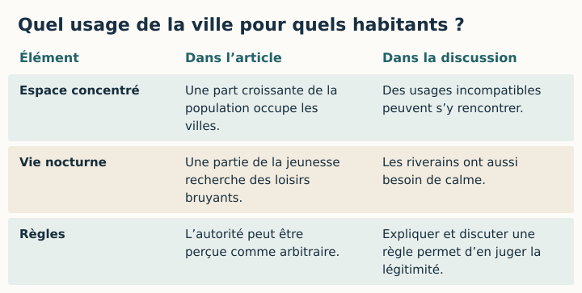

# ENS Rennes · D1 · Espagnol 2006 — Corrigé brut

*Corrigé rédigé par IA, non officiel. Signalez toute erreur.*

**Rédaction** · GPT-6.2 Astra Ultra · vitesse non renseignée

Écrit de l’ENS de Cachan, conservé dans les archives D1 de Rennes. Lola Galán, « Jóvenes sin límites », El País, 15 janvier 2006.

## Version française

La saleté et les dégradations sont peu à peu devenues l'une des marques distinctives des grandes villes espagnoles et de bien d'autres à l'étranger. L'image du Premier ministre britannique Tony Blair effaçant les graffitis dans une rue de Swindon a fait le tour du monde, tout comme son initiative pour lutter contre le vandalisme dans l'ensemble du pays. Mais le mal dont souffrent nos métropoles a ses traits propres. Elles subissent les tensions que créent les sorties nocturnes, le tourisme de masse et celui des routards, l'indifférence croissante de leurs habitants et la simple pression qui s'exerce sur un espace où se concentrent des personnes toujours plus nombreuses. Près de la moitié de la population mondiale vit en ville, d'après les données des Nations unies. En Espagne, où l'urbanisation progresse à un rythme effréné, 70 % des habitants vivent dans des agglomérations de plus de 10 000 habitants. S'y concentre la population d'âge mûr, majoritaire dans notre société, mais aussi la jeunesse, clientèle potentielle de loisirs souvent bruyants. Comment partager cet espace équitablement sans que des usages abusifs provoquent des heurts et des tensions ? « Nous sommes la société du tutoiement », dit Miguel del Río, chef du protocole au Parlement de Cantabrie, qui vient de publier un livre sur le protocole et les bonnes manières.

## Expression en espagnol

Commenter en espagnol, en 100 mots, l’affirmation sur la perception du principe d’autorité publique comme dictatorial.

Entiendo que algunos jóvenes desconfíen de la autoridad cuando una norma se impone sin explicación o se aplica de manera desigual. Sin embargo, llamar dictatorial a cualquier límite impide distinguir entre una prohibición arbitraria y una regla que protege a otros ciudadanos. En una plaza, por ejemplo, quienes desean reunirse de noche tienen derechos, pero también los tienen quienes necesitan descansar. El ayuntamiento debería escuchar a ambos grupos, justificar los horarios y permitir que se revisen. Así la autoridad pública se gana el respeto sin exigir obediencia ciega. Participar en la decisión enseña mejor la convivencia que una multa aislada.

*100 mots, comptés par espaces.*

[Feuillet original, p. 6](https://www.ens-rennes.fr/medias/fichier/2006-annales-d1_1423060020336-pdf#page=6) · [Rapport du jury, partie écrite](https://www.ens-rennes.fr/medias/fichier/2006-rapport-d1_1423060025947-pdf#page=14)
