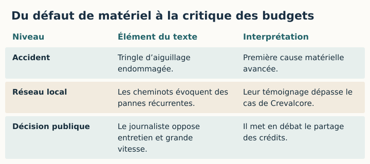

# ENS Rennes · D1 · Italien 2006 — Corrigé brut

*Corrigé rédigé par IA, non officiel. Signalez toute erreur.*

**Rédaction** · GPT-6.2 Astra Ultra · vitesse non renseignée

Écrit de l’ENS de Cachan, conservé dans les archives D1 de Rennes. Giorgio Bocca, « Il disastro annunciato », La Repubblica.it, 8 janvier 2005.

## Version française

**Une catastrophe annoncée**

Ceux qui avaient prédit, sous le choc du grand raz-de-marée, que ce serait l'année des catastrophes semblent confortés dans leur pessimisme par les nouvelles qui arrivent de Crevalcore, petite gare sur la ligne Bologne-Vérone. Un train de marchandises a percuté à vive allure un train de voyageurs interrégional. On dénombre treize morts et de très nombreux blessés. Seule explication de la catastrophe, bien qu'elle soit insuffisante, la tringle endommagée d'un aiguillage qui devait faire passer le train de marchandises sur une voie déviée. Tandis qu'on s'efforce de dégager des tôles tordues les victimes, parmi lesquelles les quatre conducteurs des deux trains, les responsables politiques ont déjà commencé leur échange de justifications aussi navrant que décevant.

Le ministre des Infrastructures, Pietro Lunardi, n'a pas fait preuve d'une grande imagination. « Ce gouvernement, a-t-il déclaré, a fait de la sécurité routière et ferroviaire l'une de ses préoccupations majeures. […] »

Les déclarations des cheminots paraissent plus convaincantes. « Le nombre de pannes et d'accidents ferroviaires qui touchent les lignes locales ne cesse d'augmenter. Nous avons le sentiment d'être en présence d'une tragédie annoncée et de responsabilités bien précises. » Ce qui est une certitude et non un sentiment, c'est cette politique habituelle en Italie, mais aussi dans d'autres pays développés, qui consiste à tirer dans tous les sens une couverture trop courte pour couvrir les besoins réels, et surtout les ambitions de ceux qui gouvernent. Nul besoin d'enquêtes spécialisées pour découvrir que les moyens consacrés à l'entretien des lignes secondaires sont sans commune mesure avec les dépenses insensées et souvent frauduleuses engagées pour la grande vitesse, dernière idole inventée pour faire voler en éclats toutes les prévisions budgétaires.

## Expression en italien

Présenter en italien, en 100 mots, le problème soulevé par l’article.

L'articolo denuncia lo squilibrio tra le risorse destinate alle grandi opere ferroviarie e quelle riservate alla manutenzione delle linee locali. Dopo lo scontro di Crevalcore, individuare il pezzo danneggiato aiuta a capire come sia avvenuto l'incidente, ma non basta a spiegare perché i guasti si ripetano. Il ministro ricorda gli obiettivi dichiarati dal governo, mentre i ferrovieri parlano della loro esperienza quotidiana. Bocca mette quindi in discussione una scelta politica: investire in progetti visibili può soddisfare le ambizioni dei governanti, lasciando senza mezzi i servizi ordinari. Per il giornalista la sicurezza si giudica dalle spese effettive e dalla manutenzione garantita.

*100 mots, comptés par espaces.*

[Feuillet original, p. 7](https://www.ens-rennes.fr/medias/fichier/2006-annales-d1_1423060020336-pdf#page=7)
