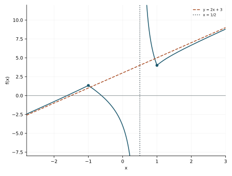
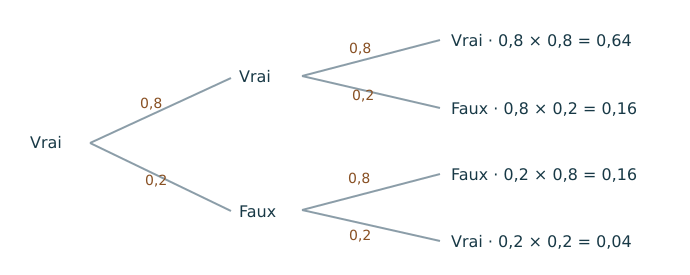

# ENS de Cachan D1 — Mathématiques appliquées et statistiques 2006 · Corrigé guidé

*Corrigé rédigé par IA, non officiel. Signalez toute erreur.*

**Rédaction** · GPT-6.2 Astra Ultra · vitesse non renseignée

**Révision** · GPT-6.2 Astra Ultra · vitesse non renseignée

Le cahier C1683V2 associe une courbe rationnelle par morceaux, un télescopage, une chaîne de transmission et deux applications du théorème des valeurs intermédiaires.

## Exercice 1. Valeur absolue et asymptote oblique

### Question 1.1

> [!INDICATION]
> Pour x assez grand, enlever la valeur absolue puis identifier les coefficients dominants.

#### Solution

Pour $x\ge1$, le numérateur vaut $x^2+x-1$. Si $a=0$, le quotient est quadratique ou indéfini. Pour $a\ne0$, la différence avec $2x+3$ a pour numérateur
$$(1-2a)x^2+(1-3a-2b)x-1-3b.$$
Le dénominateur étant de degré 1, la différence tend vers zéro si et seulement si les coefficients de degrés 2 et 1 s’annulent. On obtient $a=1/2$ et $b=-1/4$. Le reste constant est $-1/4$, donc la condition est suffisante.

### Question 1.2

> [!INDICATION]
> Séparer les deux expressions du numérateur aux abscisses −1 et 1.

#### Solution

Le domaine est $\mathbb R\setminus\{1/2\}$. Pour $|x|\ge1$ on a $f(x)=2x+3-1/(2x-1)$, de dérivée $2+2/(2x-1)^2>0$. Pour $|x|\le1$, $x\ne1/2$, on trouve $f(x)=-2x+1+5/(2x-1)$, de dérivée $-2-10/(2x-1)^2<0$ à l’intérieur de chaque branche.

La courbe monte de $-\infty$ au maximum local $(-1,4/3)$ puis redescend vers $-\infty$ au bord gauche de $1/2$. À droite du pôle elle descend de $+\infty$ au minimum local $(1,4)$ puis remonte vers $+\infty$. La droite $y=2x+3$ est asymptote aux deux infinis. Le changement de signe de l’expression dans la valeur absolue aux abscisses $\pm1$ crée deux points anguleux.

## Exercice 2. Somme factorielle

### Question 2.1

> [!INDICATION]
> Écrire k − 1 comme k + 1 − 2.

#### Solution

Pour $k\ge2$,
$$\frac{2^{k-1}(k-1)}{(k+1)!}=\frac{2^{k-1}}{k!}-\frac{2^k}{(k+1)!}.$$
Les termes consécutifs s’annulent deux à deux dans la somme. Il reste $2/2!-2^n/(n+1)!=1-2^n/(n+1)!$ pour tout $n\ge2$.

## Exercice 3. Transmission d’une information

### Question 3.a

> [!INDICATION]
> Conditionner sur la véracité du message entrant.

#### Solution

Dans le modèle où chaque nouvel intermédiaire inverse le message avec probabilité $p$ indépendamment de ce qu’il reçoit, une sortie vraie provient d’une entrée vraie transmise fidèlement ou d’une entrée fausse inversée. Ainsi $p_{k+1}=(1-p)p_k+p(1-p_k)=p+(1-2p)p_k$.

Cette formule suppose que la probabilité de mentir reste $p$ quelle que soit la véracité du message reçu. Pour voir le rôle de cette hypothèse, imaginons que tous les habitants suivent un même tirage initial. Avec probabilité $p$, tous inversent le message, sinon tous le conservent. Chacun a encore une probabilité individuelle $p$ de mentir. Après deux transmissions le message est toujours vrai, puisque deux inversions se compensent. En revanche, avec des décisions indépendantes, $p_2=(1-p)^2+p^2<1$.

### Question 3.b

> [!INDICATION]
> Soustraire le point fixe de la récurrence.

#### Solution

Comme $p+(1-2p)/2=1/2$, la transformation $u_k=p_k-1/2$ donne $u_{k+1}=(1-2p)u_k$. La suite est géométrique de raison $1-2p$.

### Question 3.c

> [!INDICATION]
> Itérer la multiplication par la raison.

#### Solution

Pour $k\ge0$, $u_k=u_0(1-2p)^k$, avec $u_0=p_0-1/2=1/2$.

### Question 3.d

> [!INDICATION]
> Revenir à la probabilité en utilisant la borne sur p.

#### Solution

On obtient $p_n=[1+(1-2p)^n]/2$. Puisque $0<p<1/2$, la raison est comprise strictement entre zéro et un. Ainsi $p_n\to1/2$.

## Exercice 4. Deux conséquences de la continuité

### Question 4.a

> [!INDICATION]
> Comparer f(x) à x aux deux extrémités.

#### Solution

Supposons $a\ge0$. La fonction $g(x)=f(x)-x$ est continue. Comme $f$ prend ses valeurs dans $[-a,a]$, $g(-a)=f(-a)+a\ge0$ et $g(a)=f(a)-a\le0$. Le théorème des valeurs intermédiaires fournit $x_0$ tel que $g(x_0)=0$, donc $f(x_0)=x_0$, éventuellement à une borne.

### Question 4.b

> [!INDICATION]
> Comparer cette fois f(x) à −x.

#### Solution

La fonction $h(x)=f(x)+x$ est continue. On a $h(-a)=f(-a)-a\le0$ et $h(a)=f(a)+a\ge0$. Il existe donc $y_0\in[-a,a]$ avec $h(y_0)=0$, soit $f(y_0)=-y_0$. Pour $a=0$, les deux points demandés sont simplement 0.
