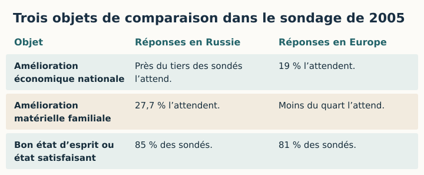

# ENS Rennes · D1 · Russe 2006 — Corrigé guidé

*Corrigé rédigé par IA, non officiel. Signalez toute erreur.*

**Rédaction** · GPT-6.2 Astra Ultra · vitesse non renseignée

Écrit de l’ENS de Cachan, conservé dans les archives D1 de Rennes. Ekspert, livraison du 12 au 18 septembre 2005.

## Version française

**Le bonheur existe, il ne peut pas ne pas exister**

Les Russes envisagent l'avenir avec beaucoup plus d'optimisme que les Européens. Tel est le résultat inattendu de sondages réalisés auprès de la population de la Russie, des États membres de l'Union européenne et des pays candidats à l'adhésion.

Des Européens de trente pays ont été interrogés au printemps et à l'été de cette année dans le cadre de l'Eurobaromètre standard. En Russie, c'est l'Institut de conception de projets de société qui a commandé l'étude. Dans les deux cas, le sondage a été réalisé par le groupe TNS Gallup Media.

L'enquête a montré que près d'un tiers des Russes sont convaincus que la situation économique de leur pays va s'améliorer. Chez leurs voisins qui ont fait échouer la Constitution européenne, seuls 19 % des sondés partagent cet avis. Parmi les Européens, 37 % pensent même que l'économie de leur pays va décliner. En Russie, seuls 18,3 % se montrent aussi pessimistes.

On observe une situation comparable lorsque les personnes interrogées sont invitées à évaluer l'avenir matériel de leur famille. En moyenne, 27,7 % des Russes croient à une amélioration, alors que les optimistes représentent moins du quart des Européens. Une dégradation de leurs conditions de vie est attendue par 18 % des Européens. Parmi les Russes interrogés, seuls 13,2 % ont choisi cette réponse. Fait remarquable, plus de 17 % de nos compatriotes ont eu du mal à répondre à cette question, alors que dans une Europe stable, l'avenir ne paraît incertain qu'à 3 % des sondés.

Les Russes et les habitants de l'Europe jugent leur état d'esprit à peu près de la même façon. Respectivement 85 % et 81 % des personnes interrogées l'ont qualifié de bon ou de satisfaisant. Un mal-être est ressenti par 19 % des Européens et 15 % des Russes.

## Expression en russe

Expliquer pourquoi, à son avis, les Russes expriment davantage de confiance envers l’économie nationale dans cette enquête. Répondre en russe en 100 mots.

Опрос показывает, что в 2005 году россияне чаще европейцев ожидали улучшения экономики. Возможно, люди сравнивали настоящее с разными периодами своей жизни. После тяжёлых девяностых годов даже небольшое повышение доходов могло казаться началом длительного подъёма. В странах, где уровень жизни уже долго оставался высоким, ожидания могли быть скромнее. Однако это лишь предположение. Чтобы проверить его, следовало бы сравнить ответы людей одного возраста и сходного материального положения в разных странах. Кроме того, многие россияне затруднились ответить на вопрос о будущем семьи. Поэтому было бы ошибкой видеть в результатах доказательство безусловного доверия всех граждан к экономической политике или неизменной черты русского национального характера.

*100 mots, comptés par espaces.*

## Comment construire la réponse

**Suivre la population et la date.** L'article d'*Ekspert* est daté de septembre 2005. « Cette année » désigne donc 2005. L'enquête européenne couvre trente pays et porte à la fois sur des pays membres et sur des candidats. Garder le « nos compatriotes » de la publication au paragraphe sur les familles.

**Classer les pourcentages.** Le premier groupe de chiffres mesure les attentes pour l'économie du pays. Le deuxième porte sur le foyer. Le dernier concerne l'état d'esprit actuel. Dans celui-ci les pourcentages positifs suivent l'ordre Russie, Europe, mais les pourcentages de malaise sont donnés dans l'ordre inverse.

**Respecter le statut de l'explication.** L'enquête relève un écart entre réponses. La comparaison avec les années 1990 est une hypothèse personnelle que des renseignements sur les parcours individuels pourraient éprouver. Elle ne transforme pas les anticipations déclarées en mesure de la croissance réelle.

[Feuillet original, p. 8](https://www.ens-rennes.fr/medias/fichier/2006-annales-d1_1423060020336-pdf#page=8)
