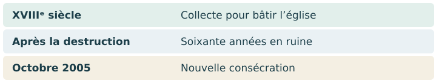

# ENS · MP-PC · Allemand (LV1) 2006 — Corrigé guidé

*Corrigé rédigé par IA, non officiel. Signalez toute erreur.*

**Rédaction** · GPT-6.2 Astra Ultra · vitesse non renseignée

**La Frauenkirche de Dresde, une reconstruction partagée.** La garde 61.12PM annonce deux heures pour les ENS de Paris, de Lyon et de Cachan. Le dictionnaire est interdit. La version compte pour 12 points et les deux réponses pour 8 points. La page 2 exige au moins 100 mots par réponse.

D’après Die Zeit du 27 octobre 2005.

## I. Version française

> [!INDICATION]
> L’auteur écrit le 27 octobre au sujet d’une consécration prévue le 30. Le mot Frauenkirche désigne ici un édifice précis : on peut garder son nom après avoir donné « église Notre-Dame ». S. Alloyer et E. Chevrel relèvent les confusions entre Stadt et Staat et les contresens sur sich versöhnen.

> [!INDICATION]
> Gardez la métaphore des blessures dans la chute. L’écart entre geheilt et heiler fait passer d’une ville reconstruite au désir d’une histoire un peu moins meurtrie. L’expression sonst als entzweit gilt présente la division Est-Ouest comme un jugement habituel.

Le 30 octobre, l’église Notre-Dame de Dresde sera de nouveau consacrée. Rarement un édifice aura captivé et ému tant de gens. Jamais encore l’enthousiasme pour un monument architectural autrefois anéanti n’avait franchi ainsi toutes les frontières des villes et des États. Et la joie ne cesse de grandir à la vue de cette église qui, restée en ruine soixante ans durant, commence aujourd’hui une nouvelle vie. Trois jours et trois nuits de discours et de musique célèbrent cette résurrection. Ce que l’on acclame est une victoire. Victoire sur toutes les difficultés financières et techniques, victoire aussi qui bat en brèche bien des clichés auxquels on s’était attaché au sujet des Allemands. Par exemple, celui de l’Allemand qui passe son temps à s’apitoyer sur son sort, qui se sent impuissant parce que, de toute façon, on ne pourrait rien changer à notre société.

La Frauenkirche raconte tout le contraire. Au départ, quelques idéalistes enthousiastes et déterminés ont communiqué leur idée à tout le monde. Même ce qui semblait impossible n’a pu les décourager et, en peu de temps, cette modeste initiative a pris les dimensions d’un vaste mouvement. […] Au XVIIIᵉ siècle déjà, les habitants de la ville avaient rassemblé des sommes énormes pour pouvoir construire leur monument protestant. Deux cents ans plus tard, la volonté d’aider et le plaisir de donner étaient encore plus grands.

Aujourd’hui encore, il est difficile de dire où l’intérêt pour la Frauenkirche est le plus vif, à l’Est ou à l’Ouest. Ainsi, sous l’imposante coupole semblent s’unir, comme idéalement, ceux que l’on tient d’ordinaire pour divisés. En refermant les blessures de la guerre, des Allemands peuvent se réconcilier avec d’autres Allemands. Car ils s’accordent au moins sur un point : leur besoin d’harmonie, leur désir de voir guérir une ville et de voir s’apaiser aussi les blessures de leur histoire.

## II.1. Lieux symboliques et conscience historique

> [!INDICATION]
> Expliquez comment un visiteur passe d’un détail matériel à une question historique. L’exemple de Dresde suffit si l’argument distingue les traces visibles et l’interprétation que le visiteur construit. Le sujet impose au moins cent mots par question.

Symbolische Bauwerke können das Geschichtsbewusstsein stärken, weil sie eine Frage dort aufwerfen, wo man ihr sonst vielleicht ausweichen würde. In Dresden sieht man an der Frauenkirche ältere dunkle Steine neben helleren neuen. Wer den Unterschied bemerkt, möchte wissen, warum das Gebäude zerstört wurde, warum es lange als Ruine stehen blieb und wer später für den Wiederaufbau eintrat. An einem einzigen Ort werden so mehrere historische Entscheidungen sichtbar. Allerdings erzählt kein Stein von selbst eine vollständige Geschichte. Ein Rundgang gewinnt viel, wenn Zeitzeugen, Bilder und unterschiedliche Stimmen hinzukommen. Besonders wichtig finde ich, dass auch Menschen zu Wort kommen, die den Wiederaufbau anders beurteilt haben. Dann dient ein Symbol als Ausgangspunkt für eine Untersuchung, und die gemeinsame Erinnerung bleibt offen für Fragen.

*120 Wörter.*

## II.2. Que vaut ce cliché sur les Allemands ?

> [!INDICATION]
> La question appelle deux gestes : évaluer le cliché cité, puis formuler votre propre regard. Pour ce second geste, une diversité d’expériences est plus intéressante qu’un autre portrait uniforme.

Das Bild von einem Deutschen, der sich ständig selbst bemitleidet, überzeugt mich wenig. Es verwechselt eine Äußerung mit einer dauerhaften Eigenschaft und schreibt diese dann noch einer ganzen Bevölkerung zu. Wer öffentlich auf einen Missstand hinweist, kann gerade deshalb sprechen, weil er ihn ändern möchte. Der Wiederaufbau der Frauenkirche ist dafür ein anschauliches Beispiel: Aus Unzufriedenheit mit einem Zustand entstand eine Initiative, an der sehr unterschiedliche Menschen teilnahmen.

Deutschland sehe ich eher als ein Land mit verschiedenen regionalen Erfahrungen und lebhaften öffentlichen Auseinandersetzungen. Schon die Frage, wie man an die Teilung erinnert, bekommt je nach Familie und Wohnort eine andere Antwort. Mich interessiert deshalb mehr, wer in welcher Situation spricht, als die Suche nach einem angeblich typisch deutschen Charakter.

*119 Wörter.*

S. Alloyer et E. Chevrel rendent compte de 66 copies de MP et 39 de PC.

[Cahier, allemand p. 2](https://banques-ecoles.fr/cms/wp-content/data/filiere-pc/annales-de-la-banque-pc/session-2006/sujet-2006-ecrit-mp_pc_langue_vivante_1.pdf#page=2) · [Rapport du jury](https://banques-ecoles.fr/cms/wp-content/data/filiere-pc/rapports-des-jurys-de-la-banque-pc/session-2006/rapport-2006-pc_ecrit_langue_vivante_1_allemand.pdf)
